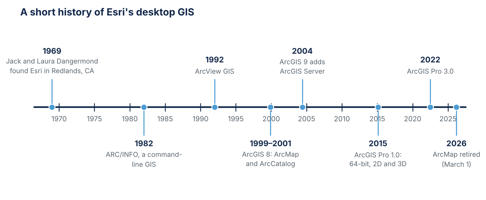
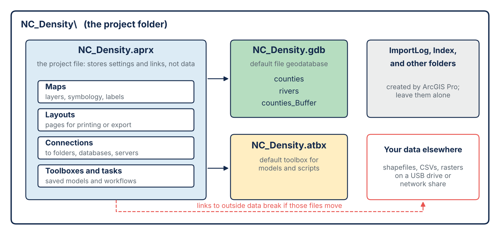
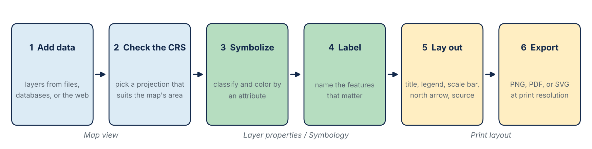
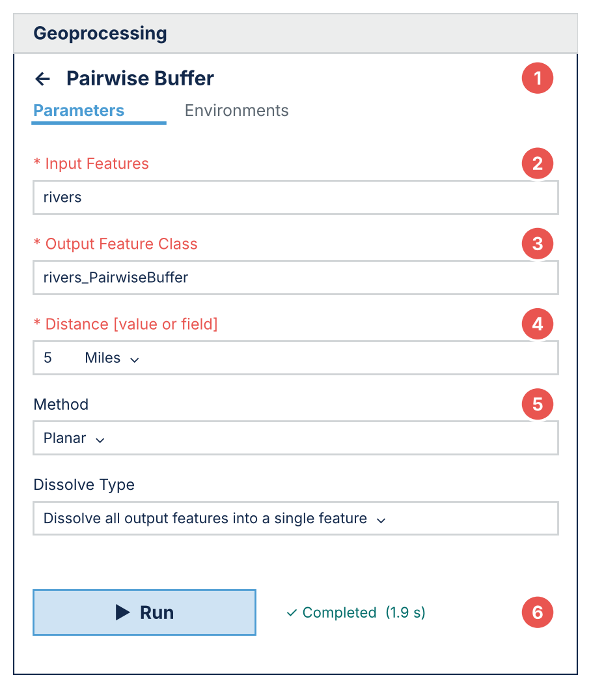

::: {.callout-note appearance="simple"}
## Learning objectives

By the end of this chapter you should be able to:

1.  Describe ArcGIS Pro and the ArcGIS family of software, and how Esri's desktop GIS developed from ARC/INFO to ArcMap to ArcGIS Pro.
2.  Explain how ArcGIS Pro is licensed, and how to install it and sign in.
3.  Find your way around the ArcGIS Pro window: the ribbon, views, and panes.
4.  Explain what an ArcGIS Pro project contains, and organize a project and its data.
5.  Add data, create a feature class, edit features, and calculate attributes.
6.  Make a basic map with symbology, labels, and a layout, and run tools in the Geoprocessing pane.
:::

ArcGIS Pro is the desktop GIS made by **Esri**, the largest GIS software company in the world. It is used by governments, utilities, businesses, and universities, so it appears in a large share of job postings for GIS analysts. Like QGIS ([Chapter 22](qgis.qmd)), it can do nearly everything described in this book, and most tasks follow the same steps in both. This chapter introduces ArcGIS Pro: its history, how it is licensed, how its window is organized, and how to do the common tasks of entering data and making a map.

The figures in this chapter are diagrams of the ArcGIS Pro window, not screenshots, so they show where things are rather than every button. Esri's own documentation, listed at the end of the chapter, has screenshots of the current version. Commands are written as **Tab ▸ Group ▸ Button**, following the ribbon.

## ArcGIS and ArcGIS Pro {#sec-arcgis-family}

**ArcGIS** is not one program but a family of products that share data formats and accounts:

- **ArcGIS Pro**, the desktop application, for editing, analysis, and cartography. It is the subject of this chapter.
- **ArcGIS Online**, a cloud service for storing data, making web maps and apps, and sharing them, run by Esri.
- **ArcGIS Enterprise**, the same kinds of services, run on an organization's own servers.
- **Field and web apps**, such as ArcGIS Field Maps (for collecting data on a phone), ArcGIS Survey123 (forms), ArcGIS StoryMaps (stories built around maps), and ArcGIS Dashboards.
- **Developer tools**, such as **ArcPy**, a Python library for running ArcGIS tools from scripts, and APIs for building web and mobile apps.

ArcGIS Pro is **proprietary** software: Esri owns it, its source code is private, and using it requires a paid license. It runs only on **Windows**. On a Mac, you can run it in a Windows virtual machine or use a university's virtual computer lab.

ArcGIS Pro is a 64-bit program that works with 2D maps and 3D scenes side by side, and its tools are arranged on a **ribbon**, like Microsoft Office. It is closely tied to ArcGIS Online: you sign in with an ArcGIS account to use it, and you can share maps and layers from it to the web in a few clicks.

## A short history {#sec-arcgis-history}

Esri (originally the Environmental Systems Research Institute) was founded in 1969 by Jack and Laura Dangermond in Redlands, California, as a land-use consulting firm. Jack Dangermond had studied at Harvard's Graduate School of Design, near the Harvard Laboratory for Computer Graphics and Spatial Analysis, one of the birthplaces of GIS (Chapter 1). Esri's early work was GIS projects for government clients, and the software it wrote for them became its products (@fig-esri-timeline).

{#fig-esri-timeline fig-alt="A timeline from 1967 to 2027. 1969: Jack and Laura Dangermond found Esri in Redlands, California. 1982: ARC/INFO, a command-line GIS. 1992: ArcView GIS. 1999 to 2001: ArcGIS 8, with ArcMap and ArcCatalog. 2004: ArcGIS 9 adds ArcGIS Server. 2015: ArcGIS Pro 1.0, 64-bit, 2D and 3D. 2022: ArcGIS Pro 3.0. 2026: ArcMap retired, March 1."}

- **1982: ARC/INFO.** Esri's first major product was a command-line GIS. Users typed commands to build and analyze *coverages*, a vector format that stored topology. ARC/INFO ran on minicomputers and workstations, and dominated professional GIS through the 1980s and 1990s.
- **1992: ArcView GIS.** A desktop program with a graphical interface, for viewing, querying, and mapping data. ArcView introduced the **shapefile**, a simple, openly documented format that became the most widely shared vector format in the world (Chapter 2).
- **1999–2001: ArcGIS 8.** Esri rebuilt its software as a single system for Windows, called **ArcGIS Desktop**. Its main applications were **ArcMap**, for mapping, editing, and analysis, and **ArcCatalog**, for managing data. It also introduced the **geodatabase**, Esri's format for storing many layers and tables together.
- **2004 onward: ArcGIS 9 and 10.** Later versions added ArcGIS Server, for publishing maps and data on the web, and ArcGIS Online, Esri's cloud platform. ArcMap 10.x became the standard desktop GIS in many offices for most of two decades.
- **2015: ArcGIS Pro 1.0.** A new, 64-bit desktop application, released alongside ArcMap, with integrated 2D and 3D, a ribbon interface, multiple maps and layouts in one project, and close ties to ArcGIS Online.
- **2022: ArcGIS Pro 3.0.** A major update. A project saved in version 3 can no longer be opened in version 2.
- **2026: ArcMap retired.** In 2020, Esri announced that ArcMap 10.8 would be its last version, and that ArcMap would be supported until March 1, 2026. ArcGIS Pro is now Esri's only desktop GIS.

You will still find ArcMap in older tutorials, books, and offices. Its ideas carry over to ArcGIS Pro, but its menus and toolbars do not, so look for tutorials written for Pro.

::: {.callout-note .did-you-know appearance="simple" icon=false}
## Did you know..?

Esri was started in 1969 with $1,100 of the Dangermonds' savings, and is still privately owned by its founders. Its first user conference, held in Redlands in 1981, had 16 attendees. Today the Esri User Conference fills the San Diego Convention Center every July, and is one of the largest GIS gatherings in the world.
:::

## Getting ArcGIS Pro {#sec-arcgis-license}

### Licensing

Using ArcGIS Pro requires a license, which comes at one of three **license levels**. Each level includes everything in the levels below it:

| Level | Formerly | What it adds |
|---|---|---|
| **Basic** | ArcView | Viewing, mapping, editing simple data, and most analysis tools |
| **Standard** | ArcEditor | Editing of advanced geodatabase features, such as topology and versioned data shared by many editors |
| **Advanced** | ArcInfo | The full set of geoprocessing tools, including advanced overlay and generalization |

: ArcGIS Pro license levels. {#tbl-license-levels}

**Extensions**, such as Spatial Analyst (raster analysis, Chapter 15), Geostatistical Analyst (kriging, Chapter 18), 3D Analyst, and Network Analyst, add more tools, and are licensed separately.

In an ArcGIS organization, the level comes with the account's *user type*: Basic with the Creator user type, Standard with Professional, and Advanced with Professional Plus. Most users today have a **named user license**: the license is assigned to your ArcGIS account by your organization (such as a university or employer), and ArcGIS Pro checks it when you sign in. Universities usually have a campus license that covers students, with the extensions included. Esri also sells personal-use licenses at low cost for non-commercial use, and offers free trials.

Some tools and services, such as geocoding many addresses with Esri's World Geocoding Service, demographic enrichment, and storing large amounts of data in ArcGIS Online, use **credits**, a currency that your organization buys and allots to its users. Tools that use credits say so in their documentation.

### Installing and signing in

1.  Check that your computer meets the system requirements: for current versions, 64-bit Windows 11, with at least 8 GB of memory (32 GB is recommended).
2.  Download ArcGIS Pro from your ArcGIS account (my.esri.com, or the link your organization gives you) and run the installer.
3.  Start ArcGIS Pro and **sign in** with your organization's ArcGIS account. University accounts usually sign in through the university's own login page: choose *Your ArcGIS organization's URL* and enter it.

ArcGIS Pro is updated a few times a year. The version number is in **Project ▸ About ArcGIS Pro**.

## The ArcGIS Pro window {#sec-arcgis-window}

When ArcGIS Pro starts, it shows a start page for opening a recent project or creating a new one from a template. The **Map** template creates a project with one empty map, which is the usual place to start. @fig-arcgis-interface shows the main window.

{#fig-arcgis-interface fig-alt="A schematic drawing of the ArcGIS Pro window. A dark title bar holds the Quick Access Toolbar buttons and the project name. Below it, ribbon tabs read Project, Map, Insert, Analysis, View, Edit, Imagery, Share, and Help, with contextual tabs Feature Layer, Labeling, and Data in a different color. The ribbon shows command groups labeled Clipboard, Navigate, Layer, Selection, Inquiry, Labeling, and Offline. On the left, the Contents pane lists the map's layers, cities, rivers, counties, and a Topographic basemap. In the middle, the map view shows a land area with a river and cities. On the right, the Catalog pane lists Maps, Layouts, Toolboxes, Databases, Styles, Folders, and Locators. Along the bottom are the map scale, coordinates, and selected feature count."}

1.  The **Quick Access Toolbar** at the top left has buttons for saving, undoing, and opening projects. The title bar also holds **Command Search** (Alt+Q), where you can type the name of any command or tool to find it, and your sign-in name.
2.  **Ribbon tabs** organize the commands: **Project** (open, save, options, and licensing), **Map** (navigating, adding data, selecting), **Insert** (new maps, layouts, and toolboxes), **Analysis** (geoprocessing tools), **View** (panes and windows), **Edit**, **Imagery**, **Share**, and **Help**. **Contextual tabs**, in a different color, appear only when something is selected. Select a layer in the Contents pane, for example, and the **Feature Layer**, **Labeling**, and **Data** tabs appear.
3.  The **ribbon** shows the commands on the current tab, arranged in **groups**, such as Navigate, Layer, and Selection on the Map tab.
4.  The **Contents pane** lists the layers in the active map, in drawing order: layers at the top draw on top. Check a box to show or hide a layer, drag to reorder, and right-click a layer for its options.
5.  The **view** is where you work with a map, a 3D scene, a layout, or a table. Each opens as a tab, and you can have many open at once, side by side or stacked.
6.  The **Catalog pane** shows everything in the project: its maps, layouts, toolboxes, databases, styles, and folder connections. Other panes, such as **Geoprocessing**, **Symbology**, **Create Features**, and **Element**, open in the same space as tabs.
7.  The bottom of each map view shows the **scale**, the **coordinates** under the cursor, and the number of **selected features**.

Panes can be docked, floated, or closed. To reopen a pane, find it on the **View** tab, or search for it with Command Search.

### Navigating the map

| To do this | Use |
|---|---|
| Pan and zoom | **Map ▸ Navigate ▸ Explore**, then drag to pan and roll the wheel to zoom |
| Show a whole layer | Right-click the layer ▸ **Zoom To Layer** |
| Show all layers | **Map ▸ Navigate ▸ Full Extent** |
| Go back to the previous view | **Map ▸ Navigate ▸ Previous Extent** |
| See a feature's attributes | Click the feature with the **Explore** tool; a pop-up shows its attributes |
| Measure a distance or area | **Map ▸ Inquiry ▸ Measure** |

: Navigating a map in ArcGIS Pro. {#tbl-arcgis-navigation}

## Projects {#sec-arcgis-projects}

Work in ArcGIS Pro is saved as a **project**. When you create a project, ArcGIS Pro makes a **project folder** with the project file and a few default items (@fig-arcgis-project):

- The **project file** (`.aprx`) stores the project's maps, layouts, and settings, and *links* to its data. Like a QGIS project, it does not contain the data itself.
- The **default geodatabase** (`.gdb`), named after the project, is where new data and tool outputs are saved unless you choose otherwise.
- The **default toolbox** (`.atbx`) holds models and script tools you create.
- Other folders, such as `ImportLog` and `Index`, are used by ArcGIS Pro itself.

{#fig-arcgis-project fig-alt="A diagram of a project folder called NC_Density. Inside, the project file NC_Density.aprx stores settings and links, not data, and contains maps, layouts, connections, and toolboxes and tasks. Arrows point to the default file geodatabase NC_Density.gdb, holding counties, rivers, and counties_Buffer, and to the default toolbox NC_Density.atbx. Other folders such as ImportLog and Index are created by ArcGIS Pro. A dashed red arrow points to your data elsewhere, such as shapefiles and rasters on a USB drive, with the warning that links to outside data break if those files move."}

The habits that keep QGIS projects working apply here too: keep each project and its data together in one folder, use short names without spaces, and work on a local drive rather than a USB drive or a cloud-synced folder. Save often with Ctrl+S. If a layer's data moves, a red exclamation mark appears next to it in the Contents pane; click it to locate the data again.

### The geodatabase

A **geodatabase** is Esri's format for storing geographic data. A **file geodatabase** is a folder ending in `.gdb` that holds any number of **feature classes** (vector layers), **tables**, and **raster datasets**. It has advantages over shapefiles: long field names, large sizes, null values, and advanced features such as domains (lists of valid values), topology, and relationship classes. Use the project's default geodatabase for your new data. Don't open, copy, or rename the files *inside* a `.gdb` folder with Windows File Explorer; manage them in the Catalog pane.

A geodatabase is not readable by every program the way a shapefile or GeoPackage is. QGIS can read file geodatabases, and newer versions can edit them, but to share data with someone who doesn't use ArcGIS, export it to a GeoPackage or shapefile.

## Adding data {#sec-arcgis-adding-data}

- **Map ▸ Layer ▸ Add Data** opens a browse dialog for files, geodatabases, and data in ArcGIS Online.
- **Drag** a feature class or file from the Catalog pane onto the map.
- To browse a folder outside the project, right-click **Folders** in the Catalog pane and choose **Add Folder Connection**.

When the first layer is added to a new map, the map takes on that layer's coordinate system, and later layers are projected on the fly to match. To change it, right-click the map's name in the Contents pane, choose **Properties**, and open the **Coordinate Systems** tab.

### Points from a table of coordinates

To make points from a CSV or Excel table of coordinates, add the table to the map (it appears under *Standalone Tables* in the Contents pane), right-click it, and choose **Create Points From Table ▸ XY Table To Point**. The tool asks for:

- **X Field**: the longitude (or easting).
- **Y Field**: the latitude (or northing).
- **Coordinate System**: the system the coordinates are in. For latitude and longitude from a GPS or web map, this is usually GCS WGS 1984.

The output is a new point feature class in the project geodatabase. As in QGIS, the most common mistake is swapping X and Y: longitude is X.

### Basemaps

**Map ▸ Layer ▸ Basemap** opens a gallery of basemaps from ArcGIS Online, such as Topographic, Imagery, Streets, and Light Gray Canvas. New maps start with a basemap, usually World Topographic Map, which appears at the bottom of the Contents pane. Basemaps require an internet connection and sign-in.

## Entering data {#sec-arcgis-entering-data}

### Creating a feature class

To create a new, empty layer, right-click the project geodatabase in the Catalog pane and choose **New ▸ Feature Class**. A wizard walks through the steps:

1.  **Name** the feature class (such as `field_sites`) and choose its **feature class type**: point, line, polygon, or another type.
2.  **Fields**: add fields, giving each a name and a **data type**, such as Text, Short or Long (integers), Float or Double (decimal numbers), or Date. ArcGIS adds an `OBJECTID` field (the feature ID) and, for lines and polygons, `Shape_Length` and `Shape_Area` fields, which it keeps up to date.
3.  **Spatial Reference**: choose the coordinate system, such as NAD 1983 StatePlane North Carolina FIPS 3200 (Meters).
4.  Click **Finish**. The new, empty layer is added to the map.

The **Create Feature Class** tool in the Geoprocessing pane does the same thing.

### Editing features

Editing in ArcGIS Pro is done from the **Edit** tab:

1.  Click **Edit ▸ Features ▸ Create**. The **Create Features** pane lists a *template* for each editable layer.
2.  Click the template for the layer you want, such as `field_sites`, and choose a construction tool (for a point layer, Point).
3.  Click the map to place a point. For a line or polygon, click each vertex, and double-click (or press F2) to finish.
4.  Fill in the new feature's attributes in the **Attributes** pane (**Edit ▸ Selection ▸ Attributes**).
5.  Click **Edit ▸ Manage Edits ▸ Save** to save the edits, or **Discard** to throw them away.

Other tools on the Edit tab move, reshape, split, and merge features. **Snapping** (**Edit ▸ Snapping**) makes new vertices jump to existing vertices and edges, so that shared boundaries line up.

### The attribute table

Right-click a layer and choose **Attribute Table** (or select the layer and press Ctrl+T) to open its table as a view below the map. Click a row's gray box at the left to select the feature; double-click a cell to edit it. The table's menu buttons add fields, calculate fields, select by attributes, and switch between all and selected records.

### Calculating fields

**Calculate Field** (right-click a column heading in the table, or find the tool in the Geoprocessing pane) fills a field with an expression. You can write the expression in **Python** or in **Arcade**, Esri's own expression language, which also works in ArcGIS Online:

- In Python, field names are wrapped in exclamation marks: `!pop_2025! / (!aland_sqmi! * 2.58999)`.
- In Arcade, fields are properties of `$feature`: `$feature.pop_2025 / ($feature.aland_sqmi * 2.58999)`.

To add a field first, use **Add Field** on the table's menu, or **Data ▸ Design ▸ Fields**, which shows all the layer's fields and their types. **Calculate Geometry** (right-click a column heading) fills a field with each feature's area, length, or coordinates, in the units and coordinate system you choose.

### Joins

To join a table to a layer by a common field (Chapter 6), right-click the layer and choose **Joins and Relates ▸ Add Join**. For a spatial join (Chapter 7), use the **Spatial Join** tool or **Add Spatial Join**.

## Selecting and querying {#sec-arcgis-selecting}

The **Map ▸ Selection** group holds the selection tools (Chapter 5):

- **Select** selects features by clicking or dragging on the map.
- **Select By Attributes** selects features with a query built from clauses, such as `density is greater than 500`, or written in SQL.
- **Select By Location** selects features by their spatial relationship to another layer.
- **Clear** clears the selection.

The number of selected features is shown at the bottom of the map and of the table. Most tools run on the selected features only, when a layer has a selection, so clear selections you no longer need. To keep a selection as a new layer, right-click the layer and choose **Data ▸ Export Features**.

A **definition query** (layer **Properties ▸ Definition Query**) hides every feature that doesn't match a query. Like a QGIS filter, it affects everything you do with the layer.

## Making a basic map {#sec-arcgis-basic-map}

The steps of making a map are the same as in QGIS (@fig-map-workflow-pro): add data, check the coordinate system, symbolize, label, lay out, and export.

{#fig-map-workflow-pro fig-alt="A flowchart of six steps: 1, add data; 2, check the CRS; 3, symbolize; 4, label; 5, lay out, with title, legend, scale bar, north arrow, and source; 6, export as PNG, PDF, or SVG."}

### Symbology

Right-click a layer and choose **Symbology** to open the **Symbology pane**. The **Primary symbology** menu chooses how features are drawn:

- **Single Symbol**: every feature the same.
- **Unique Values**: a symbol for each value of a field, for categories.
- **Graduated Colors**: classes of a numeric field shown in a color scheme, for choropleth maps.
- **Graduated Symbols** and **Proportional Symbols**: symbol sizes that vary with a numeric field.
- **Dot Density**, **Charts**, **Heat Map**, and others.

For the map of population density, choose **Graduated Colors**, set **Field** to `density`, set **Method** to Natural Breaks (Jenks) and **Classes** to 5, and pick a **Color scheme**. The **Histogram** tab shows the class breaks on the data's distribution (Chapter 12). Changes appear on the map as you make them.

### Labels

Select the layer in the Contents pane, and click the **Labeling** contextual tab. Click **Label** to turn labels on, choose the **Field** (such as `name`), and set the font, size, and color in the **Text Symbol** group. A halo (Esri's name for a buffer around the text) makes labels readable over busy backgrounds. To add one, click the small launcher arrow at the corner of the **Text Symbol** group, which opens the **Label Class** pane, and set the **Halo** under the symbol's appearance settings.

### Layouts

A **layout** is a page for printing or exporting a finished map.

1.  **Insert ▸ Project ▸ New Layout**, and choose a page size and orientation, such as Letter, landscape. The layout opens as a new view.
2.  **Insert ▸ Map Frames ▸ Map Frame**, choose the map, and drag a rectangle on the page. To change what the frame shows, use **Layout ▸ Map ▸ Activate**, navigate the map, then close the activated view.
3.  **Insert ▸ Graphics and Text ▸ Text** (or **Dynamic Text ▸ Title**) for the title, source, and author.
4.  **Insert ▸ Map Surrounds ▸ Legend**, **Scale Bar**, and **North Arrow**. Each is linked to the map frame and updates when the map changes.
5.  Select any element and use the **Format** pane (or the **Element** pane) to change its properties: legend items, scale bar units and divisions, fonts, and sizes.
6.  **Share ▸ Output ▸ Export Layout** to export the layout as a PDF, PNG, JPEG, SVG, or other format, at the resolution you choose. **Share ▸ Output ▸ Print Layout** prints it.

A project can hold many maps and many layouts, all listed in the Catalog pane.

## Geoprocessing {#sec-arcgis-geoprocessing}

**Geoprocessing** is Esri's term for running tools that create or change data: buffers, overlays, conversions, and analysis of every kind (Chapters 14–18). The tools are organized in **toolboxes**, such as the Analysis, Data Management, Conversion, and Spatial Analyst toolboxes.

Open the **Geoprocessing pane** with **Analysis ▸ Geoprocessing ▸ Tools**. Type a tool's name in the search box, and click it to open it (@fig-arcgis-gp):

{#fig-arcgis-gp fig-alt="A schematic drawing of the Geoprocessing pane with the Pairwise Buffer tool open. Required parameters are marked with red asterisks: Input Features set to rivers, Output Feature Class set to rivers_PairwiseBuffer, and Distance set to 5 miles. Optional parameters are Method set to Planar and Dissolve Type set to dissolve all output features into a single feature. A Run button is at the bottom, with a message that the tool completed in 1.9 seconds."}

- **Required parameters** are marked with a red asterisk. A tool can't run until they are filled in.
- The **output** is saved by default to the project geodatabase, with a name built from the input and the tool.
- **Environments** set rules for every tool, such as the output coordinate system, the processing extent, and the cell size for raster outputs.
- **Run** starts the tool. A green check means it succeeded, and **View Details** shows its messages; a red X means it failed, and the messages explain why.

Every tool you run is recorded in the project's **History** (**Analysis ▸ Geoprocessing ▸ History**), where you can open it again with the same settings. To chain tools into a repeatable workflow, use **ModelBuilder** (**Analysis ▸ Geoprocessing ▸ ModelBuilder**), which draws the workflow as a flowchart (Chapter 14). For scripting, the **Python window** (**Analysis ▸ Geoprocessing ▸ Python**) and **ArcGIS Notebooks** run tools with **ArcPy**. Every tool's help page shows the Python code to run it.

::: {.callout-tip appearance="simple"}
## Think about it

ArcGIS Pro has both a **Buffer** and a **Pairwise Buffer** tool, and both a **Dissolve** and a **Pairwise Dissolve**. The "pairwise" tools are newer versions that are faster on large datasets and use all of your computer's processor cores. Why might Esri keep both versions, instead of replacing the old tools?
:::

## Sharing to the web {#sec-arcgis-sharing}

Because ArcGIS Pro is tied to ArcGIS Online, you can publish your work to the web. **Share ▸ Share As ▸ Web Map** shares a map, with its layers and symbology, as a web map that anyone you choose can open in a browser; **Web Layer** shares a single layer. Web maps can then be used in ArcGIS StoryMaps, Dashboards, and apps. You choose who can see each item: just you, groups, your organization, or everyone.

## QGIS and ArcGIS Pro compared {#sec-qgis-vs-arcgis}

| | QGIS | ArcGIS Pro |
|---|---|---|
| Cost | Free | Paid license (usually through an employer or university) |
| License | Open source (GNU GPL) | Proprietary |
| Operating systems | Windows, macOS, Linux | Windows only |
| Main vector format | GeoPackage | File geodatabase |
| Project file | `.qgz` | `.aprx` |
| Analysis tools | Processing Toolbox (QGIS, GDAL, GRASS) | Geoprocessing toolboxes and extensions |
| Workflow models | Model Designer | ModelBuilder |
| Scripting | Python (PyQGIS) | Python (ArcPy), Arcade |
| Map output | Print layout | Layout |
| Web sharing | Plugins and other software, such as qgis2web and QGIS Server | Built in, through ArcGIS Online or Enterprise |
| Extending | Thousands of free community plugins | Esri extensions, add-ins, and partner products |

: QGIS and ArcGIS Pro side by side. {#tbl-qgis-vs-arcgis}

The two programs share far more than they differ. Both read the same common formats (shapefiles, GeoPackages, GeoTIFFs, CSVs), both use GDAL and PROJ-style coordinate systems identified by EPSG codes, and the concepts in this book apply equally to both. Many GIS professionals use both: ArcGIS Pro where their organization runs on Esri software, and QGIS on their own computers, for formats or tools that ArcGIS lacks, or when sharing work with people without a license.

## Getting help {#sec-arcgis-help}

- **Help buttons**: the **?** on any tool or pane, or F1, opens the matching page of the ArcGIS Pro documentation.
- **The ArcGIS Pro documentation** at <https://pro.arcgis.com> includes a "Get started" section, a tool reference for every geoprocessing tool, and the ArcPy reference.
- **Learn ArcGIS** (<https://learn.arcgis.com/en/>) has free, step-by-step lessons with data, from beginner to advanced.
- **Esri Training** (<https://www.esri.com/training/>) has courses, many of them free, including *Getting Started with ArcGIS Pro*.
- **Esri Community** (<https://community.esri.com>) and **GIS Stack Exchange** (tag `arcgis-pro`) answer questions.

## Check your understanding

::: {.content-visible when-format="html"}

1.  Which company makes ArcGIS Pro? <select class='webex-select'><option value='blank'></option><option value=''>OSGeo</option><option value='answer'>Esri</option><option value=''>Google</option><option value=''>Microsoft</option></select>

2.  Which operating system does ArcGIS Pro run on? <select class='webex-select'><option value='blank'></option><option value='answer'>Windows only</option><option value=''>Windows and macOS</option><option value=''>Linux only</option><option value=''>Any operating system with a web browser</option></select>

3.  Esri's older desktop application, retired in March 2026, was: <select class='webex-select'><option value='blank'></option><option value=''>ArcGIS Online</option><option value='answer'>ArcMap</option><option value=''>QGIS</option><option value=''>ArcGIS StoryMaps</option></select>

4.  An ArcGIS Pro project file has the extension: <select class='webex-select'><option value='blank'></option><option value=''>.qgz</option><option value=''>.shp</option><option value='answer'>.aprx</option><option value=''>.gdb</option></select>

5.  By default, where are new feature classes and tool outputs saved? <select class='webex-select'><option value='blank'></option><option value=''>On the desktop</option><option value='answer'>In the project's default geodatabase</option><option value=''>In ArcGIS Online</option><option value=''>Inside the .aprx file</option></select>

6.  Tabs that appear on the ribbon only when a certain kind of item is selected are called: <select class='webex-select'><option value='blank'></option><option value=''>Hidden tabs</option><option value='answer'>Contextual tabs</option><option value=''>Quick tabs</option><option value=''>Extension tabs</option></select>

7.  In a Python expression for Calculate Field, a field named density is written: <select class='webex-select'><option value='blank'></option><option value=''>"density"</option><option value=''>$feature.density</option><option value='answer'>!density!</option><option value=''>[density]</option></select>

8.  Which license level includes the full set of geoprocessing tools? <select class='webex-select'><option value='blank'></option><option value=''>Basic</option><option value=''>Standard</option><option value='answer'>Advanced</option><option value=''>Viewer</option></select>

9.  Which symbology makes a choropleth map from a numeric field? <select class='webex-select'><option value='blank'></option><option value=''>Single Symbol</option><option value=''>Unique Values</option><option value='answer'>Graduated Colors</option><option value=''>Dot Density</option></select>

:::

::: {.content-visible unless-format="html"}
The interactive self-check questions for this chapter are in the online version of the book.
:::

## Summary

- **ArcGIS Pro** is Esri's proprietary desktop GIS for Windows, part of the ArcGIS family that includes ArcGIS Online, ArcGIS Enterprise, field and web apps, and ArcPy.
- **Esri** was founded in 1969 by Jack and Laura Dangermond. Its desktop GIS went from **ARC/INFO** (1982) to **ArcView** (1992), **ArcMap** (1999), and **ArcGIS Pro** (2015). ArcMap was retired in March 2026.
- ArcGIS Pro needs a license, usually a **named user license** assigned to your ArcGIS account, at the **Basic**, **Standard**, or **Advanced** level, with **extensions** for specialized tools. Some services use **credits**.
- The window has a **ribbon** of tabs and groups, with **contextual tabs** that appear as needed; **views** for maps, layouts, and tables; and **panes**, such as Contents, Catalog, Geoprocessing, and Symbology. **Command Search** finds any command.
- A **project** (`.aprx`) links to data and holds maps and layouts. New data goes in the project's default **file geodatabase**.
- Add data with **Add Data** or from the Catalog pane, and points from coordinates with **XY Table To Point**. Create **feature classes** in the Catalog pane, digitize with **Create Features**, and save edits from the **Edit** tab.
- Make a map with the **Symbology** pane, the **Labeling** tab, and a **layout** with a map frame, title, legend, scale bar, and north arrow, then export it.
- Run tools in the **Geoprocessing pane**, chain them in **ModelBuilder**, and script them with **ArcPy**.

## Exercises

1.  **Sign in and explore.** Start ArcGIS Pro, sign in, and create a project from the Map template. What version are you using? What license level and extensions do you have (**Project ▸ Licensing**)? Find the Contents pane, the Catalog pane, and Command Search.
2.  **The project folder.** Open the project folder in Windows File Explorer. List what ArcGIS Pro created. Which items hold data, and which hold settings?
3.  **Points from a spreadsheet.** Make a CSV of five places with their latitudes and longitudes, and use XY Table To Point to map them. Add a basemap and check that they land in the right places.
4.  **Digitize.** Create a polygon feature class in the project geodatabase, with a Text field `name`, in a State Plane coordinate system. Digitize three buildings on campus over the Imagery basemap. What are their areas in the `Shape_Area` field, and in what units?
5.  **A choropleth map.** Map population density for North Carolina's counties with Graduated Colors and five natural-breaks classes. Build a layout with a title, legend, scale bar, north arrow, and source, and export it as a PDF. Then make the same map in QGIS. Which steps were the same, and which were different?
6.  **Geoprocessing history.** Buffer a layer with the Pairwise Buffer tool, then open the History. Copy the tool's Python command (right-click ▸ Copy Python Command), and paste it into the Python window. What does each part of the command mean?

## Further reading and online resources

### ArcGIS Pro documentation

- ArcGIS Pro documentation home: <https://pro.arcgis.com/en/pro-app/latest/get-started/get-started.htm>.
- "What's new in ArcGIS Pro," for the current version: <https://pro.arcgis.com/en/pro-app/latest/get-started/whats-new-in-arcgis-pro.htm>.
- "ArcGIS Pro system requirements": <https://pro.arcgis.com/en/pro-app/latest/get-started/arcgis-pro-system-requirements.htm>.
- "Layouts in ArcGIS Pro": <https://pro.arcgis.com/en/pro-app/latest/help/layouts/layouts-in-arcgis-pro.htm>.
- "What is geoprocessing?": <https://pro.arcgis.com/en/pro-app/latest/help/analysis/geoprocessing/basics/what-is-geoprocessing-.htm>.
- "What is ArcPy?": <https://pro.arcgis.com/en/pro-app/latest/arcpy/get-started/what-is-arcpy-.htm>.
- "License levels" for ArcGIS Pro: <https://pro.arcgis.com/en/pro-app/latest/get-started/license-levels.htm>.
- ArcGIS Arcade documentation: <https://developers.arcgis.com/arcade/>.

### Lessons and courses

- Learn ArcGIS, free lessons: <https://learn.arcgis.com/en/>.
- Esri Training catalog: <https://www.esri.com/training/>.
- *Getting to Know ArcGIS Pro*, by Michael Law and Amy Collins (Esri Press), a step-by-step workbook updated for each major version.
- *Understanding GIS: An ArcGIS Pro Project Workbook*, by Christian Harder and Clint Brown (Esri Press).

### History and community

- Esri on Wikipedia: <https://en.wikipedia.org/wiki/Esri>.
- ArcGIS on Wikipedia, with a table of versions: <https://en.wikipedia.org/wiki/ArcGIS>.
- Esri Community: <https://community.esri.com>.
- GIS Stack Exchange, questions tagged `arcgis-pro`: <https://gis.stackexchange.com/questions/tagged/arcgis-pro>.
- Esri User Conference: <https://www.esri.com/en-us/about/events/uc/overview>.
