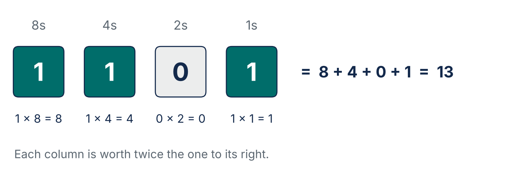
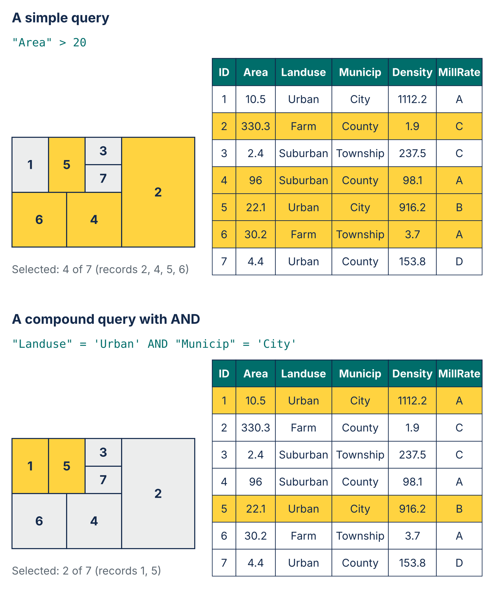
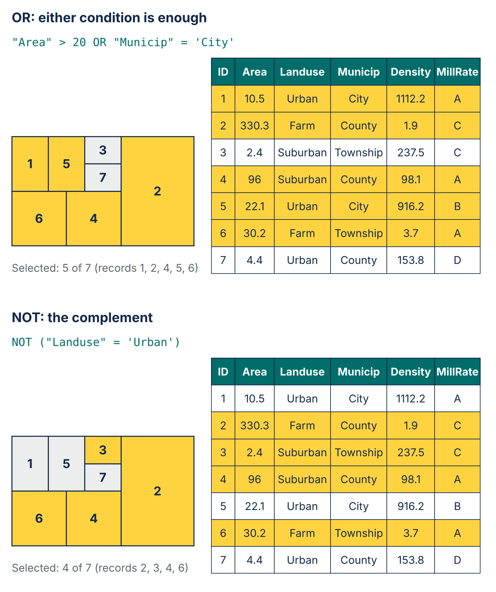
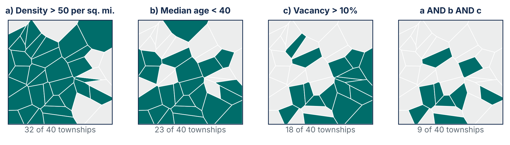
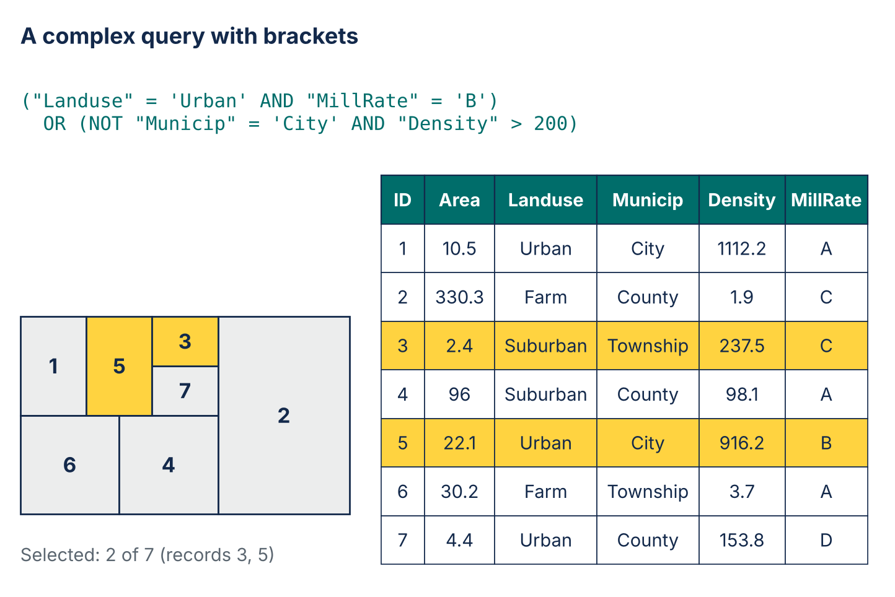
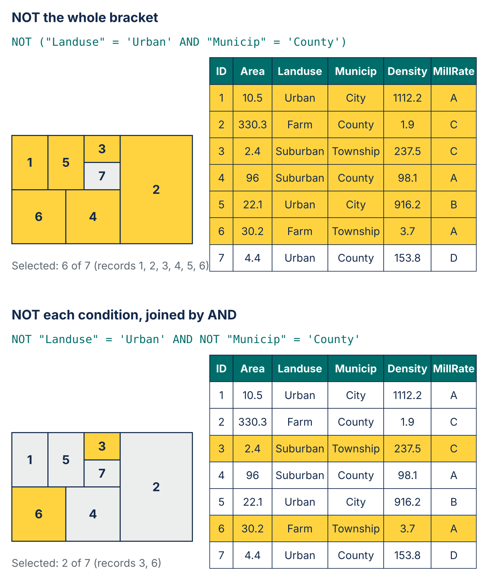
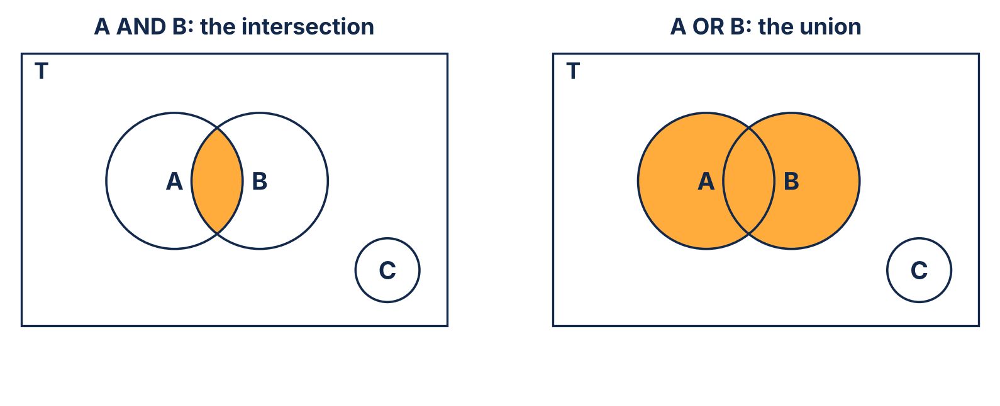
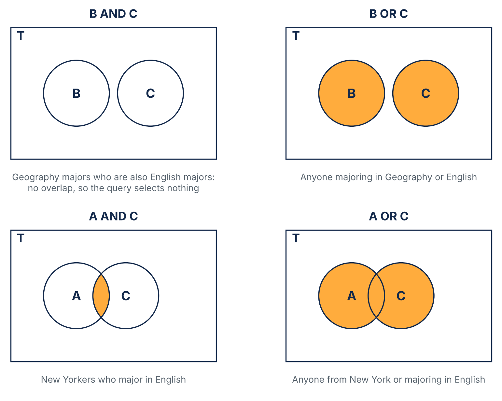
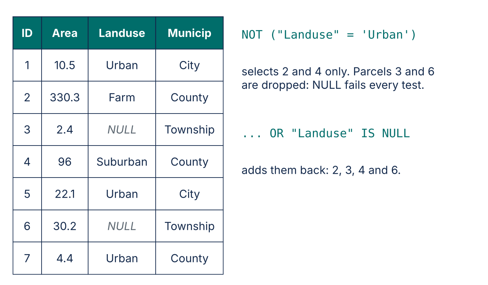

::: {.callout-note appearance="simple"}
## Learning objectives

By the end of this chapter you should be able to:

1.  Describe how an attribute table stores data, with one record per feature and one attribute per column.
2.  Choose a data type for a field in QGIS or ArcGIS Pro, and explain how the number of bits behind a field limits what it can hold.
3.  Tell the four levels of measurement apart (nominal, ordinal, interval, and ratio) and say which questions each one supports.
4.  Write SQL WHERE clauses with comparison operators, AND, OR, NOT, brackets, LIKE, BETWEEN, IN, and IS NULL.
5.  Predict which records a query selects, using sets and Venn diagrams, and spot queries that can only select everything or nothing.
6.  Explain how NULL values behave in a query.
7.  Use a selection: zoom to it, summarize it, calculate a field from it, and export it.
:::

Chapters 2 to 4 were about *where*: how a GIS stores geometry, and how coordinates pin it to the Earth. This chapter is about the other half of GIS data, the half that says *what*. A polygon tells you where a county is. Its attributes tell you its name, how many people live there, how old they are, and how many homes stand empty. Most of the questions people bring to a GIS start with attributes: *Which counties lost population? Which parcels are zoned commercial and larger than five acres? Which schools have no address?*

To answer them, you need to know how attributes are stored, what kinds of values they hold, and how to write a **query**, a precise question the software can test against every record. We will finish with a way to check your own queries using sets, and with the trap of missing values.

Five terms carry the whole chapter:

- A **table** is a grid that holds the attributes of every feature in a layer.
- An **attribute**, also called a **field** or a column, is one variable, measured the same way for every feature.
- A **record**, or row, is everything known about one feature.
- A **data type** is how a field is stored: as text, an integer, a decimal number, a date, and so on.
- A **query**, usually written in **SQL** (Structured Query Language), is a written condition that selects records.

## Attribute data {#sec-attribute-data}

### Attribute tables

In Chapter 2, data abstraction turned a wetland into a data model: polygons for the geometry, and a table for everything else. That table is the **attribute table**, the non-spatial half of a vector layer. It follows three rules (@fig-record-attribute):

- **One row per feature.** Every parcel on the map has exactly one record in the table, and every record has a parcel.
- **One column per attribute.** Each column holds one kind of measurement, such as area or land use, for every feature.
- **The table and the map are linked.** Select a record, and its feature lights up on the map; select a feature, and its record lights up in the table. The table is where you ask the question; the map is where the answer is drawn.

{#fig-record-attribute fig-alt="On the left, a map of seven rectangular parcels numbered 1 to 7, labeled Parcels, not to scale. Parcel 5 is yellow; the rest are gray. On the right, an attribute table with columns ID, Area, Landuse, Municip, Density, and MillRate, and seven rows. Row 5, which reads 22.1, Urban, City, 916.2, B, is highlighted in yellow. The Landuse column is shaded green. A label pointing to the column reads: an attribute, column, Landuse, for every parcel. A label pointing to row 5 reads: a record, row, everything about parcel 5. A red two-headed arrow links row 5 to parcel 5 on the map."}

We will use these seven parcels throughout the chapter. Their attributes are:

- **ID**, a number that identifies each parcel.
- **Area**, in acres.
- **Landuse**: Urban, Suburban, or Farm.
- **Municip**, the kind of local government the parcel is in: City, Township, or County.
- **Density**, in people per square mile.
- **MillRate**, a property tax class from A to D.

Software uses several words for the same things. A column may be called an attribute, a field, or an item. A row may be called a record, a row, or (because each row is one feature) a feature. In this book, *field* and *attribute* mean the same thing, and so do *record* and *row*.

In QGIS, open a layer's table by right-clicking it in the Layers panel and choosing **Open Attribute Table**. In ArcGIS Pro, right-click the layer in the Contents pane and choose **Attribute Table**. Click a column header to sort the table by that column; click again to sort the other way. Sorting a layer of world cities by population, largest first, is a quick way to explore a new dataset.

### Data types

Every field has a **data type**, chosen when the field is created. The data type decides what a field can store and how much space each value takes. QGIS and ArcGIS Pro name their types a little differently (@tbl-types).

| What it stores | QGIS | ArcGIS Pro | Range or example |
|:--|:--|:--|:--|
| Text, any characters | Text (string) | Text | John Doe, 27514 |
| Small whole numbers (16-bit) | (none) | Short Integer | −32,768 to 32,767 |
| Whole numbers (32-bit) | Integer (32 bit) | Long Integer | −2,147,483,648 to 2,147,483,647 |
| Large whole numbers (64-bit) | Integer (64 bit) | Big Integer | about ±9.2 × 10¹⁸ in QGIS; ±9,007,199,254,740,991 in ArcGIS Pro |
| Decimal numbers, about 7 significant digits | (none) | Float | about ±3.4 × 10³⁸ |
| Decimal numbers, about 15 significant digits | Decimal number (double) | Double | about ±1.8 × 10³⁰⁸ |
| True or false | Boolean | (none; use Short Integer 0 or 1) | true, false |
| Dates and times | Date, Date & Time | Date, Date Only, Time Only | 12/31/2012 11:59:59 PM |
| A unique ID for each record | (fid) | Object ID | 1, 2, 3, … |
| The feature's shape | (geometry) | Geometry (Shape) | point, line, polygon |

: Common field data types. Which types are available also depends on the format: a shapefile, a GeoPackage, a file geodatabase, or a database such as PostGIS. ArcGIS Pro's Big Integer, Date Only, and Time Only types need version 3.2 or later. {#tbl-types}

Two terms describe numeric fields:

- **Precision** is the total number of digits a field can hold.
- **Scale** is how many of those digits fall after the decimal point.

A field with a precision of 6 and a scale of 2 can hold numbers up to 9,999.99. In ArcGIS Pro, you choose the type, and for some formats the precision and scale, when you create a field, and **they can't be changed later**. To change a field's type, you add a new field of the right type and calculate the values into it.

Some rules of thumb for choosing a type:

- Store **identifiers that are never used in arithmetic as text**, even if they look like numbers. ZIP codes, FIPS codes, phone numbers, and parcel IDs all belong in text fields. Stored as a number, the ZIP code of Boston's City Hall, 02201, becomes 2201, and Orange County's FIPS code, 37135, can no longer be matched to another table that stores it as text.
- Use an **integer** type for counts, such as population or number of rooms.
- Use **Double** for measurements that need decimals, such as area or density. Float saves a little space, but it keeps only about 7 significant digits, so it can round large numbers.

### Why fields have limits: binary

Why do field types have such strange limits, like 32,767 or 2,147,483,647? Because everything in an attribute table is ultimately stored in **binary**, as ones and zeros, and each field gets a fixed number of **bits** (binary digits).

In binary, each column is worth twice the one to its right: ones, twos, fours, eights, and so on (@fig-binary). So the binary number 1101 means 8 + 4 + 0 + 1 = 13.

{#fig-binary fig-alt="Four square tiles in a row, labeled above as 8s, 4s, 2s, and 1s. The tiles read 1, 1, 0, 1; the 1 tiles are dark green and the 0 tile is gray. Below each tile: 1 times 8 equals 8, 1 times 4 equals 4, 0 times 2 equals 0, 1 times 1 equals 1. To the right: equals 8 plus 4 plus 0 plus 1 equals 13. A note reads: each column is worth twice the one to its right."}

With *n* bits you can write 2ⁿ different values. If one bit is used for the sign, plus or minus, half of them are negative:

- A **16-bit** short integer has 2¹⁶ = 65,536 values, from −32,768 to 32,767.
- A **32-bit** integer has about 4.3 billion values, from about −2.1 billion to 2.1 billion.
- A **64-bit** integer has 2⁶⁴ = 18,446,744,073,709,551,616 values, about ±9.22 × 10¹⁸.

Modern computers process data in 64-bit *words*: that is what "a 64-bit processor" means. It refers to how many bits the processor handles at once, not to how much memory the computer has. An integer field is only as wide as the bits behind it, so the population of a county fits easily in a 32-bit integer, but the population of the world, about 8.2 billion, does not.

::: {.callout-note .did-you-know appearance="simple" icon=false}
## Did you know..?

In December 2014, the music video for PSY's "Gangnam Style" became the first video on YouTube to be watched more than 2,147,483,647 times, the largest number a signed 32-bit integer can hold. YouTube's engineers had seen it coming and had already switched the view counter to a 64-bit integer, which can count past nine quintillion. YouTube joked that it had never thought a video would be watched more times than a 32-bit integer could count. The same limit is behind the "Year 2038 problem": many older computer systems count time as the number of seconds since January 1, 1970, in a signed 32-bit integer, which will run out on January 19, 2038.
:::

### Levels of measurement

The data type says what the computer can *store*. The **level of measurement** says what you may legitimately *ask*. They are different questions. The number 3 stored in an integer field could be a count of bedrooms, a rank, a temperature, or a code for "forest," and the arithmetic that makes sense is different for each. The psychologist S. S. Stevens described four levels of measurement in 1946 [@stevens1946], and they are still the standard way to sort attributes (@tbl-levels).

| Level | What it is | Examples | What you may ask |
|:--|:--|:--|:--|
| **Nominal** | Categories with no order. Two values are only ever the same or different. | Landuse, county name, land cover code | = and ≠. Counts and the most common value (the mode). No averages. |
| **Ordinal** | Ranked categories, but the distance between ranks is unknown. | MillRate (A, B, C, D), a hurricane's category, "low, medium, high" | = ≠ < >. A median, not a mean. |
| **Interval** | Equal steps, but the zero point is arbitrary. | Temperature in °F or °C, calendar year | Differences. Sums and ratios mislead: 20 °C is not twice as hot as 10 °C. |
| **Ratio** | Equal steps and a true zero, so ratios hold. | Population, area, density, income, rainfall | Everything, including ratios and normalization, such as density = population ÷ area. |

: The four levels of measurement. Each level supports everything the levels above it support, and more. {#tbl-levels}

A few notes:

- A **nominal** attribute can be stored as numbers, like land cover codes 11 for water and 41 for forest, but the average land cover code of a county is meaningless.
- An **ordinal** attribute has an order, but not a size. A Category 4 hurricane is stronger than a Category 2, but it isn't "twice as strong."
- An **interval** attribute's zero doesn't mean "none." Zero degrees Celsius is not the absence of temperature, and the year 0 is not the beginning of time, so ratios of interval values make no sense.
- A **ratio** attribute's zero does mean "none": zero people, zero acres. Only ratio data supports statements like "twice as many."

The level of measurement also guides how you map an attribute: nominal data gets different colors or symbols for each category, while ordinal, interval, and ratio data get graduated colors or sizes. You will meet these ideas again when we make maps of census data.

::: {.callout-tip appearance="simple"}
## Think about it

What level of measurement is each of these: a parcel's zoning code, a restaurant's health inspection grade (A, B, or C), median household income, the year a building was built, elevation in meters above sea level, and a student's class rank?
:::

## Querying a table {#sec-querying}

### What is a query?

A **query** is a written condition, not a click. It asks the table a question, such as *which parcels are larger than 20 acres?*, and four ideas follow from that:

- The software tests **every record separately, one at a time**, against the condition.
- The answer is a **set of records**, and therefore a set of features on the map.
- The records that pass make up the **selected set**, or **selection**. They are highlighted in the table and on the map.
- The logical operators **AND**, **OR**, and **NOT** decide how several conditions combine.

### SQL

**SQL**, Structured Query Language, is the standard language for asking a database a question. A full SQL statement reads:

```sql
SELECT * FROM parcels WHERE "Area" > 20
```

In words: *select all the columns (`*`) from the table named parcels, for the records where Area is greater than 20.*

In a GIS you rarely type the whole statement. The layer you are working on supplies the `FROM` part, and the selection tool supplies the `SELECT` part, so **you write only the WHERE clause**, the condition:

```sql
"Area" > 20
```

- In **QGIS**, use **Select Features by Expression** (on the attribute table's toolbar, or under Edit > Select). Type the condition into the expression box, or build it by double-clicking fields and operators in the lists.
- In **ArcGIS Pro**, use **Select By Attributes** (on the Map tab, or in the attribute table), which runs the **Select Layer By Attribute** tool. Build the clause with drop-down lists, or switch to SQL mode to type it.

A WHERE clause uses **comparison operators** (@tbl-operators).

| Operator | Meaning | Example |
|:--|:--|:--|
| `=` | equal to | `"Landuse" = 'Urban'` |
| `<>` or `!=` | not equal to | `"Municip" <> 'City'` |
| `>` and `>=` | greater than, greater than or equal to | `"Area" > 20` |
| `<` and `<=` | less than, less than or equal to | `"Density" <= 100` |

: Comparison operators. {#tbl-operators}

**Quoting is not decoration.** It tells the software what kind of thing each part of the clause is:

- **Field names** take double quotes: `"Area"`, `"Landuse"`.
- **Text values** take single quotes: `'Urban'`.
- **Numbers** take no quotes: `20`.

A number in quotes is text, and text sorts alphabetically, so `'9'` comes after `'10'`. A text value without quotes is read as a field name, which usually gives an error. Whether a text comparison cares about capital letters depends on the format: `'urban'` may or may not match `Urban`, so match the capitalization in the data.

### Simple and compound queries

A **simple query** uses one attribute and one comparison. `"Area" > 20` tests each parcel's area and selects four of the seven: parcels 2, 4, 5, and 6 (@fig-simple-and, top).

A **compound query** joins two or more conditions with a logical operator. With **AND**, a record must pass *both* tests. `"Landuse" = 'Urban' AND "Municip" = 'City'` selects only parcels 1 and 5, the only ones that are both urban and in a city (@fig-simple-and, bottom).

{#fig-simple-and fig-alt="Two panels, each with a parcel map and the attribute table. Top, A simple query, Area greater than 20: parcels 2, 4, 5, and 6 are yellow on the map and their rows are yellow in the table; caption, selected 4 of 7, records 2, 4, 5, 6. Bottom, A compound query with AND, Landuse equals Urban AND Municip equals City: parcels 1 and 5 are yellow; caption, selected 2 of 7, records 1, 5."}

**AND narrows.** Adding a condition with AND can never make a selection larger. Every extra condition is one more filter a record has to get through.

### AND, OR, and NOT

There are three logical operators:

- **AND**: both conditions must be true for the same record. The result is where the two sets overlap.
- **OR**: either condition is enough. The result is everything in either set. **OR widens**: it can never make a selection smaller.
- **NOT**: reverses a condition, and selects every record the condition *doesn't* describe, its *complement*. It is written in front of the condition: `NOT ("Landuse" = 'Urban')`, which is the same as `"Landuse" <> 'Urban'`.

@fig-or-not shows OR and NOT on the same seven parcels, and @tbl-and-or-not compares all three.

{#fig-or-not fig-alt="Two panels, each with a parcel map and the attribute table. Top, OR: either condition is enough, Area greater than 20 OR Municip equals City: parcels 1, 2, 4, 5, and 6 are yellow; caption, selected 5 of 7. Bottom, NOT: the complement, NOT Landuse equals Urban: parcels 2, 3, 4, and 6 are yellow; caption, selected 4 of 7."}

| Operator | Expression | Records selected | Count |
|:--|:--|:--|:--|
| AND | `"Landuse" = 'Urban' AND "Municip" = 'City'` | 1, 5 | 2 of 7 |
| OR | `"Area" > 20 OR "Municip" = 'City'` | 1, 2, 4, 5, 6 | 5 of 7 |
| NOT | `NOT ("Landuse" = 'Urban')` | 2, 3, 4, 6 | 4 of 7 |

: The three logical operators on the seven parcels. {#tbl-and-or-not}

Why does OR leave out parcels 3 and 7? Parcel 3 is 2.4 acres in a township, and parcel 7 is 4.4 acres in a county: each fails both tests.

### Selecting rows also selects features

Selecting records in a table and selecting features on a map are the same act. That makes queries a powerful way to find *places*. @fig-townships shows a made-up county of forty townships. Each of the first three maps is one simple condition, and each selects a large, plausible-looking region. The fourth map ANDs all three together. Only the townships that pass all three tests remain, and there are far fewer of them than any one map suggests.

{#fig-townships fig-alt="Four square maps of the same county divided into forty irregular townships, with selected townships in dark green and the rest in light gray. a, density greater than 50 per square mile: 32 of 40 townships, most of the county except the edges. b, median age less than 40: 23 of 40, mostly in the lower half. c, vacancy greater than 10 percent: 18 of 40, mostly on the right side. a AND b AND c: only 9 of 40 townships, scattered in the lower middle and right."}

Before you run a query like this, predict the result. If the answer is very different from what you expected, either the data or your query will teach you something.

### Complex queries and brackets

A **complex query** mixes AND, OR, and NOT. Then the order in which the parts are evaluated matters, and **brackets** (parentheses) decide it. Each bracketed group is worked out on its own before the groups are joined (@fig-complex):

```sql
("Landuse" = 'Urban' AND "MillRate" = 'B')
  OR (NOT "Municip" = 'City' AND "Density" > 200)
```

Read it in two groups. In the first, only parcel 5 is urban with a mill rate of B. In the second, only parcel 3 is outside a city with a density above 200 (it is a township with 237.5 people per square mile). The OR then joins the groups, so the query selects parcels 3 and 5.

{#fig-complex fig-alt="A parcel map and the attribute table, under the title A complex query with brackets and the expression: open bracket Landuse equals Urban AND MillRate equals B close bracket, OR open bracket NOT Municip equals City AND Density greater than 200 close bracket. Parcels 3 and 5 are yellow on the map and in the table. Caption: selected 2 of 7, records 3, 5."}

Without brackets, SQL evaluates NOT first, then AND, then OR. That happens to give the same answer here, but most of the time, removing brackets changes the answer. **Always write the brackets**, even when you think you don't need them. They make the query say what you mean, and they make it easy for the next person to read.

### Where you put NOT matters

The position of NOT can change a query's answer completely (@fig-not-placement).

- `NOT ("Landuse" = 'Urban' AND "Municip" = 'County')` negates the whole bracket. Only parcel 7 is both urban and in a county, so negating that selects everything else: **six** records.
- `NOT "Landuse" = 'Urban' AND NOT "Municip" = 'County'` negates each condition, then joins them with AND. A parcel must be neither urban nor in a county. Only parcels 3 and 6 qualify: **two** records.

{#fig-not-placement fig-alt="Two panels, each with a parcel map and the attribute table. Top, NOT the whole bracket, NOT open bracket Landuse equals Urban AND Municip equals County close bracket: parcels 1 through 6 are yellow and only parcel 7 is gray; caption, selected 6 of 7. Bottom, NOT each condition, joined by AND, NOT Landuse equals Urban AND NOT Municip equals County: only parcels 3 and 6 are yellow; caption, selected 2 of 7."}

This is **De Morgan's law**, from logic: NOT (A AND B) is the same as (NOT A) OR (NOT B), *not* (NOT A) AND (NOT B). If you move a NOT inside a bracket, flip each AND to an OR, and each OR to an AND.

### Beyond = and >

Four more operators make everyday queries shorter and clearer (@tbl-more-operators).

| Operator | Example | What it does |
|:--|:--|:--|
| `LIKE` | `"NAME" LIKE 'North%'` | Matches a text pattern. `%` stands for any number of characters (including none), and `_` for exactly one. This finds North Carolina, North Dakota, and Northampton. |
| `BETWEEN` | `"Pop2020" BETWEEN 5000 AND 9000` | Selects an inclusive range: **both** 5,000 and 9,000 are selected. It is a tidy way to write `"Pop2020" >= 5000 AND "Pop2020" <= 9000`. |
| `IN` | `"Landuse" IN ('Urban', 'Suburban')` | Tests membership in a list. It is a tidy way to write a chain of ORs on the same field. |
| `IS NULL` | `"Pop2020" IS NULL` | The only correct way to test for a missing value (see @sec-null). `IS NOT NULL` finds records that have a value. |

: Four more operators. {#tbl-more-operators}

Watch BETWEEN when you divide data into classes. If one class is `BETWEEN 0 AND 5000` and the next is `BETWEEN 5000 AND 10000`, a county with exactly 5,000 people lands in both. In QGIS, `ILIKE` works like LIKE but ignores capital letters.

### What to do with a selection

A query only creates a selection. What you do next is what produces a result:

1.  **Zoom to the selection** and look at it. This is the cheapest check there is. If the selected features are in implausible places, the expression is wrong, not the data. (QGIS: **Zoom Map to Selected Rows** in the attribute table. ArcGIS Pro: right-click the layer, **Selection > Zoom To Selection**.)
2.  **Read the summary statistics** for the selected set: the count, sum, mean, and range. Read the **count** first. It tells you whether the query did what you meant. (QGIS: the attribute table's title bar shows how many features are selected, and the **Statistics** panel summarizes a field for selected features only. ArcGIS Pro: the bottom of the attribute table shows the count, and right-clicking a field and choosing **Statistics** makes a chart and summary.)
3.  **Calculate a field** for the selection. The **field calculator** writes values into an attribute, for the selected records only. For example, set a new field, `Flag`, to 1 for the selected parcels. That turns a query into a permanent category you can map and query again. (QGIS: **Field Calculator**, with *Only update selected features* checked. ArcGIS Pro: **Calculate Field**.)
4.  **Export the selection** to a new layer or table, so it survives. (QGIS: right-click the layer, **Export > Save Selected Features As**. ArcGIS Pro: right-click the layer, **Data > Export Features**; with a selection, only the selected features are exported.)

**A selection is temporary.** Clearing it erases it, and so does closing the project, or sometimes a careless click on the map. If you will need the result again, calculate it into a field or export it.

When you want a layer to show only some features, all the time, use a filter instead of a selection: in QGIS, **Filter** (in the layer's right-click menu), and in ArcGIS Pro, a **definition query** (in the layer's Properties). A filter uses the same WHERE clause, but it hides the records that fail it until you remove it.

::: {.callout-note .did-you-know appearance="simple" icon=false}
## Did you know..?

SQL was invented at IBM in the early 1970s by Donald Chamberlin and Raymond Boyce, to query the "relational" databases their colleague Edgar F. Codd had described in 1970 [@codd1970]. They first called it SEQUEL, for Structured English Query Language, but another company already had a trademark on that name, so it was shortened to SQL. That is why people still argue about whether to say "sequel" or "S-Q-L." (Both are fine.) More than fifty years later, SQL is still one of the most widely used programming languages in the world, and every GIS program you will use speaks some form of it.
:::

## Thinking in sets {#sec-sets}

### Every condition names a set

Here is a way to check a query before you trust it: think in **sets**. Each condition in a query selects a set of records.

- **AND** keeps only the records in both sets: the **intersection**.
- **OR** keeps the records in either set: the **union**.
- **NOT** keeps the records outside a set: the **complement**.

A **Venn diagram** draws each set as a circle, inside a rectangle that holds every record. Sketching one before you write a query catches most logic mistakes. Try it with students. Let:

- T = all students at the university (the whole table),
- A = students from New York,
- B = Geography majors, and
- C = English majors.

The query `"Home_State" = 'NY' AND "Major" = 'Geography'` selects A AND B: students who are in both sets, the overlap of the circles. Change one word, `"Home_State" = 'NY' OR "Major" = 'Geography'`, and it selects A OR B: everyone inside either circle, including the overlap (@fig-venn).

{#fig-venn fig-alt="Two Venn diagrams, each a rectangle labeled T holding two overlapping circles, A and B, and a small separate circle, C. Left, A AND B: the intersection: only the lens-shaped overlap of A and B is shaded orange. Right, A OR B: the union: both circles A and B are entirely shaded orange. C is unshaded in both."}

AND can never select more records than either condition alone; OR can never select fewer. If an OR query returns almost the whole table, check whether you meant AND. If an AND query returns nothing, check whether the circles can overlap at all.

### What do you get?

Try these four before you look at @fig-venn-quiz. For each, which students are selected?

1.  `"Major" = 'Geography' AND "Major" = 'English'`
2.  `"Major" = 'Geography' OR "Major" = 'English'`
3.  `"Home_State" = 'NY' AND "Major" = 'English'`
4.  `"Home_State" = 'NY' OR "Major" = 'English'`

{#fig-venn-quiz fig-alt="Four Venn diagrams. B AND C: two separate circles, B and C, not touching, with nothing shaded; caption, Geography majors who are also English majors, no overlap, so the query selects nothing. B OR C: the same two separate circles, both shaded orange; caption, anyone majoring in Geography or English. A AND C: two overlapping circles, A and C, with only the overlap shaded; caption, New Yorkers who major in English. A OR C: the same overlapping circles, both entirely shaded; caption, anyone from New York or majoring in English."}

The first is the surprise. Each record has only one value in the Major field, so no single student is both a Geography major and an English major *in this table*. The circles don't overlap, and the query selects nothing. **An AND on two different values of the same field always selects nothing.**

### Each feature is tested separately

That leads to the two most common mistakes in writing queries, both caused by forgetting that **each record is tested on its own** (@tbl-wrong-right).

| Wrong | Why it fails | Right |
|:--|:--|:--|
| `"Landuse" = 'Urban' AND "Landuse" = 'Farm'` | No single parcel is both urban and farm, so **nothing** is selected. | `"Landuse" = 'Urban' OR "Landuse" = 'Farm'`, or `"Landuse" IN ('Urban', 'Farm')` |
| `"Pop2020" >= 5000 OR "Pop2020" < 9000` | Every number is either at least 5,000 or below 9,000, so **everything** is selected. | `"Pop2020" >= 5000 AND "Pop2020" < 9000` |

: Two classic mistakes. {#tbl-wrong-right}

The rule of thumb: **two values of one attribute take OR; two bounds on one attribute take AND.**

The trouble comes from how we talk. "Show me the urban parcels and the farm parcels" uses *and* in English, but it means OR in SQL: you want a parcel if it is urban *or* if it is farm. Translate the question into "a parcel is selected if…" before you write the query.

## Null values and missing data {#sec-null}

One last trap. A **NULL** is not a value. It is the record telling you it doesn't know.

- **NULL is not zero, and not blank.** NULL means no value was recorded. Zero is a measurement, and an empty text string is a value. A Density of 0 says "nobody lives here"; a Density of NULL says "we never counted."
- **NULL is equal to nothing**, not even another NULL. So `"Density" = NULL` selects no records at all, even if half the table is NULL. Use `IS NULL` or `IS NOT NULL` instead.
- **NULL fails every comparison.** A record with a NULL Pop2020 is selected by neither `"Pop2020" >= 5000` nor `"Pop2020" < 5000`. Two queries that look like they split the table in two no longer add up to the whole table.
- **NOT doesn't rescue it.** `NOT ("Landuse" = 'Urban')` drops the NULL records along with the urban ones. If you want them, say so: `NOT ("Landuse" = 'Urban') OR "Landuse" IS NULL` (@fig-null).

{#fig-null fig-alt="A table with columns ID, Area, Landuse, and Municip for parcels 1 to 7. The Landuse values of parcels 3 and 6 read NULL in gray italics. Beside it: NOT Landuse equals Urban selects 2 and 4 only; parcels 3 and 6 are dropped, NULL fails every test. Then: OR Landuse IS NULL adds them back: 2, 3, 4 and 6."}

Shapefiles make this worse: the old dBASE format can't store a true NULL in a numeric field, so missing numbers are often stored as 0, or as a code like −9999. Always read the metadata to find out how missing values are coded.

Build a habit: **before you trust any count, query `IS NULL` on each field you used**, and see how many records were never in the running.

::: {.callout-tip appearance="simple"}
## Think about it

A table of 100 counties has 12 with a NULL median income. `"MedIncome" > 50000` selects 40 counties. How many does `"MedIncome" <= 50000` select? How many does `NOT ("MedIncome" > 50000)` select?

<details><summary>Show the answer</summary>
**48** for both. The 12 counties with NULL income fail both comparisons, and NOT doesn't bring them back: 40 + 48 + 12 = 100.
</details>
:::

## Check your understanding

::: {.content-visible when-format="html"}

1.  In an attribute table, each row describes one: <select class='webex-select'><option value='blank'></option><option value=''>Attribute</option><option value='answer'>Feature</option><option value=''>Data type</option><option value=''>Layer</option></select>

2.  Which data type should you use for ZIP codes? <select class='webex-select'><option value='blank'></option><option value='answer'>Text</option><option value=''>Short Integer</option><option value=''>Double</option><option value=''>Date</option></select>

3.  What decimal number is the binary number 1010? <input class='webex-solveme nospaces' size='3' data-answer='["10"]'/>

4.  A hurricane's category (1 to 5) is measured at which level? <select class='webex-select'><option value='blank'></option><option value=''>Nominal</option><option value='answer'>Ordinal</option><option value=''>Interval</option><option value=''>Ratio</option></select>

5.  Adding a condition with AND can make a selection larger. <select class='webex-select'><option value='blank'></option><option value=''>TRUE</option><option value='answer'>FALSE</option></select>

6.  Using the seven parcels, how many records does `"Landuse" = 'Urban' OR "Landuse" = 'Farm'` select? <input class='webex-solveme nospaces' size='3' data-answer='["5"]'/>

7.  Which query finds records with a missing population? <select class='webex-select'><option value='blank'></option><option value=''>"Pop2020" = NULL</option><option value=''>"Pop2020" = 0</option><option value='answer'>"Pop2020" IS NULL</option><option value=''>NOT "Pop2020"</option></select>

8.  `"Landuse" = 'Urban' AND "Landuse" = 'Farm'` selects: <select class='webex-select'><option value='blank'></option><option value=''>Every record</option><option value=''>The urban and farm parcels</option><option value='answer'>No records</option><option value=''>Only the NULL records</option></select>

<div class='webex-solution'><button>Show hint for question 6</button>

Count the parcels whose Landuse is Urban (1, 5, 7) and those whose Landuse is Farm (2, 6).

</div>

:::

::: {.content-visible unless-format="html"}
The interactive self-check questions for this chapter are in the online version of the book.
:::

## Summary

- An **attribute table** stores one **record** (row) per feature and one **attribute** (field, column) per variable. Selecting a record selects its feature on the map.
- A field's **data type** limits what it can store. Integer types are only as wide as the **bits** behind them: a 32-bit integer tops out at 2,147,483,647. Store identifiers like ZIP codes and FIPS codes as **text**.
- The **level of measurement** limits what you may ask: **nominal** (categories), **ordinal** (ranks), **interval** (equal steps, arbitrary zero), and **ratio** (a true zero).
- A **query** is a WHERE clause the software tests against every record, one at a time. In **SQL**, field names take double quotes, text values single quotes, and numbers none.
- **AND** narrows (the **intersection**), **OR** widens (the **union**), and **NOT** takes the **complement**. Brackets and the placement of NOT change the answer, so write them out.
- **LIKE**, **BETWEEN**, **IN**, and **IS NULL** shorten everyday queries.
- Draw a **Venn diagram** to check a query. Two values of one attribute take OR; two bounds on one attribute take AND.
- **NULL** means no value was recorded. It fails every comparison, so run IS NULL before you trust a count.
- A **selection** is temporary. Zoom to it, read its count, then calculate a field or export it to keep the result.

## Exercises

1.  **Explore a table.** Download Natural Earth's populated places layer (<https://www.naturalearthdata.com>) and open its attribute table. How many records does it have? Sort it by `pop_max`. What are the ten largest cities? Find a field with NULL values.
2.  **Data types.** For each of these fields, choose a data type and explain why: a county FIPS code, the number of students in a school, a stream's length in kilometers, whether a road is paved, a building's construction date, and a phone number.
3.  **Levels of measurement.** For each field in exercise 2, name its level of measurement. Which could you average?
4.  **Write the query.** Using the seven parcels, write a WHERE clause for each, and list the parcels it selects: (a) farm parcels larger than 50 acres; (b) parcels in a township or a county; (c) urban parcels with a density over 1,000 or a mill rate of A; (d) every parcel that is not suburban.
5.  **Predict, then run.** In QGIS or ArcGIS Pro, with the populated places layer, write one query with AND, one with OR, and one with IS NULL. Predict the count before you run each one. How close were you?
6.  **Find the mistake.** Explain what's wrong with each query, and fix it: (a) `"STATE" = 'NC' AND "STATE" = 'SC'`; (b) `"POP" > 1000 OR "POP" < 5000`; (c) `"NAME" = Durham`; (d) `"INCOME" = NULL`.
7.  **De Morgan.** Rewrite `NOT ("Landuse" = 'Urban' OR "Municip" = 'City')` without a bracket after the NOT. Which parcels does it select?
8.  **Keep the answer.** Select the North Carolina counties with more than 100,000 people. Calculate a field, `Big`, set to 1 for those counties, and export them to a new layer. Then clear the selection. Which of the two results survived?

## Further reading and online resources

### Books and open textbooks

- *GIS Fundamentals: A First Text on Geographic Information Systems*, by Paul Bolstad [@bolstad2022]. Chapter 8, "Attribute Data and Tables," covers attribute tables, SQL queries, and Boolean logic.
- *Understanding GIS through Sustainable Development Goals*, by Paul Holloway [@holloway2023]. Includes worked attribute queries in QGIS and ArcGIS Pro.
- *Essentials of Geographic Information Systems*, by Jonathan Campbell and Michael Shin. Chapter 5, "Geospatial Data Management," covers attribute tables, data types, and queries: <https://open.umn.edu/opentextbooks/textbooks/67>.
- *The Nature of Geographic Information*, by David DiBiase and colleagues at Penn State. Chapter 3, "Census Data and Thematic Maps," discusses levels of measurement: <https://www.e-education.psu.edu/natureofgeoinfo/c3.html>.
- *Intro to GIS and Spatial Analysis*, by Manuel Gimond. The chapter "GIS Data Formats" covers attribute tables and data types: <https://mgimond.github.io/Spatial/>.
- *Getting Started with SQL*, by Thomas Nield (O'Reilly, 2016), a short, friendly introduction to SQL.
- *PostGIS in Action*, by Regina Obe and Leo Hsu (3rd ed., Manning, 2021), for when you are ready to query spatial databases directly.

### Attribute data, data types, and measurement

- QGIS User Guide, "Working with the Attribute Table": <https://docs.qgis.org/latest/en/docs/user_manual/working_with_vector/attribute_table.html>.
- QGIS, *A Gentle Introduction to GIS*, "Vector Attribute Data": <https://docs.qgis.org/latest/en/docs/gentle_gis_introduction/vector_attribute_data.html>.
- ArcGIS Pro, "ArcGIS field data types": <https://pro.arcgis.com/en/pro-app/latest/help/data/geodatabases/overview/arcgis-field-data-types.htm>.
- ArcGIS Pro, "Add Field" tool, including precision and scale: <https://pro.arcgis.com/en/pro-app/latest/tool-reference/data-management/add-field.htm>.
- Stevens, S. S., "On the Theory of Scales of Measurement," *Science* [@stevens1946], the original paper on levels of measurement: <https://doi.org/10.1126/science.103.2684.677>.
- The GIS&T Body of Knowledge, "Scales of Measurement," "Database Management Systems," and "Structured Query Language (SQL) and Attribute Queries": <https://gistbok.ucgis.org>.

### Queries and SQL

- QGIS User Guide, "Expressions," the full list of operators and functions you can use in Select by Expression: <https://docs.qgis.org/latest/en/docs/user_manual/expressions/expression.html>.
- QGIS User Guide, "Selecting features," including Select by Expression: <https://docs.qgis.org/latest/en/docs/user_manual/introduction/general_tools.html#selecting-features>.
- ArcGIS Pro, "Select Layer By Attribute" tool: <https://pro.arcgis.com/en/pro-app/latest/tool-reference/data-management/select-layer-by-attribute.htm>.
- ArcGIS Pro, "SQL reference for query expressions used in ArcGIS": <https://pro.arcgis.com/en/pro-app/latest/help/mapping/navigation/sql-reference-for-elements-used-in-query-expressions.htm>.
- ArcGIS Pro, "Write a query in the Query Builder": <https://pro.arcgis.com/en/pro-app/latest/help/mapping/navigation/write-a-query-in-the-query-builder.htm>.
- ArcGIS Pro, "Use definition queries": <https://pro.arcgis.com/en/pro-app/latest/help/mapping/layer-properties/definition-query.htm>.
- SQLBolt, free interactive SQL lessons in your browser: <https://sqlbolt.com>.
- W3Schools SQL Tutorial, with a try-it-yourself editor for every operator in this chapter: <https://www.w3schools.com/sql/>.
- Khan Academy, "Intro to SQL: Querying and managing data": <https://www.khanacademy.org/computing/computer-programming/sql>.
- SQLite Tutorial, "SQLite NULL," on how NULL behaves: <https://www.sqlitetutorial.net/sqlite-is-null/>.
- Codd, E. F., "A Relational Model of Data for Large Shared Data Banks" [@codd1970], the paper that started relational databases: <https://doi.org/10.1145/362384.362685>.

### Sets and logic

- Math is Fun, "Sets and Venn Diagrams": <https://www.mathsisfun.com/sets/venn-diagrams.html>.
- Math is Fun, "Introduction to Sets" and set operations: <https://www.mathsisfun.com/sets/sets-introduction.html>.
- Wikipedia, "De Morgan's laws": <https://en.wikipedia.org/wiki/De_Morgan%27s_laws>.
- Stanford Encyclopedia of Philosophy, "Propositional Logic," for a deeper look at AND, OR, and NOT: <https://plato.stanford.edu/entries/logic-propositional/>.

### Tutorials and data for practice

- Learn ArcGIS, lessons on querying and selecting data, such as "Get started with ArcGIS Pro": <https://learn.arcgis.com>.
- Natural Earth, free world data with rich attribute tables to practice on: <https://www.naturalearthdata.com>.
- NC OneMap, North Carolina's data portal: <https://www.nconemap.gov>.
- U.S. Census Bureau, TIGER/Line shapefiles, whose attribute tables are a good place to practice queries on FIPS codes and names: <https://www.census.gov/geographies/mapping-files/time-series/geo/tiger-line-file.html>.
