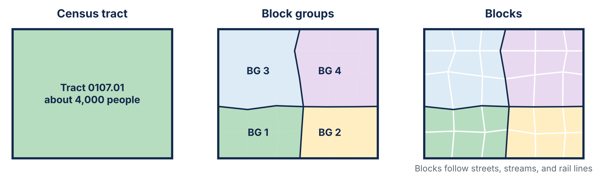
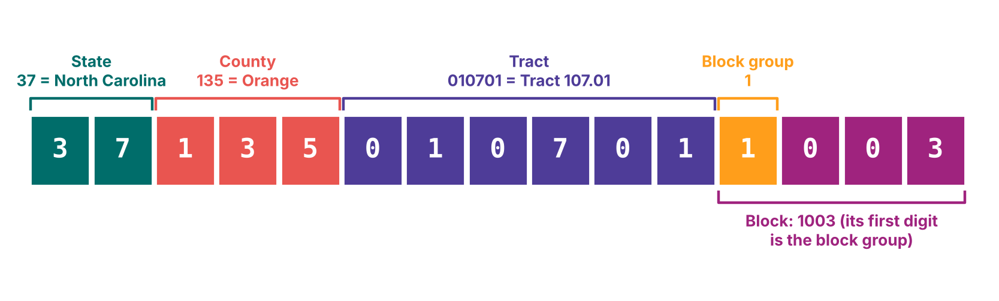
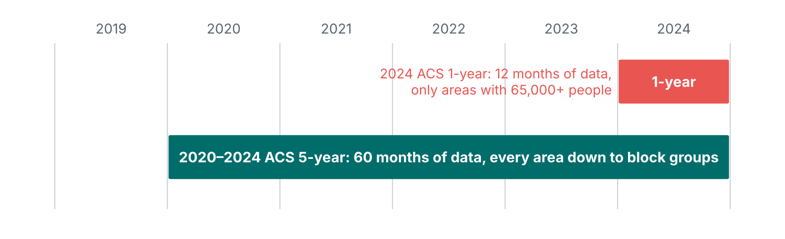
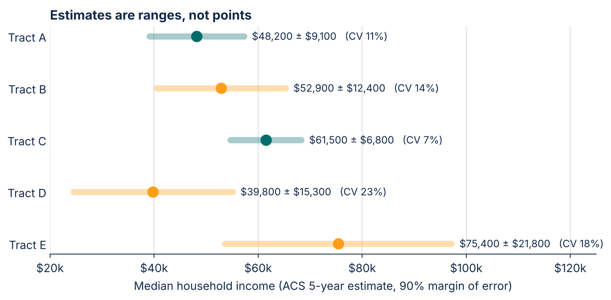

::: {.callout-note appearance="simple"}
## Learning objectives

By the end of this chapter you should be able to:

1.  Tell authoritative data from asserted data, and name the main kinds of population and place data.
2.  Describe what the decennial census, the American Community Survey (ACS), and the Economic Census collect.
3.  Explain the hierarchy of census geography, from the nation to the block, and which areas sit off the spine.
4.  Choose the right census product (decennial, ACS 1-year, or ACS 5-year) for a geography and a question.
5.  Read a margin of error, and judge whether an estimate is reliable enough to map.
6.  Find a census table, build or read its GEOID, and join it to census boundaries in ArcGIS Pro or QGIS.
:::

Chapter 6 joined a census table to census tracts to learn how joins work. This chapter turns to the data itself. The U.S. Census Bureau is the largest source of free, consistent information about people and places in the country. Its numbers decide how many members of Congress each state sends to Washington, where trillions of federal dollars go, where companies open stores, and how public health workers turn case counts into rates.

Census data are also easy to misuse. The same variable can come from three different products, published for eight levels of geography, and many values are estimates with sizable errors. This chapter is about choosing the right product and geography for a question, reading the numbers honestly, and getting them onto a map.

This chapter starts the unit on spatial data quality. Every dataset has a source, a method, and limits. The census documents all three unusually well, so it is a good place to learn to ask about them.

## Population and place data {#sec-population-data}

### Authoritative and asserted data

Data about people and places come from two very different kinds of source:

- **Authoritative data** come from official agencies, such as the Census Bureau or the U.S. Geological Survey. They are collected under documented standards, and they ship with **metadata** that describe their sources, methods, dates, and accuracy.
- **Asserted data**, also called volunteered geographic information, are contributed by the public. OpenStreetMap is the best-known example (Chapter 11). Their accuracy is undocumented and uneven, and they often have little or no metadata. Busy, popular places tend to be mapped well; quiet ones may be sparse. Where contributors are active, asserted data can be more current, and even more accurate, than old official data.

Neither kind is always better. Before using any dataset, ask who made it, how, when, and whether there is metadata that tells you how accurate it is.

### Four kinds of population and place data

Most data about people and places fall into four groups:

- **Demographic data** describe who lives in a place: counts of people and households, and their age, sex, race and ethnicity, and household type. The main sources are the decennial census, the ACS, and the Census Bureau's annual population estimates.
- **Socioeconomic data** describe economic and social conditions: education, income, employment, poverty, and housing costs. They are often used to characterize neighborhoods, for example in **deprivation indices**, and as stand-ins for health, because they track health outcomes closely. The main source is the ACS, so every value is an estimate.
- **Environmental and neighborhood data** describe the places themselves: air and water pollution, flood zones, temperature, the habitats of disease-carrying insects, and amenities such as parks, grocery stores, and sidewalks. They usually come from outside the Census Bureau (the EPA, NOAA, and local governments), and are linked to census geography to describe the people exposed.
- **Health data** include vital statistics (births and deaths), morbidity (illness), and the locations of hospitals, clinics, and doctors. They are often published only for counties or states, to protect privacy. Census counts supply the **denominators** that turn health counts into comparable rates, such as deaths per 100,000 residents.

A rule runs through all of them: **the finer the geography, the fewer variables are published, and the less precise they are.** A state has thousands of detailed census tables; a block has a handful of counts.

## The U.S. Census {#sec-census}

### The constitutional count

The census is written into the U.S. Constitution. Article I, Section 2 requires an "actual Enumeration" of the population every ten years, to divide the seats in the House of Representatives among the states. The first census was taken in 1790; the 2020 Census was the 24th, and the next is in 2030.

The **decennial census** counts every resident, whatever their age, citizenship, or housing status. Since 2010, it has asked only a short list of questions: age, sex, race, Hispanic origin, each person's relationship to the householder, and whether the home is owned or rented. Everything else, from income and education to commuting and home values, now comes from a separate survey, the ACS.

::: {.callout-note .did-you-know appearance="simple" icon=false}
## Did you know..?

Your individual census answers are sealed for 72 years. Until then, the Census Bureau may publish only statistics, and it cannot share your answers with any other agency, including the police, immigration authorities, or the IRS. In April 2022, the National Archives released the individual records of the 1950 census, and the 2020 records will be opened in 2092. Genealogists wait for each release eagerly.
:::

### The big three surveys

The Census Bureau runs dozens of surveys, but three matter most for mapping (@tbl-big-three).

| Survey | How often | What it covers | Kind of numbers |
|--------|-----------|----------------|-----------------|
| **Decennial census** | Every 10 years (2010, 2020, 2030) | Every resident: age, sex, race, Hispanic origin, household relationship, owning or renting | Counts of the whole population |
| **American Community Survey (ACS)** | Every year, published as 1-year and 5-year estimates | About 3.5 million addresses a year: income, education, employment, commuting, housing costs, language, disability, and much more | Estimates from a sample, each with a margin of error |
| **Economic Census** | Every 5 years, in years ending in 2 and 7 | Businesses: number of firms, employees, payroll, and sales, by industry | Counts and totals for businesses |

: The three Census Bureau surveys used most in GIS. {#tbl-big-three}

Most of the socioeconomic variables you will map come from the ACS. The Bureau also publishes annual **population estimates** between censuses, built from the last census plus records of births, deaths, and migration.

### Why census data matter

Census numbers drive decisions in three arenas:

- **Political power.** The decennial count divides the 435 seats in the House among the states (apportionment), and states use the census to redraw congressional and legislative districts (redistricting).
- **Money.** In fiscal year 2021, 353 federal programs, including Medicaid, SNAP, and Head Start, used census data to distribute more than $2.8 trillion [@census2023funds].
- **Business, planning, and health.** Companies use census demographics to choose store sites and gauge labor markets. Planners use commuting times to plan transit, and the age and tenure of housing to plan for growth. Health departments use census counts to compute rates and to find groups that are hit harder by disease. Emergency managers use them to find residents, such as older adults or households without a car, who may need help to evacuate.

### The census is not perfect

Three limits are worth knowing:

- **Undercounts and overcounts.** Some groups are missed more than others. After each census, the Bureau runs a **Post-Enumeration Survey** to measure the errors. For 2020, it estimated that the census missed about 5 percent of Hispanic residents and 3.3 percent of Black residents, and an even larger share of American Indians living on reservations, while overcounting non-Hispanic White and Asian residents [@census2022pes]. Young children are also undercounted, census after census.
- **Differential privacy.** For 2020, the Bureau began adding carefully calibrated statistical noise to its published tables, so that individuals cannot be identified by combining them. Totals for states are exact, but counts for small areas, especially blocks, can look odd: a block with houses but no people, or a few children with no adults.
- **Change.** Boundaries, questions, and methods change from census to census. Comparing 2010 and 2020 tract data, for example, requires care, because many tracts were split or redrawn.

The Census Bureau's Vintage 2025 population estimates, released in January 2026, are a reminder that the population itself keeps changing: U.S. growth slowed to about half a percent between 2024 and 2025, mostly because fewer people moved to the country from abroad. Estimates like these are revised every year, so always check which vintage you are using.

## Census geography {#sec-census-geography}

### The spine

Census data are published for a hierarchy of areas (@fig-hierarchy). The main line, called the **spine**, runs from the nation through regions, divisions, states, counties, census tracts, and block groups, down to blocks. **Each level nests completely inside the one above.** A block is always inside one block group, which is inside one tract, which is inside one county. Because of that, you can add up the blocks in a tract to get the tract, or the tracts in a county to get the county.

{#fig-hierarchy fig-alt="A vertical chain of boxes linked by arrows: Nation, Regions (4), Divisions (9), States (50 plus DC), Counties (about 3,100), Census tracts (about 85,000), Block groups (about 240,000), Blocks (about 8 million). Dashed boxes beside the chain list areas off the spine: American Indian, Alaska Native, and Native Hawaiian areas; metropolitan and micropolitan statistical areas; places; school, congressional, and legislative districts; and ZIP Code Tabulation Areas."}

Other areas sit **off the spine**. They are built from blocks (or, for metropolitan areas, from counties), but they don't fit neatly inside the spine's levels:

- **Places**: incorporated cities and towns, and **census-designated places** for unincorporated communities.
- **ZIP Code Tabulation Areas (ZCTAs)**: approximations of ZIP Code areas built from blocks. ZIP Codes are mail routes, not areas, so a ZCTA is never an exact match.
- **Metropolitan and micropolitan statistical areas**: groups of counties tied together by commuting.
- **School districts, and congressional and state legislative districts.**
- **American Indian, Alaska Native, and Native Hawaiian areas**, which can cross state lines.

Off-spine areas cross the spine's boundaries: a city can spill across two counties, and a ZCTA can cross tracts. You can't get a ZCTA's value by adding up tracts.

### Tracts, block groups, and blocks

Three small levels are used most in local studies (@fig-nesting):

- **Census tracts** are relatively permanent subdivisions of a county, with 1,200 to 8,000 people and about 4,000 on average. There are about 85,000 of them. They are updated each decade as the population changes, by splitting tracts that grew and merging ones that shrank. Tracts are the usual unit for neighborhood and health studies.
- **Block groups** are clusters of blocks within a tract, usually with 600 to 3,000 people. There are about 240,000. They are the smallest areas with ACS estimates, and those estimates often carry large errors.
- **Blocks** are the smallest areas, bounded by streets, streams, rail lines, and other visible features. The 2020 Census had more than 8 million of them, many with no one living there at all. Blocks get decennial counts only, with no ACS estimates.

{#fig-nesting fig-alt="Three panels of the same rectangular tract. The first is a single green area labeled Tract 0107.01, about 4,000 people. The second divides it into four colored block groups, BG 1 to BG 4. The third shows each block group divided further into small irregular blocks, separated by white lines."}

### GEOIDs

Every census area has a **GEOID**, made by stringing together the FIPS codes of the levels above it (Chapter 6). The GEOID is the key that links census tables to boundaries.

| Geography | GEOID structure | Digits | Example |
|-----------|-----------------|--------|---------|
| State | SS | 2 | `37` (North Carolina) |
| County | SS + CCC | 5 | `37135` (Orange County) |
| Tract | SS + CCC + TTTTTT | 11 | `37135010701` |
| Block group | SS + CCC + TTTTTT + B | 12 | `371350107011` |
| Block | SS + CCC + TTTTTT + BBBB | 15 | `371350107011003` |

: GEOID structure for the spine's main levels. {#tbl-geoid-structure}

@fig-geoid breaks a block GEOID into its parts. The block group is not a separate piece: it is the first digit of the four-digit block number.

{#fig-geoid fig-alt="The digits 3 7 1 3 5 0 1 0 7 0 1 1 0 0 3 in colored boxes. 37 is labeled State, North Carolina. 135 is County, Orange. 010701 is Tract 107.01. The next digit, 1, is the block group, and the last four digits, 1003, are the block."}

Store GEOIDs as **text**. As a number, Alabama's state code 01 becomes 1, and California's tracts lose their leading zero.

## Census products and variables {#sec-census-products}

### What is published where

Smaller geographies get fewer tables (@tbl-variables). The decennial census publishes the same few thousand variables for every level, down to the block. The ACS publishes far more, but not for every area.

| Geography | Decennial (2020) | ACS 1-year | ACS 5-year |
|-----------|------------------|------------|------------|
| Block | 9,067 | none | none |
| Block group | 9,067 | none | 4,108 |
| Tract | 9,067 | none | 17,168 |
| County | 9,067 | 36,400 | 18,123 |
| State | 9,067 | 36,400 | 19,564 |

: Approximate number of variables published for each geography. Counts vary by year. {#tbl-variables}

### ACS 1-year and 5-year estimates

The ACS samples addresses every month, and pools them into two products (@fig-acs-periods):

- **1-year estimates** use 12 months of data. They are the most current, but because the sample is small, they are published only for areas with **65,000 or more people**, and they are the least reliable. No tract or block group has 1-year estimates.
- **5-year estimates** pool 60 months of data. They are published for every area down to block groups, and they are the most reliable, but the least current: the 2020–2024 estimates describe the average over five years, not 2024.

{#fig-acs-periods fig-alt="A timeline from 2019 to 2024. A short red bar over 2024 is labeled 1-year: 12 months of data, only areas with 65,000 or more people. A long green bar from 2020 through 2024 is labeled 2020 to 2024 ACS 5-year: 60 months of data, every area down to block groups."}

Use 1-year estimates for large areas when timeliness matters, such as tracking a state's income after a recession. Use 5-year estimates for small areas or small population groups. Never compare a 1-year estimate with a 5-year estimate, and don't compare 5-year estimates whose periods overlap (2015–2019 with 2017–2021, for example), because they share years of data.

### Counts and estimates

Decennial counts are full counts: everyone was asked. ACS values are **estimates** from a sample of about one household in 40 each year, and every one comes with a **margin of error (MOE)**.

A margin of error works like the one on an opinion poll. If a poll finds that 55 percent of people prefer Coffee A, with a margin of error of ±3 points, the true share is probably between 52 and 58 percent. The Census Bureau's margins of error use a **90 percent confidence level**: if the survey were repeated 100 times, about 90 of the ranges would contain the true value.

@fig-moe shows five tract estimates of median household income. Tract D's estimate, $39,800, looks lower than Tract A's $48,200. But D's margin of error is $15,300, so its true value could be anywhere from about $24,500 to $55,100. The two ranges overlap widely, so the data can't tell you which tract has the lower income.

{#fig-moe fig-alt="Five horizontal bars, one per tract, each with a dot for the estimate and a wide bar for the margin of error. Tract A 48,200 plus or minus 9,100, CV 11 percent. Tract B 52,900 plus or minus 12,400, CV 14 percent. Tract C 61,500 plus or minus 6,800, CV 7 percent. Tract D 39,800 plus or minus 15,300, CV 23 percent. Tract E 75,400 plus or minus 21,800, CV 18 percent. The bars of A, B, and D overlap widely."}

A common way to judge an estimate is its **coefficient of variation (CV)**, the standard error as a percentage of the estimate:

$$
\text{CV} = \frac{\text{MOE} / 1.645}{\text{estimate}} \times 100
$$

The 1.645 turns a 90 percent margin of error into a standard error. A widely used rule of thumb treats a CV under 12 percent as reliable, 12 to 40 percent as usable with caution, and over 40 percent as unreliable. When many of your estimates are unreliable, combine them: use larger areas (tracts instead of block groups), or broader categories (all people under 18 instead of each age).

When you add estimates together, the margin of error of the sum is approximately the square root of the sum of the squared margins of error:

$$
\text{MOE}_{\text{sum}} = \sqrt{\text{MOE}_1^2 + \text{MOE}_2^2 + \cdots}
$$

So combining two tracts with MOEs of 300 and 400 people gives an MOE of 500, not 700.

::: {.callout-tip appearance="simple"}
## Think about it

You are mapping the share of households without a car in each block group of Durham County, to plan bus service. Half the block groups have a CV over 40 percent. What could you do instead? What would you lose by doing it?
:::

### Choosing a product and a geography

Put the pieces together like this:

1.  **What do you need to measure?** If it's a basic count (people, age, race, housing units), the decennial census has it, down to blocks. If it's income, education, commuting, or anything else social or economic, you need the ACS.
2.  **How small are your areas?** Blocks get decennial counts only. Tracts and block groups get ACS 5-year estimates. Areas of 65,000 or more people also get ACS 1-year estimates.
3.  **How current must it be?** For large areas, 1-year estimates are newer. For everything else, use the latest 5-year estimates.
4.  **Do your areas nest?** Stay on the spine when you add up areas or compare levels. If you need ZCTAs or school districts, download them directly rather than building them from tracts.
5.  **Are the estimates reliable enough?** Check the margins of error before you map.

::: {.callout-note .did-you-know appearance="simple" icon=false}
## Did you know..?

The 2020 Census was the first in which most households could answer online. About two-thirds of the households that responded on their own did so, and about 80 percent of those used the internet. The rest were counted by mail, by phone, or by census takers who visited the homes that didn't respond.
:::

## Getting census data into a GIS {#sec-census-gis}

### Where to get the data

- **data.census.gov** is the Census Bureau's main site for tables. Search by topic, place, or table ID (such as `S1901`, income in the past 12 months), filter by geography, year, and survey, and download the table as a CSV.
- **The Census Data API** (api.census.gov) returns any table for any geography from a URL. Packages for R and Python use it to download tables with their boundaries in one step.
- **IPUMS NHGIS** (nhgis.org) offers census tables back to 1790, with boundary files for each year, and tables already adjusted to consistent boundaries over time.
- **TIGER/Line shapefiles** are the official boundaries for every census geography, with the GEOID in every record. The Bureau also publishes **cartographic boundary files**, simplified and clipped to the shoreline, which are better for small-scale maps.

### Tutorial: a census join in ArcGIS Pro

This tutorial attaches median household income from the ACS to North Carolina's 100 counties, in ArcGIS Pro. The QGIS steps were covered in Chapter 6 (@sec-census-join).

1.  **Get the data.** Download a county boundary layer for North Carolina (for example the TIGER/Line or cartographic boundary file for U.S. counties, selected to `STATEFP = '37'`). On data.census.gov, find table **S1901** (Income in the Past 12 Months) from the latest ACS 5-year estimates, filter to all counties in North Carolina, and download it as a CSV.
2.  **Start a project, add the data.** Create a new map project and add the county layer and the CSV. The CSV appears under *Standalone Tables* in the Contents pane.
3.  **Check the key fields.** Open the county layer's fields view (*right-click > Data Design > Fields*). The county layer's `GEOID` is text, 5 characters. Open the CSV: ArcGIS Pro reads its ID column, after you clean it to the 5-digit code, as a number (Long integer). **The two key fields must have the same type**, so one has to change.
4.  **Match the types.** A CSV is read-only in ArcGIS Pro, so add a field to the county layer instead. In the county attribute table, click *Add*, name the field `fips5`, set its type to *Long*, and save. Right-click the new column and choose *Calculate Field*, with the expression `fips5 = !GEOID!`. Each text code is converted to a number. (Because both keys are now numbers, the missing leading zeros don't matter.)
5.  **Join.** Right-click the county layer, choose *Joins and Relates > Add Join*. Set the *Input Join Field* to `fips5`, the *Join Table* to the CSV, and the *Join Table Field* to its ID column. Click *Validate Join* to check how many records match: it should be all 100. Click *OK*.
6.  **Check and make it permanent.** Open the attribute table and look for NULLs in the joined fields. Then right-click the layer and choose *Data > Export Features* to save a new feature class with the joined fields.
7.  **Map it.** Symbolize the counties with *Graduated Colors* on the median household income field. Add the margin of error to the pop-up, so that readers can see how precise each estimate is.

## Check your understanding

::: {.content-visible when-format="html"}

1.  OpenStreetMap is an example of: <select class='webex-select'><option value='blank'></option><option value=''>Authoritative data</option><option value='answer'>Asserted (volunteered) data</option><option value=''>Decennial census data</option><option value=''>Metadata</option></select>

2.  Median household income for a census tract comes from: <select class='webex-select'><option value='blank'></option><option value=''>The decennial census</option><option value='answer'>The ACS 5-year estimates</option><option value=''>The ACS 1-year estimates</option><option value=''>The Economic Census</option></select>

3.  Which level of geography is NOT on the census spine? <select class='webex-select'><option value='blank'></option><option value=''>Census tract</option><option value=''>Block group</option><option value='answer'>ZIP Code Tabulation Area</option><option value=''>County</option></select>

4.  How many digits are in a block group GEOID? <input class='webex-solveme nospaces' size='3' data-answer='["12"]'/>

5.  ACS 1-year estimates are published only for areas with at least how many people? <input class='webex-solveme nospaces' size='8' data-answer='["65000","65,000"]'/>

6.  The Census Bureau's margins of error use a confidence level of: <select class='webex-select'><option value='blank'></option><option value=''>50 percent</option><option value='answer'>90 percent</option><option value=''>95 percent</option><option value=''>99 percent</option></select>

7.  Two tract estimates have margins of error of 300 and 400. What is the margin of error of their sum? <input class='webex-solveme nospaces' size='5' data-answer='["500"]'/>

8.  You can find a ZCTA's population by adding up the census tracts inside it. <select class='webex-select'><option value='blank'></option><option value=''>TRUE</option><option value='answer'>FALSE</option></select>

<button>Show hint for question 7</button>

Square each margin of error, add the squares, and take the square root: √(300² + 400²).

:::

::: {.content-visible unless-format="html"}
The interactive self-check questions for this chapter are in the online version of the book.
:::

## Summary

- **Authoritative data** follow documented standards and come with metadata; **asserted data** are contributed by the public and their accuracy is undocumented.
- Population and place data are **demographic**, **socioeconomic**, **environmental**, or **health** data. The finer the geography, the fewer variables and the larger the errors.
- The **decennial census** counts everyone every ten years with a short form. The **American Community Survey** samples about 3.5 million addresses a year for social, economic, and housing data. The **Economic Census** profiles businesses every five years.
- Census data apportion the House, guide trillions of federal dollars, and serve business, planning, and public health. The census also has limits: uneven undercounts, differential privacy noise in small areas, and changing boundaries.
- Census geography has a **spine** (nation, regions, divisions, states, counties, tracts, block groups, blocks) whose levels nest, and **off-spine** areas such as places and ZCTAs that don't.
- A **GEOID** strings FIPS codes together: 2 digits for a state, 5 for a county, 11 for a tract, 12 for a block group, 15 for a block. Keep it as text.
- **ACS 1-year** estimates are current but cover only areas of 65,000+ people. **ACS 5-year** estimates cover every area down to block groups and are more reliable.
- Every ACS value has a **margin of error** at 90 percent confidence. Check the **coefficient of variation**, and combine areas or categories when estimates are unreliable.
- Join census tables to boundaries on the GEOID, with **matching field types**, and check the result for NULLs.

## Exercises

1.  **Authoritative or asserted?** Classify each source, and say what metadata you would look for: the 2020 Census, OpenStreetMap, a county's parcel layer, a crowd-sourced map of potholes, and the USGS National Hydrography Dataset.
2.  **Pick the product.** For each question, choose the product (decennial, ACS 1-year, or ACS 5-year) and the geography: (a) the number of children under 5 in each block of Chapel Hill; (b) median rent in each tract of Wake County; (c) the poverty rate in North Carolina in the latest year; (d) the share of commuters who walk to work in each block group of Orange County.
3.  **Read a GEOID.** What does the GEOID `371830541091` identify? Which state, which county, which tract, and which level of geography?
4.  **Margins of error.** Download median household income (table B19013) for every tract in Orange County, NC, from the latest ACS 5-year estimates, including the margins of error. Compute the CV of each tract. How many are over 12 percent? Over 40 percent?
5.  **County join.** Follow the ArcGIS Pro tutorial in @sec-census-gis (or the QGIS steps in Chapter 6) to map median household income for North Carolina's counties. Which county has the highest income, and which the lowest? Are their margins of error small enough to be sure?
6.  **Rates.** Download county population from the 2020 Census and a count of something by county (for example, hospitals, or COVID-19 cases from the state health department). Compute and map a rate per 100,000 residents. Why is a map of the raw counts misleading?

## Further reading and online resources

### Books and guides

- U.S. Census Bureau, *Understanding and Using American Community Survey Data: What All Data Users Need to Know* (2020), the official handbook, including how to work with margins of error: <https://www.census.gov/programs-surveys/acs/library/handbooks/general.html>.
- *Analyzing US Census Data: Methods, Maps, and Models in R*, by Kyle Walker (CRC Press, 2023), free online. The concepts chapters on census geography and margins of error are useful even without R: <https://walker-data.com/census-r/>.
- *GIS Fundamentals: A First Text on Geographic Information Systems*, by Paul Bolstad [@bolstad2022]. Chapter 7 discusses census data and other digital data sources.
- *The Nature of Geographic Information*, by David DiBiase and colleagues at Penn State. Chapter 3, "Census Data and Thematic Maps": <https://www.e-education.psu.edu/natureofgeoinfo/c3.html>.

### Census Bureau resources

- data.census.gov, for finding and downloading tables: <https://data.census.gov>.
- Census Bureau, "Geography Program," including the hierarchy of census geographies: <https://www.census.gov/programs-surveys/geography.html>.
- Census Bureau, "Understanding Geographic Identifiers (GEOIDs)": <https://www.census.gov/programs-surveys/geography/guidance/geo-identifiers.html>.
- Census Bureau, TIGER/Line shapefiles: <https://www.census.gov/geographies/mapping-files/time-series/geo/tiger-line-file.html>.
- Census Bureau, cartographic boundary files: <https://www.census.gov/geographies/mapping-files/time-series/geo/cartographic-boundary.html>.
- Census Bureau, American Community Survey: <https://www.census.gov/programs-surveys/acs>.
- Census Bureau, Census Data API: <https://www.census.gov/data/developers.html>.
- Census Bureau, "Uses of Census Bureau Data in Federal Funds Distribution" [@census2023funds].
- Census Bureau, Post-Enumeration Survey results for the 2020 Census [@census2022pes]: <https://www.census.gov/library/stories/2022/03/who-was-undercounted-overcounted-in-2020-census.html>.
- Census Bureau, "Disclosure Avoidance and the 2020 Census," on differential privacy: <https://www.census.gov/programs-surveys/decennial-census/decade/2020/planning-management/process/disclosure-avoidance.html>.
- Census Academy, free videos and courses on using census data: <https://www.census.gov/data/academy.html>.
- National Archives, the 1950 census records: <https://1950census.archives.gov>.

### Other sources and tools

- IPUMS NHGIS, historical census tables and boundaries: <https://www.nhgis.org>.
- Social Explorer, census maps and tables back to 1790 (many universities subscribe): <https://www.socialexplorer.com>.
- censusdis, a Python package for downloading census data with boundaries: <https://github.com/censusdis/censusdis>.
- Esri, "Living Atlas" ACS layers, ready to map in ArcGIS: <https://livingatlas.arcgis.com>.
- North Carolina Office of State Budget and Management, State Demographer's population estimates and projections: <https://www.osbm.nc.gov/facts-figures/population-demographics>.
- Carolina Demography, at UNC's Carolina Population Center, on North Carolina's census data: <https://carolinademography.cpc.unc.edu>.
