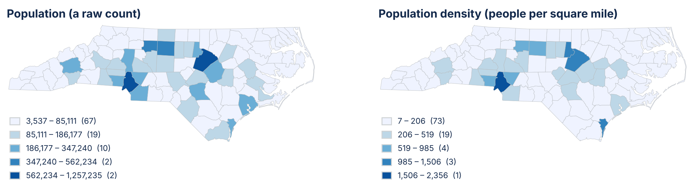
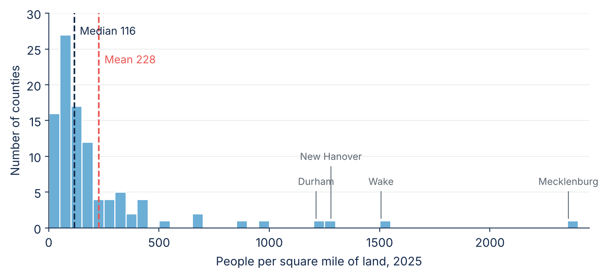
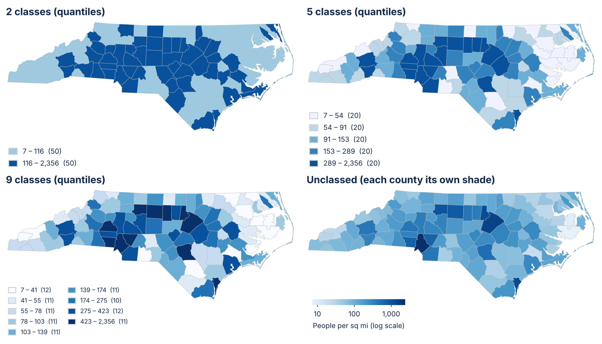
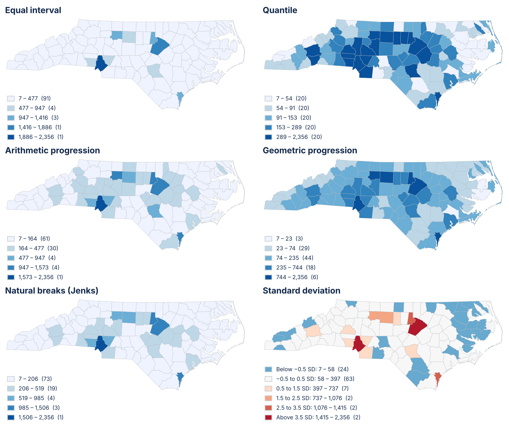
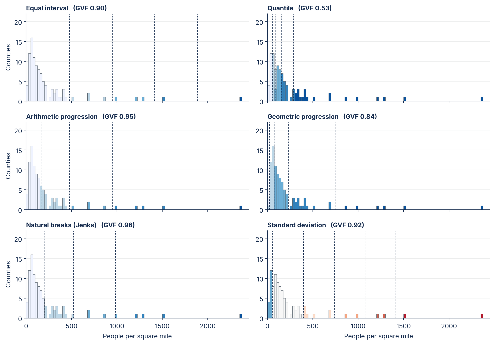

::: {.callout-note appearance="simple"}
## Learning objectives

By the end of this chapter you should be able to:

1.  Explain what a choropleth map shows, and why it needs normalized data rather than raw counts.
2.  Decide whether to class data at all, and how many classes a map can carry.
3.  Describe how six classification methods set class breaks: equal interval, quantile, arithmetic and geometric progression, natural breaks (Jenks), and standard deviation.
4.  Read a histogram to choose a method that fits a data distribution and the purpose of a map.
5.  Measure how well classes fit the data with the goodness of variance fit.
6.  Class and symbolize a choropleth map in ArcGIS Pro and QGIS.
:::

The chapters so far have put attribute data into a GIS, queried it, and joined it to boundaries. The next step is to show it, and the simplest analysis of all is a map. Most thematic maps of places, from election results to disease rates, are **choropleth maps**: maps that shade each area by its value. They look easy to make, and every GIS will make one in a few clicks. But behind every choropleth map are two decisions that can change its story completely: how many classes to use, and where to put the breaks between them.

This chapter maps one dataset, the population density of North Carolina's 100 counties, many different ways. Every difference you see between the maps comes from those two decisions, not from the data.

## Choropleth maps {#sec-choropleth}

### Shading areas by value

A **choropleth map** shades each **enumeration unit**, an area for which data are collected and reported, such as a county, a census tract, or a state, by its value. Darker or more saturated shades usually mean higher values. The areas are fixed in advance: their boundaries come from the data source, not from the pattern being mapped.

Choropleth maps are everywhere because so much data is published for administrative areas. They are good at showing how a rate or a share varies from place to place, and at helping readers find their own area. They also have weaknesses, which this chapter returns to: they show each area as uniform inside, and large areas dominate them whatever their values.

::: {.callout-note .did-you-know appearance="simple" icon=false}
## Did you know..?

The first choropleth map was made in 1826 by the French mathematician Charles Dupin. It shaded each French *département* by the number of boys in school relative to its population, from white for the best-educated to black for the least, and it gave the French their first picture of a divided country: an educated north and a poorer south. The name *choropleth*, from the Greek *choros* (place) and *plethos* (multitude), was coined by the American geographer John K. Wright more than a century later, in 1938.
:::

### Normalize first

The most common mistake on a choropleth map is to shade the areas by a **raw count**, such as the number of people, cases, or crimes. Big areas tend to have big counts simply because they are big, or because more people live in them. A reader's eye is also drawn to large areas. So a map of raw counts exaggerates large units twice, and mostly shows where the people are.

The fix is to **normalize** the counts before mapping them:

- **Divide by area** to get a density, such as people per square mile.
- **Divide by population** to get a rate or a share, such as deaths per 100,000 residents or the percentage of votes cast.
- **Use a summary statistic**, such as a median income or an average age.

@fig-counts-vs-density shows the difference. On the left, the raw population count makes the large urban counties stand out, along with big counties such as Buncombe and Onslow. On the right, population density (people per square mile of land) shows how crowded each county is.

{#fig-counts-vs-density fig-alt="Two maps of North Carolina's 100 counties. Left, population: Wake and Mecklenburg are darkest, Guilford and Forsyth next, and many mid-sized counties such as Buncombe, Cumberland, and Onslow are in the middle class. Right, population density: only Mecklenburg is darkest, Wake, Durham, and New Hanover are next, most of the state is in the lightest class, and counties such as Onslow and Buncombe drop to the second."}

A rule of thumb: **if a number would grow just because the area or its population grew, normalize it before you make a choropleth map.** Raw counts belong on other kinds of map, such as proportional symbol maps, where the symbol's size shows the count.

::: {.callout-tip appearance="simple"}
## Think about it

A news site maps the number of COVID-19 cases in each North Carolina county, and Wake and Mecklenburg are the darkest. Does that tell you where the risk of catching COVID-19 was highest? What would you map instead?
:::

### Look at the distribution first

Before choosing classes, look at how the values are spread. The best tool is a **histogram**, a bar chart of how many areas fall in each range of values (@fig-density-histogram).

{#fig-density-histogram fig-alt="A histogram of county population densities. Most counties are between 0 and 300 people per square mile, with the tallest bar, 27 counties, between 50 and 100. A long tail stretches to the right with single counties: Durham and New Hanover near 1,250, Wake near 1,500, and Mecklenburg near 2,350. The median is 116 and the mean 228."}

North Carolina's county densities are strongly **skewed**. Half of the counties have fewer than 116 people per square mile, but a few urban counties have many more: Mecklenburg has 2,356. The mean (228) is twice the median (116), pulled up by those few counties. Skewed data are the rule, not the exception, for counts and densities of people, and the shape of the histogram decides which classing methods will work.

## How many classes? {#sec-number-of-classes}

### To class or not to class

The first decision is whether to class the data at all. In an **unclassed map**, each area gets its own shade, in proportion to its value. In a **classed map**, the values are grouped into a few classes, and every area in a class gets the same shade.

In 1973, Waldo Tobler argued that once computers could shade each area by its exact value, classes were no longer needed [@tobler1973]. The data are continuous, he said, so the symbols should be too, and the reader cares about the overall pattern, not exact values. The case for classing is about the reader. People match a few distinct shades to a legend far more accurately than they read a value from a smooth ramp; a handful of classes is easier to remember; and class breaks can mark values that matter, such as a poverty line. Most published choropleth maps are classed, but unclassed maps are a good choice when the overall pattern is what matters.

### How many can readers tell apart?

@fig-number-of-classes maps the same densities in 2, 5, and 9 classes, and unclassed. With two classes, the map is simple, but it hides almost everything: a county with 117 people per square mile looks the same as Mecklenburg. With nine, it keeps more detail, but try to match the middle shades of the map to the legend.

{#fig-number-of-classes fig-alt="Four maps of North Carolina population density by county. Two classes: half the counties light, half dark, the dark ones forming a band through the Piedmont. Five classes: a gradient from light counties in the far west and northeast to dark counties around Charlotte, the Triad, the Triangle, and Wilmington. Nine classes: similar, with many shades of blue that are hard to tell apart. Unclassed: every county a slightly different shade, with a smooth legend from 10 to over 1,000 people per square mile on a log scale."}

Some guidelines:

- **Most readers can tell apart about five to seven shades** of a single color. Beyond that, they start to confuse neighboring classes.
- **Use fewer classes** when there are few areas, when the map will be printed in grayscale, or when the audience is general.
- **Use more classes** only when readers need the detail, and test that they can tell the shades apart.
- **Sturges' rule** gives a statistical starting point: $k \approx 1 + 3.3 \log_{10}(n)$, where $n$ is the number of areas [@sturges1926]. For North Carolina's 100 counties, $k \approx 1 + 3.3 \times 2 = 7.6$, about 8. That is at the limit of what readers can tell apart, so in practice you would use five or six.
- **ColorBrewer** (colorbrewer2.org) offers color schemes for 3 to 9 classes that have been tested for legibility and for color-blind readers [@harrower2003].

### Classing is generalization

Classing is a kind of **map generalization**, the cartographer's toolkit for deciding what to keep and what to leave out. Generalization has three broad operations: **simplification** removes detail, **classification** groups values or features together, and **enhancement** adds detail or emphasis back where the reader needs it. When we class data, the goal is a map whose symbols fit the real distribution of the data, with as little of the important detail lost as possible.

One kind of detail is lost on every choropleth map, classed or not. A county's density is an average. It doesn't mean that people are spread evenly across the county: Mecklenburg has dense neighborhoods and nearly empty ones, and most of Hyde County's people live in a few small towns. Assuming that everyone in an area shares its average value is the **ecological fallacy**. Maps that redistribute values within each area, such as **dasymetric maps**, which place people only on land where people live, are one answer to it.

## Where to put the breaks {#sec-classification-methods}

### Classing as modeling

The second decision is where to put the **class breaks**, the values that divide one class from the next. Each classification method puts them somewhere different, and so highlights a different side of the data. It is rarely obvious in advance which will work best, so treat classing as modeling:

1.  **Model the data.** Plot a histogram, and look for skew, gaps, and outliers.
2.  **Try several methods.** A pattern that appears under every method is probably real. One that appears under only one method may be an artifact of that method.
3.  **Measure the error.** Check how well the classes fit the data, for example with the goodness of variance fit (@sec-gvf).

@fig-methods-maps maps North Carolina's county densities with six methods, each with five or six classes. @fig-methods-histograms shows where each method puts its breaks on the histogram. The numbers in brackets in the legends are the number of counties in each class.

{#fig-methods-maps fig-alt="Six maps of the same data. Equal interval: 91 counties are in the lightest class; only nine urban counties are darker. Quantile: an even mix of five shades, with a dark band through the Piedmont and light counties in the mountains and the northeast. Arithmetic progression: mostly the two lightest classes, with the urban counties darker. Geometric progression: a smooth gradient from light rural counties to dark urban ones, with most counties in the middle classes. Natural breaks: 73 counties in the lightest class, with the urban counties in four darker classes. Standard deviation: a diverging map with 24 counties in blue below the mean, 63 in near-white around the mean, and the urban counties in shades of red above it."}

{#fig-methods-histograms fig-alt="Six histograms of the same county densities, each with dashed lines at its class breaks and bars colored by class. Equal interval breaks are evenly spaced at about 477, 947, 1,416, and 1,886; GVF 0.90. Quantile breaks are bunched at the low end, at about 54, 91, 153, and 289; GVF 0.53. Arithmetic progression breaks at about 164, 477, 947, and 1,573; GVF 0.95. Geometric progression breaks at about 23, 74, 235, and 744; GVF 0.84. Natural breaks at about 206, 519, 985, and 1,506; GVF 0.96. Standard deviation breaks at about 58, 397, 737, 1,076, and 1,415; GVF 0.92."}

### Equal interval

**Equal interval** divides the range of the data, from the minimum to the maximum, into classes of equal width. North Carolina's densities run from 7 to 2,356, so five equal classes are each about 470 people per square mile wide.

- **Good for:** data spread fairly evenly across their range, and legends that are easy to read, especially when the breaks are rounded to familiar values (0, 500, 1,000, ...).
- **Watch out for:** skewed data. Here, 91 of the 100 counties fall in the lowest class, and the map says little except that a few cities are dense.

### Quantile

**Quantile** classing puts the same number of areas in each class. With five classes these are **quintiles**, 20 counties each; with four, **quartiles**.

- **Good for:** ranking places (a dark county is in the top fifth), and maps where every shade is used. Readers find quantile maps easy to use, and they work well for comparing a series of maps [@brewer2002].
- **Watch out for:** breaks that ignore the gaps in the data. Counties with nearly the same density can land in different classes, while very different counties share one: the top class here runs from 289 to 2,356, so Mecklenburg looks the same as counties with an eighth of its density.

::: {.callout-note .did-you-know appearance="simple" icon=false}
## Did you know..?

Which method do readers find easiest to use? Cynthia Brewer and Linda Pickle tested seven methods on maps of death rates, asking people to read and compare them [@brewer2002]. Quantile classing, often criticized by cartographers, was among the best. The popular natural breaks method did less well, partly because its breaks change from map to map, so the same shade means different values on each one.
:::

### Arithmetic progression

In an **arithmetic progression**, each class is wider than the one before by a constant amount: if the first class is $w$ wide, the next is $2w$, then $3w$, and so on.

- **Good for:** data that thin out steadily toward high values. It gives more classes to the low end than equal interval does.
- **Watch out for:** strongly skewed data. Here it helps a little, but 61 counties are still in the first class and 30 in the second.

### Geometric progression

In a **geometric progression**, each class is wider than the one before by a constant *ratio*. Equivalently, the breaks are evenly spaced on a logarithmic scale. North Carolina's densities span about 2.5 orders of magnitude (7 to 2,356), so each of five breaks is about 3.2 times the one before: 23, 74, 235, and 744.

- **Good for:** strongly skewed data, such as population density or income, whose values span orders of magnitude. Compare it with equal interval: the same data now show a clear gradient from rural counties to the cities.
- **Watch out for:** irregular break values that are harder for readers to interpret.

### Natural breaks (Jenks)

The **natural breaks**, or **Jenks**, method groups similar values together. It searches for the breaks that make the classes as alike inside as possible: it minimizes the variance within each class and maximizes the variance between them [@jenks1977]. In practice, it tends to put breaks at the gaps in the histogram.

- **Good for:** data with clusters and gaps. It is the default method in ArcGIS Pro.
- **Watch out for:** comparing maps. Because the breaks are fitted to one dataset, two natural breaks maps of different years or places usually have different breaks, and can't be compared directly. On skewed data, natural breaks also spends most of its classes on the few high values: here, 73 counties share the lowest class.

(The method is named for George Jenks, a cartographer at the University of Kansas, so it is *Jenks*, not *Jenk's*.)

### Standard deviation

**Standard deviation** classing sets breaks at fixed distances from the mean, such as every half or whole standard deviation. A county in the class "0.5 to 1.5 SD" is between half and one and a half standard deviations above the mean.

- **Good for:** showing which areas are above or below average. Because the classes have a meaningful midpoint, the mean, this is one of the few cases where a **diverging color scheme** fits: one hue for values below the midpoint, another for values above it, and a light neutral color in the middle.
- **Watch out for:** skewed data. The method assumes a roughly normal, bell-shaped distribution. Here, the lowest class, below −0.5 SD, already reaches down to the least dense county: no county could be even 0.7 standard deviations below the mean, which would be a negative density. Mecklenburg, meanwhile, is more than six standard deviations above it.

### Manual (defined) intervals

Finally, you can set the breaks yourself, at values that mean something: a poverty threshold, a regulatory limit, or round numbers. **Manual** or **defined intervals** are also the best choice when several maps must be compared, such as the same variable across census years, because every map then uses the same classes.

### Matching the method to the data

| Method | How the breaks are set | Best for |
|---|---|---|
| Equal interval | Equal-width steps across the range | Evenly spread data; round break values |
| Quantile | The same number of areas in each class | Ranking places; comparing a series of maps |
| Arithmetic progression | Widths grow by a constant amount | Moderately skewed data |
| Geometric progression | Widths grow by a constant ratio | Strongly skewed data |
| Natural breaks (Jenks) | Minimize the variance within classes | Clustered data with gaps |
| Standard deviation | Fixed steps from the mean | Above or below average; near-normal data |
| Manual (defined) | The analyst sets meaningful thresholds | Policy cutoffs; maps compared over time |

: Classification methods and when to use them. {#tbl-methods}

The best method depends on two things: the shape of the distribution, which you see in the histogram, and the purpose of the map.

::: {.callout-tip appearance="simple"}
## Think about it

You are making a map for county commissioners showing which counties are more densely populated than the state as a whole (about 230 people per square mile). Which method would you use, and what color scheme? Would your answer change if the map were for a report comparing 2010 and 2025?
:::

## Measuring the fit {#sec-gvf}

How do you know whether a set of classes fits the data? One measure is the **goodness of variance fit (GVF)**, which compares how spread out the values are within each class with how spread out they are overall:

$$
\text{GVF} = 1 - \frac{\text{SDCM}}{\text{SDAM}}
$$

- **SDAM**, the sum of squared deviations from the array mean, adds up the squared difference between each value and the mean of all the values.
- **SDCM**, the sum of squared deviations from the class means, adds up the squared difference between each value and the mean of its own class.

If every class held only identical values, SDCM would be 0 and the GVF would be 1. The closer the GVF is to 1, the better the classes fit the data. The GVF of each method for North Carolina's densities is shown in @fig-methods-histograms.

Natural breaks has the highest GVF (0.96), as it should: it is designed to maximize it. Quantile has the lowest (0.53), because its top class lumps together counties from 289 to 2,356. But the GVF is not the only test of a good map. The quantile map shows far more of the state's geography than the natural breaks map, in which 73 counties look alike. A high GVF means the classes describe the *values* well; whether they tell the *story* well is a judgment about the map's purpose.

## Choropleth maps in a GIS {#sec-choropleth-gis}

### Color schemes

Choose the color scheme to fit the data:

- **Sequential** schemes, in light-to-dark steps of one hue (or a few related hues), fit most data, which run from low to high. Light usually means low.
- **Diverging** schemes, two hues that meet at a light neutral color, fit data with a meaningful midpoint, such as values above and below a mean, a median, or zero (a change from one year to the next).
- **Qualitative** schemes, of distinct hues, fit categories, such as land-cover types, not quantities.

### ArcGIS Pro

1.  **Prepare the data.** Join your table to its boundaries (Chapter 6), and add a field with the normalized value, or plan to normalize in the symbology.
2.  **Open the symbology.** Right-click the layer, choose *Symbology*, and set *Primary symbology* to **Graduated Colors**.
3.  **Choose the field.** Set *Field* to the value to map. To divide by another field on the fly, set *Normalization* (for example, a population field to map a count per person, or a land-area field to map a density).
4.  **Choose the method and classes.** Set *Method* (Natural Breaks (Jenks) is the default; the others include Equal Interval, Quantile, Standard Deviation, Geometrical Interval, Defined Interval, and Manual Interval) and the number of *Classes*.
5.  **Check the histogram.** The *Histogram* tab shows the distribution with the breaks marked; you can drag breaks to new values, which switches the method to Manual Interval.
6.  **Choose a color scheme**, and edit the class labels into rounded, readable values.

ArcGIS Pro's *Geometrical Interval* is its own method, designed for skewed data. It is similar to, but not exactly the same as, the geometric progression described above.

### QGIS

1.  **Prepare the data.** Join and normalize as needed. You can also type an expression instead of a field, such as `"POP_2025" / "ALAND_SQMI"`.
2.  **Open the symbology.** Open *Layer Properties > Symbology* and choose **Graduated**.
3.  **Choose the value and ramp.** Set *Value* to the field or expression and choose a *Color ramp*.
4.  **Choose the mode and classes.** Set *Mode*: Equal Interval, Equal Count (Quantile), Natural Breaks (Jenks), Standard Deviation, Pretty Breaks, or Logarithmic scale. Set the number of *Classes*, and click *Classify*.
5.  **Check the histogram.** The *Histogram* tab plots the values with the breaks; click *Load values* to see it. Double-click a class's values to edit its breaks.

::: {.callout-note appearance="simple"}
## A checklist for choropleth maps

- Is the value normalized (a rate, share, density, or average), not a raw count?
- Did you look at the histogram before choosing a method?
- Can readers tell the classes apart (usually 3 to 7)?
- Does the color scheme fit the data: sequential, or diverging around a meaningful midpoint?
- Are the class labels rounded and readable, with no gaps or overlaps?
- If maps will be compared, do they share the same classes?
:::

## Check your understanding

::: {.content-visible when-format="html"}

1.  Which of these should NOT be mapped on a choropleth map as it is? <select class='webex-select'><option value='blank'></option><option value=''>Median household income</option><option value=''>Population density</option><option value='answer'>Total number of crimes</option><option value=''>Percentage of votes cast</option></select>

2.  Which method puts the same number of areas in each class? <select class='webex-select'><option value='blank'></option><option value=''>Equal interval</option><option value='answer'>Quantile</option><option value=''>Natural breaks (Jenks)</option><option value=''>Standard deviation</option></select>

3.  Which method minimizes the variance within classes? <select class='webex-select'><option value='blank'></option><option value=''>Equal interval</option><option value=''>Quantile</option><option value='answer'>Natural breaks (Jenks)</option><option value=''>Geometric progression</option></select>

4.  Data range from 0 to 500. What is the width of each class with five equal intervals? <input class='webex-solveme nospaces' size='5' data-answer='["100"]'/>

5.  Using Sturges' rule, about how many classes would you start with for 1,000 areas? <input class='webex-solveme nospaces' size='4' data-answer='["11","10.9"]'/>

6.  A diverging color scheme fits standard deviation classes because they have a meaningful midpoint. <select class='webex-select'><option value='blank'></option><option value='answer'>TRUE</option><option value=''>FALSE</option></select>

7.  A GVF of 1 means: <select class='webex-select'><option value='blank'></option><option value=''>The classes fit the data as badly as possible</option><option value='answer'>Every value in a class is the same as its class mean</option><option value=''>There is only one class</option><option value=''>The data are normally distributed</option></select>

8.  Which method is best for strongly skewed data, such as population density? <select class='webex-select'><option value='blank'></option><option value=''>Equal interval</option><option value='answer'>Geometric progression</option><option value=''>Standard deviation</option><option value=''>Arithmetic progression</option></select>

<button>Show hint for question 5</button>

$k \approx 1 + 3.3 \log_{10}(1000) = 1 + 3.3 \times 3$.

:::

::: {.content-visible unless-format="html"}
The interactive self-check questions for this chapter are in the online version of the book.
:::

## Summary

- A **choropleth map** shades each enumeration unit by its value. **Normalize** counts first, by area, by population, or with a summary statistic, because raw counts mostly show where the people are.
- Look at the **histogram** before choosing classes. Counts and densities of people are usually strongly **skewed**.
- **Unclassed** maps show every value; **classed** maps are easier to read and remember. Most readers can tell apart **five to seven** shades; **Sturges' rule** gives a statistical starting point.
- Classing is **generalization**. Every choropleth map also hides variation inside each area, and assuming everyone shares the average is the **ecological fallacy**.
- **Equal interval** gives equal-width classes; **quantile**, equal counts; **arithmetic** and **geometric progressions**, classes that widen by a constant amount or ratio; **natural breaks (Jenks)**, classes of similar values; **standard deviation**, steps from the mean; and **manual** intervals, meaningful thresholds.
- The **goodness of variance fit** measures how well the classes fit the values; the purpose of the map decides whether they tell the right story.
- Use **sequential** color schemes for most data and **diverging** schemes for data with a meaningful midpoint.

## Exercises

1.  **Normalize.** For each variable, say whether it can go on a choropleth map as it is, and if not, how you would normalize it: (a) number of hospitals per county; (b) median age; (c) acres of farmland; (d) number of people without health insurance; (e) the percentage of adults with a bachelor's degree.
2.  **Equal intervals by hand.** A variable ranges from 12 to 87. Compute the breaks for four equal-interval classes. Then compute the breaks for four classes in a geometric progression (hint: the ratio is $(87 / 12)^{1/4}$).
3.  **Six methods.** Download the population of North Carolina's counties and their land areas (Chapter 9), compute population density, and map it in ArcGIS Pro or QGIS with equal interval, quantile, natural breaks, and standard deviation classes. Which map would you publish, and why?
4.  **Histograms.** Open the histogram of the same data in your GIS. Then map the natural log of density with equal intervals. How does the histogram change? How does the map compare with the geometric progression map in @fig-methods-maps?
5.  **Number of classes.** Make the same quantile map with 3, 5, 7, and 9 classes. At what point can you no longer match every shade on the map to the legend?
6.  **Map a series.** Map the same variable (for example, the percentage of people in poverty) for two years. Class each with natural breaks, then both with the same manual breaks. Which pair of maps lets you see change correctly?

## Further reading and online resources

### Books and articles

- *Thematic Cartography and Geovisualization*, by Terry Slocum, Robert McMaster, Fritz Kessler, and Hugh Howard [@slocum2022], the standard textbook on classing and choropleth maps.
- *How to Lie with Maps*, by Mark Monmonier [@monmonier2018], on how choices such as class breaks change a map's message.
- *Designing Better Maps: A Guide for GIS Users*, by Cynthia Brewer [@brewer2016], with practical advice on classes and color.
- Tobler, "Choropleth Maps Without Class Intervals?" [@tobler1973].
- Brewer and Pickle, "Evaluation of Methods for Classifying Epidemiological Data on Choropleth Maps in Series" [@brewer2002].
- Harrower and Brewer, "ColorBrewer.org: An Online Tool for Selecting Colour Schemes for Maps" [@harrower2003].
- *GIS Fundamentals: A First Text on Geographic Information Systems*, by Paul Bolstad [@bolstad2022], on classification of attribute data.

### Online resources

- ColorBrewer 2.0, color schemes for maps: <https://colorbrewer2.org>.
- Axis Maps, *Cartography Guide*, on choropleth maps, normalization, and data classification: <https://www.axismaps.com/guide/choropleth>.
- The Nature of Geographic Information, Penn State, on thematic maps and data classification: <https://www.e-education.psu.edu/natureofgeoinfo/c3_p13.html>.
- *Geography 486: Cartography and Visualization*, Penn State, on classing and color: <https://courses.ems.psu.edu/geog486/>.
- The GIS&T Body of Knowledge, "Statistical Mapping (Enumeration, Normalization, Classification)" and "Choropleth Maps": <https://www.ucgis.org/site/gis-t-body-of-knowledge>.
- Esri, "Data classification methods" in ArcGIS Pro: <https://pro.arcgis.com/en/pro-app/latest/help/mapping/layer-properties/data-classification-methods.htm>.
- Esri, "Graduated colors" symbology in ArcGIS Pro: <https://pro.arcgis.com/en/pro-app/latest/help/mapping/layer-properties/graduated-colors.htm>.
- QGIS User Guide, "Graduated Renderer": <https://docs.qgis.org/latest/en/docs/user_manual/working_with_vector/vector_properties.html#graduated-renderer>.
- Kenneth Field, *Cartography.* (Esri Press, 2018), a richly illustrated reference with entries on classification and choropleth maps.
- Datawrapper Academy, "What to consider when creating choropleth maps": <https://academy.datawrapper.de/article/134-what-to-consider-when-creating-choropleth-maps>.
- U.S. Census Bureau, 2020 Census Gazetteer files (land area for every geography): <https://www.census.gov/geographies/reference-files/time-series/geo/gazetteer-files.html>.
