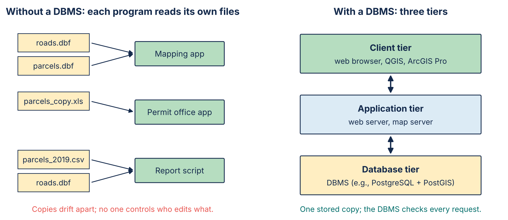
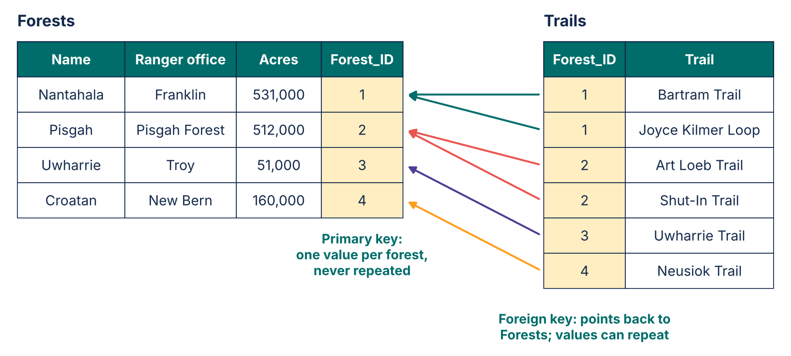
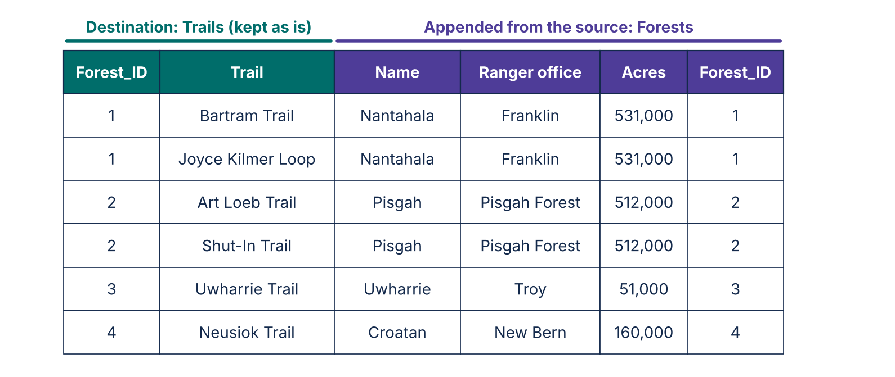
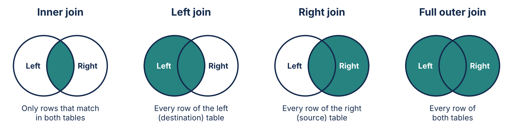
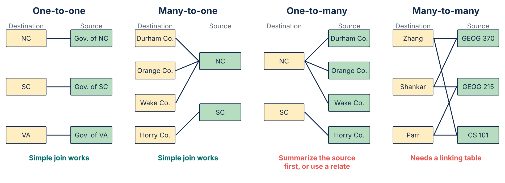
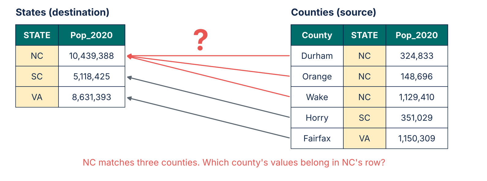
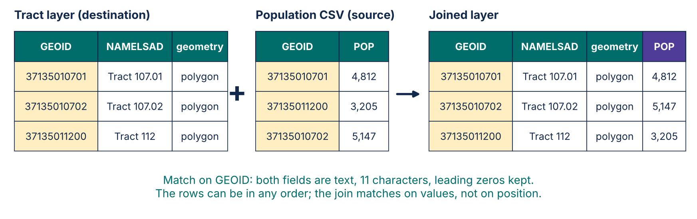
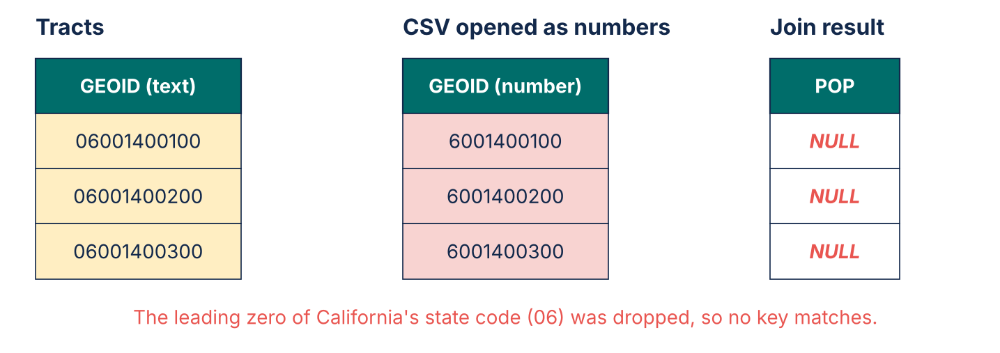

::: {.callout-note appearance="simple"}
## Learning objectives

By the end of this chapter you should be able to:

1.  Explain what a database management system (DBMS) does, and why GIS data is often stored in one.
2.  Describe a relational database, and tell a primary key from a foreign key.
3.  Join two tables on a shared key field, and say which table is the destination and which is the source.
4.  Predict which records an inner, left, right, or full outer join keeps.
5.  Name the cardinality of a join (one-to-one, many-to-one, one-to-many, or many-to-many), and decide whether a simple join will work.
6.  Join a census table to census tract boundaries in QGIS, and fix the problems that make joins fail.
:::

Chapter 5 asked questions of a single attribute table. Real projects rarely stop at one table. The census tract boundaries you download from the Census Bureau carry a code and a name, but no population. The population sits in a separate table, from a separate website, with no geometry at all. A county's parcels live in one table, and its owners in another. A forest's trails are in one table, and the forest's size and ranger office in a second.

To map any of these, you have to bring the two tables together. That operation is a **table join**, and it is one of the most common and most error-prone steps in GIS work. This chapter starts with how databases store and link tables, then shows how joins work, how they fail, and how to check them.

## Databases and keys {#sec-databases}

### From one table to many

An attribute table follows the rules from Chapter 5: one row per feature, and one column per attribute. A layer of Washington counties might have a FIPS code, a name, the 1990 population, the land area, and the population density, all in one table.

That works until the questions get bigger. Suppose you also track every county's hospitals, every hospital's doctors, and every doctor's specialties. You could keep adding columns to the county table, but you would soon need a column for "hospital 1," "hospital 2," and so on, with most of them empty. A better design splits the data into several tables, each about one kind of thing, and links them through shared values. Storing and linking many tables is the job of a database.

### What is a database management system?

A **database management system (DBMS)** is software that stores data once and lets many programs and many people query it. Common examples include:

- **Oracle** and **Microsoft SQL Server**, large commercial systems used by governments and companies.
- **MySQL** and **PostgreSQL**, free, open-source servers. **PostGIS** is an extension that adds geometry types and spatial functions to PostgreSQL.
- **SQLite**, a small database that lives in a single file. **SpatiaLite** adds spatial functions to it, and a **GeoPackage** (Chapter 2) is a SQLite database laid out to a published standard. QGIS saves new layers as GeoPackages by default.

Without a DBMS, every program reads its own files directly (@fig-dbms-architecture, left). The mapping app reads one copy of the parcels, the permit office keeps another in a spreadsheet, and a reporting script reads last year's export. The copies drift apart, and no one controls who edits what.

{#fig-dbms-architecture fig-alt="Two diagrams. On the left, three programs (a mapping app, a permit office app, and a report script) each read their own files, including duplicate copies of parcels and roads. On the right, three stacked boxes labeled client tier, application tier, and database tier, joined by two-way arrows."}

A DBMS changes four things:

- **Client/server.** Client programs such as QGIS, ArcGIS Pro, or a web browser send requests to a database server, which does the work and sends back the answer.
- **Multiple tiers.** Large systems are usually built in three tiers (@fig-dbms-architecture, right): the client, an application tier (for example a web server or map server), and the database tier.
- **No direct write access.** Users change data only through the DBMS, which checks their permissions first. A summer intern can be allowed to read the parcel table but not to edit it.
- **Concurrency.** Many users can read and edit at the same time. The DBMS makes sure that two people editing the same record don't overwrite each other's work.

::: {.callout-note .did-you-know appearance="simple" icon=false}
## Did you know..?

SQLite is probably the most widely used database engine in the world. It is built into every Android and iPhone, every major web browser, and many desktop programs, so a typical smartphone holds hundreds of SQLite databases. Every GeoPackage you save from QGIS is one more [@sqlite2024].
:::

### Relational databases

Most databases are **relational databases**: they store data in tables, and they link the tables through fields that hold the same values. The idea goes back to the paper by E. F. Codd that we met in Chapter 5 [@codd1970].

@fig-relational-tables shows a small example from North Carolina's national forests. One table lists the four forests: each one's name, ranger office, rough size, and an ID number. A second table lists trails, and each trail records the ID of the forest it is in. The two tables share no names, but they share the `Forest_ID` field, and that is enough to link every trail to its forest.

{#fig-relational-tables fig-alt="A Forests table with columns Name, Ranger office, Acres, and Forest_ID, for Nantahala, Pisgah, Uwharrie, and Croatan. A Trails table with columns Forest_ID and Trail. Arrows connect each trail's Forest_ID to the matching row of the Forests table: two trails to Nantahala, two to Pisgah, one each to Uwharrie and Croatan."}

### Primary and foreign keys

A field that links tables is called a **key**. There are two kinds:

- A **primary key** is a field whose values identify each row of a table uniquely. No value may repeat, and none may be missing. `Forest_ID` is the primary key of the Forests table: each forest has one ID, and no two forests share one.
- A **foreign key** is a field in another table that holds values of that primary key. `Forest_ID` in the Trails table is a foreign key. Its values can repeat, because a forest can have many trails.

The names of the two fields don't have to match. A Trails table could call the field `FOREST` and the Forests table could call it `Forest_ID`. What matters is that the values match, and that the two fields have the same data type.

Good keys are codes, not names. Names are spelled in different ways ("Pisgah," "Pisgah NF," "Pisgah National Forest"), and different places can share a name: about 30 states have a Washington County. In U.S. data, the most common keys are **FIPS codes**, the numeric codes the federal government gives each state, county, and census area. The Census Bureau's **GEOID** strings these codes together, so that each place has its own code (@sec-census-join).

::: {.callout-tip appearance="simple"}
## Think about it

Your university gives you a student ID number (a PID at UNC). Why does the registrar's database use that number as the key, rather than your name or your email address? What could go wrong with each of the other two?
:::

## Joining tables {#sec-joining}

### What a join does

A **table join** appends the fields of one table to another, by matching the values in a key field. The two tables have names that tell you their role:

- The **destination table** (ArcGIS calls it the target, or input, table) is the one that receives the new fields. Its rows are all kept, in their own order. In GIS, the destination is usually the layer with the geometry, because you want to map the result.
- The **source table** (the join table) supplies the fields. Each of its values is copied to the destination row whose key matches.

It helps to picture the destination on the left and the source on the right. @fig-joined-table shows the trails joined to the forests: every trail now carries its forest's name, ranger office, and acreage. Nantahala's values appear twice, because two trails point to it.

{#fig-joined-table fig-alt="One table with six rows of trails. The first two columns, Forest_ID and Trail, are from the Trails table. The next four columns, Name, Ranger office, Acres, and Forest_ID, are shaded purple and were copied from the Forests table for each matching ID."}

Three things about joins are easy to forget:

1.  **A join matches values, not positions.** The two tables can be sorted in any order. The software looks up each destination key in the source.
2.  **A join is temporary.** In QGIS and ArcGIS Pro, a join is a live link between two tables. Nothing is written to the files on disk. If you remove the join, or open the layer in a new project, the fields are gone. To keep them, export the joined layer to a new file.
3.  **A join changes neither table.** The source table is not altered, and the destination only borrows the source's fields while the join is in place.

### Tables are bags, not sets

In Chapter 5 we treated the records a query selects as a **set**: a collection of distinct things, with no duplicates. A database table is not always a set. Unless a primary key forbids it, a table can hold two identical rows. A collection that can contain duplicates is called a **bag** (or a multiset).

That matters for joins. The table below, TAKES, records which students take which courses. Zhang appears twice, because Zhang takes two courses. When the TAKES table is joined to a table of students, Zhang's row has two matches. A join does not choose between them: it either repeats Zhang's row once for each match, or it keeps only the first one. We return to this problem under cardinality (@sec-cardinality).

### Which rows does a join keep? {#sec-join-types}

Here are two small tables from a student records system. STUDENT has one row per student. TAKES has one row per enrollment. One enrollment, for ID 33301, belongs to a student who has since left and is no longer in STUDENT.

::: {layout-ncol=2}

| Id    | Name    |
|-------|---------|
| 00128 | Zhang   |
| 12345 | Shankar |
| 11122 | Parr    |
| 22211 | McKeon  |

: STUDENT {#tbl-student}

| Id    | Course_id | Sec_id |
|-------|-----------|--------|
| 00128 | CS-347    | 1      |
| 00128 | CS-101    | 2      |
| 12345 | HIS-222   | 1      |
| 33301 | GEOG-370  | 1      |

: TAKES {#tbl-takes}

:::

Parr and McKeon have no enrollments. The student with ID 33301 has an enrollment but no row in STUDENT. A join has to decide what to do with records like these, which have no partner in the other table. There are four kinds of join, and they differ only in which unmatched records they keep (@fig-join-types-venn):

- An **inner join** keeps only rows that match in both tables. Here that is Zhang's two enrollments and Shankar's one.
- A **left join** (or left outer join) keeps every row of the left table, the destination, and fills the source fields with NULL where there is no match. Here that adds Parr and McKeon, with NULL courses.
- A **right join** keeps every row of the right table, the source. Here that is the three matched enrollments plus 33301's enrollment, with a NULL name.
- A **full outer join** keeps every row of both tables.

{#fig-join-types-venn fig-alt="Four Venn diagrams of two overlapping circles labeled Left and Right. Inner join shades only the overlap. Left join shades the whole left circle. Right join shades the whole right circle. Full outer join shades both circles."}

The left join of STUDENT to TAKES gives @tbl-left-join. Every student is there, once for each enrollment, and the two students with no enrollments are kept with NULL values.

| Id    | Name    | Course_id | Sec_id |
|-------|---------|-----------|--------|
| 00128 | Zhang   | CS-347    | 1      |
| 00128 | Zhang   | CS-101    | 2      |
| 12345 | Shankar | HIS-222   | 1      |
| 11122 | Parr    | NULL      | NULL   |
| 22211 | McKeon  | NULL      | NULL   |

: The left join of STUDENT (left) and TAKES (right). {#tbl-left-join}

**The left join is the default in GIS.** When you join a table to a layer in QGIS or ArcGIS Pro, every feature of the layer is kept, matched or not. That is what you usually want: a county with no data should still appear on the map, so that you can see the gap. To get an inner join instead:

- In **ArcGIS Pro**, uncheck *Keep All Target Features* in the Add Join tool.
- In **QGIS**, use the *Join Attributes by Field Value* tool from the Processing Toolbox, and check *Discard records which could not be joined*.

Right and full outer joins are rare in desktop GIS, because the extra rows they keep have no geometry to draw. You will meet them in SQL databases.

### A second example: people and cars

The key fields don't need the same name. In the tables below, a People table is the destination and a Cars table is the source. They are linked by matching `Name` in People to `Owner` in Cars.

::: {layout-ncol=2}

| Name    | Address    | Kids |
|---------|------------|------|
| Dave    | 10 Main St | 0    |
| Lola    | 1 Walnut Av| 3    |
| Todd    | 5 LBJ      | 1    |
| Melanie | 7 Sessom St| 9    |

: People (destination) {#tbl-people}

| Car    | Year | Owner   |
|--------|------|---------|
| Hummer | 1999 | Dave    |
| Fiat   | 2012 | Dave    |
| Toyota | 2002 | Todd    |
| Miata  | 2009 | Melanie |
| VW Bus | 1968 | Melanie |

: Cars (source) {#tbl-cars}

:::

Run a left join, and the result has six rows. Dave and Melanie each own two cars, so each appears twice. Lola owns no car, so her row is kept with NULL in the Car and Year fields. Notice that the result has *more* rows than the People table: the "one row per person" rule no longer holds. In a GIS, where each row is a feature, that is a problem, and it is the subject of the next section.

## Cardinality {#sec-cardinality}

### Four kinds of relationship

**Cardinality** describes how many records in one table match each record in the other. Name the destination first, and there are four possibilities (@fig-cardinality):

- **One-to-one (1:1).** Each destination record matches exactly one source record. *States to governors*: each state has one governor, and each governor runs one state.
- **Many-to-one (M:1).** Many destination records match the same source record, but each destination record matches only one. *Counties to states*: many counties share a state, but each county is in one state.
- **One-to-many (1:M).** One destination record matches many source records. *States to counties*: each state has many counties.
- **Many-to-many (M:M).** Records on both sides match many records on the other. *Students to classes*: each student takes many classes, and each class has many students.

{#fig-cardinality fig-alt="Four panels. One-to-one links three states to three governors with single lines. Many-to-one links four counties to two states, three lines meeting at NC. One-to-many links two states to four counties, three lines leaving NC. Many-to-many links three students to three classes with crossing lines."}

The order matters. Counties to states is many-to-one; states to counties is one-to-many. The same two tables give a different cardinality depending on which one is the destination.

### The rule of joining

**One-to-one and many-to-one joins work directly.** Every destination record finds at most one match, so there is exactly one value to copy into each field. In the Trails-to-Forests join (@fig-joined-table), each trail is in one forest, so each trail gets one set of forest attributes. That many forest values are repeated doesn't matter.

**One-to-many and many-to-many joins break the rule of a GIS layer**, that each record is one feature. Suppose the destination is a states layer and the source is a table of counties (@fig-one-to-many). North Carolina matches three counties here (and 100 in reality). Which county's population should go in North Carolina's row?

{#fig-one-to-many fig-alt="A States table with NC, SC, and VA and their 2020 populations, and a Counties table with Durham, Orange, Wake, Horry, and Fairfax. Red arrows run from Durham, Orange, and Wake to the single NC row, with a large question mark between the tables."}

Software answers that question in different ways, and none of them is what you want:

- **QGIS** copies the first matching record it finds and ignores the rest. You get one county's value in each state, with no warning.
- **ArcGIS Pro**'s Add Join tool also keeps only the first match by default (its *Join Operation* is set to one-to-first), so it too drops records without a warning.
- **A SQL database** repeats the state's row once for each county, so North Carolina appears 100 times. On a map, that means 100 copies of the North Carolina polygon stacked on top of each other.

There are three ways to handle a one-to-many relationship properly:

1.  **Summarize the source first.** If you want the total county population in each state, use a summary tool (*Aggregate* or *Statistics by categories* in QGIS, *Summary Statistics* in ArcGIS Pro) to make a table with one row per state. Then join that table, which is now one-to-one.
2.  **Swap the tables.** Make the counties the destination and the states the source. Counties to states is many-to-one, so each county gets its state's attributes.
3.  **Use a relate.** A **relate** (ArcGIS Pro) or a **relation** (QGIS) links the two tables without copying fields. Select North Carolina, and you can open all its counties in the related table. A relate never breaks the one-row-per-feature rule, because it never adds fields to the layer.

Many-to-many relationships need a third table. A **linking table** (a junction table) has one row for each pair: TAKES is a linking table between STUDENT and a COURSES table. Each of the two original relationships, students to enrollments and courses to enrollments, is then one-to-many.

::: {.callout-tip appearance="simple"}
## Think about it

You have a layer of North Carolina's 100 counties and a table of every hospital in the state, with the county each hospital is in. What is the cardinality of a join from counties to hospitals? How would you make a map of the number of hospital beds in each county?
:::

## Joining census data in QGIS {#sec-census-join}

### The task

The most common join in American GIS work is attaching census statistics to census boundaries. The Census Bureau publishes the two separately. Boundary files, called TIGER/Line shapefiles, have geometry and identifiers but almost no statistics. Statistics come as tables, downloaded from data.census.gov, with identifiers but no geometry. A join is the bridge (@fig-census-join). Chapter 8 covers the census itself; here we focus on the join.

{#fig-census-join fig-alt="Three tables. A tract layer with GEOID, NAMELSAD, and geometry. A population CSV with GEOID and POP, in a different row order. A joined layer with all four fields, where POP has been filled in for each tract by matching GEOID."}

### The key: GEOID

Each census tract has an 11-character **GEOID** made of three FIPS codes strung together:

| Part   | Digits | Example | Meaning                         |
|--------|--------|---------|---------------------------------|
| State  | 2      | `37`    | North Carolina                  |
| County | 3      | `135`   | Orange County                   |
| Tract  | 6      | `010701`| Tract 107.01 (the decimal is implied) |

: The parts of an 11-character tract GEOID, 37135010701. {#tbl-geoid}

The GEOID is a code, not a quantity, so it must be stored as **text** (Chapter 5). Stored as text, California's tract `06001400100` keeps its leading zero. Stored as a number, it becomes `6001400100`, and it no longer matches anything.

### Step by step

The steps below join 2020 tract populations to North Carolina's census tracts. The same steps work for any state, and for counties or block groups.

1.  **Load the destination layer.** Download the tract shapefile for your state from the Census Bureau's TIGER/Line page, and add it to QGIS. Open its attribute table, and find the `GEOID` field. Check that it is a text field (*Layer Properties > Fields* shows the type).
2.  **Get the source table.** On data.census.gov, find table P1 (Race) from the 2020 Decennial Census for all tracts in the state, and download it as a CSV. The `GEO_ID` column looks like `1400000US37135010701`: the GEOID with a prefix in front. The total population is in the column `P1_001N`. (Older downloads, from before 2020, call the GEOID field `GEO.id2`.) Clean the table first if needed: delete the second header row, and make a column holding just the last 11 characters of `GEO_ID`.
3.  **Add the CSV as a table.** Use *Layer > Add Layer > Add Delimited Text Layer*. Set the file format to CSV, check *First record has field names*, and under *Geometry definition* choose *No geometry (attribute only table)*. Under *Record and fields options*, uncheck *Detect field types*, so that the GEOID stays text. Click *Add*.
4.  **Join.** Open the tract layer's *Properties* and go to the *Joins* tab. Click the green plus. Set *Join layer* to the CSV, *Join field* to its GEOID column, and *Target field* to `GEOID`. You can choose which fields to bring across, and set a short prefix for their names. Click *OK*.
5.  **Check the join.** Reopen the tract layer's attribute table. The joined fields appear at the right end, named with the CSV's name or your prefix, such as `pop_P1_001N`. Sort by the joined field and look for NULL values. Every NULL is a tract that found no match. Never assume a join worked: always look.
6.  **Make it permanent.** Export the joined layer (*right-click > Export > Save Features As*) to a new GeoPackage. The joined fields are now part of the new file.
7.  **Map it.** Style the tracts with *Graduated* symbology on the population field. Chapter 11 covers how to choose the classes.

In ArcGIS Pro the steps are the same, except that you add the table with *Add Data* and join it with *Add Join* (right-click the layer, then *Joins and Relates*).

::: {.callout-note .did-you-know appearance="simple" icon=false}
## Did you know..?

Spreadsheets cause so many join failures that scientists once renamed genes to avoid them. Excel turned gene symbols such as SEPT1 and MARCH1 into the dates 1-Sep and 1-Mar, and a 2016 study found the error in about a fifth of the genetics papers that came with Excel files [@ziemann2016]. In 2020 the committee that names human genes gave 27 genes new symbols, such as SEPTIN1 and MARCHF1, partly to stop it. Opening a census CSV in Excel does the same thing to GEOIDs: it drops the leading zeros.
:::

### Why joins fail

When a join gives NULL for every record, or for some of them, the cause is almost always one of the four in @tbl-join-problems.

| Problem | What you see | Fix |
|---------|--------------|-----|
| The key fields have different types (text and number) | The join fails, or every value is NULL | Convert one field so that both keys have the same type |
| Leading zeros were lost (`06001` became `6001`) | Many NULLs, often a whole state | Keep IDs as text. Don't open the CSV in Excel; set the field types with a `.csvt` file, or turn off *Detect field types* |
| Extra spaces or different capitalization (`'Wake '` vs. `'WAKE'`) | Some rows fail to match | Trim spaces and make the case the same before the join |
| Duplicate keys in the source | Wrong or missing values | The join is one-to-many: summarize the source first |

: Common join problems and their fixes. {#tbl-join-problems}

@fig-leading-zero shows the second problem, the most common of all. The tract layer stores GEOID as text, with the leading zero. The CSV was read as numbers, which have no leading zeros. Not a single key matches.

{#fig-leading-zero fig-alt="Three tables. Tracts has GEOIDs as text starting with 06. The CSV, read as numbers, has the same GEOIDs without the leading zero. The join result shows NULL in every row."}

A **.csvt file** fixes the field types of a CSV in QGIS and GDAL. It is a one-line text file with the same name as the CSV (for example `pop.csvt` next to `pop.csv`), which lists the type of each column in order, in quotes:

```
"String","Integer"
```

### Attribute joins and spatial joins

Everything in this chapter is an **attribute join**: the tables are matched by the values of a shared key. Sometimes two layers share no key at all. A table of EMS calls has coordinates but no neighborhood code; a layer of neighborhoods has no call numbers. They can still be linked, by location, with a **spatial join**. That is the subject of Chapter 7.

| | Attribute join | Spatial join |
|---|---|---|
| Matches records by | A shared key field | Location |
| Example | Census CSV to tracts by GEOID | Count the schools in each district |
| Needs | A common field of the same type | Both layers in a suitable coordinate system |
| In QGIS | *Layer Properties > Joins* | *Join Attributes by Location* |
| In ArcGIS Pro | *Add Join* | *Spatial Join* |

: Attribute joins and spatial joins compared. {#tbl-join-compare}

## Check your understanding

::: {.content-visible when-format="html"}

1.  A field whose values identify each row of a table uniquely is a: <select class='webex-select'><option value='blank'></option><option value='answer'>Primary key</option><option value=''>Foreign key</option><option value=''>Bag</option><option value=''>Source table</option></select>

2.  In a table join, the table that receives the new fields is the: <select class='webex-select'><option value='blank'></option><option value=''>Source table</option><option value='answer'>Destination table</option><option value=''>Linking table</option><option value=''>Join table</option></select>

3.  The two key fields in a join must have the same name. <select class='webex-select'><option value='blank'></option><option value=''>TRUE</option><option value='answer'>FALSE</option></select>

4.  Which join keeps every record of the destination table, matched or not? <select class='webex-select'><option value='blank'></option><option value=''>Inner join</option><option value='answer'>Left join</option><option value=''>Right join</option><option value=''>No join keeps unmatched records</option></select>

5.  In the STUDENT and TAKES example, how many rows does an inner join return? <input class='webex-solveme nospaces' size='3' data-answer='["3"]'/>

6.  A join from a layer of states (destination) to a table of counties (source) is: <select class='webex-select'><option value='blank'></option><option value=''>One-to-one</option><option value=''>Many-to-one</option><option value='answer'>One-to-many</option><option value=''>Many-to-many</option></select>

7.  How many characters are in a census tract GEOID? <input class='webex-solveme nospaces' size='3' data-answer='["11"]'/>

8.  A census join gives NULL for every tract in California, whose state FIPS code is 06. The most likely cause is: <select class='webex-select'><option value='blank'></option><option value=''>The join is one-to-many</option><option value='answer'>The GEOID was read as a number and lost its leading zero</option><option value=''>The layers are in different coordinate systems</option><option value=''>The CSV has too many columns</option></select>

<div class='webex-solution'><button>Show hint for question 5</button>

An inner join keeps only rows that match in both tables. Count the TAKES rows whose Id is also in STUDENT.

</div>

:::

::: {.content-visible unless-format="html"}
The interactive self-check questions for this chapter are in the online version of the book.
:::

## Summary

- A **database management system (DBMS)** stores data once and controls who can read and change it. It works as a client/server system, often in three tiers, and lets many users work at the same time.
- A **relational database** links tables through **keys**. A **primary key** identifies each row uniquely; a **foreign key** in another table points back to it and can repeat.
- A **table join** appends the fields of a **source table** to a **destination table** by matching key values. The key fields can have different names, but their values and data types must match.
- A join is temporary, matches on values rather than row order, and changes neither table. Export the result to keep it.
- An **inner join** keeps only matched rows. A **left join** keeps every destination row, with NULL where there is no match; it is the default in QGIS and ArcGIS Pro.
- **Cardinality** is how many source records match each destination record. **One-to-one** and **many-to-one** joins work directly. For **one-to-many**, summarize the source first, swap the tables, or use a **relate**. **Many-to-many** needs a linking table.
- Census statistics join to census boundaries on the **GEOID**, which must stay text so that its leading zeros survive.
- Most failed joins come from mismatched types, lost leading zeros, stray spaces, or duplicate keys. Always check the result for NULLs.

## Exercises

1.  **Design the keys.** A city tracks parks, the playgrounds in each park, and the inspections of each playground. Sketch three tables. Give each a primary key, and show the foreign keys that link them.
2.  **Predict the join.** Using the People and Cars tables, write out the result of an inner join, a left join, and a right join. How many rows does each have?
3.  **Name the cardinality.** For each pair, name the destination and source and give the cardinality: (a) counties to a table of county unemployment rates; (b) ZIP codes to a table of businesses with their ZIP code; (c) census tracts to the counties they are in; (d) rivers to the counties they flow through.
4.  **Census join.** Follow the steps in @sec-census-join for North Carolina's census tracts. How many tracts are there? How many have NULL population after the join, and why? Export the result and make a graduated map.
5.  **Break it on purpose.** Repeat exercise 4, but open the CSV in a spreadsheet program first and save it again. Then add it to QGIS with *Detect field types* checked. What happens to the join? For which state would this mistake do the most damage?
6.  **One-to-many.** Join a table of North Carolina counties to a layer of the 50 states, with the states as the destination. What value does North Carolina get? Then summarize the county table by state and join it again. Compare the two results.
7.  **Relates.** In QGIS, set up a relation between a layer of states and a table of counties (*Project Properties > Relations*). Use the identify tool on North Carolina. What do you see that a join could not show?

## Further reading and online resources

### Books and open textbooks

- *GIS Fundamentals: A First Text on Geographic Information Systems*, by Paul Bolstad [@bolstad2022]. Chapter 8, "Attribute Data and Tables," covers relational databases, keys, and table joins.
- *Understanding GIS through Sustainable Development Goals*, by Paul Holloway [@holloway2023]. Includes worked table joins in QGIS and ArcGIS Pro.
- *Essentials of Geographic Information Systems*, by Jonathan Campbell and Michael Shin. Chapter 5, "Geospatial Data Management," covers databases, keys, and joins: <https://open.umn.edu/opentextbooks/textbooks/67>.
- *Database System Concepts*, by Abraham Silberschatz, Henry Korth, and S. Sudarshan (7th ed., McGraw-Hill, 2019), the source of the STUDENT and TAKES example, and a standard text on relational databases.
- *PostGIS in Action*, by Regina Obe and Leo Hsu (3rd ed., Manning, 2021), for joins inside a spatial database.

### Databases

- PostgreSQL, "Joins Between Tables," from the official tutorial: <https://www.postgresql.org/docs/current/tutorial-join.html>.
- PostGIS, the spatial extension for PostgreSQL: <https://postgis.net>.
- SQLite, "Most Widely Deployed and Used Database Engine": <https://www.sqlite.org/mostdeployed.html>.
- OGC GeoPackage, the standard behind the format: <https://www.geopackage.org>.
- Codd, E. F., "A Relational Model of Data for Large Shared Data Banks" [@codd1970]: <https://doi.org/10.1145/362384.362685>.
- The GIS&T Body of Knowledge, "Database Management Systems" and "Relational Database Management Systems": <https://www.ucgis.org/site/gis-t-body-of-knowledge>.

### Joins in QGIS and ArcGIS Pro

- QGIS User Guide, "The Vector Properties Dialog," including the Joins tab: <https://docs.qgis.org/latest/en/docs/user_manual/working_with_vector/vector_properties.html>.
- QGIS User Guide, "Creating one or many to many relations": <https://docs.qgis.org/latest/en/docs/user_manual/working_with_vector/joins_relations.html>.
- QGIS Tutorials and Tips, "Performing Table Joins," by Ujaval Gandhi, a step-by-step census join: <https://www.qgistutorials.com/en/docs/3/performing_table_joins.html>.
- ArcGIS Pro, "Add Join" tool: <https://pro.arcgis.com/en/pro-app/latest/tool-reference/data-management/add-join.htm>.
- ArcGIS Pro, "Joins and relates": <https://pro.arcgis.com/en/pro-app/latest/help/data/tables/joins-and-relates.htm>.
- GDAL, "Comma Separated Value (.csv)," including how `.csvt` files set field types: <https://gdal.org/en/stable/drivers/vector/csv.html>.

### SQL joins

- W3Schools, "SQL Joins," with a try-it-yourself editor for inner, left, right, and full joins: <https://www.w3schools.com/sql/sql_join.asp>.
- SQLBolt, lessons 6 and 7 on joins: <https://sqlbolt.com>.
- Wikipedia, "Join (SQL)": <https://en.wikipedia.org/wiki/Join_(SQL)>.
- Wikipedia, "Cardinality (data modeling)": <https://en.wikipedia.org/wiki/Cardinality_(data_modeling)>.

### Census data and keys

- U.S. Census Bureau, "Understanding Geographic Identifiers (GEOIDs)": <https://www.census.gov/programs-surveys/geography/guidance/geo-identifiers.html>.
- U.S. Census Bureau, TIGER/Line shapefiles: <https://www.census.gov/geographies/mapping-files/time-series/geo/tiger-line-file.html>.
- data.census.gov, where the census tables are downloaded: <https://data.census.gov>.
- Ziemann, Eren, and El-Osta, "Gene name errors are widespread in the scientific literature" [@ziemann2016]: <https://doi.org/10.1186/s13059-016-1044-7>.
