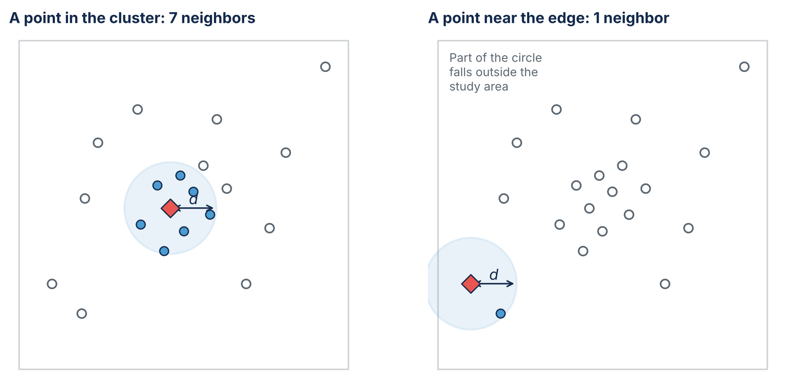
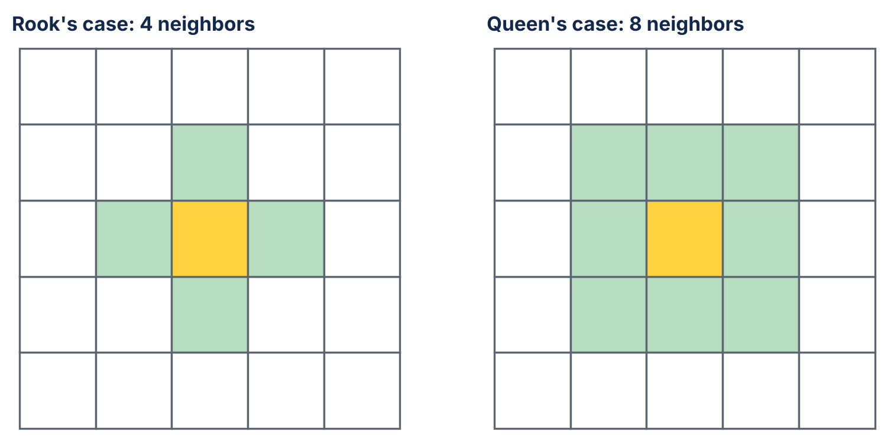
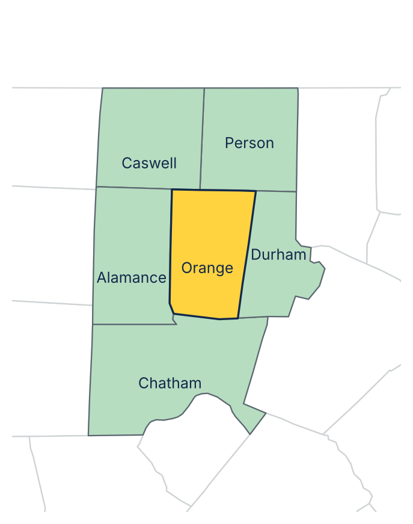
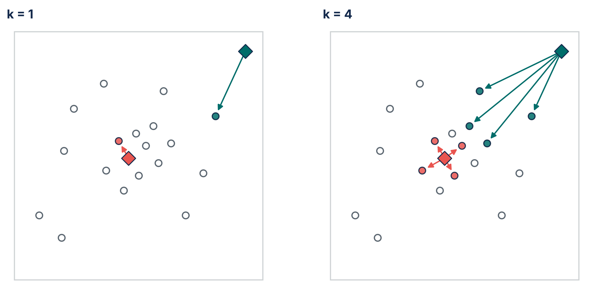
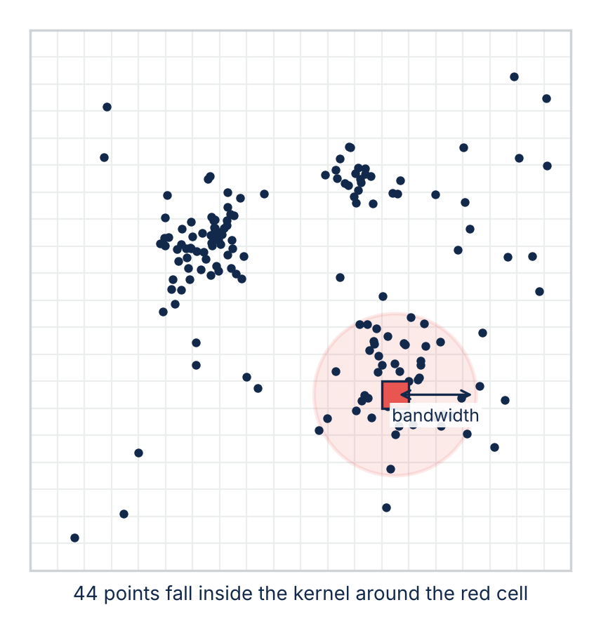
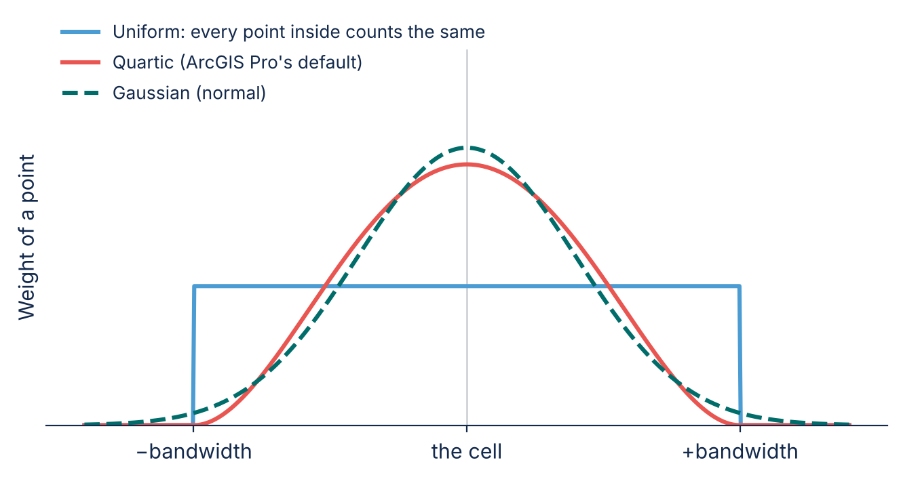
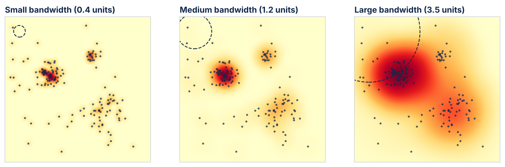

::: {.callout-note appearance="simple"}
## Learning objectives

By the end of this chapter you should be able to:

1.  Calculate a density as a count divided by an area, and explain why the choice of area changes the answer.
2.  State Tobler's first law of geography, and explain how it relates to spatial autocorrelation.
3.  Define neighborhoods by distance, by contiguity (rook's and queen's case), and by number of nearest neighbors, and name the strengths and pitfalls of each.
4.  Explain how kernel density estimation turns points into a continuous density surface.
5.  Describe how bandwidth, kernel shape, and cell size change a density surface.
6.  Run kernel density in ArcGIS Pro and QGIS, and interpret the result.
:::

Chapter 8 mapped the population density of North Carolina's counties. The counties were ready-made areas to divide by. But much of the data we care about arrives as points with no area around them: crimes, trees, cases of a disease, car crashes, or 911 calls. Where are they concentrated? To answer that, we need an area to divide by, and when no area exists, we have to define one. This chapter is about how to do that: with **neighborhoods**, and with **kernel density estimation**, which turns a set of points into a smooth surface of density.

## Density: things per area {#sec-density-ratio}

**Density** is a count divided by an area. **Population density** is the number of people divided by the area they live in. North Carolina had 10,439,388 people in the 2020 Census, so:

$$
\text{density} = \frac{10{,}439{,}388 \text{ people}}{53{,}819 \text{ mi}^2} \approx 194 \text{ people per mi}^2
$$

But 53,819 square miles is North Carolina's *total* area, including its sounds, lakes, and rivers. The Census Bureau divides by *land* area alone, 48,618 square miles, which gives 214.7 people per square mile. Same people, same state, different answer.

This is the theme of the chapter: **the area you divide by changes the density.** For a state, the choice is between total and land area. For points, there is no area at all until we define one, and every choice of area gives a different result.

::: {.callout-tip appearance="simple"}
## Think about it

Think of a place you know well in Chapel Hill. Where would you expect the most people, crimes, or trees per square mile? What area would you divide by to measure it?
:::

## Neighborhoods {#sec-neighborhoods}

### What is a neighborhood?

Ask people to describe their neighborhood, and you get three kinds of answer:

- **A distance**: "everything within a 10-minute walk."
- **Shared borders**: "my street, and the streets that touch it."
- **The nearest neighbors**: "the four houses around mine."

In spatial analysis, a **neighborhood** is a zone of analysis drawn around a location, and those are the three ways to draw it: by **distance**, by **contiguity**, or by a **number of neighbors**. We need neighborhoods because many things we map show **neighborhood effects**. A house's price tracks the prices of the houses around it; dense blocks sit next to dense blocks; species cluster in suitable habitat; and a disease spreads to nearby people first.

### Tobler's first law

Why are nearby places alike? Waldo Tobler put it in one sentence in 1970:

> "Everything is related to everything else, but near things are more related than distant things." [@tobler1970]

This is **Tobler's first law of geography**. Its measurable version is **spatial autocorrelation**: values at nearby locations are more similar (**positive** spatial autocorrelation) or more different (**negative** spatial autocorrelation) than chance would predict. Most geographic data show positive spatial autocorrelation, which is what makes maps useful: if nearby places were no more alike than distant ones, a map would look like random noise.

The law leaves open what counts as *near*. A neighborhood definition is how we decide, so the rest of this section is about making that choice explicit. None of the three definitions is correct in general. The right one depends on the process you are studying: walking distance for access to a grocery store, shared borders for a policy that spills over from one county to the next.

::: {.callout-note .did-you-know appearance="simple" icon=false}
## Did you know..?

Tobler's first law first appeared in a paper about a computer movie. In 1970, Tobler made one of the first computer-animated films in geography, simulating the growth of the Detroit region's population from 1910 to 2000. To keep the model simple, he assumed that each place was influenced most by the places closest to it, and stated the assumption as a "first law." It has been quoted, and argued over, ever since. Tobler later said he had called it a law a little tongue in cheek.
:::

### By distance

A **distance-based neighborhood** includes every location within a set radius, $d$, of the location in question (@fig-distance-neighbors). In the simplest, **binary** version, each pair of locations gets a weight of 1 if they are neighbors and 0 if they are not. Repeating this for every location builds a table of who neighbors whom, often stored as a **spatial weights matrix**.

{#fig-distance-neighbors fig-alt="Two square study areas with the same 20 points. Left: a circle of radius d around a point in the middle of a cluster contains 7 other points, filled blue. Right: the same radius around a point near the left edge contains only 1 neighbor, and part of the circle falls outside the study area, labeled as such."}

Because the cutoff is a fixed distance, the data must be in a **projected coordinate system** (Chapter 4), so that $d$ is in meters or feet, not degrees.

Distance neighborhoods have two weaknesses:

- **Isolated locations may have no neighbors at all.** A point in an empty corner of the map gets nothing within $d$.
- **The edge effect.** A point near the edge of the study area has part of its circle outside the data, so it finds fewer neighbors than it should (@fig-distance-neighbors, right). Its true neighbors exist, but we never observed them. Boundary locations look less dense than they are. The fix is to collect data in a buffer beyond the study area, or to apply an edge correction.

### By contiguity

For polygons, such as counties or census tracts, we can define neighbors by **contiguity**: polygons that touch are neighbors. No distance is needed: shared borders define the neighborhood. Contiguity is a *relative*, topological measure of nearness. Two counties are neighbors because they touch, not because their centers are within some distance.

There are two ways for polygons to touch, named for chess pieces (@fig-contiguity-grid):

- In **rook's case** contiguity, neighbors share an *edge*. The rook moves only in straight lines.
- In **queen's case** contiguity, neighbors share an edge *or a corner*. The queen moves straight or diagonally. Queen's case always finds the same or more neighbors than rook's case. It is the default in many tools, such as GeoDa.

{#fig-contiguity-grid fig-alt="Two 5 by 5 grids with a yellow cell in the center. Rook's case: the four cells above, below, left, and right of it are green, 4 neighbors. Queen's case: those four plus the four diagonal cells are green, 8 neighbors."}

The neighbors that touch a polygon directly are its **first-order** neighbors. The neighbors of those neighbors are **second-order** neighbors, and so on. On real maps, few polygons meet only at a corner, so rook's and queen's case often agree. Orange County has the same five first-order neighbors either way (@fig-contiguity-nc). The famous exception is the Four Corners, where Arizona and Colorado, and Utah and New Mexico, touch only at a point.

{#fig-contiguity-nc width=60% fig-alt="A map of Orange County in yellow, surrounded by five green counties that share a border with it: Caswell and Person to the north, Durham to the east, Chatham to the south, and Alamance to the west."}

Contiguity works only for polygons, and it struggles with odd shapes and **islands**: an island, or a county split by water, may touch fewer neighbors than it is really connected to by bridges and ferries, or none at all.

### By number of neighbors

A **k-nearest-neighbor** neighborhood fixes the *number* of neighbors, $k$, instead of the distance. Each location reaches out until it has found its $k$ closest locations (@fig-knn). Distance doesn't matter, only rank: the nearest wins.

{#fig-knn fig-alt="Two square study areas with the same 20 points. k = 1: the red diamond in the cluster points to one very close neighbor; the green diamond in the upper-right corner points to one neighbor much farther away. k = 4: the red diamond points to four nearby points; the green diamond's four arrows stretch far across the map toward the cluster."}

This is both the strength and the weakness of the method. Every location gets exactly $k$ neighbors, however sparse its surroundings, so no point is left out. But an isolated point's neighbors may be far away, and not really related to it. With distance neighborhoods, the size of the neighborhood is fixed and the number of neighbors varies; with $k$ nearest neighbors, the number is fixed and the size varies with the density of points. Larger $k$ smooths the results but blurs local detail.

| Definition | Neighbors are | Works best for | Watch out for |
|---|---|---|---|
| Distance | All locations within radius *d* | Points; density estimation | Edge effects; isolated points get none |
| Contiguity | Polygons sharing an edge (rook) or an edge or corner (queen) | Polygons such as counties | Odd shapes and islands |
| *k* nearest | The *k* closest locations | Uneven or sparse points | Neighbors may be far away |

: Three ways to define neighborhoods. {#tbl-neighborhoods}

::: {.callout-tip appearance="simple"}
## Think about it

You are studying whether a county's opioid overdose rate is related to the rates in the counties around it. Which neighborhood definition would you use? What about studying whether a coffee shop's sales depend on the other coffee shops nearby?
:::

## Kernel density estimation {#sec-kde}

### From points to a surface

Density estimation almost always uses distance neighborhoods, because density is a quantity per unit of area. **Kernel density estimation (KDE)** goes one step further: it lets nearer points count more than farther ones, and it produces a continuous surface, a **raster**, rather than one value per point.

Picture a grid of cells laid over the study area (@fig-kernel-window). A **kernel**, a window with a set radius called the **bandwidth** or **search radius**, is centered on each cell in turn. At each cell, the tool:

1.  finds the points that fall inside the kernel;
2.  gives each one a weight, from the kernel's shape: more for nearby points, less for distant ones;
3.  adds up the weights and divides by the kernel's area;
4.  writes the result to that cell of the output raster.

{#fig-kernel-window width=60% fig-alt="A grid over a square study area of scattered dark points with three clusters. One grid cell in the lower right is red, with a large pale red circle around it whose radius is labeled bandwidth. A note says 44 points fall inside the kernel around the red cell."}

The result is a smooth surface whose value in each cell is the density of points around it, in points per square mile or per square kilometer. Maps of such surfaces are often called **heat maps**.

The idea was developed in statistics in the 1950s and 1960s, to estimate the shape of a distribution from a sample without assuming it was normal [@silverman1986]. Geographers applied the same idea in two dimensions.

### Kernel shape

The kernel's shape decides how much weight each point gets (@fig-kernel-shapes):

- A **uniform** kernel gives every point inside the bandwidth the same weight, like a cookie cutter. It is the simplest, and gives the same result as counting points in a circle.
- A **quartic** kernel gives the most weight to points at the center and less and less toward the edge, reaching zero at the bandwidth. It is the default in ArcGIS Pro and QGIS.
- A **Gaussian** (normal) kernel is bell-shaped, and in theory never quite reaches zero.

{#fig-kernel-shapes fig-alt="A line chart. The horizontal axis runs from minus bandwidth through the cell to plus bandwidth. The uniform kernel is a flat rectangle, equal weight everywhere inside the bandwidth. The quartic kernel is a smooth hump, highest at the cell and falling to zero at the bandwidth. The Gaussian kernel is a similar bell curve with thin tails beyond the bandwidth."}

The shape of the kernel changes the result far less than its size does [@silverman1986].

### Bandwidth

**Bandwidth** is the most important choice in kernel density estimation (@fig-bandwidths):

- A **small bandwidth** lets each point influence only a short distance. It shows local hot spots, but if it is too small, it produces a spiky surface of isolated peaks, one for each point.
- A **large bandwidth** spreads each point's influence widely. It shows the broad regional pattern, but if it is too large, it produces one smooth blob that hides the hot spots.

{#fig-bandwidths fig-alt="Three panels of the same points with a yellow-to-red density surface. Small bandwidth: tight red spots on the densest parts of each cluster and faint specks around single points. Medium bandwidth: three clear hot spots, one for each cluster, with a small dashed circle for scale. Large bandwidth: the two biggest clusters merge into one large red blob that fades across most of the map, and the small cluster disappears."}

A good bandwidth matches the scale of the process you are studying: a few blocks for street crime, several miles for wildfire ignitions. Try several, and report which you used.

### Cell size and units

The **cell size** of the output raster controls how fine the surface looks, but not the pattern. Smaller cells give a smoother-looking surface and a larger file. Because the cell size and the search radius are both distances, **project your data first.** If the data are in a geographic coordinate system, both are measured in degrees, whose length changes with latitude (Chapter 3).

::: {.callout-note .did-you-know appearance="simple" icon=false}
## Did you know..?

Kernel density surfaces are often used to direct police patrols to crime "hot spots." The method is powerful, but it can also mislead. A surface built from *reported* crimes shows where crimes were reported and recorded, which partly reflects where police were already patrolling. Sending more patrols there produces more reports, which can make the hot spot look hotter: a feedback loop. Researchers and police departments now look for ways to check hot-spot maps against other data.
:::

## Kernel density in a GIS {#sec-kde-gis}

### ArcGIS Pro

The **Kernel Density** tool (*Spatial Analyst* toolbox, *Density* toolset) needs a Spatial Analyst license.

1.  **Project your data** to a projected coordinate system, such as NC State Plane (EPSG:32119).
2.  Open **Kernel Density**, and set the **Input point or polyline features**. (It takes points or lines, not polygons.)
3.  **Population field** (optional): a field that makes one feature count more than once, for example a point that stands for an apartment building with 12 units. Use *NONE* to count each feature once.
4.  **Output cell size**: the size of each raster cell, in map units.
5.  **Search radius**: the bandwidth, in map units. If you leave it blank, the tool estimates one from the spread of the points, with a version of Silverman's rule of thumb.
6.  **Area units**: the units of the output, such as square miles.
7.  Run the tool, and symbolize the output raster with a color ramp. Compare a few search radii before you choose one.

ArcGIS Pro's **Point Density** tool is the simpler, uniform-kernel version: it counts the points in a neighborhood (a circle, rectangle, ring, or wedge) around each cell and divides by its area.

### QGIS

The **Heatmap (Kernel Density Estimation)** tool is in the *Processing Toolbox*, under *Interpolation*.

1.  Project the points, as above.
2.  Set the **Point layer** and the **Radius** (the bandwidth), in map units.
3.  Set the **Output raster size** (pixel size).
4.  Optionally, choose a **Weight from field**, and a **Kernel shape** (quartic is the default; the others are triangular, uniform, triweight, and Epanechnikov).
5.  Run the tool, and symbolize the output with *Singleband pseudocolor*.

For a quick look, without creating a new raster, set the layer's symbology to the **Heatmap** renderer, which draws a kernel density surface on the fly.

## Check your understanding

::: {.content-visible when-format="html"}

1.  North Carolina had 10,439,388 people and 48,618 square miles of land in 2020. What was its population density, in people per square mile? (one decimal) <input class='webex-solveme nospaces' size='6' data-answer='["214.7"]'/>

2.  "Near things are more related than distant things" is: <select class='webex-select'><option value='blank'></option><option value=''>Linus's Law</option><option value='answer'>Tobler's first law of geography</option><option value=''>Sturges' rule</option><option value=''>The ecological fallacy</option></select>

3.  Polygons that share only a corner are neighbors in: <select class='webex-select'><option value='blank'></option><option value=''>Rook's case only</option><option value='answer'>Queen's case only</option><option value=''>Both rook's and queen's case</option><option value=''>Neither</option></select>

4.  How many neighbors does a cell in the middle of a grid have in queen's case? <input class='webex-solveme nospaces' size='2' data-answer='["8"]'/>

5.  Which neighborhood definition guarantees every location the same number of neighbors? <select class='webex-select'><option value='blank'></option><option value=''>Distance</option><option value=''>Contiguity</option><option value='answer'>k nearest neighbors</option><option value=''>Queen's case</option></select>

6.  Points near the boundary of a study area find fewer neighbors than they should. This is the: <select class='webex-select'><option value='blank'></option><option value='answer'>Edge effect</option><option value=''>Ecological fallacy</option><option value=''>Bandwidth effect</option><option value=''>Rook's case</option></select>

7.  Which choice changes a kernel density surface the most? <select class='webex-select'><option value='blank'></option><option value=''>Kernel shape</option><option value='answer'>Bandwidth</option><option value=''>Color ramp</option><option value=''>Output file format</option></select>

8.  ArcGIS Pro's Kernel Density tool can take polygons as input. <select class='webex-select'><option value='blank'></option><option value=''>TRUE</option><option value='answer'>FALSE</option></select>

:::

::: {.content-visible unless-format="html"}
The interactive self-check questions for this chapter are in the online version of the book.
:::

## Summary

- **Density** is a count divided by an area. The area you divide by, such as total or land area, changes the answer.
- **Tobler's first law** says near things are more related than distant things. **Spatial autocorrelation** measures how much nearby values are alike.
- A **neighborhood** is a zone of analysis around a location, defined by **distance** (everything within *d*), **contiguity** (polygons that touch, in **rook's** or **queen's** case), or **number of neighbors** (the *k* nearest). Match the definition to the process you are studying.
- Distance neighborhoods suffer from the **edge effect** and leave isolated points without neighbors; contiguity struggles with islands and odd shapes; *k* nearest neighbors may reach far away.
- **Kernel density estimation** slides a **kernel** across a grid, weights the points inside by their distance, and divides by the kernel's area, producing a continuous density surface.
- **Bandwidth** matters far more than kernel shape: small bandwidths show local hot spots, large ones the regional pattern. Project your data so that cell size and bandwidth are in meters or feet.

## Exercises

1.  **Which area?** Look up the population, total area, and land area of Dare County and of Orange County, North Carolina. Compute the density of each with both areas. Why is the difference so much larger for Dare County?
2.  **Neighbors by hand.** Draw a 4 by 4 grid of cells. How many rook's case neighbors does a corner cell have? An edge cell? An interior cell? Repeat for queen's case.
3.  **County neighbors.** In QGIS or ArcGIS Pro, select the counties that touch Wake County with *Select by Location* (*touching the boundary of*, Chapter 7). How many first-order neighbors does it have? Which are its second-order neighbors?
4.  **Kernel density.** Download a set of points for Chapel Hill or another town, such as crime incidents or traffic crashes from the town's open data portal. Project them, and make kernel density surfaces with three search radii: 250, 750, and 2,000 feet. Describe how the hot spots change.
5.  **Kernels and counts.** Run ArcGIS Pro's Point Density tool and its Kernel Density tool on the same points with the same radius. Where do the two surfaces differ most, and why?
6.  **Hot spots and fairness.** Read about the debate over predictive policing. Write a paragraph on how a hot-spot map could reinforce existing patterns of policing, and what you would check before using one.

## Further reading and online resources

### Books and articles

- Tobler, "A Computer Movie Simulating Urban Growth in the Detroit Region" [@tobler1970], the source of the first law.
- Silverman, *Density Estimation for Statistics and Data Analysis* [@silverman1986], the classic text on kernel density estimation.
- *Geographic Information Analysis*, by David O'Sullivan and David Unwin [@osullivan2010], on point patterns, neighborhoods, and density.
- *GIS Fundamentals: A First Text on Geographic Information Systems*, by Paul Bolstad [@bolstad2022], on neighborhood operations and density.
- *Intro to GIS and Spatial Analysis*, by Manuel Gimond, free online, with chapters on point pattern analysis and spatial autocorrelation: <https://mgimond.github.io/Spatial/>.

### Online resources

- Esri, "How Kernel Density works": <https://pro.arcgis.com/en/pro-app/latest/tool-reference/spatial-analyst/how-kernel-density-works.htm>.
- Esri, "Kernel Density" tool reference: <https://pro.arcgis.com/en/pro-app/latest/tool-reference/spatial-analyst/kernel-density.htm>.
- Esri, "Point Density" tool reference: <https://pro.arcgis.com/en/pro-app/latest/tool-reference/spatial-analyst/point-density.htm>.
- QGIS User Guide, "Heatmap (Kernel Density Estimation)": <https://docs.qgis.org/latest/en/docs/user_manual/processing_algs/qgis/interpolation.html>.
- QGIS Tutorials, "Creating Heatmaps": <https://www.qgistutorials.com/en/docs/3/creating_heatmaps.html>.
- GeoDa, free software for exploring spatial data, neighborhoods (spatial weights), and spatial autocorrelation: <https://geodacenter.github.io>.
- GeoDa workbook, "Contiguity-Based Spatial Weights": <https://geodacenter.github.io/workbook/4a_contig_weights/lab4a.html>.
- The GIS&T Body of Knowledge, "Kernels and Density Estimation," "Spatial Autocorrelation," and "Neighborhoods": <https://www.ucgis.org/site/gis-t-body-of-knowledge>.
- Town of Chapel Hill open data portal, with police incident data: <https://opendata.townofchapelhill.org>.
- Penn State, *GEOG 586: Geographic Information Analysis*, on point pattern analysis and density: <https://courses.ems.psu.edu/geog586/>.
