::: {.callout-note appearance="simple"}
## Learning objectives

By the end of this chapter you should be able to:

1.  Explain how elevation mapping evolved from hill drawings to contour lines to digital elevation models.
2.  Tell a DEM, a DTM, and a DSM apart, and describe how lidar and radar collect elevation.
3.  Download a DEM at a suitable resolution from The National Map, and check it for problems before analysis.
4.  Calculate slope and aspect from a 3 × 3 window of elevations, and explain why the method changes the answer.
5.  Explain how a hillshade is calculated from the sun's position and the terrain, and use one under a color DEM.
6.  Work through a line-of-sight test by hand, and explain how a viewshed repeats it for every cell.
:::

Chapter 15 treated rasters in general: grids of cells, each with a value. The most widely used raster of all holds elevation. Engineers use it to route roads and pipelines, hydrologists to predict where floodwater will go, ecologists to explain why a cove forest grows on one side of a ridge and not the other, and phone companies to decide where a tower will be seen. This chapter covers where elevation data come from, how to get them, and four tools that turn elevation into answers: slope, hillshade, aspect, and viewshed. The maps use a real elevation model of Linville Gorge, in the Blue Ridge Mountains of North Carolina.

## From hill drawings to numbers {#sec-dem-history}

### Pictures of hills

Early maps showed mountains as pictures. In 1770, John Collet's *A Compleat Map of North-Carolina from an Actual Survey*, engraved by I. Bayly and published in London by S. Hooper, drew the western mountains as rows of little hills (@fig-collet). This style is **pictorial relief**. It tells you where the hills are, but not how high or how steep they are.

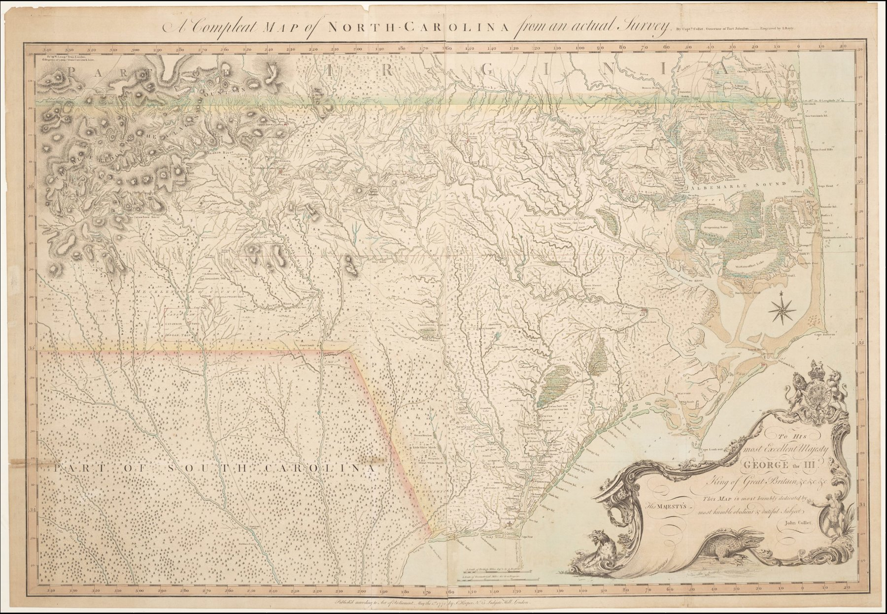{#fig-collet fig-alt="An old hand-colored map of North Carolina on cream paper, with a decorative cartouche in the lower right. Rivers are drawn in fine detail across the whole state. The western part is covered in rows of small sketched hills, and the coast has the Outer Banks and sounds. The border with South Carolina runs along the bottom." width="90%"}

Zoom in on the Piedmont near Hillsborough (@fig-collet-detail). The rivers, mills, and roads are carefully placed, because they were what settlers needed. Cane Creek Mountain is a cluster of short radiating strokes, and its size hints at how prominent it is, but no height was measured. Nobody could plan a road grade from this map.

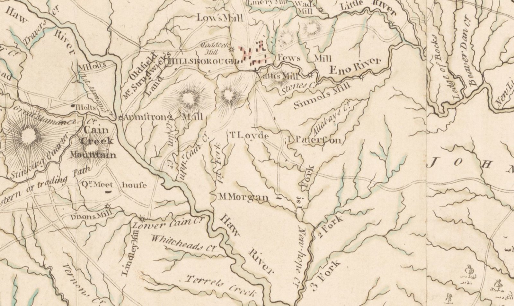{#fig-collet-detail fig-alt="A close-up of the old map. Thin wavy lines for rivers and creeks run across cream paper, with hand-lettered names including Haw River, Eno River, Hillsborough, and Cane Creek Mountain. A small group of short hatched strokes marks Cane Creek Mountain. There are no numbers for height anywhere." width="90%"}

### Contour lines

The breakthrough came from a physics experiment. In 1774, the Astronomer Royal, Nevil Maskelyne, set out to weigh the Earth by measuring how much the mass of Schiehallion, a symmetrical mountain in Scotland, pulled a plumb line sideways. To work out the mountain's volume, his team surveyed thousands of heights around it. The mathematician Charles Hutton, who had to make sense of all those numbers, joined the points of equal height with lines [@hutton1778]. The result was the **contour line**, still the basis of topographic maps (@fig-schiehallion).

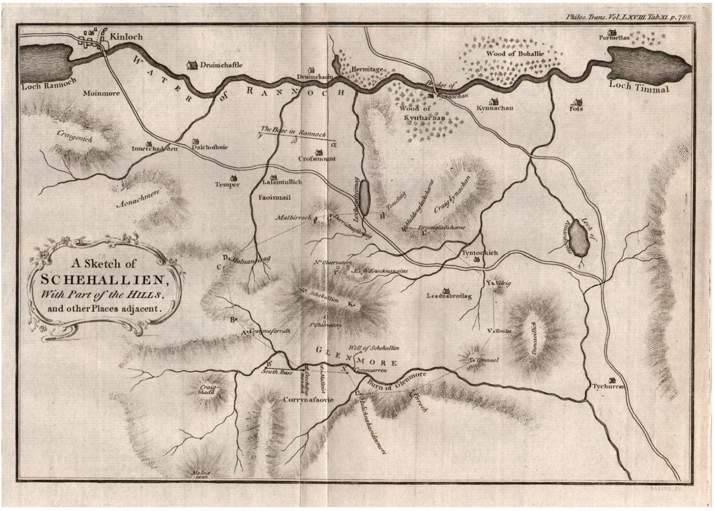{#fig-schiehallion fig-alt="An old engraved map in a black frame, titled A Sketch of Schehallien with part of the hills and other places adjacent. A river and a loch run along the top. Hills are drawn with fine shading strokes, and Schiehallion is a long ridge in the middle, with roads and a few houses around it." width="80%"}

::: {.callout-note .did-you-know appearance="simple" icon=false}
## Did you know..?

The Schiehallion experiment worked. From the plumb line's tiny deflection, Hutton estimated that the Earth is about 4.5 times as dense as water. The modern value is 5.5, so the estimate was within about 20 percent, and it was the first good evidence that the Earth's core is much denser than the rocks at its surface.
:::

### Topographic maps

National surveys made contours standard. The U.S. Coast Survey, founded in 1807, mapped the shoreline on detailed topographic sheets. The U.S. Geological Survey (USGS), founded in 1879, began mapping the whole country, and its 1:24,000 quadrangles, with contours every 10 or 20 feet, became the standard U.S. topographic map. A **topographic map** shows the shape of the land with contours, along with streams, roads, and place names (@fig-marcy).

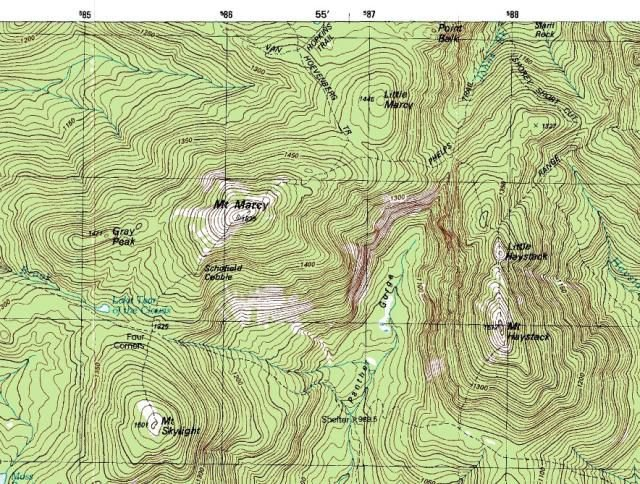{#fig-marcy fig-alt="A section of a green and brown topographic map. Brown contour lines wind across green forest. They crowd tightly around peaks labeled Mt Marcy, Little Haystack, Mt Haystack, and Mt Skylight, and spread out in the lower areas. Heavier contours have elevation labels, and blue lines show streams and a small lake." width="80%"}

To read contours:

- Every point on a contour line has the same elevation. The **contour interval** is the change in elevation from one line to the next.
- Lines close together mean a steep slope; lines far apart mean a gentle one.
- Every fourth or fifth line is a thicker **index contour**, labeled with its elevation.
- Contours bend upstream where they cross a valley, making a V that points uphill.

Contours are a vector way to show a surface. A digital elevation model is the raster way.

## What a DEM is {#sec-dem-what}

### A grid of elevations

A **digital elevation model** (DEM) is a raster in which every cell holds one elevation (@fig-contours-vs-grid). The values are usually meters above a **vertical datum**, such as the North American Vertical Datum of 1988 (NAVD 88) in the United States, which is close to mean sea level. As with any raster (Chapter 15), the **cell size**, or resolution, is a DEM's most important property: a cell shows one height, so nothing smaller than a cell can appear.

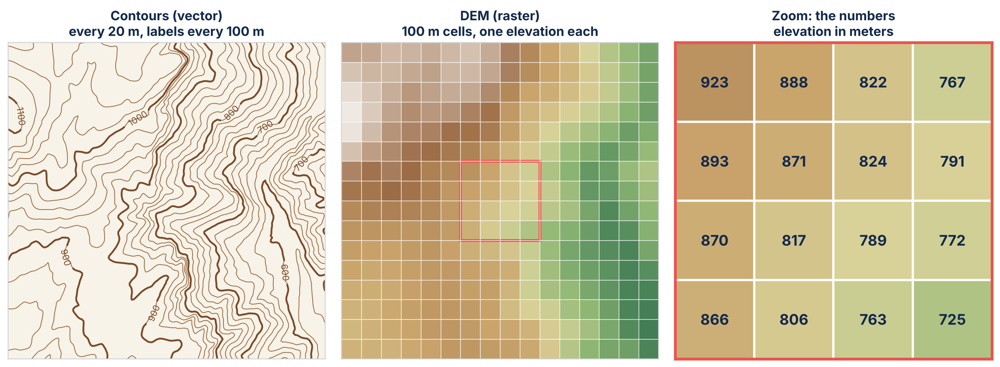{#fig-contours-vs-grid fig-alt="Three panels. Left: brown contour lines every 20 meters on a cream background, with labels every 100 meters from 600 to 1000. Middle: a 16 by 16 grid of colored squares, brown and white where high on the left, green where low on the right, with a 4 by 4 block outlined in red. Right: that block enlarged, with an elevation in meters in each cell: 923, 888, 822, 767 across the top row, down to 866, 806, 763, 725 across the bottom."}

Software can display those numbers many ways: as gray shades, as a color ramp from green to brown to white, or draped in 3D (@fig-dem-3d). The colors and the 3D view are display choices. The data underneath are just numbers.

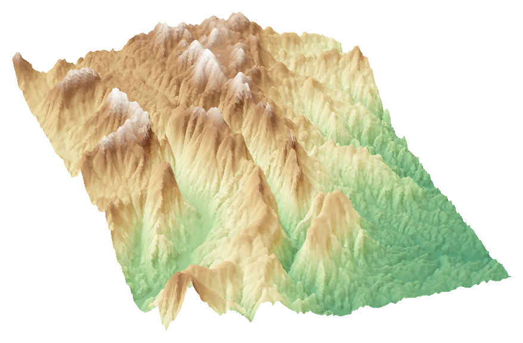{#fig-dem-3d fig-alt="A 3D view of rugged mountains. A deep, winding gorge runs from the bottom of the image toward the top, with steep brown ridges and white summits on both sides. The land to the right is lower, green, and covered in small ridges and valleys." width="85%"}

### A short history of DEMs

DEMs began in the late 1950s, when engineers at MIT proposed storing terrain as a grid of numbers for highway design, and called it a digital terrain model [@miller1958]. Early grids came from field surveys, from measuring stereo pairs of air photos (**photogrammetry**), or from tracing the contours on paper maps.

- **1986:** The French SPOT 1 satellite provided stereo images that made DEMs from space practical.
- **1996:** GTOPO30 from the USGS, the first global DEM, with cells about 1 km across.
- **2000:** The Shuttle Radar Topography Mission (SRTM) mapped most of Earth's land, between 60° N and 56° S, with radar [@farr2007].
- **Today:** The USGS **3D Elevation Program** (3DEP) keeps U.S. elevation data current, mostly with lidar.

::: {.callout-note .did-you-know appearance="simple" icon=false}
## Did you know..?

SRTM mapped about 80 percent of Earth's land in just 11 days in February 2000. The Space Shuttle *Endeavour* carried one radar antenna in its cargo bay and a second at the end of a 60 m mast, the longest rigid structure ever flown in space. With two antennas a known distance apart, the radar measured heights the way your two eyes judge depth [@farr2007].
:::

## Where elevation data come from {#sec-dem-sources}

### Lidar

**Lidar** (light detection and ranging) is now the main source of new elevation data in the United States. A scanner on an aircraft or drone fires hundreds of thousands of laser pulses a second, and times how long each takes to bounce back. Combined with the aircraft's exact position from GPS, each return becomes a point with x, y, and z coordinates. Millions of them make a **point cloud**.

One pulse can come back several times (@fig-dem-dsm). The **first return** comes from the first thing the pulse hits: a treetop, a roof, or a power line. Some of the light passes through gaps in the canopy and reaches the ground, and that **last return** comes from the bare earth. That is why lidar can map the ground under a forest, which air photos can't. Lidar for 3DEP must have a vertical accuracy of 10 cm or better (as a root mean square error), and newer collections are better still.

::: {.callout-note .did-you-know appearance="simple" icon=false}
## Did you know..?

Lidar has found lost cities. In 2016, a lidar survey of about 2,100 km² of jungle in northern Guatemala revealed more than 60,000 Maya structures hidden under the trees, including houses, causeways, farm terraces, and defensive walls. Archaeologists had walked the area for a century without seeing most of them [@canuto2018].
:::

### DEM, DTM, and DSM

The three terms are often used loosely, so it helps to define them carefully (@tbl-dem-dsm).

| Term | Full name | What it includes |
|---|---|---|
| DEM | Digital elevation model | The general term; in U.S. practice, usually the bare-earth surface |
| DTM | Digital terrain model | Bare earth, plus terrain features such as ridge lines and stream lines |
| DSM | Digital surface model | The first surface a sensor hits: roofs, tree canopies, and power lines |

: Three kinds of elevation model. {#tbl-dem-dsm}

A **digital terrain model** (DTM) adds **breaklines**, lines along ridges, streams, and road edges where the slope changes sharply, so that the surface keeps those features crisp. A **digital surface model** (DSM) is made from first returns (@fig-dem-dsm).

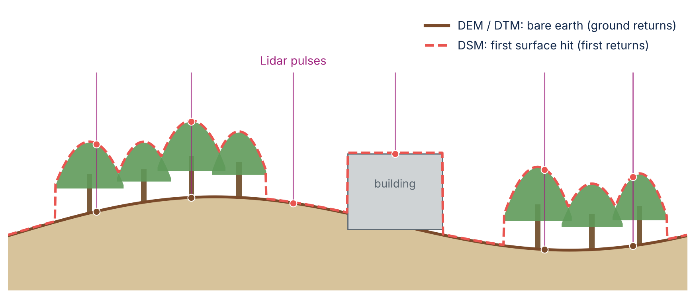{#fig-dem-dsm fig-alt="A side view of rolling ground with two groups of trees and a gray building. Vertical purple lines are lidar pulses. Red dots mark where each pulse first hits a treetop, the roof, or bare ground, and brown dots mark where pulses through the trees reach the ground. A dashed red line, the DSM, runs over the tree crowns and the roof. A solid brown line, the DEM, follows the ground under everything."}

Choose the surface to match the question:

- Use a **DEM or DTM** for water: flow, flooding, and watersheds. Water runs over the ground, not over the treetops.
- Use a **DSM** for anything that light or radio waves travel through: line of sight, solar exposure, and 3D city models.

### Why elevation matters

Governments spend billions of dollars mapping height because terrain controls so much:

- **Hydrology.** Floodplain maps, watersheds, and where water will flow all come from DEMs.
- **Infrastructure.** Highway engineers use DEMs to balance "cut and fill," the earth removed from hills and used to fill hollows.
- **Hazards.** Landslides start on steep slopes, and lava and debris flows follow valleys.
- **Telecommunications.** Cell towers and radio links need a clear line of sight.
- **Ecology and agriculture.** Slope and the direction a slope faces control sunlight, soil moisture, and what grows where.
- **Archaeology.** Lidar DEMs reveal earthworks hidden under forests.

::: {.callout-note .did-you-know appearance="simple" icon=false}
## Did you know..?

North Carolina was the first state to map all of its land with lidar. After Hurricane Floyd flooded eastern North Carolina in 1999, the state and FEMA launched the North Carolina Floodplain Mapping Program, which flew lidar over all 100 counties between 2001 and 2005 to redraw the state's flood maps. The state has since flown it again, and the data are free on NC OneMap.
:::

## Getting a DEM {#sec-dem-getting}

### The National Map

In the United States, the place to start is **The National Map Downloader** from the USGS (<https://apps.nationalmap.gov/downloader/>). Its elevation data come from 3DEP, cover the whole country, and are free and in the public domain.

1.  Zoom to your study area, and draw a box around it (or use the current map extent).
2.  Under **Data**, check **Elevation Products (3DEP)**, then the resolution you need.
3.  Click **Search Products**. The results list GeoTIFF tiles, which you can download one at a time or as a batch.
4.  If your area spans several tiles, combine them with Mosaic to New Raster (ArcGIS Pro) or Merge (QGIS).

### Resolution

3DEP offers several standard resolutions (@tbl-3dep). Resolutions in **arc-seconds** are cell sizes measured in degrees of latitude and longitude: an arc-second is 1/3,600 of a degree, about 30 m on the ground.

| Product | Cell size | Coverage |
|---|---|---|
| 1 arc-second | About 30 m | The whole United States |
| 1/3 arc-second | About 10 m | The lower 48 states, Hawaii, and parts of Alaska |
| 1/9 arc-second | About 3 m | Limited areas |
| 1 meter | 1 m | Areas with lidar, a growing share of the country |
| 5 meter | 5 m | Alaska only |

: USGS 3DEP elevation products. {#tbl-3dep}

Smaller cells show more detail, but the files grow fast. Cutting the cell size to a third, from 30 m to 10 m, makes 3 × 3 = 9 times as many cells (@fig-resolution). The 1/3 arc-second DEM is the usual choice for county-scale work; the 1 m DEM is best for a site, a neighborhood, or a stream reach.

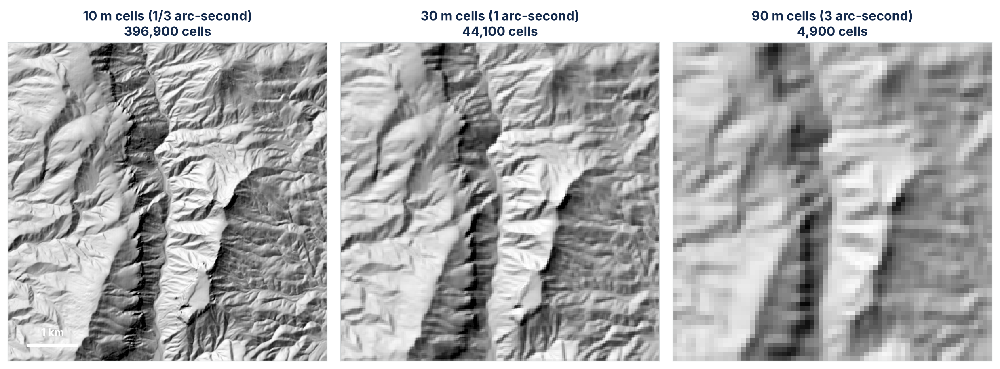{#fig-resolution fig-alt="Three gray shaded-relief maps of the same rugged area. At 10 meters, 396,900 cells, small gullies and ridges are crisp. At 30 meters, 44,100 cells, the main ridges and the gorge are clear but small details are soft. At 90 meters, 4,900 cells, the land is blocky and blurred, and only the largest ridges can be made out."}

### Global DEMs

Outside the United States, start with a global DEM (@tbl-global-dems). All three common free ones have cells of about 30 m. Inside the United States, 3DEP is better than any of them.

| Dataset | Cell size | Coverage | Made by |
|---|---|---|---|
| SRTM (2000) | 30 m | 60° N to 56° S | NASA and NGA |
| ASTER GDEM v3 (2019) | 30 m | 83° N to 83° S | NASA and Japan's METI |
| Copernicus GLO-30 | 30 m | All land | European Space Agency and Airbus |
| USGS 3DEP | 1–30 m | United States | USGS |

: Free DEMs for areas outside the United States. {#tbl-global-dems}

SRTM has gaps in steep mountains, where the radar couldn't see the far side of ridges. ASTER GDEM, built from stereo satellite images, reaches farther north and south but has more artifacts, especially under clouds. **Copernicus GLO-30**, made from the TanDEM-X radar mission, is generally the most accurate of the three and has the fewest gaps. It is a DSM, though: in forests and cities, it shows the tops of trees and buildings.

### Check a DEM before you use it

A DEM can have problems, and every tool you run on it inherits them. A quick hillshade (@sec-hillshade) is the fastest way to spot them.

- **Voids** are NoData holes, common in radar DEMs over steep mountains and water. Fill them from another source or by interpolation before analysis.
- **Sinks** are cells lower than all their neighbors. Most are errors, and they trap modeled water, which breaks flow direction and watershed tools. Hydrologists remove them with the **Fill** tool first [@jenson1988].
- **Artifacts** such as stripes, seams between tiles, and patterns from interpolation show up clearly in hillshades.
- **Units.** If x and y are in degrees but z is in meters, every slope comes out nearly vertical (@fig-units-mistake). Project the DEM to a coordinate system in meters, such as UTM or NC State Plane, or set a **z-factor**, a multiplier that converts z into the units of x and y.

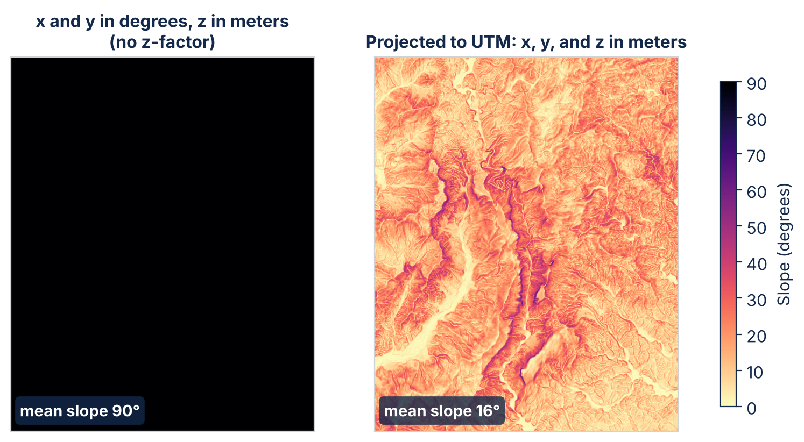{#fig-units-mistake fig-alt="Two slope maps of the same area with one color bar from 0 to 90 degrees. Left: solid black, labeled x and y in degrees, z in meters, no z-factor, mean slope 90 degrees. Right: a detailed map in pale yellow, orange, and purple, labeled projected to UTM, mean slope 16 degrees, with the steepest slopes in purple along the gorge."}

The units mistake is the most common one students make. If your slope map is almost one color, check the coordinate system first.

## Slope {#sec-slope}

### Rise over run

**Slope** is how steep the ground is: how much the elevation changes over a horizontal distance, or **rise over run**. It can be written two ways (@fig-rise-run):

- **Degrees** use the angle, where tan(angle) = rise ÷ run. Slope in degrees runs from 0 (flat) to 90 (vertical).
- **Percent** is rise ÷ run × 100. A 45° slope is 100 percent, because the rise equals the run. Percent slope has no upper limit.

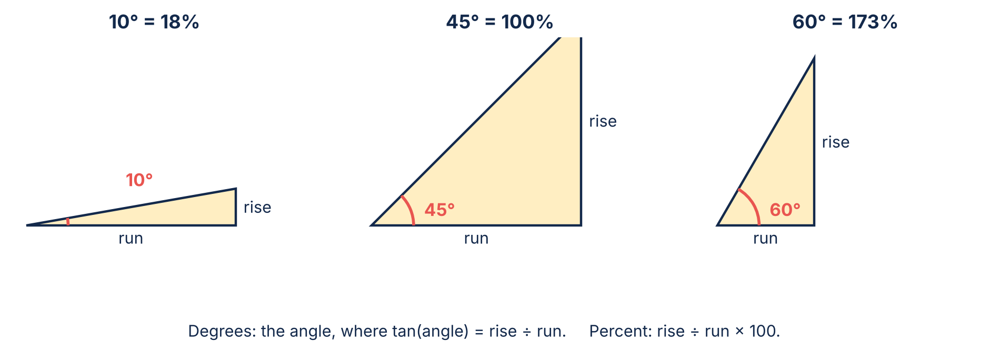{#fig-rise-run fig-alt="Three right triangles labeled rise and run. A shallow one is labeled 10 degrees equals 18 percent. A middle one with equal sides is labeled 45 degrees equals 100 percent. A steep one is labeled 60 degrees equals 173 percent."}

Road signs, building codes, and hiking guides usually give percent; most scientific work uses degrees. Always check which unit a slope layer is in.

### Slope from a grid

On a real hillside, the ground can slope in both the east–west direction and the north–south direction, and the two combine into the overall slope:

$$
\text{slope} = \arctan \sqrt{\left(\frac{dz}{dx}\right)^2 + \left(\frac{dz}{dy}\right)^2}
$$

where *dz/dx* is the rate of change in elevation from west to east, and *dz/dy* from south to north. A DEM has no smooth surface, only a grid of numbers, so the slope tool estimates *dz/dx* and *dz/dy* for each cell from a 3 × 3 window around it. Slope is a neighborhood function (Chapter 15): it moves the window across the raster and writes one value for every cell. @fig-slope-window works one window two ways, with 50 m cells.

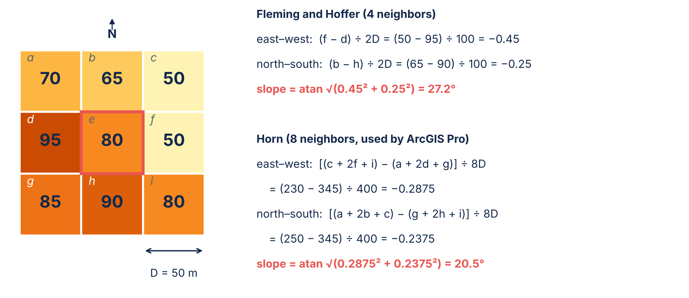{#fig-slope-window fig-alt="A 3 by 3 grid of elevations with letters a to i: top row 70, 65, 50; middle row 95, 80, 50; bottom row 85, 90, 80, with the center 80 outlined and north at the top. The cell distance D is 50 meters. To the right, the Fleming and Hoffer method uses four neighbors: east-west is 50 minus 95 over 100, or negative 0.45; north-south is 65 minus 90 over 100, or negative 0.25; slope is 27.2 degrees. Horn's method uses eight neighbors: east-west is 230 minus 345 over 400, or negative 0.2875; north-south is 250 minus 345 over 400, or negative 0.2375; slope is 20.5 degrees."}

**Fleming and Hoffer's method** uses only the four direct neighbors [@fleming1979]. The east–west change is the right neighbor minus the left, over twice the cell distance: (50 − 95) ÷ 100 = −0.45. The north–south change is (65 − 90) ÷ 100 = −0.25. The slope is arctan √(0.45² + 0.25²) = arctan 0.515 = **27.2°**.

**Horn's method** uses all eight neighbors, and counts the direct neighbors twice [@horn1981]. Each side of the window becomes a weighted sum: the east column is 50 + 2 × 50 + 80 = 230, and the west column is 70 + 2 × 95 + 85 = 345, so *dz/dx* = (230 − 345) ÷ (8 × 50) = −0.2875. The north row is 70 + 2 × 65 + 50 = 250, and the south row is 85 + 2 × 90 + 80 = 345, so *dz/dy* = (250 − 345) ÷ 400 = −0.2375. The slope is arctan √(0.2875² + 0.2375²) = **20.5°**.

The two answers differ by almost 7°. Horn's method averages over more cells, so it is less sensitive to noise in any one cell, and it is the method ArcGIS Pro's Slope tool and QGIS's Slope tool use. The lesson is broader: the method is part of the result.

### Slope in ArcGIS Pro and QGIS

In ArcGIS Pro, the **Slope** tool (Spatial Analyst) outputs degrees or percent rise. In QGIS, use **Raster Terrain Analysis ▸ Slope** or the GDAL **Slope** tool. The output has the same cell size as the DEM. In @fig-linville-slope, the steepest cells line Linville Gorge and the smaller valleys, while ridge tops and valley floors are flat.

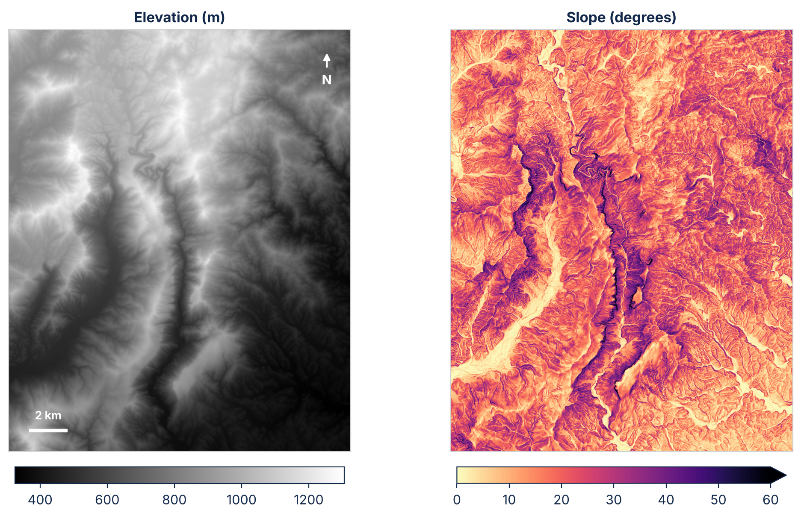{#fig-linville-slope fig-alt="Two maps of the same area. Left: elevation in gray, from about 330 meters in black to 1,300 meters in white, with a deep dark gorge running north to south down the middle and bright ridges on either side. Right: slope from 0 degrees in pale yellow to 60 degrees or more in black. The steepest slopes, in purple and black, follow the walls of the gorge and the sides of every valley, while ridge tops and the floors of valleys are pale."}

## Hillshade {#sec-hillshade}

### Sunlight on terrain

A **hillshade**, or **shaded relief**, shows how the terrain would look lit by the sun from a chosen direction and height. Slopes that face the sun are bright; slopes that face away are dark. Two properties of the sun matter (@fig-sun-geometry):

- **Azimuth** is the compass direction the light comes from, in degrees clockwise from north.
- **Altitude** is the sun's angle above the horizon.

Two properties of each cell matter too: its slope, and its **aspect**, the compass direction it faces (@sec-aspect).

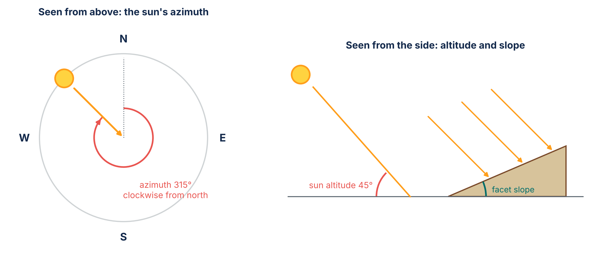{#fig-sun-geometry fig-alt="Left: a compass circle seen from above, with N, E, S, and W. A sun in the upper left shines toward the center, and a red arc runs clockwise from north all the way around to the sun, labeled azimuth 315 degrees, clockwise from north. Right: a side view. A sun in the upper left sends a ray down to the ground at 45 degrees, labeled sun altitude 45 degrees. Parallel rays hit a wedge of ground that tilts up toward the right, with its angle labeled facet slope."}

### The relative radiance equation

The brightness of each cell, its **relative radiance** *R*, comes from those four angles:

$$
R = \cos(A_s - A_f)\,\sin(S_f)\,\cos(S_s) + \cos(S_f)\,\sin(S_s)
$$

where *A~s~* is the sun's azimuth, *A~f~* is the cell's aspect, *S~s~* is the sun's altitude, and *S~f~* is the cell's slope. When a cell faces the sun, cos(*A~s~* − *A~f~*) is 1 and the cell is bright. When it faces directly away, that term is −1, and the cell is dark, or in shadow if *R* drops below 0.

ArcGIS Pro's **Hillshade** tool scales *R* to the range of an 8-bit image, from 0 (full shadow) to 255 (full sunlight). Take the center cell of @fig-slope-window, which has a slope of 20.5° and faces 50° (northeast; see @sec-aspect), lit from 315° at 45°. Then *R* = cos(265°) × sin(20.5°) × cos(45°) + cos(20.5°) × sin(45°) = −0.023 + 0.663 = 0.639, and 0.639 × 255 = **163**, a medium-light gray. The cell faces almost at right angles to the sun, so most of its brightness comes from the sun being high.

### Which way should the light come from?

The default sun in ArcGIS Pro and QGIS is at azimuth 315° (the northwest) and altitude 45°. Real sunlight in North Carolina never comes from the northwest, but cartographers light maps from the upper left because that is how most people expect shadows to fall [@imhof1982]. Light a map from the south or southeast, and many readers see the terrain upside down: valleys look like ridges, and ridges like valleys (@fig-linville-hillshade). This illusion is called **relief inversion**.

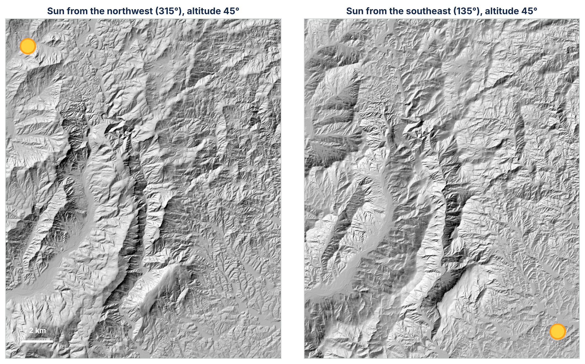{#fig-linville-hillshade fig-alt="Two gray shaded-relief maps of the same rugged area, each with a small yellow sun. Left: the sun is in the upper left corner, and the deep gorge down the middle reads clearly as a valley. Right: the sun is in the lower right corner, and the same gorge and valleys look raised, like ridges."}

A hillshade is mostly for seeing terrain, not measuring it. Its most common use is under a semi-transparent color DEM, so that the color shows the height and the shading shows the shape of the land (@fig-shaded-relief). Almost every topographic basemap is made this way. ArcGIS Pro's Hillshade tool also has a **Model shadows** option that casts shadows from neighboring terrain, which is useful for solar analysis.

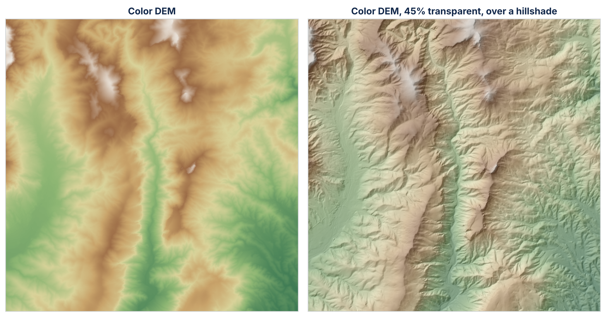{#fig-shaded-relief fig-alt="Two maps of the same area with the same colors, green for low ground, tan and brown for higher ground, and white for the highest peaks. Left: the color DEM alone looks flat and smooth. Right: the same colors over a hillshade show every ridge, valley, and gully in three dimensions."}

## Aspect {#sec-aspect}

### The direction a slope faces

**Aspect** is the compass direction a slope faces: the direction water would run straight downhill. It is measured in degrees clockwise from north, so 0° (or 360°) is north, 90° is east, 180° is south, and 270° is west. It is often grouped into eight compass directions, N, NE, E, SE, S, SW, W, and NW, each 45° wide. Flat cells have no aspect, and ArcGIS Pro gives them −1.

Aspect matters wherever the sun does. In the Northern Hemisphere, south-facing slopes get the most sun: they are warmer and drier, lose snow first, and are best for solar panels and vineyards. North-facing slopes are cooler and moister. In the North Carolina mountains, they hold the rich cove forests and northern hardwoods.

### Aspect from a grid

Aspect uses the same two numbers as slope, *dz/dx* and *dz/dy*. Slope combines their sizes; aspect uses their direction. ArcGIS Pro computes an angle from them,

$$
\theta = \operatorname{atan2}\left(\frac{dz}{dy_{\text{S}}},\ -\frac{dz}{dx}\right)
$$

where *dz/dy~S~* is the change from north to south (the south row minus the north row), then converts θ, which is measured counterclockwise from east, into a compass bearing clockwise from north. For the window in @fig-slope-window, *dz/dx* = −0.2875 and *dz/dy~S~* = +0.2375, so θ = atan2(0.2375, 0.2875) = 39.6°, and the compass aspect is 90° − 39.6° = **50.4°**, northeast. That makes sense: the high cells are on the west and south sides of the window, so the ground falls toward the northeast.

### Mapping aspect

ArcGIS Pro's **Aspect** tool and QGIS's **Aspect** tool output degrees. The standard symbology gives each of the eight directions its own color and flat cells gray (@fig-linville-aspect). Because the meaning is carried only by color, always include a legend that names each direction, such as a compass rose, so that the map works for readers with color vision deficiency.

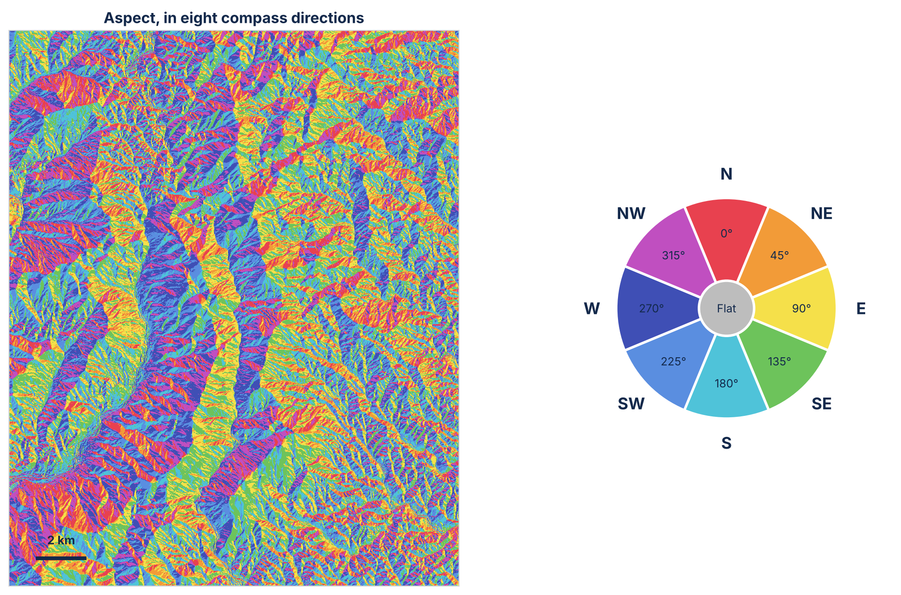{#fig-linville-aspect fig-alt="A map in bright colors, with a compass-rose legend to its right. The legend has eight wedges: N red at 0 degrees, NE orange at 45, E yellow at 90, SE green at 135, S cyan at 180, SW light blue at 225, W dark blue at 270, NW magenta at 315, and gray for flat in the center. On the map, long bands of blue and purple run along one side of each valley and bands of yellow and green along the other, so the opposite walls of the gorge are in contrasting colors."}

## Line of sight and viewshed {#sec-viewshed}

### Line of sight

A **line of sight** test asks whether one target is visible from one observer. The method:

1.  Find the direction (azimuth) from the observer to the target.
2.  Compute the **elevation angle** from the observer to the target, φ~t~ = arctan(Δz ÷ Δd), where Δz is the target's elevation minus the observer's, and Δd is the horizontal distance between them.
3.  For every cell along the line between them, compute its elevation angle, φ~a~, the same way.
4.  If the target's angle is greater than every φ~a~, the target is visible. If any cell in between has a greater angle, it blocks the view.

In @fig-line-of-sight, the observer stands at 50 m, and the target is 100 m away at 20 m. Its angle is arctan(−30 ÷ 100) = −16.7°. Point P1, 60 m away at 28 m, has an angle of arctan(−22 ÷ 60) = −20.1°, lower than the target's, so it doesn't block. Point P2, 30 m away at 43 m, has an angle of arctan(−7 ÷ 30) = −13.1°. That is *higher* than the target's −16.7°, so P2 blocks the view, and the target is not visible.

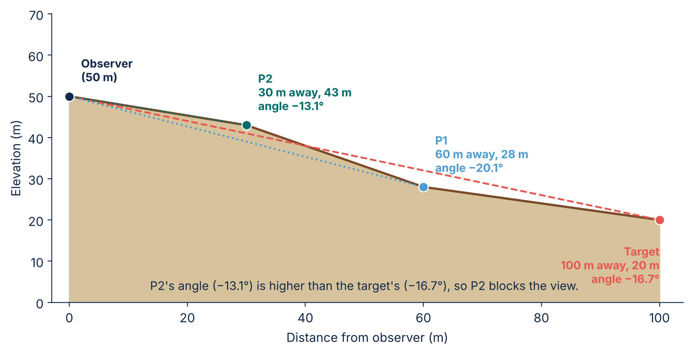{#fig-line-of-sight fig-alt="A side view of ground sloping down from left to right, with elevation in meters from 0 to 70 and distance from the observer from 0 to 100 meters. The observer is at 0 meters distance and 50 meters elevation. P2 is at 30 meters, elevation 43, angle negative 13.1 degrees. P1 is at 60 meters, elevation 28, angle negative 20.1 degrees. The target is at 100 meters, elevation 20, angle negative 16.7 degrees. A dashed red line from the observer to the target passes just under the ground at P2. Text reads: P2's angle, negative 13.1 degrees, is higher than the target's, negative 16.7 degrees, so P2 blocks the view."}

### Viewshed

A **viewshed** is the whole area visible from one or more observer points: the line-of-sight test run from the observer to every cell in the DEM. Each cell is marked visible or not visible. With several observers, the output can count how many observers see each cell.

The tools take a DEM and the observer points, plus options such as:

- **Observer height** above the ground: 1.7 m for a person's eyes, or 30 m for a tower. In ArcGIS Pro, it is the OFFSETA field of the observer points.
- **Target height**, for asking whether something tall, such as a wind turbine, can be seen.
- **Earth's curvature and refraction.** Over long distances, the Earth curves away by about 7 m at 10 km, and the atmosphere bends light back a little. ArcGIS Pro's Viewshed tool can correct for both, and the Geodesic Viewshed tool does so by default.

@fig-linville-viewshed shows what a hiker standing on Table Rock, a peak on the east rim of Linville Gorge, could see.

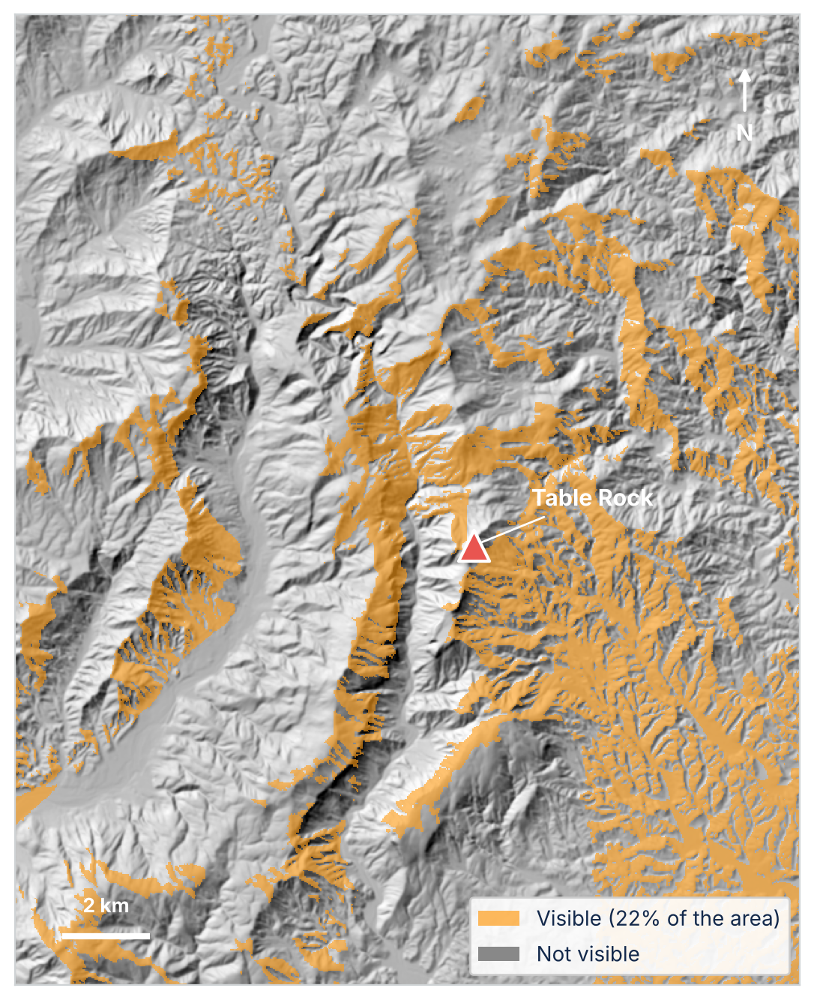{#fig-linville-viewshed fig-alt="A gray shaded-relief map of Linville Gorge with orange patches marking the visible areas and a red triangle for Table Rock, on the east side of the gorge. Much of the land to the east and southeast is visible, along with the far wall of the gorge and scattered slopes to the west and north, while the bottom of the gorge and the valleys behind nearby ridges are not visible. A legend reads visible, 22 percent of the area, and not visible."}

Two things to keep in mind. First, a bare-earth DEM ignores trees and buildings, so a viewshed on a DEM shows what you could see in winter with no leaves, or after clear-cutting. When obstructions matter, use a DSM. Second, the result is only as good as the DEM: an error of a few meters on a ridge can hide or reveal a whole valley.

::: {.callout-note .did-you-know appearance="simple" icon=false}
## Did you know..?

Viewsheds were siting fire lookouts long before GIS. The U.S. Forest Service built thousands of lookout towers in the early 1900s, choosing peaks whose views overlapped so that every part of a forest could be seen from at least one tower. Rangers drew the "seen areas" by hand, from contour maps and field checks. Today, the same question, which few sites see the most land, is answered with multiple-observer viewsheds.
:::

### Line of sight and viewshed in practice

The two tools answer different questions:

- **Line of sight** answers a yes-or-no question between two points. Can a radar station see an aircraft? Will a microwave link between two towers be blocked? Is a proposed building visible from a historic site?
- **Viewshed** answers a *where* question. Which areas can a cell tower, a fire lookout, or a wind farm be seen from? Which candidate tower site covers the most area? For siting problems, analysts run viewsheds from several candidate locations and compare how much area each one covers, often as a layer in a suitability model (Chapter 19).

## Surface tools in ArcGIS Pro and QGIS {#sec-surface-tools}

| Task | ArcGIS Pro | QGIS |
|---|---|---|
| Download a DEM | The National Map Downloader (web) | The National Map Downloader (web) |
| Combine tiles | Mosaic to New Raster | Merge (GDAL) or Build Virtual Raster |
| Project the DEM | Project Raster | Warp (Reproject) (GDAL) |
| Fill sinks | Fill (Spatial Analyst) | Fill Sinks (Wang & Liu) (SAGA), or r.fill.dir (GRASS) |
| Slope | Slope (Spatial Analyst) | Slope (Raster Terrain Analysis or GDAL) |
| Aspect | Aspect (Spatial Analyst) | Aspect (Raster Terrain Analysis or GDAL) |
| Hillshade | Hillshade (Spatial Analyst) | Hillshade (Raster Terrain Analysis or GDAL) |
| Viewshed | Viewshed or Geodesic Viewshed (Spatial Analyst) | Viewshed (GDAL), or the Visibility Analysis plugin |
| Line of sight | Line Of Sight (3D Analyst) | The Visibility Analysis plugin |
| Contours | Contour (Spatial Analyst) | Contour (GDAL) |

: Surface tools in the two programs. {#tbl-surface-tools}

ArcGIS Pro's surface tools need the Spatial Analyst or 3D Analyst extension. Its **Surface Parameters** tool can also calculate slope and aspect by fitting a smooth surface to a larger window than 3 × 3, which helps with noisy, high-resolution lidar DEMs. In QGIS, all the tools above are free; the GDAL versions also run from the command line with `gdaldem` and `gdal_viewshed`.

## Check your understanding

::: {.content-visible when-format="html"}

1.  Who first joined points of equal height with contour lines, to summarize the Schiehallion survey? <select class='webex-select'><option value='blank'></option><option value=''>John Collet</option><option value='answer'>Charles Hutton</option><option value=''>Nevil Maskelyne</option><option value=''>Berthold Horn</option></select>

2.  On a topographic map, contour lines that are very close together mean: <select class='webex-select'><option value='blank'></option><option value=''>Flat ground</option><option value='answer'>A steep slope</option><option value=''>A river</option><option value=''>An index contour</option></select>

3.  Which surface would you use to check whether a building blocks a cell tower's signal? <select class='webex-select'><option value='blank'></option><option value=''>A bare-earth DEM</option><option value=''>A DTM</option><option value='answer'>A DSM</option><option value=''>A contour map</option></select>

4.  You switch from a 30 m DEM to a 10 m DEM of the same area. About how many times as many cells does it have? <input class='webex-solveme nospaces' size='3' data-answer='["9"]'/>

5.  A slope of 45° is how many percent? <input class='webex-solveme nospaces' size='4' data-answer='["100"]'/>

6.  Your slope map from a DEM in latitude and longitude shows almost every cell near 90°. What is the most likely problem? <select class='webex-select'><option value='blank'></option><option value=''>The DEM has sinks</option><option value='answer'>x and y are in degrees but z is in meters</option><option value=''>The cell size is too small</option><option value=''>Horn's method was used</option></select>

7.  What is the default sun azimuth for a hillshade in ArcGIS Pro, in degrees? <input class='webex-solveme nospaces' size='4' data-answer='["315"]'/>

8.  A cell has an aspect of 180°. Which way does it face? <select class='webex-select'><option value='blank'></option><option value=''>North</option><option value=''>East</option><option value='answer'>South</option><option value=''>West</option></select>

9.  In a line-of-sight test, a point between the observer and the target has an elevation angle of −10°, and the target's angle is −15°. The target is: <select class='webex-select'><option value='blank'></option><option value=''>Visible</option><option value='answer'>Not visible</option></select>

:::

::: {.content-visible unless-format="html"}
The interactive self-check questions for this chapter are in the online version of the book.
:::

## Summary

- Elevation mapping moved from **pictorial relief**, to **contour lines** (Hutton, 1774), to national **topographic maps**, to **digital elevation models**.
- A **DEM** is a raster of elevations. **Cell size** sets what it can show; cutting the cell size to a third makes nine times as many cells.
- **Lidar** times laser pulses: **first returns** build a **DSM** of treetops and roofs, and ground returns build a bare-earth **DEM**. A **DTM** adds breaklines. Use bare earth for water, and a DSM for sight lines.
- U.S. DEMs come from **3DEP** through **The National Map Downloader**. Elsewhere, start with **Copernicus GLO-30**. Check every DEM for **voids**, **sinks**, artifacts, and mismatched **units** before analysis.
- **Slope** is rise over run, in degrees or percent, estimated from a 3 × 3 window. **Horn's method** (eight neighbors) is used by ArcGIS Pro and QGIS; **Fleming and Hoffer's** (four neighbors) gives a different answer.
- A **hillshade** computes brightness from the sun's **azimuth** and **altitude** and each cell's slope and aspect. Light from the northwest (315°) avoids **relief inversion**. A color DEM over a hillshade is **shaded relief**.
- **Aspect** is the direction a slope faces, 0–360° clockwise from north, from the same two partial slopes. Label every direction in the legend.
- **Line of sight** compares elevation angles along a line; a **viewshed** repeats it for every cell, from one or more observers.

## Exercises

1.  **Contours by hand.** Print a USGS topographic map of the area around your hometown from topoView. Find the steepest and the flattest places on it, and explain how you could tell from the contours alone.
2.  **Download a DEM.** Download the 1/3 arc-second DEM for Orange County, NC, from The National Map Downloader. What is its coordinate system? Project it to NC State Plane (meters) before going on.
3.  **Slope by hand.** For the window 100, 110, 120 / 100, 105, 115 / 95, 100, 110, with 10 m cells, compute the slope by Fleming and Hoffer's method and by Horn's method. Which is steeper?
4.  **Aspect by hand.** For the same window, which way does the center cell face? Explain your answer from the numbers before you calculate it.
5.  **Surface tools.** With your Orange County DEM, run Slope, Aspect, and Hillshade. Then make a shaded-relief map: put the DEM over the hillshade with a color ramp and 50 percent transparency. Where are the steepest slopes, and why there?
6.  **Relief inversion.** Make two hillshades of the same area, one lit from 315° and one from 135°. Show them to a friend without saying which is which. Which one looks right to them?
7.  **Viewshed.** Put an observer on the top of a hill or building on or near campus, with a height of 1.7 m, and run a viewshed. Then run it again with the observer 30 m higher, as if on a tower. How much more area is visible?
8.  **Global DEMs.** For a mountain range outside the United States, download SRTM and Copernicus GLO-30 from OpenTopography, and subtract one from the other with map algebra (Chapter 15). Where do they differ most, and why?

## Further reading and online resources

### Books and papers

- *GIS Fundamentals*, by Paul Bolstad [@bolstad2022]. The chapters on raster analyses and terrain analysis cover DEMs, slope, aspect, and viewsheds.
- *Principles of Geographical Information Systems*, by Peter Burrough, Rachael McDonnell, and Christopher Lloyd [@burrough2015], has a full chapter on digital elevation models and surface derivatives.
- *Terrain Analysis: Principles and Applications*, edited by John Wilson and John Gallant [@wilson2000].
- *Cartographic Relief Presentation*, by Eduard Imhof [@imhof1982], the classic book on showing terrain on maps, including hillshading and the northwest light.
- Berthold Horn, "Hill shading and the reflectance map" [@horn1981], the source of Horn's method.
- Charles Miller and Robert Laflamme, "The digital terrain model: Theory and application" [@miller1958], the first description of a DEM.
- Tom Farr and colleagues, "The Shuttle Radar Topography Mission" [@farr2007].
- Marcello Canuto and colleagues, "Ancient lowland Maya complexity as revealed by airborne laser scanning of northern Guatemala" [@canuto2018].
- Susan Jenson and Julia Domingue, "Extracting topographic structure from digital elevation data for geographic information system analysis" [@jenson1988], the method behind filling sinks.

### ArcGIS Pro

- Esri, "An overview of the Surface toolset": <https://pro.arcgis.com/en/pro-app/latest/tool-reference/spatial-analyst/an-overview-of-the-surface-tools.htm>.
- Esri, "Slope" tool reference: <https://pro.arcgis.com/en/pro-app/latest/tool-reference/spatial-analyst/slope.htm>.
- Esri, "How Slope works": <https://pro.arcgis.com/en/pro-app/latest/tool-reference/spatial-analyst/how-slope-works.htm>.
- Esri, "How Aspect works": <https://pro.arcgis.com/en/pro-app/latest/tool-reference/spatial-analyst/how-aspect-works.htm>.
- Esri, "How Hillshade works": <https://pro.arcgis.com/en/pro-app/latest/tool-reference/spatial-analyst/how-hillshade-works.htm>.
- Esri, "Viewshed" tool reference: <https://pro.arcgis.com/en/pro-app/latest/tool-reference/spatial-analyst/viewshed.htm>.
- Esri, "Line Of Sight" (3D Analyst): <https://pro.arcgis.com/en/pro-app/latest/tool-reference/3d-analyst/line-of-sight.htm>.
- Esri, "Fill" tool reference: <https://pro.arcgis.com/en/pro-app/latest/tool-reference/spatial-analyst/fill.htm>.
- Esri, "Surface Parameters" tool reference: <https://pro.arcgis.com/en/pro-app/latest/tool-reference/spatial-analyst/surface-parameters.htm>.

### QGIS and GDAL

- QGIS User Guide, "Raster terrain analysis" (Slope, Aspect, Hillshade, Ruggedness): <https://docs.qgis.org/latest/en/docs/user_manual/processing_algs/qgis/rasterterrainanalysis.html>.
- QGIS User Guide, GDAL "Raster analysis" (Slope, Aspect, Hillshade, Viewshed, Contour): <https://docs.qgis.org/latest/en/docs/user_manual/processing_algs/gdal/rasteranalysis.html>.
- QGIS Training Manual, "Terrain Analysis": <https://docs.qgis.org/latest/en/docs/training_manual/rasters/terrain_analysis.html>.
- GDAL, `gdaldem` (slope, aspect, hillshade, and color relief): <https://gdal.org/en/stable/programs/gdaldem.html>.
- GDAL, `gdal_viewshed`: <https://gdal.org/en/stable/programs/gdal_viewshed.html>.

### Elevation data

- USGS, The National Map Downloader: <https://apps.nationalmap.gov/downloader/>.
- USGS, 3D Elevation Program (3DEP): <https://www.usgs.gov/3d-elevation-program>.
- USGS, "About 3DEP Products & Services": <https://www.usgs.gov/3d-elevation-program/about-3dep-products-services>.
- USGS EarthExplorer, for SRTM, ASTER GDEM, and GTOPO30: <https://earthexplorer.usgs.gov>.
- USGS EROS, "Global 30 Arc-Second Elevation (GTOPO30)": <https://www.usgs.gov/centers/eros/science/usgs-eros-archive-digital-elevation-global-30-arc-second-elevation-gtopo30>.
- USGS EROS, "Shuttle Radar Topography Mission (SRTM) 1 Arc-Second Global": <https://www.usgs.gov/centers/eros/science/usgs-eros-archive-digital-elevation-shuttle-radar-topography-mission-srtm-1>.
- NASA JPL, "Shuttle Radar Topography Mission": <https://www2.jpl.nasa.gov/srtm/>.
- NASA JPL, ASTER Global Digital Elevation Model: <https://asterweb.jpl.nasa.gov/gdem.asp>.
- Copernicus Data Space Ecosystem, "Copernicus DEM": <https://dataspace.copernicus.eu/explore-data/data-collections/copernicus-contributing-missions/collections-description/COP-DEM>.
- OpenTopography, for global DEMs and lidar point clouds: <https://opentopography.org>.
- NOAA Digital Coast, for coastal lidar and elevation: <https://coast.noaa.gov/digitalcoast/>.
- NC OneMap, North Carolina's geospatial data portal: <https://www.nconemap.gov>.
- North Carolina Spatial Data Download, for the state's lidar and DEMs: <https://sdd.nc.gov>.
- North Carolina Floodplain Mapping Program: <https://flood.nc.gov/ncflood/>.

### Topographic maps

- USGS topoView, for current and historical topographic maps: <https://ngmdb.usgs.gov/topoview/>.
- USGS, "Historical Topographic Maps: Preserving the Past": <https://www.usgs.gov/programs/national-geospatial-program/historical-topographic-maps-preserving-past>.
- Wikipedia, "Schiehallion experiment": <https://en.wikipedia.org/wiki/Schiehallion_experiment>.

### Lidar and shaded relief

- Tom Patterson, Shaded Relief, on making terrain maps: <https://shadedrelief.com>.
- The GIS&T Body of Knowledge, including entries on DEMs and terrain analysis: <https://www.ucgis.org/site/gis-t-body-of-knowledge>.
