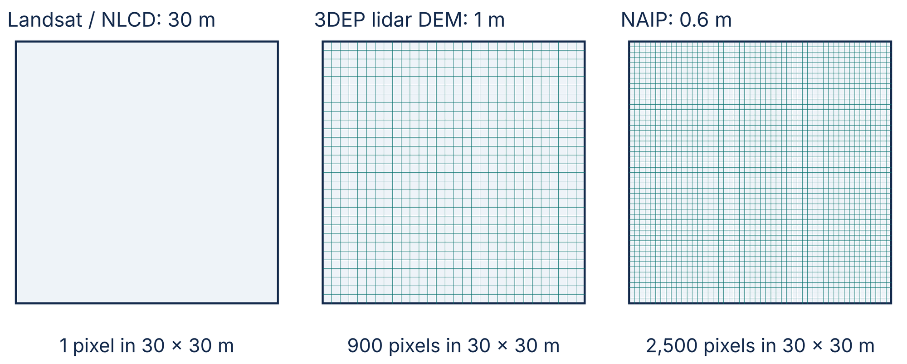
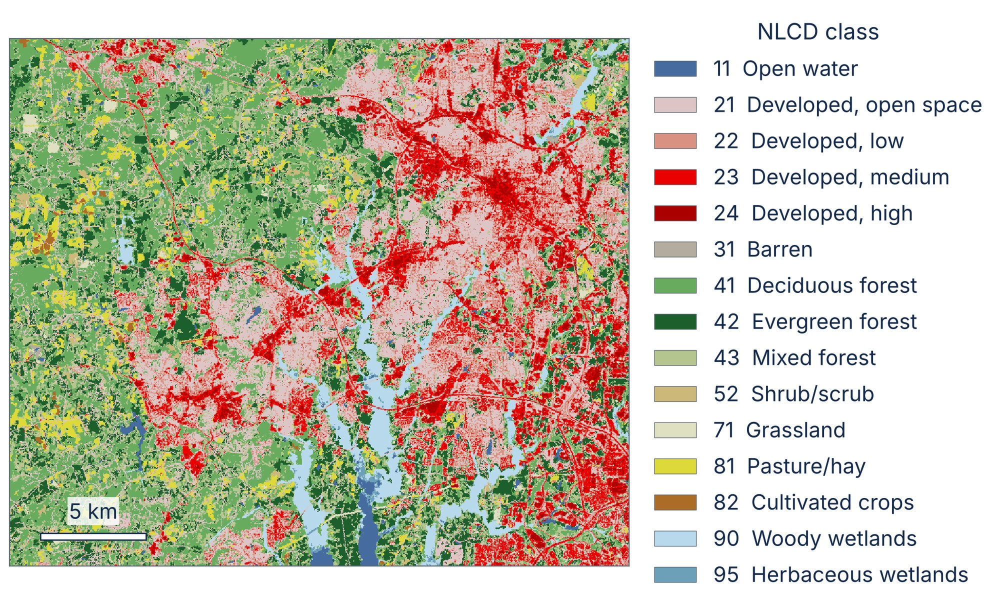
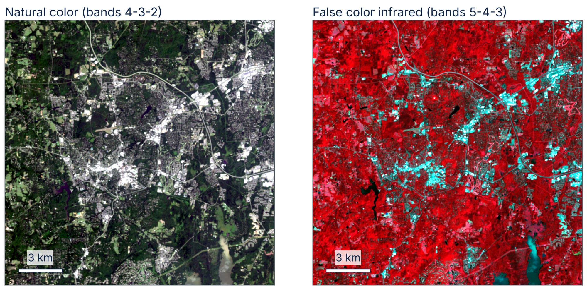
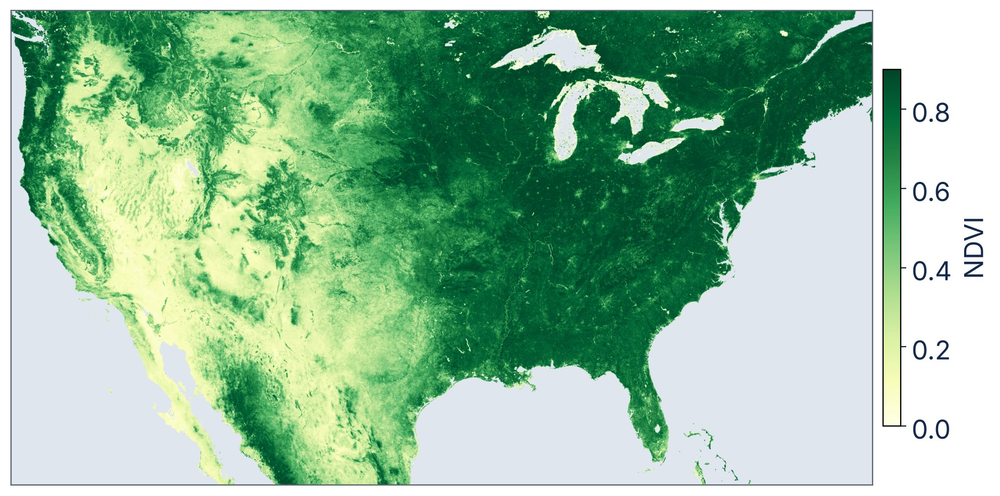
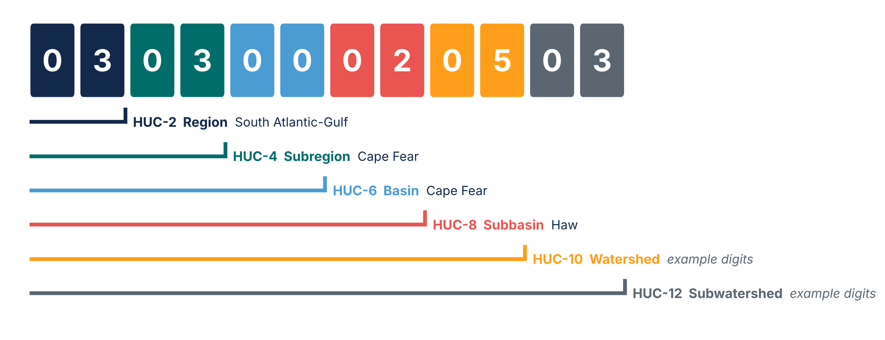
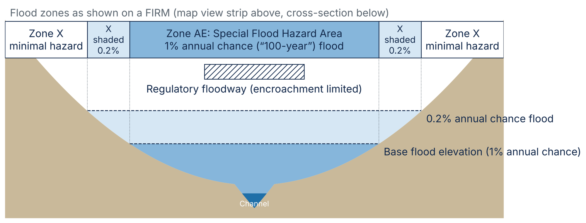
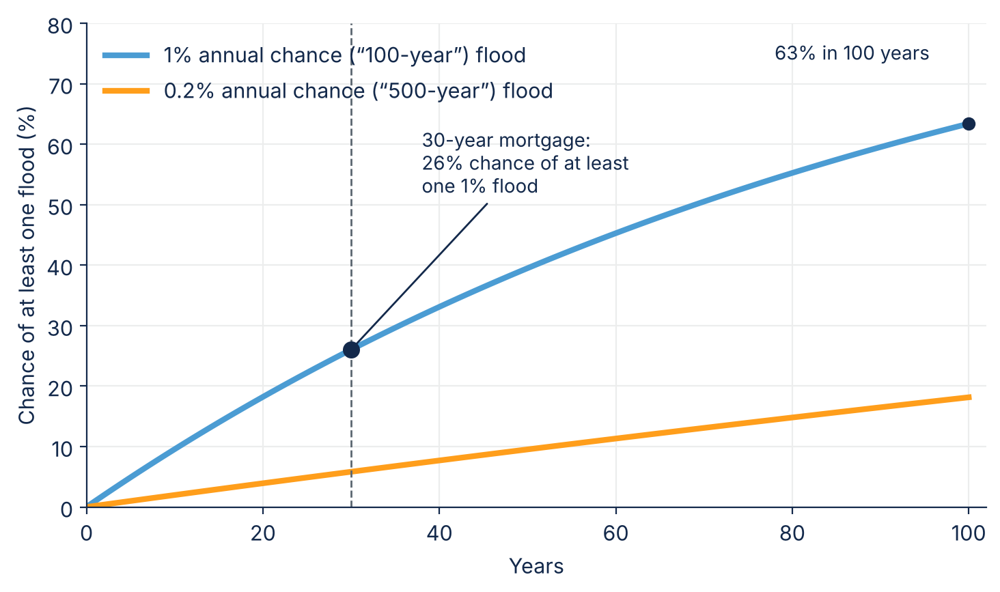
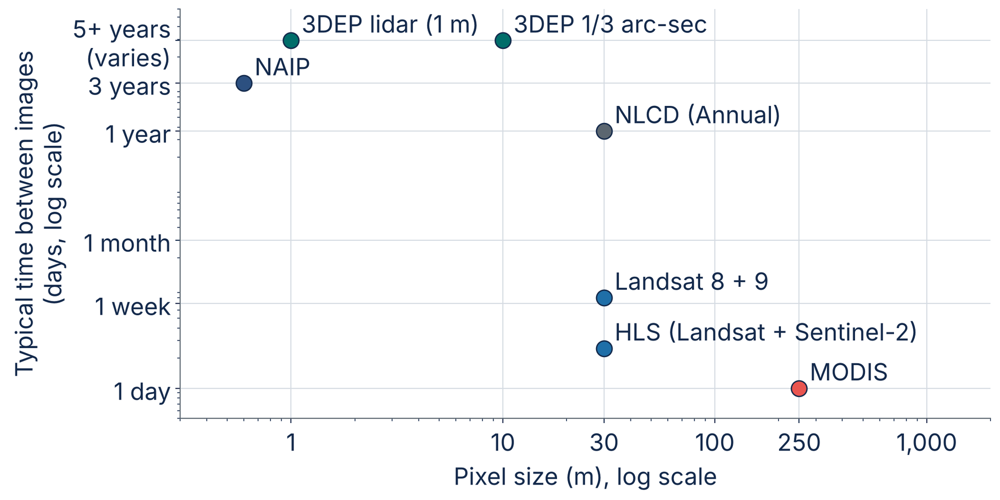

::: {.callout-note appearance="simple"}
## Learning objectives

By the end of this chapter you should be able to:

1.  Name the agency, resolution, and update cycle of the federal data sets used most in U.S. GIS work: NAIP, NLCD, Landsat, MODIS, 3DEP, NHD, the FEMA flood maps and National Risk Index, and EPA's water quality data.
2.  Choose the right data set for a question, based on its spatial and temporal resolution and its coverage.
3.  Find and download each data set from its official portal.
4.  Read the metadata of a federal data set, and cite it correctly.
5.  Recognize the limits of each data set before you use it in an analysis.
:::

Chapter 9 introduced the largest federal source of data about people, the U.S. Census Bureau. This chapter tours the other federal agencies whose data you will reach for most often: aerial photographs from the Department of Agriculture, land cover maps and elevation from the U.S. Geological Survey (USGS), satellite images from NASA, flood maps from the Federal Emergency Management Agency (FEMA), and water quality reports from the Environmental Protection Agency (EPA).

Like the census, these data are free, cover the whole country with one method, and are carefully documented. They are also easy to misuse. A land cover map can be read at a scale it was never meant for, a flood map can be years out of date, and two satellite images of the same place can measure very different things. For each data set, this chapter asks the same five questions: **who makes it, what it measures, how detailed it is, how often it is updated, and where to get it.** The answers decide whether it fits your question.

The maps in this chapter all show the area around Chapel Hill and Durham, North Carolina, so you can compare what each data set shows of the same place.

## Why start with federal data? {#sec-why-federal}

### What makes federal data different

For a project in the United States, federal data are usually the first place to look:

- **Free, and usually public domain.** Works made by employees of the U.S. government are not protected by copyright (17 U.S.C. § 105). You can download, change, and republish them without permission or fees. Some federal data sets are made with state, local, or commercial partners, though, and may carry other terms, so check the **use constraints** in the metadata.
- **National coverage with one method.** The same classification, resolution, and accuracy standard covers Maine and New Mexico, so places can be compared fairly.
- **Documented.** Federal data come with **metadata** written to standards from the Federal Geographic Data Committee (FGDC) or the International Organization for Standardization (ISO): the source, the date, the coordinate system, the accuracy, and how the data were made (Chapter 2).
- **Long time series.** Landsat has imaged the Earth since 1972, so you can measure change over half a century.
- **The basis for regulation.** Some federal data sets are legal boundaries, not just maps. FEMA's flood maps decide who must buy flood insurance, and EPA's lists of impaired waters decide where pollution must be cut.

Public domain does not mean anonymous. Good practice, and most agencies, ask you to **cite** the data: the agency, the product, its version or date, and when you downloaded it. @sec-good-practice shows how.

::: {.callout-note .did-you-know appearance="simple" icon=false}
## Did you know..?

Until 2008, a single Landsat scene could cost hundreds of dollars, and the USGS distributed only a few thousand scenes a year, most of them to a few large research groups. When the USGS opened the whole archive for free in 2008, downloads jumped to millions of scenes a year. Wulder and colleagues called it a turning point for Earth science: studies that once used a handful of images, such as global maps of forest loss, could now use hundreds of thousands [@wulder2012].
:::

### Where federal geodata live

Each agency runs its own download portal (@tbl-portals). Most also publish **web services**, such as Web Map Services (WMS) and ArcGIS REST services, that you can add straight to ArcGIS Pro or QGIS without downloading anything. Services are quick for a basemap or a look around; for analysis, download the data so that you know exactly which version you used.

| Portal | Agency | Best for |
|--------|--------|----------|
| The National Map Downloader (apps.nationalmap.gov/downloader) | USGS | 3DEP elevation, NHD streams, watershed boundaries, boundaries, US Topo maps |
| EarthExplorer (earthexplorer.usgs.gov) | USGS | Landsat, NAIP, historical aerial photos, Annual NLCD |
| Earthdata Search (search.earthdata.nasa.gov) | NASA | MODIS, VIIRS, HLS, and other NASA missions |
| MRLC (mrlc.gov) | USGS-led consortium | NLCD land cover, impervious surface, tree canopy |
| FEMA Flood Map Service Center (msc.fema.gov) | FEMA | Flood Insurance Rate Maps and the National Flood Hazard Layer |
| data.gov and GeoPlatform.gov | Many agencies | Searching the catalogs of every agency at once |

: The portals used in this chapter. {#tbl-portals}

Some portals ask you to sign in. EarthExplorer needs a free USGS account, and every NASA archive uses one free **Earthdata Login**.

## Imagery and land cover {#sec-imagery-landcover}

### NAIP: aerial photographs of the whole country

The **National Agriculture Imagery Program (NAIP)** photographs the lower 48 states from aircraft during the growing season. It is run by the U.S. Department of Agriculture's Aerial Photography Field Office, in Salt Lake City, and has flown since the early 2000s.

- **Resolution:** 60 cm pixels in recent years (1 m in older years).
- **Bands:** four, red, green, blue, and **near-infrared** (NIR). The near-infrared band shows healthy vegetation brightly, so NAIP can make false-color images (@sec-landsat).
- **Update cycle:** each state is flown about every 3 years, some more often. Imagery is collected state by state, so two neighboring states may come from different years.
- **Download:** USGS EarthExplorer (as tiles called Digital Ortho Quarter Quads, each a quarter of a 7.5-minute topographic quadrangle), the USDA Geospatial Data Gateway (county mosaics), and cloud copies on Amazon Web Services and Microsoft's Planetary Computer.

NAIP was built to check that farmers were following the rules of federal farm programs during the growing season, so it is flown **leaf-on**, when trees are in full leaf. That makes it excellent for mapping vegetation and tree canopy, and poor for seeing the ground, streams, or sidewalks under trees. Its sharp detail makes NAIP a favorite basemap for digitizing buildings, roads, and parcels, and for mapping tree canopy and **impervious surfaces** such as roofs and pavement.

### How fine is 60 cm?

The **spatial resolution** of a raster is the ground size of one pixel. A 30 m Landsat pixel covers 900 m². The same square holds 900 one-meter lidar DEM pixels, and 2,500 NAIP pixels (@fig-pixel-size).

{#fig-pixel-size fig-alt="Three squares of the same size. The first, labeled Landsat / NLCD: 30 m, is a single empty square, 1 pixel in 30 by 30 m. The second, 3DEP lidar DEM: 1 m, is divided by a fine grid into 900 pixels. The third, NAIP: 0.6 m, has an even finer grid of 2,500 pixels."}

Finer pixels show more, but they cost more. The number of pixels rises with the square of the resolution, so halving the pixel size makes four times as many pixels. A NAIP mosaic of one county can take tens of gigabytes, while the National Land Cover Database for the whole lower 48 takes about 1.6 GB, because each of its pixels covers 2,500 times as much ground. **Match the resolution to the size of the features in your question.** Buildings, sidewalks, and single trees need NAIP or lidar. Land use change across a region needs Landsat or NLCD; NAIP would bury the pattern in detail and data.

### NLCD: the National Land Cover Database

The **National Land Cover Database (NLCD)** is the standard land cover map of the United States. It is made by the **Multi-Resolution Land Characteristics (MRLC) consortium**, a group of federal agencies led by the USGS, by classifying Landsat images.

- **Resolution:** 30 m cells, matching Landsat.
- **Classes:** 16 in the lower 48 states, based on the Anderson Level II classification (@fig-nlcd). Each class has a two-digit code: the first digit is the broad group (1 water, 2 developed, 4 forest, 8 agriculture, 9 wetlands), and the second the class within it. Chapter 17 uses these codes in its reclassification examples.
- **Update cycle:** the **Annual NLCD**, released starting in 2024, maps every year from 1985 on with one consistent method. The older, "classic" editions (2001, 2004, 2006, 2008, 2011, 2013, 2016, 2019, and 2021) came every 2 to 3 years.
- **Companion layers:** **fractional impervious surface** (the percentage of each cell covered by roofs and pavement), **tree canopy cover** (a percentage, made by the U.S. Forest Service), and layers of land cover change.
- **Download:** the MRLC website's viewer and data page, which can clip the data to your area, or EarthExplorer for the Annual NLCD.

{#fig-nlcd fig-alt="A land cover map with a legend of 15 NLCD classes. Pink and red developed land covers the center and east of the map, densest in dark red patches in Durham to the northeast. Thin red lines of developed pixels follow the highways. Green forest covers the west. A long, branching pale-blue area of woody wetlands and dark-blue open water runs north from the bottom of the map: Jordan Lake. A 5 km scale bar is at the lower left."}

Look closely at @fig-nlcd and you can see the 30 m cells. Highways show up as lines of developed pixels, and each cell carries a single class: the dominant cover in that 30 by 30 m square.

The four developed classes are defined by **percent impervious surface**, not by zoning or population: *Developed, Open Space* has less than 20 percent, *Low Intensity* 20 to 49 percent, *Medium Intensity* 50 to 79 percent, and *High Intensity* 80 to 100 percent. Open Space is mostly lawns, golf courses, parks, and the grassy margins of highways, not necessarily public parks.

NLCD is very good, but not perfect. Accuracy assessments, which compare the map with interpreted high-resolution photographs at thousands of sample points, find an overall accuracy in the 80 percent range for the detailed classes, and higher for the broad groups [@wickham2021]. Water and developed land are mapped reliably. Classes that look alike from space, such as grassland and pasture, or the different kinds of wetland, are confused far more often.

### Using NLCD well

- **One label per cell.** Classes are mutually exclusive, even where a cell is a mix of house, lawn, and trees.
- **Compare years within one product.** For a change study, use the Annual NLCD for every year. Mixing a classic edition with an annual one mixes methods, and the "change" you find may be a change in method.
- **Summarize by zone.** To find the share of each class in a tract, watershed, or county, use Zonal Statistics or Tabulate Area (Chapter 17), as in the tutorial in @sec-federal-tutorial.
- **Keep it in an equal-area projection.** NLCD comes in an Albers Equal Area Conic projection, so every cell has the same area. Keep it there when you measure area (Chapter 4).
- **Report the right year.** Cite the year the land cover describes, and the edition or collection, not the year it was released.

::: {.callout-tip appearance="simple"}
## Think about it

Find where you live in @fig-nlcd, or open the MRLC viewer and find it there. What class is your block? Does that class describe it well? What would a 30 m cell miss about your street?
:::

## NASA satellite data {#sec-nasa}

### Landsat: more than 50 years of Earth observation {#sec-landsat}

**Landsat** is a joint mission of NASA, which builds and launches the satellites, and the USGS, which runs them and keeps the archive. Landsat 1 launched in 1972, and Landsat 8 (2013) and Landsat 9 (2021) operate today. It is the longest continuous record of the Earth's land surface from space.

- **Resolution:** 30 m for the multispectral bands, 15 m for the panchromatic (black and white) band, and 100 m for the thermal bands.
- **Revisit:** each satellite passes over the same place every 16 days; together, Landsat 8 and 9 image it every 8 days, when clouds allow.
- **Download:** USGS EarthExplorer, with cloud copies on Amazon Web Services, Google Earth Engine, and Microsoft's Planetary Computer. Images are organized by a grid of **paths and rows** (the Worldwide Reference System 2); Chapel Hill is in path 16, row 35.
- **Which product:** for most analysis, use **Collection 2 Level-2 surface reflectance**, which has been corrected for the haze and scattering of the atmosphere, so that values from different dates can be compared.

Landsat is a **multispectral** sensor: it records separate images, called **bands**, for different wavelengths of light, including some the eye can't see. A color image puts three bands into the red, green, and blue channels of the screen (@fig-landsat). In **natural color**, those are the red, green, and blue bands, and the image looks like a photograph. In **false color infrared**, the near-infrared band goes into the red channel. Healthy plants reflect near-infrared light strongly, so vegetation glows red, while water, which absorbs near-infrared light, turns almost black.

{#fig-landsat fig-alt="Two satellite images of the same area side by side, each with a 3 km scale bar. The left image, natural color bands 4-3-2, shows dark green forest, gray and white developed areas along highways, and a brownish lake at the bottom. The right image, false color infrared bands 5-4-3, shows the same scene with all vegetation in bright red, buildings and pavement in cyan, and lakes in black."}

In the false color image, lawns, forest, and pavement are far easier to tell apart. That contrast between red and near-infrared light is also the basis of the **normalized difference vegetation index (NDVI)**:

$$
\text{NDVI} = \frac{\text{NIR} - \text{Red}}{\text{NIR} + \text{Red}}
$$

NDVI is map algebra (Chapter 17) on two bands. It ranges from −1 to 1. Dense, healthy vegetation is above about 0.6, bare ground and pavement are near 0.1, and water is negative (@fig-ndvi-grid).

{#fig-ndvi-grid fig-alt="Three 3 by 3 grids of numbers. Red reflectance: 0.04, 0.05, 0.12; 0.05, 0.20, 0.25; 0.06, 0.18, 0.05. Near-infrared reflectance: 0.45, 0.50, 0.28; 0.48, 0.26, 0.30; 0.40, 0.24, 0.02. NDVI: 0.84, 0.82, 0.40; 0.81, 0.13, 0.09; 0.74, 0.14, minus 0.43. NDVI cells are shaded dark green for high values, pale yellow near 0.1, and orange for the negative value."}

### MODIS and VIIRS: a new image every day

Landsat trades time for detail. The **Moderate Resolution Imaging Spectroradiometer (MODIS)** makes the opposite trade. MODIS flies on two NASA satellites, Terra (launched in 1999) and Aqua (2002).

- **Resolution:** 36 bands at 250 m, 500 m, and 1 km.
- **Revisit:** it images the whole Earth every 1 to 2 days.
- **Products:** rather than raw images, most users download ready-made products, such as NDVI, land surface temperature, snow cover, active fires, and burned area. Product names follow a pattern: MOD for Terra, MYD for Aqua, and MCD for the two combined. MOD13A1, for example, is Terra's 16-day, 500 m vegetation index.
- **Download:** NASA Earthdata Search; AppEEARS, which clips products to a point or polygon; and Worldview, for browsing daily images.

Coarse pixels and daily images make MODIS ideal for anything large and fast-changing: the green-up of vegetation in spring, drought, wildfire, and snow (@fig-modis). Terra and Aqua are now long past their design lives and drifting in their orbits, so NASA and NOAA are moving users to the **Visible Infrared Imaging Radiometer Suite (VIIRS)**, which flies on the Suomi NPP, NOAA-20, and NOAA-21 satellites and continues most MODIS products.

{#fig-modis fig-alt="A map of the contiguous United States shaded from pale yellow (NDVI 0) to dark green (NDVI 0.8 and above). The eastern half of the country is almost entirely dark green. The Great Plains fade to lighter green, and much of the West, from Nevada to Arizona and west Texas, is pale yellow, with dark green only in the mountains and along the Pacific Northwest coast. The Great Lakes are gray."}

One mosaic like @fig-modis covers the whole country. Making the same map from NAIP would take tens of thousands of tiles flown in different years.

### NASA Earthdata

NASA's Earth science data are distributed by its Earth Observing System Data and Information System (EOSDIS), through a set of discipline archives called **Distributed Active Archive Centers (DAACs)**. Land data, including MODIS and much of Landsat's derived data, come from the Land Processes DAAC (LP DAAC) at the USGS Earth Resources Observation and Science (EROS) Center in South Dakota. You don't need to know which DAAC holds what; the tools find it for you:

- **Earthdata Login**: one free account for every NASA archive.
- **Earthdata Search**: find data by place, date, and product.
- **Worldview**: browse daily images of the whole Earth, and download snapshots.
- **AppEEARS** (Application for Extracting and Exploring Analysis Ready Samples): clips MODIS, VIIRS, Landsat, and other products to your area and dates, and returns GeoTIFFs or a CSV. It is the friendliest tool for a class project.
- **Harmonized Landsat and Sentinel-2 (HLS)**: Landsat 8 and 9 combined with the European Space Agency's Sentinel-2 satellites, adjusted to match one another, giving 30 m surface reflectance every 2 to 3 days [@claverie2018]. Credit both NASA and USGS and the European Union's Copernicus program when you use it.

::: {.callout-note .did-you-know appearance="simple" icon=false}
## Did you know..?

Hansen and colleagues mapped forest loss and gain for the whole planet, at 30 m, from 2000 to 2012, by analyzing more than 650,000 Landsat scenes on Google Earth Engine [@hansen2013]. That project would have been impossible, and unaffordable, before the Landsat archive became free in 2008.
:::

## Elevation and water {#sec-elevation-water}

### 3DEP: the 3D Elevation Program

The USGS **3D Elevation Program (3DEP)** is collecting lidar for the whole country (with radar, called IfSAR, in Alaska), and it publishes the DEMs you will use in Chapter 13.

- **Accuracy:** new collections must meet **Quality Level 2** or better: about 2 lidar points per square meter and a vertical accuracy of 10 cm [@stoker2022].
- **Products:** seamless DEMs at 1/3 arc-second (about 10 m) and 1 arc-second (about 30 m) for the whole country; 1 m DEMs and the lidar point clouds themselves where projects are finished.
- **Update cycle:** continuous. 3DEP is a partnership: the USGS shares the cost of lidar with states, counties, and other agencies, so new data arrive project by project, and the seamless layers are updated as each project is added. Always record when you downloaded them.
- **Download:** The National Map Downloader; LidarExplorer for point clouds; and cloud-optimized GeoTIFFs and lidar on Amazon Web Services.

3DEP replaced the older National Elevation Dataset. Its DEMs underlie slope, hillshade, watershed delineation, flood modeling, viewsheds, and the heights of buildings and trees.

{#fig-3dep fig-alt="A shaded-relief elevation map with a color bar from about 10 to 230 meters. Most of the map, in tan and light brown, is a rumpled upland cut by many branching stream valleys. Along the right edge, the land drops sharply to a smooth green lowland. Two larger valleys, in green, run from the center toward the lower right. A 2 km scale bar is at the lower left."}

In @fig-3dep, the sharp edge between rumpled upland and smooth lowland is the western edge of the Durham Triassic Basin, a valley that formed as the supercontinent Pangaea began to break apart about 220 million years ago. The UNC campus sits on the upland near that edge.

### The National Hydrography Dataset

The **National Hydrography Dataset (NHD)** is the USGS map of the nation's surface water: streams, rivers, canals, lakes, ponds, and coastlines.

- **Resolution:** the high-resolution NHD is mapped at 1:24,000 or better, the scale of USGS topographic maps.
- **A network, not just lines.** NHD **flowlines** carry their flow direction and a **reach code**, so a GIS can trace a drop of water downstream from any point, or find every stream upstream of a water intake.
- **NHDPlus High Resolution** adds estimates of streamflow and a **catchment** for every flowline: the area that drains directly to it, built from 3DEP elevation.
- **Update cycle:** the NHD received its final updates in 2023. The USGS is replacing it with the **3D Hydrography Program (3DHP)**, which maps streams from lidar so that they line up with 3DEP.

### Watersheds and hydrologic unit codes

The **Watershed Boundary Dataset (WBD)**, made by the USGS and the Natural Resources Conservation Service, divides the country into **hydrologic units**: areas that drain to a common outlet, nested in six levels [@usgs2013wbd]. Each unit has a **hydrologic unit code (HUC)**, and each level adds two digits to the code of the unit it sits in (@fig-huc). A HUC-8 is therefore an 8-digit code, and its first four digits are the code of the HUC-4 it lies in, much like a census GEOID (Chapter 9).

{#fig-huc fig-alt="The digits 0 3 0 3 0 0 0 2 0 5 0 3 in colored boxes, two of each color. Below them, six brackets of increasing length start at the left. The 2-digit bracket is HUC-2 Region, South Atlantic-Gulf. The 4-digit bracket is HUC-4 Subregion, Cape Fear. The 6-digit bracket is HUC-6 Basin, Cape Fear. The 8-digit bracket is HUC-8 Subbasin, Haw. The 10-digit bracket is HUC-10 Watershed, and the 12-digit bracket is HUC-12 Subwatershed, both labeled example digits."}

The two levels used most are the **HUC-8 subbasin**, of which there are more than 2,000 in the country, and the **HUC-12 subwatershed**, usually 40 to 160 km² (10,000 to 40,000 acres), the scale of local watershed planning. Chapel Hill drains to Jordan Lake through Morgan Creek and Bolin Creek, in HUC-8 03030002, the Haw subbasin of the Cape Fear River.

The NHD, the WBD, and 3DEP are built to fit together (@fig-nhd). Subwatershed boundaries follow the drainage divides, the ridges you can see in the hillshade, and streams follow the valleys.

{#fig-nhd fig-alt="A gray hillshade of rolling terrain covered by a dense, branching network of thin blue stream lines. Small dark-blue polygons mark ponds and lakes; the largest is a lake shaped like a bent arm near the center. Red lines, some solid and some dashed, mark HUC-12 watershed boundaries. They wind across the map along the ridges between stream networks, never crossing a stream. A legend at the top and a 2 km scale bar at the lower left."}

Download the NHD and WBD from The National Map Downloader, by HUC-8, state, or your current view, or add them to ArcGIS Pro or QGIS as web services. EPA's water quality tools (@sec-epa) are built on NHDPlus, so learning its structure pays off.

## Hazards and water quality {#sec-hazards}

### FEMA flood maps

The **National Flood Hazard Layer (NFHL)** is the digital version of FEMA's effective **Flood Insurance Rate Maps (FIRMs)**. Unlike most data in this chapter, it is **regulatory**: it is a legal boundary, not just a model. If a building with a federally backed mortgage lies in a **Special Flood Hazard Area**, its owner must buy flood insurance, and local permits for building there have extra requirements.

- **What it shows:** flood zones, Special Flood Hazard Areas, **base flood elevations**, floodways, and the cross-sections used in the flood studies.
- **Resolution:** it varies. Maps are made community by community, from studies of different ages and detail.
- **Update cycle:** as new studies and Letters of Map Revision take effect. A FIRM changes only through a formal process, with public notice and appeals.
- **Download:** the FEMA Flood Map Service Center (msc.fema.gov), by county or state, and the NFHL viewer and web services. In North Carolina, the state's Flood Risk Information System (fris.nc.gov) often has newer studies than the national download.

### Reading flood zones

@fig-flood-zones shows the main zones on a FIRM, in map view and in cross-section.

{#fig-flood-zones fig-alt="Top: a strip of map zones from left to right: Zone X minimal hazard, X shaded 0.2%, Zone AE Special Flood Hazard Area 1% annual chance (100-year) flood, X shaded 0.2%, Zone X minimal hazard. Below, a cross-section of a valley with a small channel at the bottom. Dark blue water fills the valley up to a line labeled base flood elevation (1% annual chance). Lighter blue above reaches a dashed line labeled 0.2% annual chance flood. A hatched bar in the middle is labeled regulatory floodway (encroachment limited). Dotted lines connect the edges of each flood level up to the zone boundaries on the strip."}

- The **Special Flood Hazard Area** is the land flooded by the **1 percent annual chance flood**, often called the "100-year flood." It is shown as zones beginning with A or V. **Zone A** has no detailed study and no base flood elevation. **Zone AE** has a base flood elevation: the height, in feet above the vertical datum, that the 1 percent flood is expected to reach. **Zone VE** is on the coast, where waves add to the danger.
- **Shaded Zone X** is the land flooded by the **0.2 percent annual chance**, or "500-year," flood.
- **Zone X** (unshaded) is outside both, with minimal hazard. Minimal is not none.
- The **regulatory floodway** is the channel and the nearest part of the floodplain, which must stay open to carry flood flows. Building there must not raise flood heights at all.

The name "100-year flood" misleads people into thinking such a flood comes once a century. It is a flood with a 1 percent chance of happening in any year, and two can happen in back-to-back years. Over the 30 years of a typical mortgage, the chance of at least one 1 percent flood is

$$
1 - (1 - 0.01)^{30} \approx 0.26
$$

about 1 in 4 (@fig-flood-odds).

{#fig-flood-odds fig-alt="A line chart with years from 0 to 100 on the x axis and the chance of at least one flood, in percent, on the y axis. The blue curve for the 1% annual chance flood rises steeply and then more slowly, passing 26% at 30 years, marked with a dot and the note 30-year mortgage, and reaching 63% at 100 years. The orange line for the 0.2% annual chance flood rises slowly, to about 18% at 100 years."}

FIRMs are only as current as their last study. Land upstream gets paved, rainfall gets heavier, and many maps are decades old. More than 20 percent of flood insurance claims come from outside the mapped high-risk zones. Treat a flood zone as the minimum risk, not the whole risk.

::: {.callout-note .did-you-know appearance="simple" icon=false}
## Did you know..?

After Hurricane Floyd flooded eastern North Carolina in 1999, the state found that many of its flood maps were out of date, and became the first state to take over flood mapping from FEMA as a "Cooperating Technical State." To make new maps, it flew lidar over the whole state, one of the first states to do so. That statewide lidar now feeds 3DEP, and North Carolina's Floodplain Mapping Program keeps its maps on the Flood Risk Information System.
:::

### FEMA's National Risk Index

FEMA's **National Risk Index (NRI)** rates the risk of 18 natural hazards, including riverine and coastal flooding, hurricanes, tornadoes, wildfire, heat waves, and earthquakes, for every county and census tract in the United States [@fema2023nri]. Chapter 21 uses it to introduce risk analysis.

The NRI combines three parts:

- **Expected annual loss**: the value of buildings, people, and agriculture that each hazard is expected to destroy in an average year, in dollars.
- **Social vulnerability**: how susceptible the community's people are to harm, from census data.
- **Community resilience**: how well the community can prepare for, absorb, and recover from a disaster.

Risk rises with expected loss and with social vulnerability, and falls with resilience. Earlier versions of the NRI multiplied expected annual loss by social vulnerability and divided by resilience; since 2023, the two are combined into a single **community risk factor** that scales the expected loss. Each tract and county gets a score and a rating from Very Low to Very High.

- **Download:** hazards.fema.gov/nri, as a CSV, shapefile, or geodatabase, with a map viewer.
- **Joins:** the tables carry the census tract or county GEOID, so they join directly to census data and boundaries (Chapters 6 and 9).
- **Versions:** the NRI is updated as its inputs change, so record the version you used.

The NRI is a **screening tool** for comparing places, not a risk assessment for a building or a site. Its formula also embeds choices: two places with the same expected loss get different scores because of their social vulnerability. Look at the components, not just the final rating.

### EPA water tools {#sec-epa}

Under the Clean Water Act, every state assesses its rivers, lakes, and estuaries and reports which are **impaired**: too polluted for one of their designated uses, such as swimming, fishing, aquatic life, or drinking water. Impaired waters go on the state's **303(d) list**, named for the section of the Act that requires it, and the state must plan how to cut the pollution. EPA publishes these assessments, and the monitoring data behind them, through several tools:

- **How's My Waterway** (mywaterway.epa.gov): plain-language water quality for any address, town, or watershed. Type in an address to see which nearby waters have been assessed, which uses are impaired, and why.
- **ATTAINS** (Assessment, Total Maximum Daily Load Tracking and Implementation System): the database where states report their assessment decisions, the causes of impairment, and their 303(d) lists. It is also published as GIS services.
- **WATERS** (Watershed Assessment, Tracking and Environmental Results System): EPA's GIS framework that links water program data, including ATTAINS, to NHDPlus streams and lakes.
- **The Water Quality Portal** (waterqualitydata.us), run by the USGS, EPA, and the National Water Quality Monitoring Council: hundreds of millions of monitoring results from thousands of agencies, searchable by place, date, and pollutant.

The data come from the states, which report every two years in their **integrated reports**, so EPA's data are only as current as the last report. Jordan Lake, for example, has been listed as impaired by chlorophyll *a*, a sign of algae fed by excess nutrients from upstream. And remember that **"not assessed" is not the same as "clean."** Most of the country's stream miles have never been assessed at all.

## Choosing and using federal data {#sec-federal-choosing}

### Comparing the data sets

@tbl-compare summarizes the data sets in this chapter. "Resolution" means something different for each kind of data: pixel size for rasters, map scale for vector data, and the reporting unit for tables such as the NRI and ATTAINS.

| Data set | Agency | Resolution | Update cycle |
|----------|--------|------------|--------------|
| NAIP | USDA | 0.6–1 m | About every 3 years per state |
| NLCD (Annual) | USGS / MRLC | 30 m | Yearly |
| Landsat 8 and 9 | NASA / USGS | 15–100 m | Every 8 days, combined |
| MODIS / VIIRS | NASA / NOAA | 250 m – 1 km | Daily |
| 3DEP | USGS | 1 m, ~10 m, ~30 m | As lidar projects finish |
| NHD / WBD | USGS | 1:24,000 | Static since 2023 |
| NFHL | FEMA | Varies by study | As revisions take effect |
| National Risk Index | FEMA | County, census tract | Periodic versions |
| ATTAINS | EPA / states | Waterbody | About every 2 years |

: Federal data sets at a glance. {#tbl-compare}

### Resolution versus revisit

Every raster data set has a **spatial resolution**, the size of its pixels, and a **temporal resolution**, how often it is updated or how often its sensor revisits a place. No single data set is both very detailed and very frequent (@fig-resolution-revisit).

{#fig-resolution-revisit fig-alt="A scatter plot with pixel size in meters on the x axis, from under 1 to 1,000, and typical time between images on the y axis, from 1 day to 5 or more years, both on log scales. At the top left are fine but infrequent data sets: NAIP at 0.6 m and 3 years, 3DEP lidar at 1 m and 3DEP 1/3 arc-second at 10 m, both at 5 or more years. NLCD Annual is at 30 m and 1 year. Lower down, Landsat 8 plus 9 is at 30 m and about a week, HLS at 30 m and 2 to 3 days, and MODIS at 250 m and 1 day, in the bottom right."}

Pick the corner of @fig-resolution-revisit that matches your question. To see individual trees or buildings, use NAIP or lidar, and accept that the data may be a few years old. To track a flood, a fire, or a growing season week by week, use Landsat, HLS, or MODIS, and accept coarser pixels. Commercial satellites and drones fill the fine-and-frequent corner, at a cost.

::: {.callout-tip appearance="simple"}
## Think about it

Which data set would you use for each of these? (a) Mapping the tree canopy over each parking lot on campus. (b) Tracking how far floodwater spread across eastern North Carolina in the week after a hurricane. (c) Measuring how much forest Chatham County lost to development between 2000 and 2020. (d) Deciding whether a house for sale needs flood insurance.
:::

### Good practice with federal data {#sec-good-practice}

- **Read the metadata first**: the date, coordinate system, accuracy, and use constraints.
- **Project to a common coordinate system before overlay.** NLCD comes in Albers Equal Area, and 3DEP's seamless DEMs in NAD83 geographic coordinates (Chapters 3 and 4).
- **Record exactly what you used**: the product, version or edition, tile or scene ID, and the date you downloaded it.
- **Keep a local copy.** Federal portals are redesigned, products are renamed, and some data sets have been withdrawn from public sites in recent years. Save the files you used, so your work can be repeated.
- **Cite the agency**, for example: "Data: USGS 3DEP 1/3 arc-second DEM, tile n36w080, accessed 2026-11-27," or "Land cover: NLCD 2021, USGS/MRLC."
- **Check for a newer state or local product.** North Carolina publishes excellent data through NC OneMap and the NC Floodplain Mapping Program, often at finer resolution, or more recently, than the national product.

## Tutorial: land cover in a watershed {#sec-federal-tutorial}

This tutorial combines two federal data sets: it finds the share of each land cover class in the HUC-12 subwatersheds around Chapel Hill. The same steps work for any zones, such as census tracts or counties.

### Get the data

1.  **Watershed boundaries.** Open The National Map Downloader. Zoom to Chapel Hill, check *Watershed Boundary Dataset (WBD)* under *Hydrography*, choose the *HU-8 Subbasin* extent and the shapefile or file geodatabase format, and click *Search Products*. Download the WBD for HU-8 03030002 and unzip it. The subwatersheds are in the `WBDHU12` layer.
2.  **Land cover.** On the MRLC website, open the viewer, draw a box around the same area, and download the latest NLCD land cover as a GeoTIFF. It comes in Albers Equal Area, with its legend colors built in.
3.  **Check the metadata.** Open the XML or text metadata that came with each download. Note the date, the coordinate system, and the version, for your citation.

### In QGIS

4.  **Add both layers** to a new project. Set the project's coordinate system to the NLCD raster's (*Project ▸ Properties ▸ CRS*).
5.  **Reproject the watersheds.** Run *Vector general ▸ Reproject Layer* on `WBDHU12`, with the NLCD raster's coordinate system as the target, so that both layers share one coordinate system before you overlay them.
6.  **Count cells by class.** In the Processing Toolbox, run *Raster analysis ▸ Zonal histogram*, with the NLCD raster as the input raster and the reprojected watersheds as the vector layer containing zones. It adds one field per land cover code (`HISTO_11`, `HISTO_21`, ...), holding the number of cells of that class in each watershed.
7.  **Turn counts into percentages.** In the Field Calculator, add a field such as `pct_dev` with the expression `100 * ("HISTO_21" + "HISTO_22" + "HISTO_23" + "HISTO_24") / ("HISTO_11" + "HISTO_21" + ... )`, adding every class field in the denominator. Each cell is 30 × 30 m, so a count times 900 is an area in square meters.

### In ArcGIS Pro

4.  **Add both layers** to a new map. Make sure the Spatial Analyst extension is available (*Project ▸ Licensing*).
5.  **Tabulate the classes.** Run the **Tabulate Area** tool (Spatial Analyst). Set the input zone data to `WBDHU12` with the zone field `huc12`, the input class data to the NLCD raster with the class field `Value` (or the class name), and set the processing cell size to 30 in the environment settings. The output is a table with one row per watershed and one field per class, holding the area in square meters. Tabulate Area projects the zones on the fly, but set the *Output Coordinate System* environment to the NLCD's Albers projection, so that the areas are equal-area measurements.
6.  **Join and compute.** Join the output table to `WBDHU12` on `huc12` (Chapter 6), then add a field and use *Calculate Field* to compute the percentage of developed land from the four developed classes (21 to 24), divided by the total area.

### Map and check

- **Map the result** with graduated colors on the percentage of developed land (Chapter 8).
- **Check it.** Do the most developed subwatersheds contain downtown Chapel Hill and Durham? Compare with @fig-nlcd. Remember that 30 m cells along the watershed edges are split between zones, so small zones can be off by a few percent.

## Check your understanding

::: {.content-visible when-format="html"}

1.  Which agency runs the National Agriculture Imagery Program (NAIP)? <select class='webex-select'><option value='blank'></option><option value=''>USGS</option><option value='answer'>USDA</option><option value=''>NASA</option><option value=''>FEMA</option></select>

2.  How many 60 cm NAIP pixels fit in one 30 m Landsat pixel? <input class='webex-solveme nospaces' size='6' data-answer='["2500","2,500"]'/>

3.  The four developed classes in the NLCD are defined by: <select class='webex-select'><option value='blank'></option><option value=''>Zoning</option><option value=''>Population density</option><option value='answer'>Percent impervious surface</option><option value=''>Building height</option></select>

4.  In a false color infrared image, healthy vegetation looks: <select class='webex-select'><option value='blank'></option><option value=''>Black</option><option value=''>Cyan</option><option value='answer'>Bright red</option><option value=''>Dark green</option></select>

5.  A cell reflects 0.05 of red light and 0.45 of near-infrared light. What is its NDVI? <input class='webex-solveme nospaces' size='5' data-answer='["0.8",".8","0.80"]'/>

6.  Which sensor images the whole Earth every 1 to 2 days at 250 m to 1 km? <select class='webex-select'><option value='blank'></option><option value=''>NAIP</option><option value=''>Landsat 9</option><option value='answer'>MODIS</option><option value=''>3DEP</option></select>

7.  A HUC-12 subwatershed's code begins with the 8-digit code of the subbasin it lies in. <select class='webex-select'><option value='blank'></option><option value='answer'>TRUE</option><option value=''>FALSE</option></select>

8.  To the nearest whole percent, what is the chance of at least one 1 percent annual chance flood over a 30-year mortgage? <input class='webex-solveme nospaces' size='4' data-answer='["26","26%"]'/>

9.  A waterbody that EPA's data show as "not assessed" is clean. <select class='webex-select'><option value='blank'></option><option value=''>TRUE</option><option value='answer'>FALSE</option></select>

<button>Show hint for questions 5 and 8</button>

For question 5, NDVI = (0.45 − 0.05) / (0.45 + 0.05). For question 8, compute 1 − 0.99³⁰.

:::

::: {.content-visible unless-format="html"}
The interactive self-check questions for this chapter are in the online version of the book.
:::

## Summary

- Federal data are **free, usually public domain, national, consistent, and documented**, and some, such as flood maps, are legal boundaries. Still read their metadata and cite them.
- Each agency has a portal: **The National Map** and **EarthExplorer** (USGS), **Earthdata Search** (NASA), **MRLC** (NLCD), and the **FEMA Flood Map Service Center**.
- **NAIP** (USDA) is leaf-on aerial photography at 60 cm to 1 m, with a near-infrared band, flown in each state about every 3 years.
- **NLCD** (USGS and MRLC) maps 16 land cover classes at 30 m from Landsat, yearly since 1985 in the Annual NLCD. Developed classes are defined by percent impervious surface. Compare years only within one product.
- **Landsat** (NASA and USGS) has imaged the Earth at 30 m since 1972, free since 2008, every 8 days with two satellites. **False color infrared** and **NDVI** use the contrast between red and near-infrared light.
- **MODIS** and its successor **VIIRS** image the Earth daily at 250 m to 1 km, with ready-made products. **HLS** combines Landsat and Sentinel-2 at 30 m every 2 to 3 days.
- **3DEP** (USGS) provides lidar and DEMs at 1 m, about 10 m, and about 30 m. The **NHD** maps streams as a network, and the **WBD** nests watersheds in **hydrologic unit codes**, two digits per level, from HUC-2 regions to HUC-12 subwatersheds.
- FEMA's **NFHL** maps the **1 percent annual chance flood** (Zones A, AE, and VE) and the 0.2 percent flood (shaded X). A "100-year flood" has about a 26 percent chance of happening in 30 years. The **National Risk Index** rates 18 hazards for every county and tract.
- EPA's **How's My Waterway**, **ATTAINS**, **WATERS**, and the **Water Quality Portal** report which waters are impaired and why. Not assessed is not clean.
- No data set is both very fine and very frequent: choose by **spatial and temporal resolution**, record versions and dates, keep local copies, and look for newer state data.

## Exercises

1.  **Five questions.** Pick one data set from this chapter that you might use in your final project. Answer the five questions for it: who makes it, what it measures, its resolution, its update cycle, and where to download it. Then find its metadata and list its coordinate system and its stated accuracy.
2.  **Your block in three resolutions.** Find your home or residence hall in NAIP (as a basemap or from EarthExplorer), in the NLCD (in the MRLC viewer), and in a Landsat scene (in EarthExplorer or LandsatLook). What can you see in each? What class does NLCD give your block, and is it right?
3.  **NDVI.** Download a cloud-free Landsat 8 or 9 Collection 2 Level-2 scene of path 16, row 35 from a summer month. Compute NDVI with the Raster Calculator in QGIS or ArcGIS Pro, using bands 5 (near-infrared) and 4 (red). What is the NDVI of the UNC campus, of Jordan Lake, and of a forest nearby?
4.  **Land cover by watershed.** Follow the tutorial in @sec-federal-tutorial. Which HUC-12 subwatershed near Chapel Hill is the most developed, and which the least? Repeat it with the earliest year of the Annual NLCD. Which subwatershed changed most?
5.  **Flood zones.** In the FEMA Flood Map Service Center or NC FRIS, look up the flood zone of a building on or near campus, and of a building in a coastal town such as Nags Head. What zone is each in? Is there a base flood elevation? How old is the study behind each map?
6.  **Impaired waters.** Look up Chapel Hill in How's My Waterway. Which nearby waters are impaired, for which uses, and why? Which waters have not been assessed?
7.  **Choosing data.** A town wants to know which neighborhoods have the least tree canopy, to plan tree planting. Which federal data sets could answer that question? Which would you choose, and why? What would you lose by using the coarser option?

## Further reading and online resources

### Books and papers

- *GIS Fundamentals: A First Text on Geographic Information Systems*, by Paul Bolstad [@bolstad2022]. Chapter 7, "Digital Data," describes the major federal data sets, and Chapter 6, "Aerial and Satellite Images," covers imagery.
- Wulder and colleagues, "Opening the archive: How free data has enabled the science and monitoring promise of Landsat" [@wulder2012].
- Homer and colleagues, on NLCD land cover change from 2001 to 2016 [@homer2020].
- Wickham and colleagues, an accuracy assessment of NLCD [@wickham2021].
- Claverie and colleagues, on the Harmonized Landsat and Sentinel-2 data set [@claverie2018].
- Stoker and Miller, on the accuracy and consistency of 3DEP data [@stoker2022].
- *The Nature of Geographic Information*, by David DiBiase and colleagues at Penn State. Chapters 6 and 7, "National Spatial Data Infrastructure I" and "II," cover federal framework data such as elevation, hydrography, and orthoimagery, and Chapter 8 covers remotely sensed image data: <https://www.e-education.psu.edu/natureofgeoinfo/>.

### Portals and catalogs

- The National Map Downloader (USGS): <https://apps.nationalmap.gov/downloader/>.
- EarthExplorer (USGS): <https://earthexplorer.usgs.gov>.
- NASA Earthdata Search: <https://search.earthdata.nasa.gov>, and Earthdata Login: <https://urs.earthdata.nasa.gov>.
- data.gov, the federal open data catalog: <https://data.gov>, and GeoPlatform.gov, its geospatial portal: <https://www.geoplatform.gov>.

### Imagery and land cover

- USDA, National Agriculture Imagery Program (NAIP): <https://www.fsa.usda.gov/programs-and-services/aerial-photography/imagery-programs/naip-imagery/>.
- USDA Geospatial Data Gateway: <https://datagateway.nrcs.usda.gov>.
- Multi-Resolution Land Characteristics Consortium (NLCD): <https://www.mrlc.gov>.
- USGS, Annual National Land Cover Database: <https://www.usgs.gov/centers/eros/science/annual-national-land-cover-database>.

### NASA and Landsat

- USGS, Landsat Missions: <https://www.usgs.gov/landsat-missions>.
- USGS, Landsat Collection 2 Level-2 Science Products: <https://www.usgs.gov/landsat-missions/landsat-collection-2-level-2-science-products>.
- NASA, Landsat Science: <https://landsat.gsfc.nasa.gov>.
- NASA, MODIS: <https://modis.gsfc.nasa.gov>.
- NASA Worldview: <https://worldview.earthdata.nasa.gov>.
- AppEEARS (LP DAAC): <https://appeears.earthdatacloud.nasa.gov>.
- NASA, Harmonized Landsat and Sentinel-2 (HLS): <https://www.earthdata.nasa.gov/esds/harmonized-landsat-sentinel-2>.

### Elevation and water

- USGS, 3D Elevation Program: <https://www.usgs.gov/3d-elevation-program>.
- USGS, National Hydrography Dataset: <https://www.usgs.gov/national-hydrography/national-hydrography-dataset>.
- USGS, Watershed Boundary Dataset: <https://www.usgs.gov/national-hydrography/watershed-boundary-dataset>, and its federal standards [@usgs2013wbd].
- USGS, 3D Hydrography Program: <https://www.usgs.gov/3d-hydrography-program>.
- NHDPlus High Resolution: <https://www.usgs.gov/national-hydrography/nhdplus-high-resolution>.

### Hazards and water quality

- FEMA Flood Map Service Center: <https://msc.fema.gov>.
- FEMA, National Flood Hazard Layer: <https://www.fema.gov/flood-maps/national-flood-hazard-layer>.
- North Carolina Flood Risk Information System: <https://fris.nc.gov>.
- FEMA, National Risk Index: <https://hazards.fema.gov/nri>.
- EPA, How's My Waterway: <https://mywaterway.epa.gov>.
- EPA, ATTAINS: <https://www.epa.gov/waterdata/attains>.
- EPA, WATERS: <https://www.epa.gov/waterdata/waters-watershed-assessment-tracking-environmental-results-system>.
- Water Quality Portal: <https://www.waterqualitydata.us>.

### North Carolina

- NC OneMap, the state's geospatial data portal: <https://www.nconemap.gov>.
