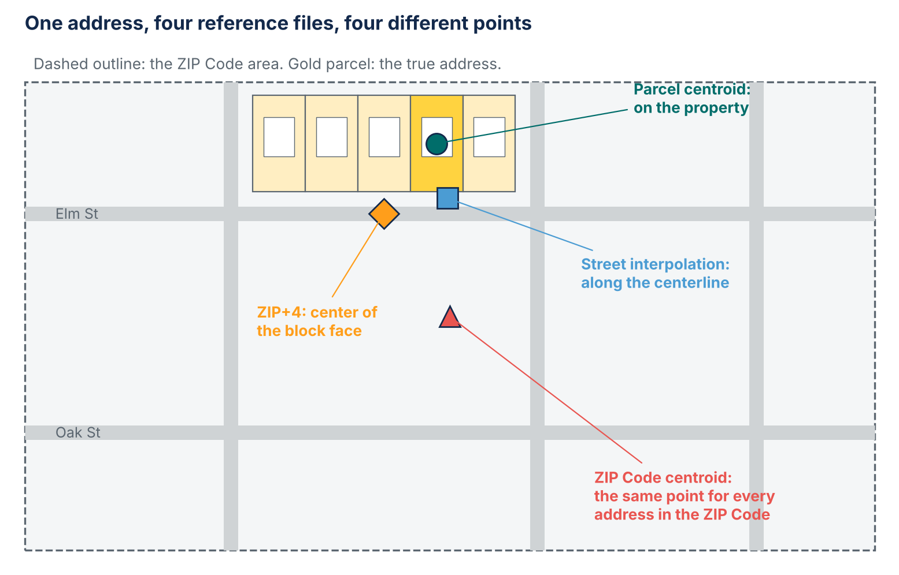
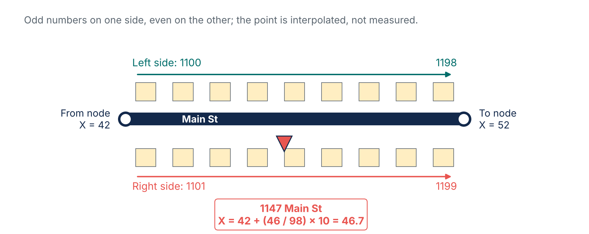
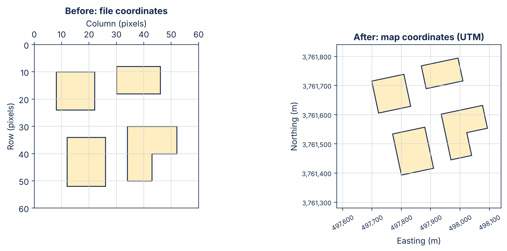
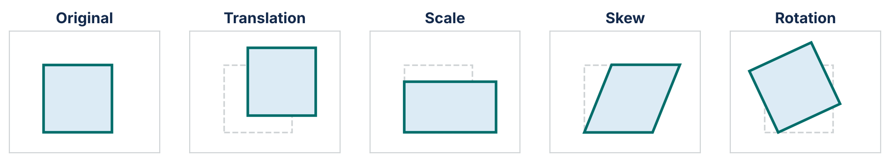
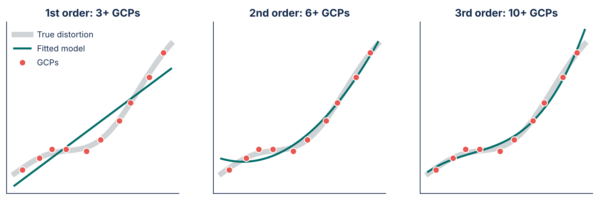
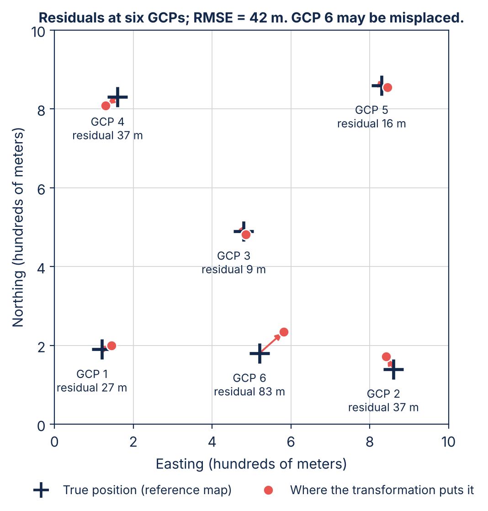

::: {.callout-note appearance="simple"}
## Learning objectives

By the end of this chapter you should be able to:

1.  Explain what geocoding is, and how address matching turns a street address into a point.
2.  Compare the reference files used for address matching, from parcels to ZIP Codes, and how each affects accuracy.
3.  Place an address on a street segment by linear interpolation.
4.  Judge the quality of a geocoded layer from its match rate and match scores.
5.  Explain what georeferencing is, and choose good ground control points.
6.  Describe affine and polynomial transformations, and how many control points each needs.
7.  Compute residuals and the root mean square error (RMSE), and use them to check a georeferenced image.
:::

Most information doesn't arrive with coordinates. A table of patients has street addresses. A list of restaurant inspections has addresses. A historic map of Chapel Hill is a scan: a grid of pixels that knows its rows and columns, but nothing about where on Earth it belongs. Before any of these can be mapped with other layers, they have to be given a location.

This chapter covers the two most common ways to do that. **Geocoding** turns descriptions of places, most often street addresses, into coordinates. **Georeferencing** ties an image or scanned map to a coordinate system. Both are estimates, and both have errors you can measure. The thread running through the chapter: the reference data you choose, and how carefully you use them, decide how accurate the result is.

## Geocoding and address matching {#sec-geocoding}

### An everyday example

Every time you type an address into a map app, the app geocodes it. The text "201 E Franklin St, Chapel Hill, NC 27514" has to become a latitude and longitude before the app can put a pin on the map or draw a route. That everyday step is the same one a health department uses to map thousands of disease cases, or a city uses to map every 911 call.

**Geocoding** is assigning geographic coordinates to data that describe a location in some other way. It is a form of data capture. The most common kind is **address matching**: placing an address at a point or in an area by comparing it with a **reference file** whose features already carry address information. The output is a point layer that keeps all the original attributes, ready to be mapped and analyzed with other layers.

### How U.S. addresses are structured

U.S. addresses are **street-based**: a house number, a street name and type, a city, a state, and a ZIP Code. Two conventions make them easy for a GIS to place:

- **House numbers increase along each street**, usually in blocks of 100. The 1100 block of Main Street comes after the 1000 block.
- **Odd numbers are on one side of the street, and even numbers on the other.**

That ordered, ranged numbering is what lets software place an address along a street line. Not every country works this way. Some historic British houses had names rather than numbers, and many villages numbered houses in any order.

::: {.callout-note .did-you-know appearance="simple" icon=false}
## Did you know..?

In most of Japan, streets have no names. A traditional Japanese address names a district, then a numbered block, then a building number, and the buildings on a block were often numbered in the order they were built, not their order along the street. Finding a house by its address alone can be hard even for locals, which is why Japanese police boxes keep detailed neighborhood maps for giving directions.
:::

### Reference files

Address matching compares each address with a reference file. There are three common kinds:

| Reference file | Each feature holds | Example |
|----------------|--------------------|---------|
| Point or polygon | One discrete address | Land parcels, address points |
| Point or polygon | A group of addresses | ZIP Code areas, ZIP+4 segments |
| Line | A range of addresses along a street segment | TIGER/Line roads, local street centerlines |

: The three common kinds of reference file for address matching. {#tbl-reference-types}

Each kind places an address differently, with a different accuracy:

- **ZIP Code centroids.** Every address in a five-digit ZIP Code is placed at the same point, the ZIP Code's center. It matches almost every address, and quickly, but it is the least precise option: in a large rural ZIP Code, the error can be several kilometers. (Remember that ZIP Codes are mail delivery routes, not areas. The Census Bureau's ZIP Code Tabulation Areas, Chapter 9, approximate them.)
- **ZIP+4 and ZIP+2.** The four extra digits of a ZIP+4 identify a short piece of a delivery route: one side of a block, a single building, or a large mail recipient. The address is placed at the center of that segment. A ZIP+2 (the first two of the four digits) groups several segments.
- **Street centerlines.** Each street segment stores the range of addresses on its left and right sides. The address is placed by **interpolation** along the segment (@sec-interpolation). The Census Bureau's free, nationwide TIGER/Line files make this the most common method in the United States.
- **Parcels.** Each parcel polygon is one property with its own address, so a match finds the exact lot. The point can be placed at the parcel's **centroid**, inside the property rather than on the street. Parcels are the most accurate reference, but counties maintain them, so coverage and quality vary from place to place.
- **Address points.** Many states and counties, including North Carolina, now keep a point for every address, often on the rooftop or the building entrance. Where they exist, address points are as accurate as parcels.

@fig-reference-files shows how the same address lands in four different places, depending on the reference file.

{#fig-reference-files fig-alt="A grid of streets inside a dashed ZIP Code boundary, with a row of parcels along Elm Street, one highlighted gold. A green circle sits on the gold parcel, labeled parcel centroid. A blue square sits at the street edge in front of it, labeled street interpolation. An orange diamond sits on Elm Street at the middle of the block, labeled ZIP+4 center of the block face. A red triangle sits far from the parcel in the middle of the ZIP Code, labeled ZIP Code centroid."}

The trade-off is summarized in @tbl-reference-accuracy. Moving down the table, matching gets easier and cheaper, and the locations get less precise.

| Reference data | Address is placed | Accuracy | Effort and cost |
|----------------|-------------------|----------|-----------------|
| Parcels or address points | On the property itself | Highest | Highest |
| Street centerlines | Interpolated along the street | High | High |
| ZIP+4 | Center of a block-face segment | Medium | Medium |
| ZIP+2 | Center of a group of segments | Medium-low | Medium-low |
| ZIP Code (5 digits) | ZIP Code centroid | Low | Low |
| ZIP Code (3 digits) | Regional centroid | Lowest | Lowest |

: Accuracy and effort of address-matching reference data. {#tbl-reference-accuracy}

### Linear interpolation along a street {#sec-interpolation}

Street centerline matching takes three steps (@fig-interpolation):

1.  **Attribute query.** Find the street segment whose name, type, and address range include the address: for 1147 Main St, the segment of Main Street that holds 1100 to 1199.
2.  **Choose the side of the street.** The segment stores a range for each side. Here the left side holds 1100 to 1198 (even), and the right side 1101 to 1199 (odd). 1147 is odd, so it is on the right.
3.  **Interpolate.** Assume the addresses are spaced evenly along the segment, and find how far along it 1147 falls.

{#fig-interpolation fig-alt="A street segment labeled Main St runs from a from node at X equals 42 to a to node at X equals 52. Houses line both sides. An arrow above reads left side 1100 to 1198; an arrow below reads right side 1101 to 1199. A red marker on the right side is labeled 1147 Main St, X equals 42 plus 46 over 98 times 10 equals 46.7."}

The share of the way along the segment is

$$
A\% = \frac{A_\# - A_{\text{from}}}{A_{\text{to}} - A_{\text{from}}}
$$

where $A_\#$ is the target house number and $A_{\text{from}}$ and $A_{\text{to}}$ are the house numbers at the segment's two ends, on that side of the street. The coordinates are then

$$
X_\# = X_{\text{from}} + A\% \times (X_{\text{to}} - X_{\text{from}}), \qquad
Y_\# = Y_{\text{from}} + A\% \times (Y_{\text{to}} - Y_{\text{from}})
$$

For 1147 Main St:

- Address difference: 1147 − 1101 = 46.
- Address range: 1199 − 1101 = 98.
- Share along the segment: 46 ÷ 98 = 0.47, or 47 percent.
- Change in X: 52 − 42 = 10.
- Interpolated X: 42 + (0.47 × 10) = 46.7.

Y is found the same way. Software then moves the point a small **offset** distance (often 5 to 10 meters) to the correct side of the centerline, so that houses on opposite sides of the street don't land on top of each other.

Interpolation is an estimate. It assumes the lots are equal in size, that every number in the range is used, and that the street is straight. A long rural driveway, a big lot at one end of a block, or a range of 1100 to 1199 with only six houses can each put the point tens of meters from the building.

::: {.callout-tip appearance="simple"}
## Think about it

Where is 1184 Main St, on the same segment? Which side of the street is it on, what is A%, and what is its interpolated X? (Answer: the left side, since 1184 is even; A% = 84 ÷ 98 = 0.86; X = 42 + 8.6 = 50.6.)
:::

### Geocoding in practice

**Individual and batch mode.** Online tools geocode one address at a time. The **Census Geocoder** (geocoding.geo.census.gov) returns the coordinates of an address and the census tract, block group, and block it is in, and it can match a batch of up to 10,000 addresses from a CSV. GIS software geocodes a whole table at once in **batch mode**: ArcGIS Pro's *Geocode Table* tool, or plugins and processing tools in QGIS such as MMQGIS.

**Standardization.** Before matching, the software parses each address into parts (number, prefix, name, type, suffix, unit) and standardizes them, so that "201 East Franklin Street" and "201 E Franklin St" are treated alike.

**Match scores.** Each candidate gets a **match score**, often from 0 to 100, measuring how closely the address agrees with the reference. Spelling differences ("Fraklin"), a missing street type, or a wrong ZIP Code lower the score. The software accepts the best candidate above a minimum score, and reports each address as:

- **Matched**: one good candidate.
- **Tied**: two or more candidates with the same score, such as "Main St" in two towns.
- **Unmatched**: no candidate good enough.

**Match rate.** The **match rate** is the share of addresses that were matched. A 70 percent match rate means three addresses in ten are missing from your map, and they are rarely missing at random: rural route and PO Box addresses, new subdivisions not yet in the reference file, and addresses typed carelessly all fail more often. Review unmatched and tied addresses by hand (ArcGIS Pro's *Rematch Addresses* pane does this), and always report the match rate with your results.

::: {.callout-tip appearance="simple"}
## Think about it

A health department geocodes the home addresses of people with a disease, and posts a map of the points online. What could go wrong? How might the department show the pattern while protecting people's privacy? (Look up *geomasking* and *aggregation*.)
:::

## Georeferencing {#sec-georeferencing}

### Why georeference?

A scanned map, an aerial photo, or a raw satellite image is a raster that knows only its own **file coordinates**: pixel columns and rows, counted from the top-left corner. Its features don't sit at their true positions on the Earth. To overlay it on other layers, measure on it, or digitize from it, you have to give it map coordinates (@fig-file-to-map).

**Georeferencing** transforms a raster from file coordinates to map coordinates in a coordinate system and projection. It is a kind of **image rectification**. Common uses include:

- Overlaying historic maps on modern data, to see how a city, coastline, or forest has changed.
- Digitizing features from a scanned paper map, such as old property lines or the boundaries of redlined neighborhoods.
- Aligning a drone image or a scanned air photo with other layers.

{#fig-file-to-map fig-alt="Left: four building outlines on a grid labeled in pixel columns and rows from 0 to 60, with rows counted downward. Right: the same four outlines, rotated slightly and plotted on a grid labeled in UTM eastings from 497,600 to 498,100 meters and northings from 3,761,300 to 3,761,800 meters."}

### Five steps

Georeferencing follows five steps:

1.  **Get to know the data.** What does the image show, what is its scale and date, and what reference layers cover the same area?
2.  **Set up ground control points (GCPs)**: features you can find on both the image and a reference layer.
3.  **Transform the raster.** This has two parts. A **coordinate transformation** (spatial interpolation) works out where each cell belongs on the map. **Resampling** (intensity interpolation) then gives each output cell a value.
4.  **Validate** the result with the residuals and the root mean square error (RMSE).
5.  **Rectify**: save the georeferenced raster.

### Ground control points

**Ground control points (GCPs)** are features that can be identified on the image and located accurately on a reference layer, such as a basemap, an orthophoto, or a road layer. Good GCPs are:

- **Easy to identify** on both: road intersections, building corners, bridges, and dams.
- **Spatially accurate** in the reference data.
- **Evenly distributed** across the whole image, including near the corners and edges. GCPs bunched in one area leave the rest of the image unconstrained.
- **Stable.** Avoid features that move or change: shorelines, river channels, vehicles, shadows, and trees. On a historic map, a church or a road junction that still exists is better than a field boundary.

### Transformations

A **transformation** is a set of equations that converts each image position $(x', y')$ into map coordinates $(x, y)$. Its coefficients are solved from the GCPs, usually by **least squares**, which finds the coefficients that make the errors at the GCPs as small as possible overall.

**First-order (affine) transformation.** For moderate distortion over a small area, a first-order polynomial with six coefficients is enough [@jensen2015]:

$$
x = a_0 + a_1 x' + a_2 y', \qquad y = b_0 + b_1 x' + b_2 y'
$$

The six coefficients model the distortions in @fig-affine: a shift in x and y (**translation**), a change of **scale** in x and in y, **skew**, and **rotation**. An affine transformation keeps straight lines straight and parallel lines parallel. It needs at least **3 GCPs**.

{#fig-affine fig-alt="Five panels. Original shows a square. Translation shows it shifted up and right. Scale shows it stretched horizontally and squashed vertically. Skew shows it slanted into a parallelogram. Rotation shows it turned about 25 degrees. In each changed panel, the original square is drawn dashed."}

**Higher-order polynomials.** Nonlinear distortions, such as those from terrain relief, lens curvature, or a paper map that has shrunk unevenly, need a higher-order polynomial, which lets the image bend (@fig-polynomial). Each order needs more GCPs:

| Order | Can model | Minimum GCPs |
|-------|-----------|--------------|
| 1st (affine) | Shift, scale, skew, rotation | 3 |
| 2nd | Simple curves | 6 |
| 3rd | More complex bends | 10 |

: Polynomial transformations and the minimum number of GCPs. {#tbl-orders}

{#fig-polynomial fig-alt="Three panels with the same red GCP dots along a gray S-shaped curve. A green straight line, the first-order fit, misses the curve at both ends. A green curve, the second-order fit, follows it more closely. A third-order curve follows it closely but swings beyond the last point at the right edge."}

Two rules follow:

- **Collect more than the minimum.** With exactly 3 GCPs, an affine transformation fits them perfectly, and you have no way to measure the error. Ten or more well-spread GCPs are a good habit.
- **Use the lowest order that fits.** A high-order polynomial bends to fit the GCPs, but it can warp badly in areas between and beyond them, as the right edge of the third panel in @fig-polynomial shows. Try first order, and move up only if the error is too large.

Software offers other transformations too. A **Helmert** (similarity) transformation allows only shift, rotation, and uniform scale. A **spline** (thin plate spline or rubber sheeting) fits every GCP exactly and stretches the image between them; it is useful for badly distorted historic maps, but it hides errors at the GCPs, because their residuals are all zero.

### Resampling

After the transformation, the output grid doesn't line up with the input pixels. Each output cell is traced back to its position in the input image, and given a value by **resampling**:

- **Nearest neighbor** takes the value of the closest input cell. It keeps the original values, so use it for categorical rasters such as land cover.
- **Bilinear interpolation** averages the four closest cells, weighted by distance. It gives a smoother look for continuous images such as air photos and scanned maps.
- **Cubic convolution** uses the 16 closest cells. It is sharper than bilinear, but slower.

### Residuals and RMSE

How good is the fit? After the transformation is solved, it is applied to each GCP's image position, and the result is compared with where the GCP really is on the reference layer. The distance between the two is the GCP's **residual** (@fig-residuals):

$$
R_i = \sqrt{(x_i - X_i)^2 + (y_i - Y_i)^2}
$$

where $(X_i, Y_i)$ are the reference coordinates of GCP $i$, and $(x_i, y_i)$ are the coordinates the transformation gives it. A residual much larger than the others flags a GCP that may be misplaced, such as a click on the wrong intersection.

{#fig-residuals fig-alt="A grid in hundreds of meters with six GCPs, each shown as a navy cross for the true position and a red dot for the transformed position, joined by a short red arrow. Residuals are labeled 27, 37, 9, 37, 16, and 83 meters. The title reads RMSE = 42 m, GCP 6 may be misplaced."}

The **root mean square error (RMSE)** combines all the residuals into one number, in map units:

$$
\text{RMSE} = \sqrt{\frac{1}{n}\sum_{i=1}^{n} R_i^2}
$$

Square each residual, average the squares, and take the square root. For four GCPs with residuals of 56.81, 92.94, 0.96, and 35.17 meters:

| GCP | Residual ($R_i$) | $R_i^2$ |
|-----|------------------|---------|
| 1 | 56.81 | 3,227.38 |
| 2 | 92.94 | 8,637.84 |
| 3 | 0.96 | 0.92 |
| 4 | 35.17 | 1,236.93 |
| Mean of $R_i^2$ | | 3,275.77 |
| RMSE | | **57.23** |

: Computing the RMSE from four residuals. {#tbl-rmse}

Lower is better. A common target is an RMSE smaller than the cell size of the raster: for an air photo with 1-meter cells, under 1 meter. For a historic map, the target depends on the map's scale and condition, and a larger RMSE may be the best that is possible. Either way, **report the RMSE and the transformation order with the result**, so users know how far to trust it.

The RMSE measures the fit at the GCPs only. A low RMSE from a few bunched GCPs, or from a high-order polynomial, can hide large errors elsewhere. The best check is to hold back a few **check points** that are not used to fit the transformation, and measure their errors too.

::: {.callout-note .did-you-know appearance="simple" icon=false}
## Did you know..?

Between 1867 and the 1960s, the Sanborn Map Company drew detailed fire insurance maps of about 12,000 American cities and towns, showing the outline, building material, and number of stories of almost every building. The Library of Congress has scanned tens of thousands of these sheets, including many of North Carolina towns, and historians and planners georeference them to trace how neighborhoods have changed.
:::

### Georeferencing in ArcGIS Pro

1.  **Open the georeference tools.** Add the scanned map to a map that already has reference layers, such as a basemap or orthophoto. Select the image in the Contents pane, and on the *Imagery* tab, click *Georeference*.
2.  **Bring the image into view.** Zoom the map to the area the scan covers, and click *Fit to Display* on the *Georeference* tab. The image is stretched over the current extent, a rough starting position.
3.  **Add control points.** Click *Add Control Points*. Click a feature on the scan, then the same feature on the reference layer. Repeat across the whole image.
4.  **Check the control point table.** Open the *Control Point Table* to see each GCP's residual and the total RMS error. Re-place or delete points with large residuals, and recheck. Change the transformation (*1st Order Polynomial* by default) only if the fit isn't good enough.
5.  **Save or export.** *Save* stores the transformation with the original raster in an auxiliary file, without changing its pixels. *Save as New* writes a new, rectified raster: choose the resampling method (nearest neighbor for categories, bilinear or cubic for images) and an output cell size close to the source's. *Export Control Points* keeps a text file of the GCPs, so the work can be checked or repeated.

### Georeferencing in QGIS

QGIS has a built-in **Georeferencer** (*Layer > Georeferencer*). Open the raster in the Georeferencer window, and click *Add Point* to place GCPs: click a feature on the image, then click *From Map Canvas* to pick its location on the main map. Under *Transformation Settings*, choose the transformation type (Linear, Helmert, Polynomial 1 to 3, Thin Plate Spline, or Projective), the target CRS, the resampling method, and the output file. The GCP table shows each point's residual, and the status bar shows the mean error. *Start Georeferencing* writes the rectified raster, and the GCPs can be saved to a `.points` file.

## Check your understanding

::: {.content-visible when-format="html"}

1.  Turning a street address into a point on a map is called: <select class='webex-select'><option value='blank'></option><option value='answer'>Address matching (geocoding)</option><option value=''>Georeferencing</option><option value=''>Resampling</option><option value=''>Rectification</option></select>

2.  Which reference file gives the most accurate geocoded points? <select class='webex-select'><option value='blank'></option><option value=''>Five-digit ZIP Code centroids</option><option value=''>ZIP+4 segments</option><option value=''>Street centerlines</option><option value='answer'>Parcels</option></select>

3.  A street segment's right side holds 1101 to 1199, and its X runs from 42 to 52. What is the interpolated X of 1151 Main St, to one decimal place? <input class='webex-solveme nospaces' size='5' data-answer='["47.1"]'/>

4.  The share of addresses that were successfully geocoded is the: <select class='webex-select'><option value='blank'></option><option value=''>Match score</option><option value='answer'>Match rate</option><option value=''>RMSE</option><option value=''>Residual</option></select>

5.  What is the minimum number of GCPs for a first-order (affine) transformation? <input class='webex-solveme nospaces' size='3' data-answer='["3"]'/>

6.  Which is the worst choice for a ground control point? <select class='webex-select'><option value='blank'></option><option value=''>A road intersection</option><option value=''>A building corner</option><option value='answer'>A point on a shoreline</option><option value=''>The end of a bridge</option></select>

7.  Which resampling method should you use for a land cover raster? <select class='webex-select'><option value='blank'></option><option value='answer'>Nearest neighbor</option><option value=''>Bilinear interpolation</option><option value=''>Cubic convolution</option></select>

8.  Three GCPs have residuals of 3, 4, and 0 meters. What is the RMSE, rounded to one decimal place? <input class='webex-solveme nospaces' size='5' data-answer='["2.9"]'/>

<button>Show hint for question 8</button>

Square each residual (9, 16, 0), average them (25 ÷ 3 = 8.33), and take the square root.

:::

::: {.content-visible unless-format="html"}
The interactive self-check questions for this chapter are in the online version of the book.
:::

## Summary

- **Geocoding** assigns coordinates to data that describe a location in another way. **Address matching** places an address by comparing it with a **reference file**.
- U.S. addresses can be interpolated because house numbers increase along each street, with odd and even numbers on opposite sides.
- Reference files range from **parcels** and address points (most accurate) through **street centerlines** and **ZIP+4** to **ZIP Code centroids** (least accurate). The same address lands in different places with each.
- **Linear interpolation** places an address along a street segment in proportion to its number within the segment's range: $A\% = (A_\# - A_{\text{from}}) / (A_{\text{to}} - A_{\text{from}})$.
- Batch geocoding standardizes addresses and scores each candidate. Report the **match rate**, and review tied and unmatched addresses, which are rarely missing at random.
- **Georeferencing** transforms a raster from file coordinates (rows and columns) to map coordinates, using **ground control points** that are easy to identify, accurate, stable, and spread across the image.
- A **first-order (affine)** transformation corrects shift, scale, skew, and rotation, and needs at least 3 GCPs. **Second-** and **third-order** polynomials bend to fit nonlinear distortion and need 6 and 10. Use the lowest order that fits.
- **Resampling** gives the output cells their values: nearest neighbor for categories, bilinear or cubic for images.
- A GCP's **residual** is the distance between where the transformation puts it and where it really is. The **RMSE** combines the residuals into one number. Check it, fix outliers, and report it with the result.

## Exercises

1.  **Interpolate.** A street segment runs from (100, 200) to (300, 260). Its left side holds 200 to 298 and its right side 201 to 299. Find the coordinates of 250 and 275, and say which side each is on.
2.  **Compare reference files.** Use the Census Geocoder to geocode your department's address, or any public building. Then find the same building on a parcel map from NC OneMap or the county GIS website. How far apart are the two points?
3.  **Batch geocode.** Make a CSV of 20 public addresses in Chapel Hill (schools, libraries, fire stations). Geocode them in batch with the Census Geocoder or in ArcGIS Pro. What is the match rate? Why did any addresses fail?
4.  **Georeference a historic map.** Download a historic map of Chapel Hill or another North Carolina town from the Library of Congress or the North Carolina Collection's digital maps. Georeference it in QGIS or ArcGIS Pro with at least 8 GCPs and a first-order transformation. Record the RMSE. Then try a second-order transformation. Did the RMSE fall? Does the image look better or worse away from the GCPs?
5.  **Find the bad GCP.** In exercise 4, deliberately place one GCP on the wrong intersection. What happens to its residual and to the RMSE? Delete it and compare.
6.  **RMSE by hand.** Five GCPs have residuals of 2.1, 3.4, 1.8, 2.6, and 9.7 meters. Compute the RMSE. Compute it again without the fifth point. What would you do next?

## Further reading and online resources

### Books and guides

- *GIS Fundamentals: A First Text on Geographic Information Systems*, by Paul Bolstad [@bolstad2022]. Chapter 4 covers registration, control points, transformations, and RMSE.
- *Introductory Digital Image Processing: A Remote Sensing Perspective*, by John R. Jensen [@jensen2015], the standard source on geometric correction, polynomial transformations, and resampling.
- Goldberg, D. W., *A Geocoding Best Practices Guide* [@goldberg2008], written for cancer registries, and the most thorough guide to geocoding quality: <https://www.naaccr.org/gis-resources/>.
- *The Nature of Geographic Information*, by David DiBiase and colleagues at Penn State, on address matching and the TIGER files: <https://www.e-education.psu.edu/natureofgeoinfo/>.
- The GIS&T Body of Knowledge, "Geocoding" and "Georeferencing": <https://www.ucgis.org/site/gis-t-body-of-knowledge>.

### Geocoding tools and data

- U.S. Census Bureau, Census Geocoder: <https://geocoding.geo.census.gov>.
- U.S. Census Bureau, TIGER/Line shapefiles, including address ranges: <https://www.census.gov/geographies/mapping-files/time-series/geo/tiger-line-file.html>.
- ArcGIS Pro, "Geocode Table" and "Rematch Addresses": <https://pro.arcgis.com/en/pro-app/latest/help/data/geocoding/what-is-geocoding-.htm>.
- QGIS, the MMQGIS plugin, with geocoding tools: <https://plugins.qgis.org/plugins/mmqgis/>.
- NC OneMap, North Carolina's address points and parcels: <https://www.nconemap.gov>.
- USPS, "ZIP Code — The Basics," on what ZIP and ZIP+4 codes are: <https://faq.usps.com>.
- Nominatim, the geocoder for OpenStreetMap data: <https://nominatim.org>.

### Georeferencing tools and historic maps

- ArcGIS Pro, "Overview of georeferencing": <https://pro.arcgis.com/en/pro-app/latest/help/data/imagery/overview-of-georeferencing.htm>.
- QGIS User Guide, "Georeferencer": <https://docs.qgis.org/latest/en/docs/user_manual/managing_data_source/georeferencer.html>.
- QGIS Tutorials and Tips, "Georeferencing Topo Sheets and Scanned Maps," by Ujaval Gandhi: <https://www.qgistutorials.com/en/docs/3/georeferencing_basics.html>.
- Library of Congress, Sanborn Maps collection: <https://www.loc.gov/collections/sanborn-maps/>.
- Library of Congress, Geography and Map Division, map collections: <https://www.loc.gov/maps/>.
- David Rumsey Map Collection, with an online georeferencer: <https://www.davidrumsey.com>.
- North Carolina Maps, from UNC Libraries and partners, with historic maps of the state: <https://web.lib.unc.edu/nc-maps/>.
- Allmaps, open-source tools for georeferencing maps from library collections: <https://allmaps.org>.
- Mapping Inequality, georeferenced redlining maps of U.S. cities, including Durham, Greensboro, and Winston-Salem: <https://dsl.richmond.edu/panorama/redlining/>.
