::: {.callout-note appearance="simple"}
## Learning objectives

By the end of this chapter you should be able to:

1.  Define spatial interpolation, and list the five steps every interpolation follows.
2.  Tell exact interpolators from inexact ones, and deterministic methods from geostatistical ones.
3.  Explain and compute nearest neighbor, average neighbor, and inverse distance weighted (IDW) estimates.
4.  Describe polynomial (trend surface) and radial basis function interpolation, and their trade-offs.
5.  Choose a search neighborhood and a sampling design.
6.  Use cross validation and root mean square error (RMSE) to compare interpolation methods.
:::

Weather stations measure temperature only where the stations are. Soil samples are taken at a few dozen spots in a field. Wells reveal the depth to groundwater at scattered points. Yet we want maps of temperature, soil chemistry, and groundwater *everywhere*. Spatial interpolation fills the gaps. This chapter covers the deterministic methods; Chapter 19 adds kriging, which brings in statistics.

## What is spatial interpolation? {#sec-what-is-interpolation}

**Spatial interpolation** is estimating the value of an attribute at unsampled locations from a set of observations. An **observation** is a location where the attribute was measured. In @fig-problem, four observations surround one unsampled location. Every method in this chapter answers the same question: how should those four values be combined to estimate the fifth?

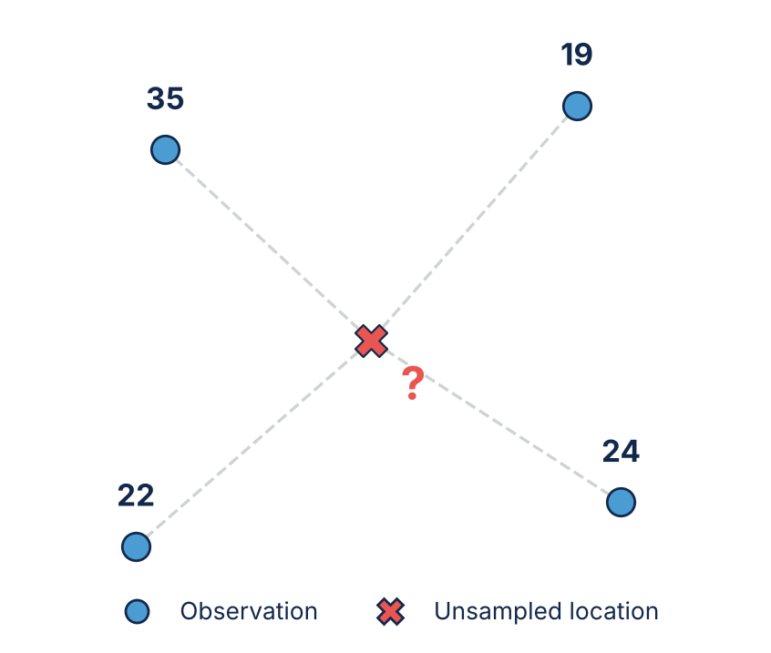{#fig-problem width=60% fig-alt="Four blue observation points with values 35, 19, 22, and 24 at the corners, connected by dashed lines to a red X in the middle, labeled with a question mark."}

The assumption behind all of it is Tobler's first law (Chapter 16): near things are more related than distant things. If values at nearby locations were unrelated, no method could estimate anything between them.

**Interpolation** estimates values *within* the area covered by the observations. **Extrapolation** estimates values *beyond* it, such as past the last station or above the highest observed value. Some methods can extrapolate; others can't. Most interpolation outputs a raster (Chapter 17), with an estimate in every cell.

### Five steps

Every interpolation, whatever the method, follows five steps:

1.  **Choose a function and its parameters**: the method, such as IDW or a polynomial, and settings such as the power or the order.
2.  **Define the neighborhood**: how far to search for observations, and in what shape.
3.  **Find the points in the neighborhood**: which observations fall inside it. This depends on how the data were sampled.
4.  **Evaluate the function** at every unknown location, usually every cell of the output raster.
5.  **Estimate the error**, with cross validation and RMSE.

### Exact and inexact interpolators

An **exact interpolator** returns the observed value at every observation: the surface passes through every point. An **inexact interpolator** smooths the data, so its surface may miss the observations (@fig-exact-inexact). Inexact isn't necessarily worse. If the measurements contain error, forcing a surface through each one fits the noise.

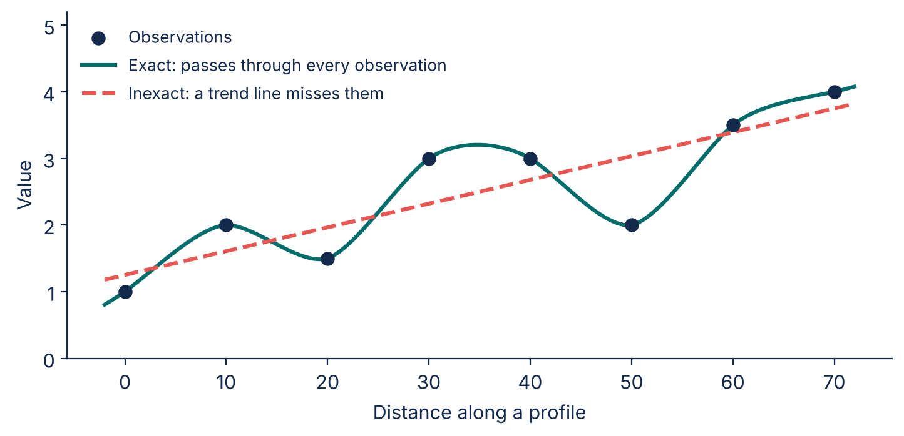{#fig-exact-inexact fig-alt="A profile with eight observations. A smooth green curve passes through every one, labeled exact. A straight red dashed line rises from left to right but misses most of the points, labeled inexact."}

The methods in this chapter are **deterministic**: the surface is fully determined by a formula and the parameters you choose. Kriging (Chapter 19) is **geostatistical**: it models the spatial autocorrelation in the data, and also estimates the uncertainty of each prediction.

## Step 1: Interpolation methods {#sec-methods}

### Nearest neighbor and Thiessen polygons

The simplest method, **nearest neighbor**, gives each location the value of the closest observation. The result is the same as drawing **Thiessen polygons** (also called Voronoi polygons): each polygon contains exactly one observation, and every location inside it is closer to that observation than to any other. The boundaries are the perpendicular bisectors between neighboring observations (@fig-thiessen).

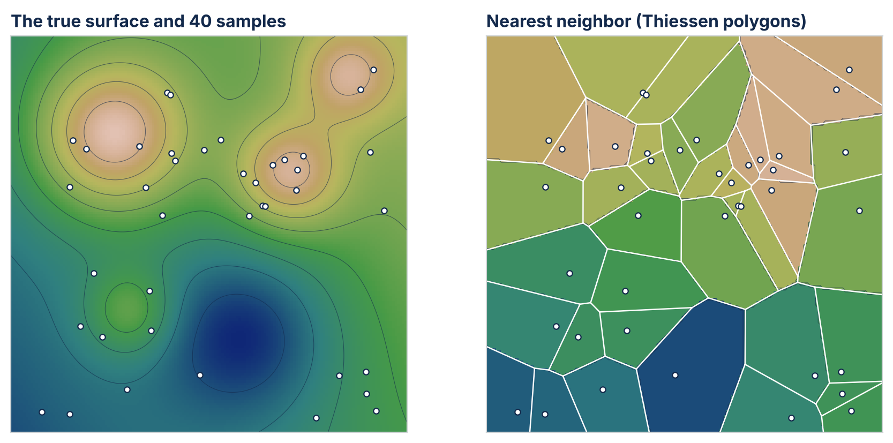{#fig-thiessen fig-alt="Left: a smooth colored surface with two high peaks, a low basin, and 40 white sample points. Right: the same area divided into Thiessen polygons, each a flat color from its sample point. The broad pattern survives, but the surface is a patchwork of flat polygons with sharp edges."}

Nearest neighbor is the right choice for **categorical** data, such as soil type or land-cover class, where averaging values would make no sense. For continuous data, its weakness is the surface itself: values jump in steps at each polygon boundary instead of changing gradually (@fig-profiles, top left).

Thiessen polygons are useful in their own right. @fig-airports-thiessen draws them around the major airports in the lower 48 states. Many U.S. weather stations, part of the Automated Surface Observing System (ASOS), are at airports, so a map like this shows which station's reading nearest-neighbor interpolation would use where. The polygons range from about 3,000 km² in the Northeast to over 240,000 km² in the interior West. **Large polygons show where estimates are least reliable**, since they come from a station that may be hundreds of kilometers away.

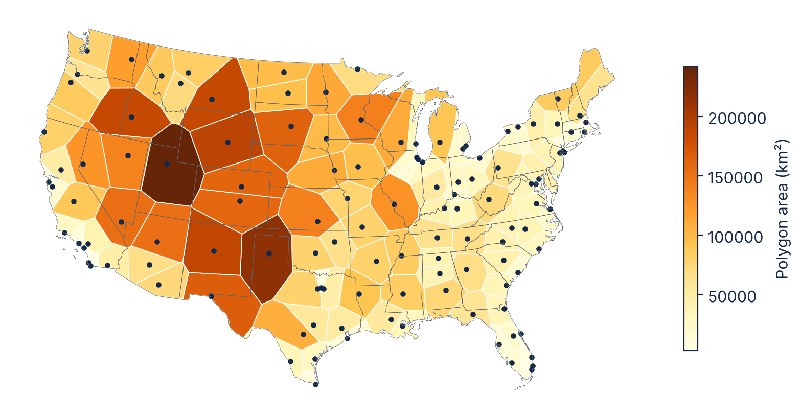{#fig-airports-thiessen fig-alt="A map of the lower 48 states divided into Thiessen polygons around dark airport dots. Polygons are small and pale in the East and along the coasts, and large and dark brown in the interior West, where airports are far apart."}

::: {.callout-note .did-you-know appearance="simple" icon=false}
## Did you know..?

Thiessen polygons are named for Alfred H. Thiessen, a meteorologist with the U.S. Weather Bureau. In 1911 he published a way to estimate the average rainfall over a large area from unevenly spaced rain gauges: weight each gauge by the area of its polygon [@thiessen1911]. Hydrologists still use "Thiessen weights." Mathematicians knew the same shapes as Voronoi diagrams, after Georgy Voronoy, and they turn up everywhere from cell biology to cellular phone networks.
:::

### Average neighbor

**Average neighbor** interpolation draws a circle of radius *r* around each unknown location, and averages every observation inside it:

$$
\hat{z} = \frac{\sum z_i}{k_r}
$$

where $\hat{z}$ is the estimate, $z_i$ are the observed values within the circle, and $k_r$ is the number of observations found. In @fig-average-neighbor, the circle captures four observations, 1, 2, 3, and 3, so the estimate is 9 ÷ 4 = 2.25.

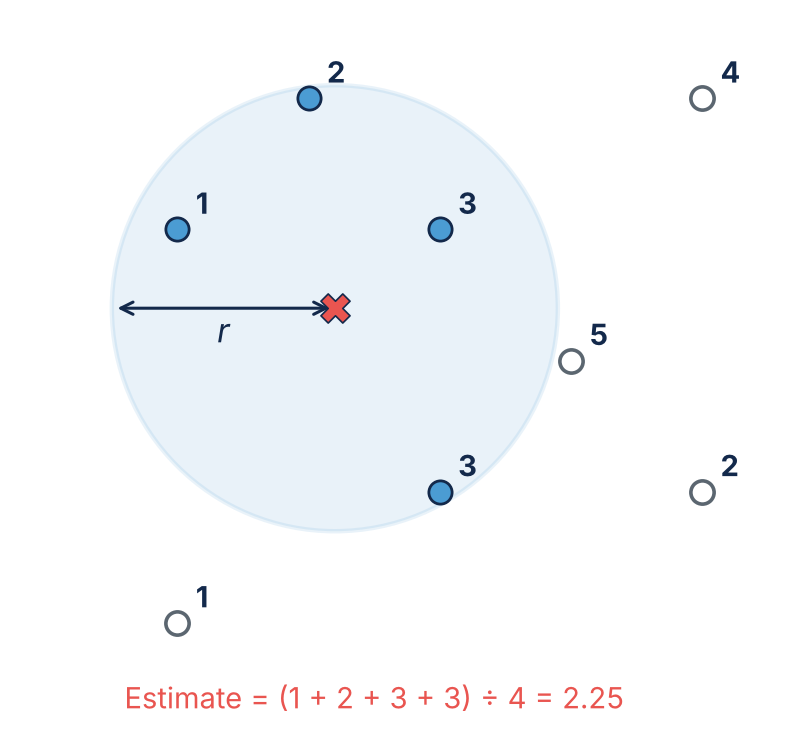{#fig-average-neighbor width=60% fig-alt="A red X at the center of a blue circle of radius r. Four filled blue points inside the circle are labeled 1, 2, 3, and 3. Four hollow points outside are labeled 4, 5, 2, and 1. Below: Estimate equals (1 + 2 + 3 + 3) divided by 4 equals 2.25."}

It is fast and smooths the data. But the radius is a subjective choice; a point at the edge of the circle counts as much as one next door; the method is not exact; and as an average, it can never estimate a value above the highest or below the lowest observation.

### Inverse distance weighted (IDW)

**Inverse distance weighted** (IDW) interpolation refines the average by giving nearer observations more weight [@shepard1968]:

$$
\hat{z} = \frac{\sum z_i / d_i^{\,p}}{\sum 1 / d_i^{\,p}}
$$

where $d_i$ is the distance to observation $i$, and $p$ is the **power**. The power models the *friction of distance*. With $p = 2$, the most common default, nearby points are far more influential than distant ones. As $p$ grows, IDW approaches nearest neighbor; as $p$ approaches 0, it approaches a simple average.

**A worked example.** Suppose we want the temperature at a location 40 km from Austin (19 °C), 50 km from San Antonio (22 °C), and 150 km from Houston (21 °C), with $p = 1$ (@fig-idw-example):

$$
\hat{z} = \frac{19/40 + 22/50 + 21/150}{1/40 + 1/50 + 1/150} = \frac{1.055}{0.05167} \approx 20.4 \text{ °C}
$$

Houston, three times farther away, has little influence. (With $p = 2$, the estimate is 20.2 °C: San Antonio and Austin matter even more. Avoid rounding the sums too early; rounding them to two places gives 21.)

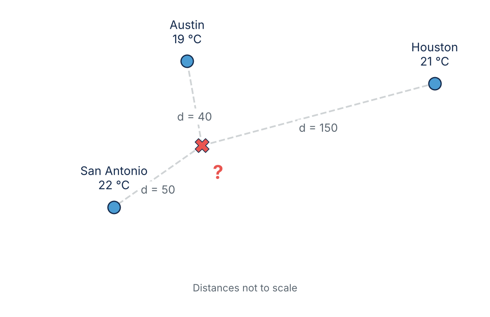{#fig-idw-example width=70% fig-alt="A red X with dashed lines to three stations: Austin, 19 degrees, at d equals 40; San Antonio, 22 degrees, at d equals 50; and Houston, 21 degrees, at d equals 150. A note says distances are not to scale."}

IDW is exact: at an observation the distance is 0, so that observation gets all the weight. It produces a continuous surface. But you must choose both the power and the number of neighbors, and the result is sensitive to both (@fig-idw-power). Like average neighbor, it can't predict values outside the observed range, so peaks and pits between observations are flattened. And it ignores direction. Its signature is the **bull's-eye**: a ring around an observation whose value differs from its neighbors'.

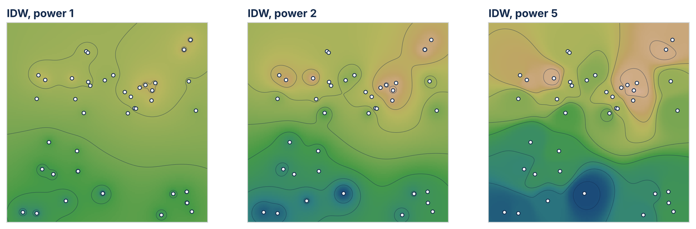{#fig-idw-power fig-alt="Three surfaces from the same sample points. Power 1: very smooth, with values pulled toward the overall average. Power 2: more detail, with small rings around some points. Power 5: flat plateaus around each point with sharp transitions, resembling Thiessen polygons."}

::: {.callout-tip appearance="simple"}
## Think about it

A city has 30 air-quality monitors, 25 of them in one neighborhood near the port. If you interpolate pollution with IDW and 12 neighbors, what happens to estimates on the far side of the city? How could the search neighborhood (@sec-neighborhood) help?
:::

### Polynomial (trend surface) interpolation

**Polynomial interpolation** fits one mathematical surface, a **trend surface**, to all the observations, usually by least squares. The **order** of the polynomial, the highest power of $x$ and $y$ in its equation, sets how many bends the surface can have (@fig-poly-order):

- **First order** is a tilted plane: $\hat{z} = \beta_0 + \beta_1 x + \beta_2 y$.
- **Second order** can bend once, like a bowl or a ridge: $\hat{z} = \beta_0 + \beta_1 x + \beta_2 y + \beta_3 x^2 + \beta_4 xy + \beta_5 y^2$.
- **Third order** can bend twice, adding the $x^3$, $x^2y$, $xy^2$, and $y^3$ terms.

Each $\beta$ is a coefficient fit from the observations. Higher orders fit more closely, but quickly become unstable, especially near the edges of the data. Orders above 3 or 4 are rarely useful.

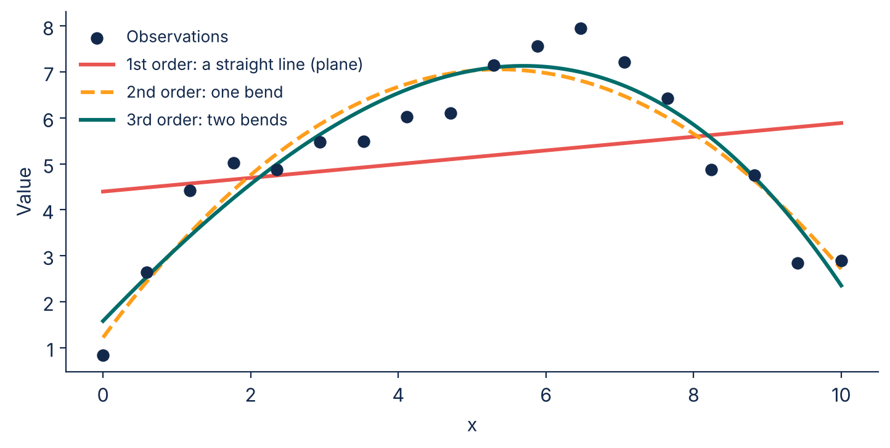{#fig-poly-order fig-alt="Eighteen observations rise, peak near x equals 6, and fall. A red first-order straight line misses the shape. An orange dashed second-order curve and a green third-order curve both follow the hump closely."}

A **global polynomial** uses one formula for the whole study area. It is simple, with only the order to choose, and can extrapolate, but it is not exact and captures only the broad, regional pattern. That makes it useful for mapping a trend, or for removing one before interpolating what's left (the residuals) with another method. A **local polynomial** fits a separate surface to each overlapping neighborhood and blends them. It follows complex surfaces and comes close to the observations, but requires more choices: the order, and the size and shape of the neighborhood.

### Radial basis functions (splines)

**Radial basis function** (RBF) interpolation, often called a **spline**, fits a smooth surface that passes exactly through every observation while bending as little as possible. Think of a thin, flexible sheet pinned at every data point. RBFs are exact, smooth, and can extrapolate: between observations, the surface can rise above or dip below the observed values (@fig-profiles, bottom right). Their weakness is surfaces with abrupt changes, such as cliffs or faults, where a smooth sheet overshoots.

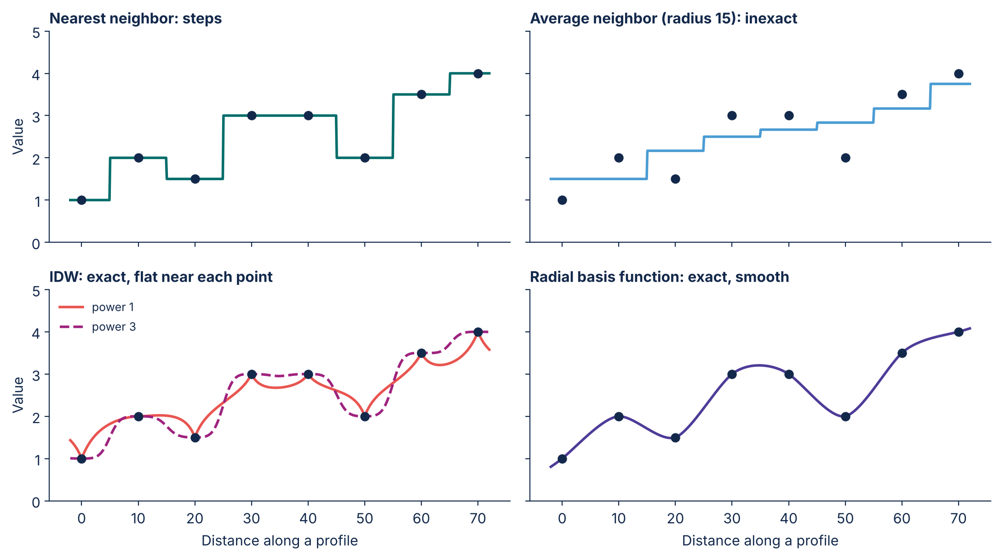{#fig-profiles fig-alt="Four profile plots of the same eight observations. Nearest neighbor: a staircase with jumps between points. Average neighbor: a gentler staircase that misses the points. IDW with powers 1 and 3: curves through every point, flattening near each one, with power 3 flatter. Radial basis function: a smooth curve through every point that overshoots slightly between some."}

### Comparing the methods

@fig-compare interpolates the same 40 samples from a made-up surface with five methods. All of them get the broad pattern. They differ in detail: Thiessen edges, IDW bull's-eyes, the global polynomial's smooth bowl, and the RBF's curves. Because every surface looks plausible, we can't pick the best by eye. That is what step 5, cross validation, is for (@sec-error).

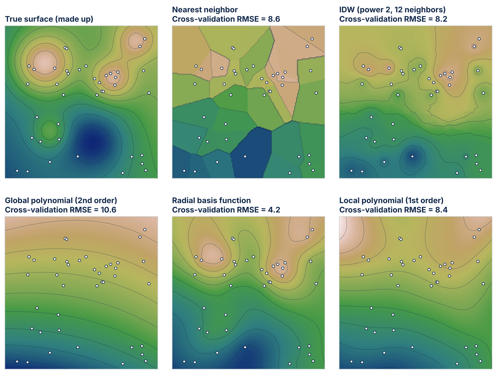{#fig-compare fig-alt="Six surfaces. True surface: two peaks in the upper left and upper right, and a deep basin in the lower middle. Nearest neighbor: patchwork polygons, RMSE 8.6. IDW: bumpy with bull's-eyes, RMSE 8.2. Global polynomial: a smooth tilted bowl with no peaks, RMSE 10.6. Radial basis function: smooth and closest to the true surface, RMSE 4.2. Local polynomial: smooth with some regional detail, RMSE 8.4."}

| Method | Exact? | Extrapolates? | Smooth? | Main choices |
|---|---|---|---|---|
| Nearest neighbor | Yes | No | No (steps) | None |
| Average neighbor | No | No | Yes | Radius *r* |
| IDW | Yes | No | Yes | Neighbors *k*, power *p* |
| Global polynomial | No | Yes | Yes | Order |
| Local polynomial | Nearly | Yes | Yes | Order, neighborhood |
| Radial basis function | Yes | Yes | Yes | Function, smoothing |

: Choosing an interpolation method. {#tbl-methods}

## Steps 2 and 3: Neighborhoods and sampling {#sec-neighborhood}

### The search neighborhood

The **search neighborhood** decides which observations feed each estimate. Its settings can change the result as much as the choice of method (@fig-search-options):

- **Radius.** A *fixed* radius uses every observation within a set distance, which may be very few in sparse areas. A *variable* radius grows until it captures *k* points.
- **Sectors.** Dividing the circle into quadrants or octants, and taking a few points from each, stops one dense cluster on one side from dominating the estimate.
- **Shape.** A circle treats all directions equally. An ellipse suits a **directional trend**, where values change faster in one direction than another, such as across a valley rather than along it.

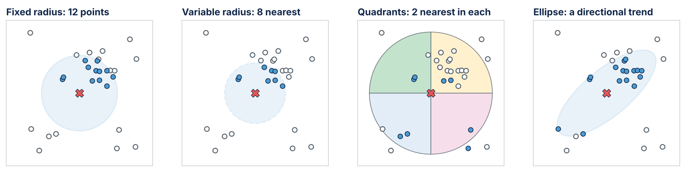{#fig-search-options fig-alt="Four panels with the same points, a cluster to the upper right of a red X and scattered points elsewhere. Fixed radius: a circle captures 12 points, most from the cluster. Variable radius: a dashed circle captures the 8 nearest. Quadrants: a circle divided into four colored sectors, with the 2 nearest points in each sector selected, so points come from every direction. Ellipse: a tilted ellipse captures points along a diagonal."}

### Sampling design

An interpolation can only be as good as its samples. **Sampling** is choosing where observations are collected, and there are four common designs (@fig-sampling):

- **Systematic**: points on a regular grid. Coverage is even and easy to plan, but a pattern that repeats at the grid spacing can be missed entirely.
- **Random**: every location has an equal chance. It avoids that bias, but by chance leaves some areas empty and others crowded.
- **Clustered**: points in groups, usually to save travel time in the field. It describes local variation well, but leaves gaps between clusters.
- **Adaptive** (multi-pass): a sparse first pass, then more samples where the first pass shows rapid change. It puts the effort where the surface is most complex, and is often the most efficient.

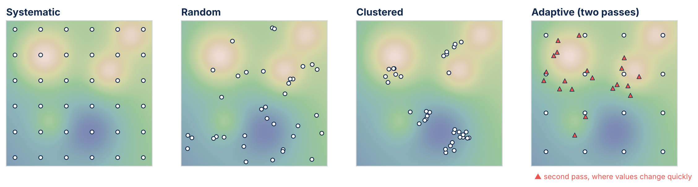{#fig-sampling fig-alt="Four panels of the same faded surface. Systematic: a 6 by 6 grid of points. Random: 36 scattered points with gaps and clumps. Clustered: five tight groups of points. Adaptive: a sparse 4 by 4 grid plus red triangles added around the peaks and steep slopes."}

A useful rule: put more samples where the surface changes quickly, and fewer where it is uniform.

## Step 5: Estimating the error {#sec-error}

### Cross validation

An interpolated surface always looks plausible, so we need a number that says how wrong it is likely to be. We usually can't go back into the field, so we test the surface with the observations we already have. **Cross validation** (leave-one-out) works like this:

1.  Remove one observation from the data.
2.  Interpolate a value at its location from the remaining observations.
3.  Compare the estimate with the observed value, and save the error.
4.  Put the observation back, and repeat for every observation.

In @fig-cross-validation, the observation of 3.0 is removed. IDW with power 1, using its four neighbors (4 and 3 at distance 10; 4 and 2 at 14.14), estimates 3.29, an error of 0.29.

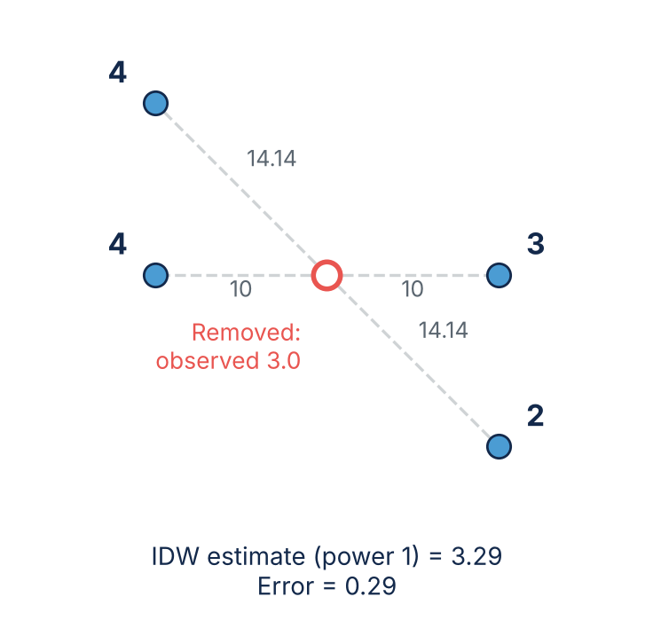{#fig-cross-validation width=60% fig-alt="A removed point, shown as a hollow red circle with an observed value of 3.0, connected to four neighbors: 4 and 3 at distance 10, to the left and right; 4 at distance 14.14 to the upper left; and 2 at 14.14 to the lower right. Below: IDW estimate (power 1) equals 3.29; error equals 0.29."}

When there are enough observations, an alternative is **validation**: hold back a separate test set, build the surface from the rest, and measure the error only at the held-back points.

### Root mean square error

**Root mean square error** (RMSE) summarizes the cross-validation errors in one number:

$$
\text{RMSE} = \sqrt{\frac{\sum (\hat{z}_i - z_i)^2}{n}}
$$

where $\hat{z}_i$ is the estimate at observation $i$, $z_i$ is its observed value, and $n$ is the number of observations. Squaring keeps positive and negative errors from canceling; the square root returns to the original units. So an RMSE of 2 mm of rainfall means something directly. **Lower is better.** RMSE is the standard way to compare methods, or settings such as the IDW power, *on the same data*.

In @fig-compare, the radial basis function has by far the lowest RMSE, 4.2, on a surface ranging from about 33 to 118. The global polynomial has the highest, 10.6, because a single bowl can't follow two peaks and a basin. On a different surface, the ranking could change. That is the point: no method wins everywhere.

The **mean error** is worth checking too. It should be near 0. If it isn't, the surface is biased: consistently too high or too low.

### Four questions

Before trusting any interpolated surface, ask:

1.  **What type of data is it?** Categorical data call for nearest neighbor; continuous data allow the other methods.
2.  **What is the error at the observations?** Exact interpolators have none there, but that doesn't make them right elsewhere.
3.  **How does the surface behave between observations?** Look for overshoot, bull's-eyes, and flat spots.
4.  **What does the error look like?** Errors should look random. If they are consistently large in one region, the method or its settings are wrong there.

## Interpolation in ArcGIS Pro and QGIS {#sec-interp-software}

- **ArcGIS Pro.** The Spatial Analyst toolbox has *IDW*, *Spline* (an RBF), *Natural Neighbor*, and *Trend* (a global polynomial). The **Geostatistical Analyst** extension adds the **Geostatistical Wizard**, which runs IDW, global and local polynomials, RBFs, and kriging with full control of the search neighborhood, and reports cross-validation statistics, including RMSE and the mean error. *Create Thiessen Polygons* (Analysis toolbox) draws Thiessen polygons.
- **QGIS.** The Processing Toolbox's *Interpolation* group has *IDW interpolation* and *TIN interpolation*; GDAL's *Grid* tools add nearest neighbor, moving average (average neighbor), and inverse distance to a power; and *Voronoi polygons* draws Thiessen polygons. SAGA and GRASS add splines and kriging.

## Check your understanding

::: {.content-visible when-format="html"}

1.  An interpolator whose surface passes through every observation is: <select class='webex-select'><option value='blank'></option><option value='answer'>Exact</option><option value=''>Inexact</option><option value=''>Global</option><option value=''>Geostatistical</option></select>

2.  Which method suits categorical data, such as soil type? <select class='webex-select'><option value='blank'></option><option value='answer'>Nearest neighbor</option><option value=''>IDW</option><option value=''>Radial basis function</option><option value=''>Global polynomial</option></select>

3.  Using IDW with power 1, estimate the temperature 40 km from Austin (19 °C), 50 km from San Antonio (22 °C), and 150 km from Houston (21 °C), to one decimal. <input class='webex-solveme nospaces' size='4' data-answer='["20.4"]'/>

4.  Average neighbor with observations 1, 2, 3, and 3 inside the radius gives what estimate? <input class='webex-solveme nospaces' size='4' data-answer='["2.25"]'/>

5.  Which of these methods can predict values above the highest observation? <select class='webex-select'><option value='blank'></option><option value=''>Nearest neighbor</option><option value=''>Average neighbor</option><option value=''>IDW</option><option value='answer'>Radial basis function</option></select>

6.  A second-order polynomial can bend how many times? <input class='webex-solveme nospaces' size='2' data-answer='["1"]'/>

7.  In cross validation, each observation is: <select class='webex-select'><option value='blank'></option><option value=''>Used twice</option><option value='answer'>Removed, estimated from the rest, and compared with its observed value</option><option value=''>Replaced with the mean</option><option value=''>Ignored</option></select>

8.  When comparing methods on the same data, a lower RMSE is better. <select class='webex-select'><option value='blank'></option><option value='answer'>TRUE</option><option value=''>FALSE</option></select>

:::

::: {.content-visible unless-format="html"}
The interactive self-check questions for this chapter are in the online version of the book.
:::

## Summary

- **Spatial interpolation** estimates values at unsampled locations from **observations**, relying on Tobler's first law. **Extrapolation** goes beyond the observations.
- Every interpolation has five steps: choose a function, define the neighborhood, find the points, evaluate the function, and estimate the error.
- **Exact** interpolators pass through every observation; **inexact** ones smooth. **Deterministic** methods use a formula; **geostatistical** methods (kriging) model autocorrelation and uncertainty.
- **Nearest neighbor** (**Thiessen polygons**) suits categories but gives a stepped surface. **Average neighbor** smooths but is inexact. **IDW** weights by distance raised to a **power**; it is exact but forms **bull's-eyes** and can't exceed the observed range.
- **Polynomial** interpolation fits a **trend surface** whose **order** sets its bends; global polynomials show broad trends, local ones follow detail. **Radial basis functions** (splines) are exact, smooth, and can extrapolate.
- The **search neighborhood** (radius, sectors, shape) and the **sampling design** (systematic, random, clustered, adaptive) shape every result.
- **Cross validation** and **RMSE** compare methods objectively. Lower RMSE is better, and the mean error should be near 0.

## Exercises

1.  **IDW by hand.** Redo the Austin–San Antonio–Houston example with power 2 and power 3. How does the estimate change, and why?
2.  **Thiessen polygons.** In QGIS or ArcGIS Pro, draw Thiessen polygons around the weather stations in North Carolina (from the State Climate Office of North Carolina or NOAA's station list). Which part of the state has the largest polygons?
3.  **Compare methods.** Download a month of rainfall totals for North Carolina stations from NOAA's Climate Data Online. Interpolate them with IDW (powers 1, 2, and 3) and a spline. Which has the lowest cross-validation RMSE?
4.  **Sampling.** You must sample soil lead in a 1 km² neighborhood with a possible hot spot near an old gas station. Which sampling design would you use, and how many samples would go near the station?
5.  **Bull's-eyes.** Find a published IDW map (for example, of precipitation or groundwater). Can you spot bull's-eyes? What do they tell you about the stations?

## Further reading and online resources

### Books

- *GIS Fundamentals*, by Paul Bolstad [@bolstad2022]. The chapter on spatial estimation covers sampling, IDW, splines, and kriging.
- *Geographic Information Analysis*, by David O'Sullivan and David Unwin [@osullivan2010], has a thorough chapter on interpolation.
- *Geospatial Analysis: A Comprehensive Guide*, by de Smith, Goodchild, and Longley, free online, with a long section on deterministic interpolation: <https://www.spatialanalysisonline.com>.
- *Intro to GIS and Spatial Analysis*, by Manuel Gimond, free online, chapter on spatial interpolation: <https://mgimond.github.io/Spatial/spatial-interpolation.html>.

### ArcGIS Pro

- Esri, "Comparing interpolation methods": <https://pro.arcgis.com/en/pro-app/latest/tool-reference/3d-analyst/comparing-interpolation-methods.htm>.
- Esri, "How IDW works": <https://pro.arcgis.com/en/pro-app/latest/tool-reference/3d-analyst/how-idw-works.htm>.
- Esri, "How Spline works": <https://pro.arcgis.com/en/pro-app/latest/tool-reference/3d-analyst/how-spline-works.htm>.
- Esri, "Performing cross validation and validation": <https://pro.arcgis.com/en/pro-app/latest/help/analysis/geostatistical-analyst/performing-cross-validation-and-validation.htm>.
- Esri, "Create Thiessen Polygons": <https://pro.arcgis.com/en/pro-app/latest/tool-reference/analysis/create-thiessen-polygons.htm>.

### QGIS

- QGIS User Guide, "Interpolation" algorithms (IDW and TIN): <https://docs.qgis.org/latest/en/docs/user_manual/processing_algs/qgis/interpolation.html>.
- QGIS User Guide, GDAL "Raster analysis" algorithms (Grid tools): <https://docs.qgis.org/latest/en/docs/user_manual/processing_algs/gdal/rasteranalysis.html>.
- QGIS Training Manual, "Spatial Statistics" and interpolation lessons: <https://docs.qgis.org/latest/en/docs/training_manual/processing/interpolation.html>.

### Data

- NOAA National Centers for Environmental Information, Climate Data Online: <https://www.ncei.noaa.gov/cdo-web/>.
- State Climate Office of North Carolina: <https://climate.ncsu.edu>.
- PRISM Climate Group, Oregon State University, which publishes interpolated climate maps for the United States: <https://prism.oregonstate.edu>.
- The GIS&T Body of Knowledge, "Spatial Interpolation" topics: <https://www.ucgis.org/site/gis-t-body-of-knowledge>.
