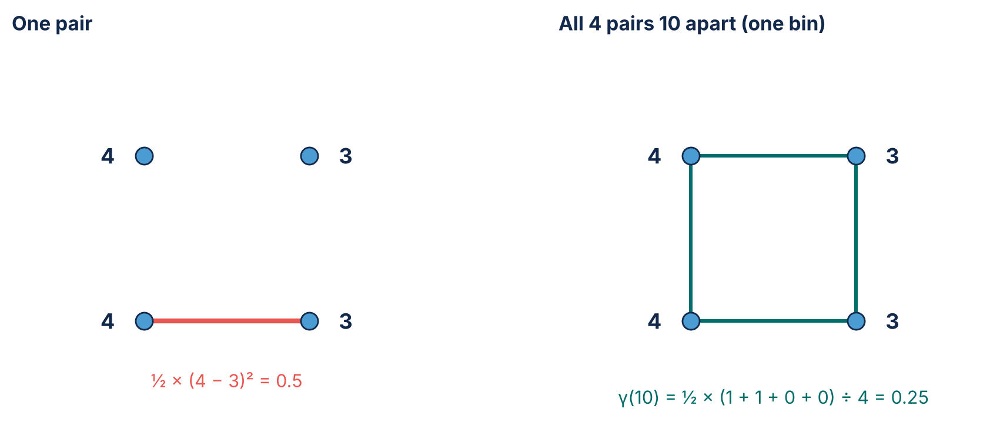
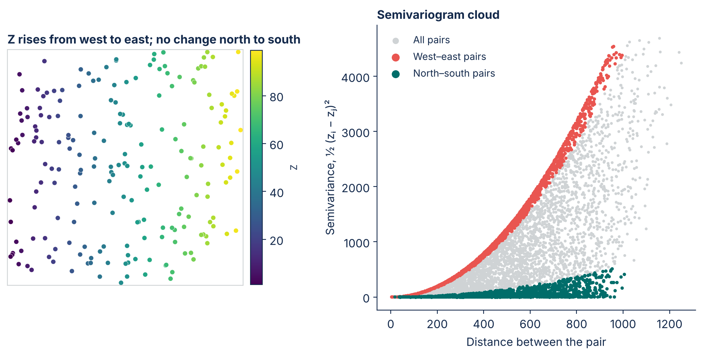
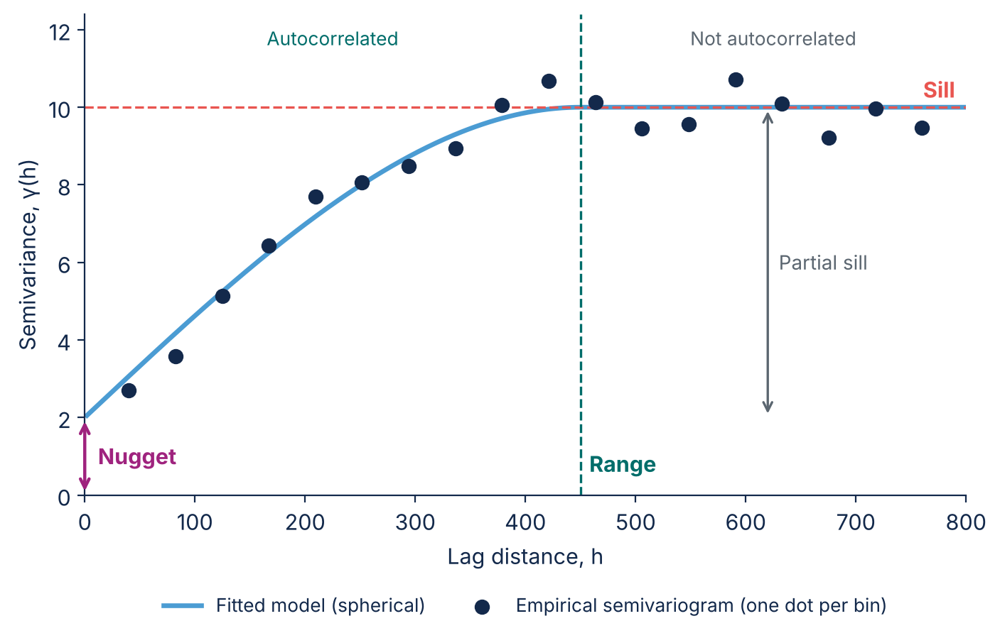
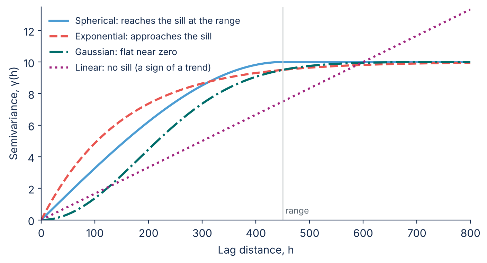
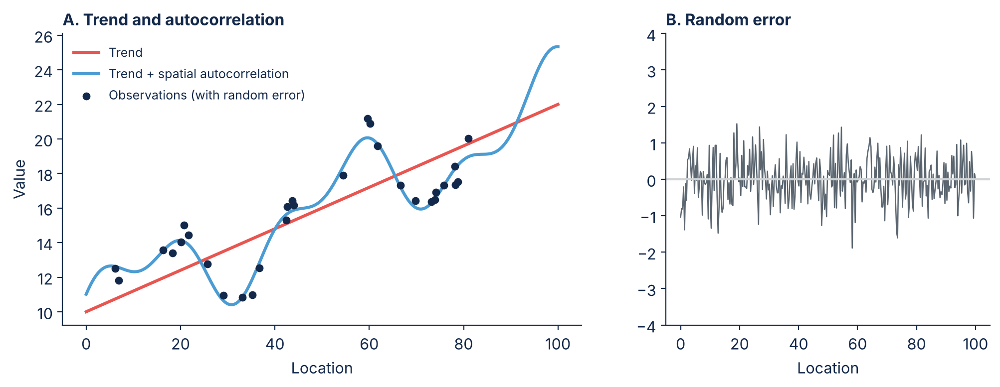
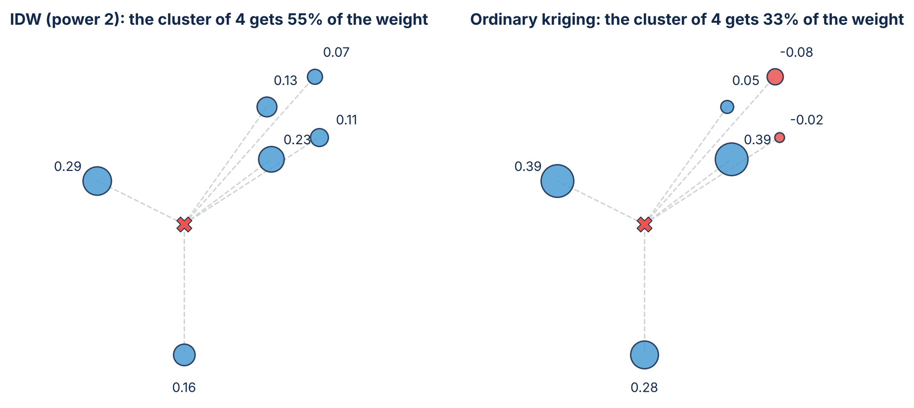
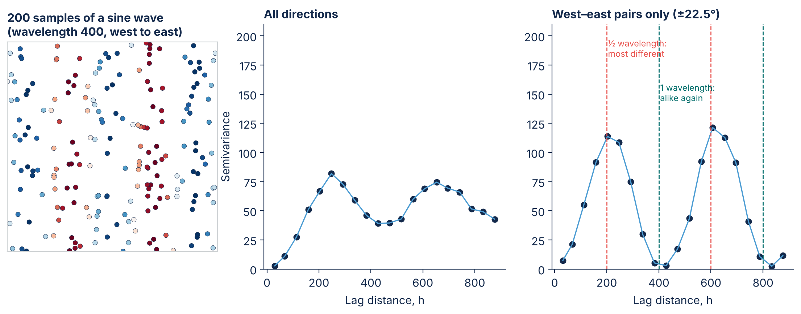
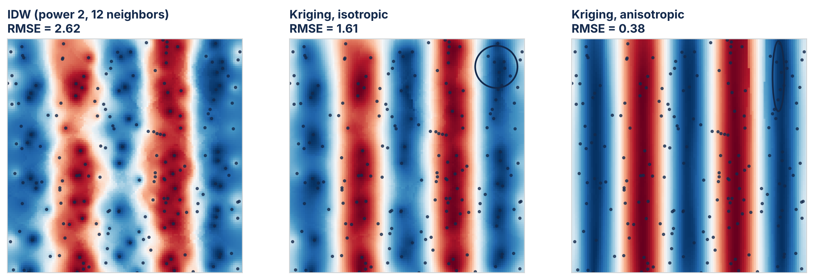
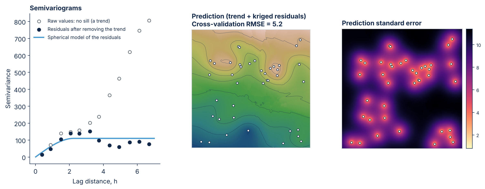

::: {.callout-note appearance="simple"}
## Learning objectives

By the end of this chapter you should be able to:

1.  Compute semivariance for a pair of observations and for a distance bin.
2.  Read a semivariogram, and explain its nugget, sill, and range.
3.  Explain how kriging sets its weights, and how that differs from IDW.
4.  Recognize anisotropy and trends, and model them.
5.  Tell ordinary, simple, universal, and cokriging apart.
6.  Judge a kriged surface with cross-validation statistics and a prediction standard error map.
:::

The interpolation methods in Chapter 17 are deterministic: you choose a formula and its settings, and the surface follows. IDW, for example, weights observations by distance raised to a power you pick, whatever the data look like. **Kriging** takes a different approach. It first *measures* how values in your data are related at different distances, then uses that measurement to set the weights. Because it is built on a statistical model, it can also estimate how uncertain each prediction is.

## Semivariance {#sec-semivariance}

### Measuring dissimilarity with distance

Tobler's first law says near things are more related than distant things [@tobler1970]. Chapter 13 called that tendency **spatial autocorrelation**. **Semivariance** turns it into a number. For two observations $i$ and $j$, it is half the squared difference between their values:

$$
\gamma = \tfrac{1}{2} (z_i - z_j)^2
$$

Similar values give low semivariance; different values give high semivariance. If the first law holds, pairs close together should have low semivariance, and pairs far apart high semivariance.

For many pairs, we group them into **bins** (also called lags) by the distance between them, and average within each bin. The semivariance of a bin $h$ with $n$ pairs is:

$$
\gamma(h) = \frac{1}{2n} \sum (z_i - z_j)^2
$$

In @fig-semivariance-example, the pair of values 4 and 3 has a semivariance of ½ × 1² = 0.5. Four pairs are exactly 10 apart, with squared differences of 1, 1, 0, and 0, so $\gamma(10)$ = ½ × 2 ÷ 4 = 0.25. (The two diagonal pairs, 14.1 apart, belong to another bin.)

{#fig-semivariance-example fig-alt="Four points in a square, with values 4 and 3 on top and 4 and 3 on the bottom. Left: the bottom pair is highlighted, with one half times 4 minus 3 squared equals 0.5. Right: all four sides of the square are highlighted, with gamma of 10 equals one half times 1 plus 1 plus 0 plus 0, divided by 4, equals 0.25."}

### Direction matters

Consider a made-up surface where values rise steadily from west to east, from 0 to 100, and don't change at all from north to south (@fig-linear-cloud). Plotting the semivariance of every pair against its distance gives a **semivariogram cloud**. West–east pairs have semivariance that grows quickly with distance, because the farther apart they are, the more their values differ. North–south pairs have low semivariance at *any* distance, because values don't change in that direction.

{#fig-linear-cloud fig-alt="Left: 200 points colored from purple in the west to yellow in the east. Right: a scatter of semivariance against distance for all pairs in gray. West–east pairs, in red, form the upper edge of the cloud, rising steeply in a curve. North–south pairs, in green, stay near zero at every distance."}

So distance alone doesn't determine semivariance; direction can matter too. We return to this as **anisotropy** (@sec-anisotropy).

## The semivariogram {#sec-semivariogram}

A **semivariogram** (often just **variogram**) summarizes the cloud: it plots the average semivariance of each distance bin against the bin's average distance. Kriging then fits a smooth mathematical model through those points. Three parameters describe the model (@fig-semivariogram):

- The **sill** is the semivariance where the curve levels off. Pairs farther apart than this are as different as two random observations.
- The **range** is the distance at which the sill is reached. Within the range, observations are autocorrelated; beyond it, they are effectively independent, and distance adds no information.
- The **nugget** is the semivariance at a distance of (nearly) zero. In theory, two measurements at the same place should be identical, so the nugget should be 0. In practice it reflects measurement error, and variation at scales smaller than the spacing of the samples. The sill minus the nugget is the **partial sill**.

{#fig-semivariogram fig-alt="A semivariogram. Dots rise from about 2.7 at short distances and level off near 10 beyond a distance of about 450. A blue spherical model curve starts at 2 at distance 0, labeled nugget, rises, and flattens at 10, labeled sill, at distance 450, labeled range. The vertical gap from the nugget to the sill is labeled partial sill. Distances below the range are labeled autocorrelated; above it, not autocorrelated."}

::: {.callout-note .did-you-know appearance="simple" icon=false}
## Did you know..?

Kriging is named for Danie Krige, a South African mining engineer. In the early 1950s, he was estimating how much gold lay between boreholes in the Witwatersrand gold fields, and found that ore grades in nearby samples were related in a way he could use [@krige1951]. The French mathematician Georges Matheron formalized his ideas as *geostatistics* in the 1960s, and coined the term *krigeage* in Krige's honor [@matheron1963]. The "nugget" in the semivariogram is a mining term too: a gold nugget in one sample makes it very different from a sample taken right beside it.
:::

### Semivariogram models

The fitted model must be one of a few allowed shapes, which guarantee that kriging gives sensible answers. Four are common (@fig-models):

- **Spherical**: rises almost linearly and reaches the sill exactly at the range. The most widely used.
- **Exponential**: rises quickly and approaches the sill gradually.
- **Gaussian**: flat near the origin, then rises; suits very smooth surfaces.
- **Linear**: never levels off. A semivariogram with no sill usually signals a **trend** in the data (@sec-trend).

{#fig-models fig-alt="Four curves of semivariance against distance. Spherical, solid blue, rises and flattens at 10 exactly at the range, 450. Exponential, dashed red, rises fastest and approaches 10 gradually. Gaussian, dash-dot green, starts flat, rises in an S shape, and approaches 10. Linear, dotted purple, rises in a straight line with no sill."}

Choose the model whose shape best matches the empirical semivariogram, especially at short distances, which matter most for prediction. Then check the choice with cross validation.

## Kriging {#sec-kriging}

### A surface in three parts

Kriging treats each value as the sum of three parts (@fig-components):

1.  A **trend**: the broad, large-scale change across the study area.
2.  **Spatial autocorrelation**: local, distance-related variation around the trend. This is what the semivariogram describes.
3.  **Random error**: what's left, which can't be predicted from location.

{#fig-components fig-alt="A: a rising red trend line, a blue wavy curve around it, and observations scattered close to the wavy curve. B: random noise around zero."}

### Weights from the semivariogram

Like IDW, kriging predicts a value at location $s_0$ as a weighted sum of nearby observations:

$$
\hat{Z}(s_0) = \sum \lambda_i \, Z(s_i)
$$

The difference is where the weights $\lambda_i$ come from. IDW sets them from distance and a power you choose. Kriging *solves* for them, using the fitted semivariogram, so that the predictions are **unbiased** and have the **smallest possible error variance**. In **ordinary kriging**, the weights sum to 1.

Because kriging accounts for how the observations relate to *each other*, not only to the prediction location, a cluster of nearby observations **shares** weight instead of each counting fully (@fig-weights). Four clustered observations tell us little more than one of them would. IDW gives the cluster more than half the weight; kriging gives it a third, and gives more to the isolated observations that bring new information. Kriging weights can even be slightly negative, for observations "screened" behind others.

{#fig-weights fig-alt="Two panels with the same six observations around a red X: one to the left, one below, and a cluster of four to the upper right. IDW: the cluster's weights are 0.23, 0.13, 0.11, and 0.07, together 55 percent. Kriging: one cluster point gets 0.39 and the others 0.05, minus 0.02, and minus 0.08, together 33 percent; the left and lower points get 0.39 and 0.28."}

Kriging also gives a **prediction standard error** at every location: an estimate of how far off the prediction might be. It is smallest near observations, and largest where they are sparse (@fig-prediction-error, right). No deterministic method offers this.

### Anisotropy {#sec-anisotropy}

A surface is **isotropic** when spatial dependence is the same in every direction, and **anisotropic** when it changes with direction. Consider a made-up surface that varies in a sine wave from west to east, with a wavelength of 400, and doesn't change from north to south (@fig-sine-variograms). A semivariogram that pools every direction blurs the pattern. One that uses only west–east pairs shows it clearly: pairs half a wavelength apart (200, 600) are most different, and pairs a full wavelength apart (400, 800) are alike again.

{#fig-sine-variograms fig-alt="Left: 200 points in alternating north-south bands of red and blue. Middle: an all-direction semivariogram with low, blurred peaks near 250 and 650. Right: a west-east semivariogram with tall peaks at 200 and 600, marked half wavelength, most different, and lows near 400 and 800, marked one wavelength, alike again."}

An **anisotropic** model fits a longer range in one direction (the **major range**) and a shorter one in the perpendicular direction (the **minor range**). Its search neighborhood becomes an ellipse stretched along the direction where values stay similar. On the sine surface, the cross-validation RMSE falls from 2.62 for IDW to 1.61 for isotropic kriging, and to 0.38 for anisotropic kriging, which keeps the bands continuous (@fig-sine-kriging).

{#fig-sine-kriging fig-alt="Three maps of alternating red and blue north-south bands. IDW, RMSE 2.62: the bands are wobbly, with bull's-eyes around points. Isotropic kriging, RMSE 1.61, with a circle drawn in one corner: smoother bands with some patches. Anisotropic kriging, RMSE 0.38, with a tall narrow ellipse drawn: clean, straight, continuous bands."}

::: {.callout-tip appearance="simple"}
## Think about it

Name a variable that you would expect to be anisotropic. Which direction would have the longer range? (Think of a river valley, a mountain front, the prevailing wind, or a coastline.)
:::

### Trends {#sec-trend}

Kriging assumes that the mean is stable across the study area. When the data have a strong trend, such as temperature falling steadily from south to north, the semivariogram keeps rising without a sill, like the linear model in @fig-models. The fix is to **remove the trend** first: fit a trend surface (Chapter 17), krige the **residuals** (observed minus trend), and add the trend back to the predictions.

@fig-prediction-error does this for the 40 made-up samples from Chapter 17. The raw semivariogram has no sill; after a first-order trend is removed, the residuals' semivariogram levels off and fits a spherical model. The kriged surface has a cross-validation RMSE of 5.2, better than IDW (8.2) but not as good as the radial basis function (4.2) on this surface. Kriging is not guaranteed to win. Its standard error map shows where the prediction is least certain: the corners and the empty lower right.

{#fig-prediction-error fig-alt="Left: hollow dots for the raw values rise steadily to over 800 without leveling off; solid dots for the residuals rise and level off near 110, matched by a blue spherical curve. Middle: a smooth predicted surface with two peaks at the top and a basin at the bottom. Right: a standard error map, near zero at each sample point and darkest in the corners and the empty lower right."}

### Types of kriging

The main types differ in how they treat the trend:

| Type | The trend (mean) is | Use when |
|---|---|---|
| **Ordinary kriging** | An unknown constant | The most common choice; no strong trend |
| **Simple kriging** | A known constant | The mean is known, for example from a long record |
| **Universal kriging** | A function of location, such as a polynomial | There is a clear trend, such as a west–east gradient |
| **Cokriging** | Any of the above, plus a correlated secondary variable | A second, densely sampled variable helps, such as elevation for temperature |

: Types of kriging. {#tbl-kriging-types}

Universal kriging is the version of @fig-prediction-error: the trend is modeled as a polynomial and the residuals are kriged. It suits variables like U.S. precipitation, which changes steadily from the dry West to the wet Southeast.

## Judging the result {#sec-kriging-errors}

### Cross-validation statistics

As in Chapter 17, **cross validation** removes each observation in turn, predicts it from the rest, and compares. Because kriging also predicts its own standard errors, it adds two statistics that test whether its uncertainty is realistic (@tbl-kriging-cv). ArcGIS Pro's Geostatistical Wizard reports all four.

| Statistic | Target | What it tells you |
|---|---|---|
| Mean error | Close to 0 | Predictions are unbiased |
| Root mean square error (RMSE) | As small as possible | How close predictions are to the observed values |
| Average standard error | Close to the RMSE | Whether the model's uncertainty is realistic |
| Root mean square standardized error | Close to 1 | Above 1: uncertainty is underestimated; below 1: overestimated |

: Kriging cross-validation statistics. {#tbl-kriging-cv}

### The kriging workflow

Putting it together, a typical kriging analysis, as in ArcGIS Pro's Geostatistical Wizard:

1.  **Explore the data.** Map it; check the histogram; look for outliers and trends.
2.  **Remove any trend**, and choose the type of kriging.
3.  **Compute the semivariogram**, in several directions to check for anisotropy.
4.  **Fit a model**: choose its shape, and set the nugget, sill, and range (and major and minor ranges, if anisotropic).
5.  **Set the search neighborhood**: the number of neighbors, sectors, and shape.
6.  **Cross-validate**, and compare the statistics with other models and methods.
7.  **Map the prediction and its standard error**.

Use cross-validation statistics, not appearance, to choose among models and methods. Every surface looks plausible.

## Kriging in ArcGIS Pro and QGIS {#sec-kriging-software}

- **ArcGIS Pro.** The **Geostatistical Wizard** (Geostatistical Analyst extension) runs ordinary, simple, universal, and cokriging, with full control of the semivariogram, anisotropy, trend removal, and search neighborhood, and reports cross-validation statistics. **Empirical Bayesian Kriging** automates semivariogram fitting by simulating many semivariograms. The Spatial Analyst *Kriging* tool offers a simpler interface.
- **QGIS.** The Processing Toolbox includes SAGA's kriging tools (ordinary and universal kriging) and GRASS's *v.surf.rst* for splines. The **Smart-Map** plugin provides kriging with semivariogram fitting and cross validation.

## Check your understanding

::: {.content-visible when-format="html"}

1.  What is the semivariance of a pair of observations with values 7 and 3? <input class='webex-solveme nospaces' size='3' data-answer='["8"]'/>

2.  The distance at which a semivariogram levels off is the: <select class='webex-select'><option value='blank'></option><option value=''>Sill</option><option value='answer'>Range</option><option value=''>Nugget</option><option value=''>Lag</option></select>

3.  Semivariance at (nearly) zero distance, from measurement error or small-scale variation, is the: <select class='webex-select'><option value='blank'></option><option value=''>Sill</option><option value=''>Range</option><option value='answer'>Nugget</option><option value=''>Trend</option></select>

4.  A semivariogram that rises without ever leveling off suggests: <select class='webex-select'><option value='blank'></option><option value=''>No autocorrelation</option><option value='answer'>A trend in the data</option><option value=''>A large nugget</option><option value=''>Isotropy</option></select>

5.  Compared with IDW, kriging gives a cluster of nearby observations: <select class='webex-select'><option value='blank'></option><option value=''>More weight</option><option value='answer'>Less weight, shared among the cluster</option><option value=''>Zero weight</option><option value=''>The same weight</option></select>

6.  Spatial dependence that changes with direction is: <select class='webex-select'><option value='blank'></option><option value=''>Isotropy</option><option value='answer'>Anisotropy</option><option value=''>Stationarity</option><option value=''>A nugget effect</option></select>

7.  Which type of kriging models the trend as a function of location? <select class='webex-select'><option value='blank'></option><option value=''>Ordinary</option><option value=''>Simple</option><option value='answer'>Universal</option><option value=''>Indicator</option></select>

8.  A root mean square standardized error well above 1 means the model underestimates its uncertainty. <select class='webex-select'><option value='blank'></option><option value='answer'>TRUE</option><option value=''>FALSE</option></select>

:::

::: {.content-visible unless-format="html"}
The interactive self-check questions for this chapter are in the online version of the book.
:::

## Summary

- **Semivariance** is half the squared difference between two values. Averaged by distance **bin**, it shows how dissimilarity grows with distance.
- A **semivariogram** plots semivariance against distance. Its **nugget**, **sill**, and **range** describe spatial dependence. Models include **spherical**, **exponential**, **Gaussian**, and **linear**.
- **Kriging** predicts a weighted sum of observations, with weights solved from the fitted semivariogram so predictions are **unbiased** with **minimum error variance**. Clustered observations share weight, and every prediction has a **standard error**.
- **Anisotropy** (dependence that changes with direction) is modeled with major and minor ranges and an elliptical search. **Trends** are removed before modeling, and added back.
- **Ordinary**, **simple**, **universal**, and **cokriging** differ in how they treat the trend, and whether they use a secondary variable.
- Judge a kriged surface with cross validation: mean error near 0, small RMSE, average standard error near the RMSE, and RMS standardized error near 1.

## Exercises

1.  **Semivariance by hand.** Five wells along a road, 100 m apart, have water-table depths of 12, 14, 13, 17, and 18 m. Compute $\gamma(100)$ and $\gamma(200)$.
2.  **Read a semivariogram.** For the semivariogram in @fig-semivariogram, estimate the nugget, sill, partial sill, and range. Beyond what distance would you stop using observations to predict a location?
3.  **Kriging vs. IDW.** Using a month of North Carolina rainfall totals from NOAA's Climate Data Online, interpolate with IDW and ordinary kriging in ArcGIS Pro's Geostatistical Wizard. Compare the cross-validation statistics. Which method wins?
4.  **Trend.** Interpolate average annual temperature for the lower 48 states with ordinary kriging and with universal kriging (first-order trend). Compare the semivariograms. Which levels off?
5.  **Standard error.** Map the prediction standard error from Exercise 3. Where would you add new rain gauges, and why?

## Further reading and online resources

### Books and papers

- *GIS Fundamentals*, by Paul Bolstad [@bolstad2022]. The chapter on spatial estimation introduces the semivariogram and kriging.
- *Geographic Information Analysis*, by David O'Sullivan and David Unwin [@osullivan2010], explains semivariograms and kriging clearly, with worked examples.
- *An Introduction to Applied Geostatistics*, by Edward Isaaks and R. Mohan Srivastava (Oxford University Press, 1989), a classic, readable introduction.
- Krige's original paper [@krige1951] and Matheron's "Principles of Geostatistics" [@matheron1963].
- *Intro to GIS and Spatial Analysis*, by Manuel Gimond, free online, includes kriging in its chapter on spatial interpolation: <https://mgimond.github.io/Spatial/spatial-interpolation.html>.

### ArcGIS Pro

- Esri, "How Kriging works": <https://pro.arcgis.com/en/pro-app/latest/tool-reference/3d-analyst/how-kriging-works.htm>.
- Esri, "Understanding a semivariogram: The range, sill, and nugget": <https://pro.arcgis.com/en/pro-app/latest/help/analysis/geostatistical-analyst/understanding-a-semivariogram-the-range-sill-and-nugget.htm>.
- Esri, "What is Empirical Bayesian Kriging?": <https://pro.arcgis.com/en/pro-app/latest/help/analysis/geostatistical-analyst/what-is-empirical-bayesian-kriging-.htm>.
- Esri, "Performing cross validation and validation": <https://pro.arcgis.com/en/pro-app/latest/help/analysis/geostatistical-analyst/performing-cross-validation-and-validation.htm>.
- Esri, "Kriging in Geostatistical Analyst": <https://pro.arcgis.com/en/pro-app/latest/help/analysis/geostatistical-analyst/kriging-in-geostatistical-analyst.htm>.

### QGIS and other tools

- Smart-Map QGIS plugin: <https://plugins.qgis.org/plugins/Smart_Map/>.
- The GIS&T Body of Knowledge, "Kriging Interpolation" and "Semivariograms": <https://www.ucgis.org/site/gis-t-body-of-knowledge>.
