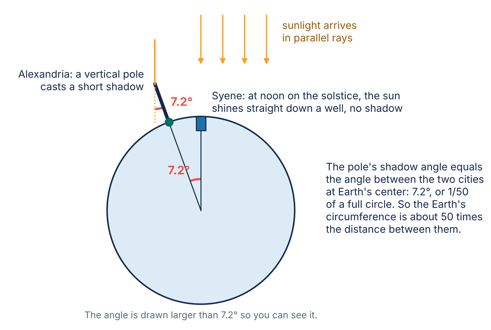
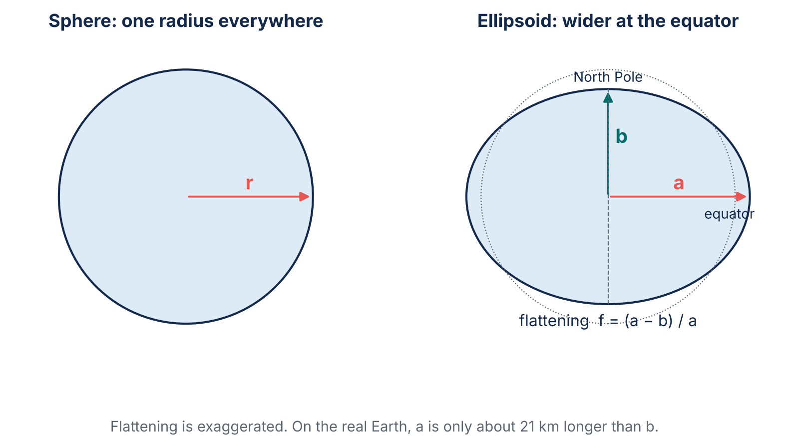
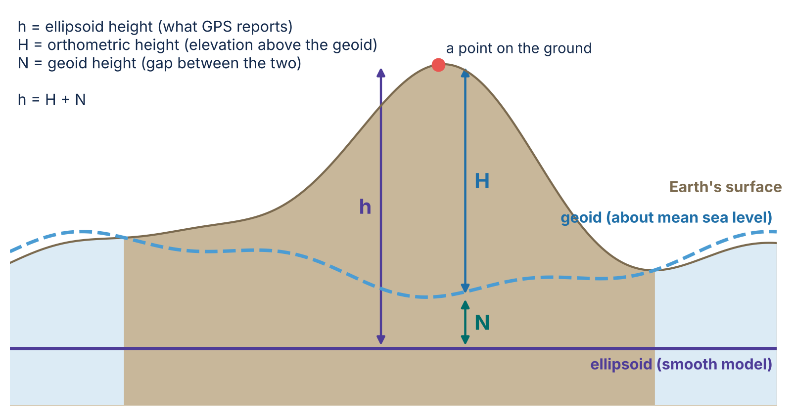
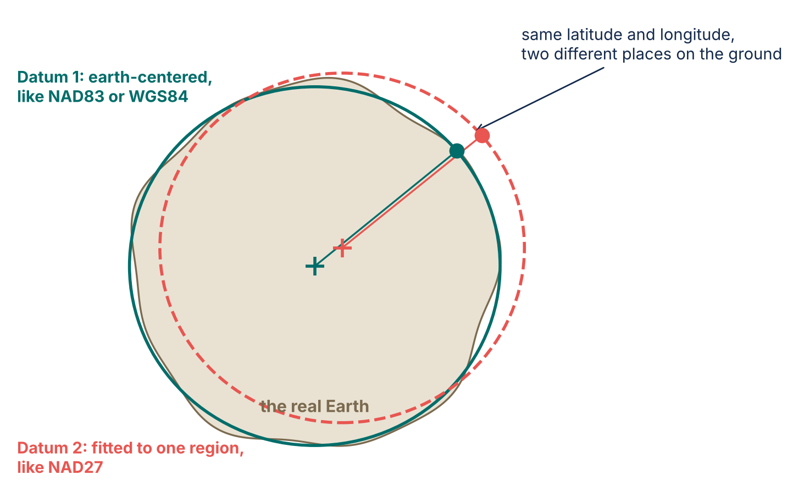
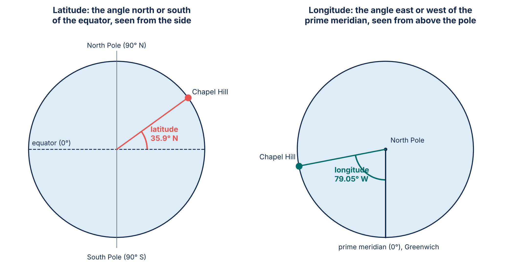
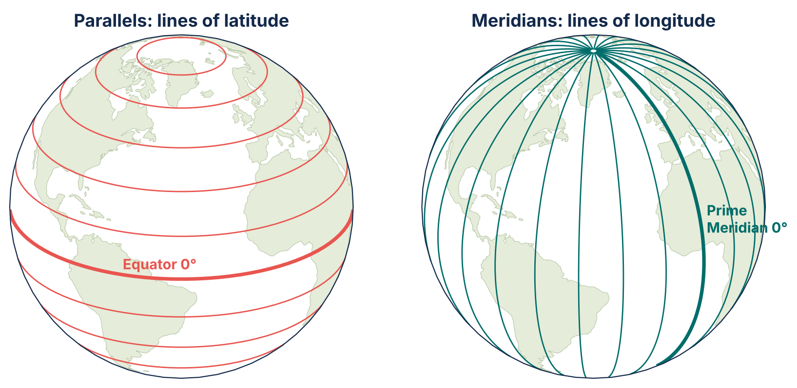
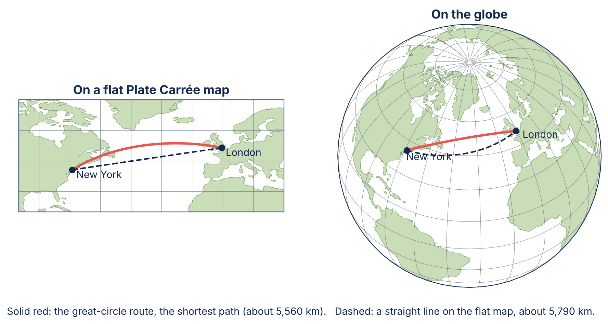
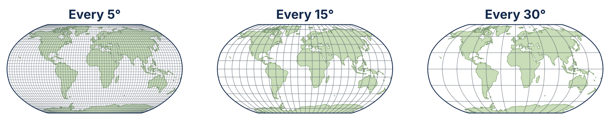
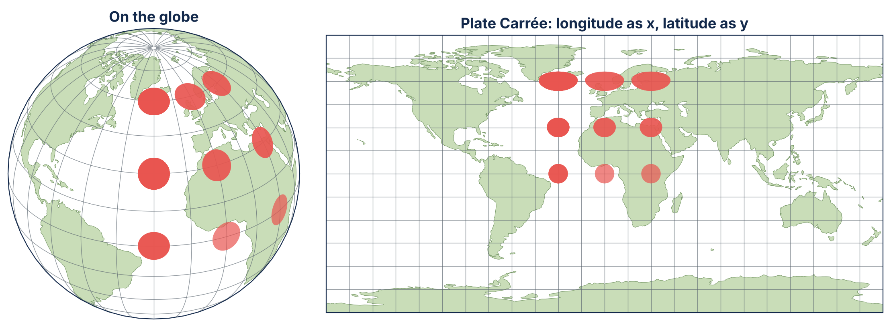
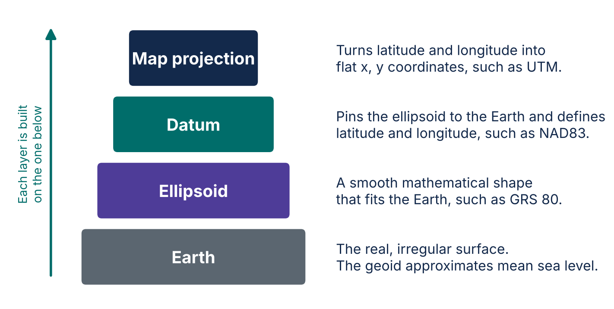

::: {.callout-note appearance="simple"}
## Learning objectives

By the end of this chapter you should be able to:

1.  Tell relative location from absolute location, and explain why a GIS needs absolute coordinates.
2.  Describe how geodesy models the Earth's shape with a sphere, an ellipsoid, and the geoid.
3.  Explain the difference between ellipsoid height, orthometric height, and geoid height, and use *h* = *H* + *N*.
4.  Explain what a geodetic datum is, compare NAD27, NAD83, and WGS84, and describe a datum shift.
5.  Convert coordinates between decimal degrees and degrees, minutes, and seconds, and choose a sensible number of decimal places.
6.  Describe how latitude and longitude are built from the poles, the equator, and a prime meridian, and define parallels, meridians, great circles, and the graticule.
7.  Explain why plotting latitude and longitude as *x* and *y* (the Plate Carrée) distorts the map.
:::

Chapter 2 asked how a computer can store a tree, a road, or a mountain. The answer was coordinates: a point is an *x, y* pair, and a line or polygon is a list of them. This chapter asks the next question. *What are those numbers measured from?* A coordinate pair like 35.91, −79.05 means nothing until you know what the Earth's shape is assumed to be, where that shape sits, and how the angles are counted. This is the first central problem of GIS: how do we represent a round, lumpy, spinning world in a computer?

Every GIS layer starts with location, and every location depends on three choices: a **model of the Earth's shape**, a **datum** that pins that model to the ground, and a **coordinate system** for writing positions. This chapter builds those three layers from the ground up. Chapter 4 adds the fourth, the map projection that flattens it all onto a screen.

## Where are we? {#sec-where}

People describe where things are all the time, and most of the time they do it relative to something else. "You are here" on a mall map. "Ten paces north of the old oak" on a treasure map. A pile of stones, a cairn, that marks a trail above the treeline. "Third floor, past the elevators" on a building directory. Each is a **relative location**: it describes a place by its relation to a landmark. Relative locations work well, but only if you already know the landmark. Hand the treasure map to someone in another county, cut down the oak, and the directions are useless.

A street address is a step better. 1600 Pennsylvania Avenue NW, Washington, DC, finds the White House for anyone who knows how Washington numbers its streets. But an address depends on a local naming system, and it doesn't work in the ocean, in a national forest, or in a new subdivision whose streets haven't been named yet.

An **absolute location** names a place in a system that means the same thing to everyone, everywhere. The White House is at 38° 53′ 52″ N, 77° 02′ 11″ W. Anyone with a GPS receiver, in any country, can go to that spot without knowing a single landmark in Washington. That is what a GIS needs: coordinates that resolve to the same spot no matter who reads them, so that layers made by different people at different times line up.

::: {.callout-tip appearance="simple"}
## Think about it

Write down three ways to tell a friend where your dorm or apartment is. Which are relative, which are absolute, and which would still work for a visitor from another country?
:::

## Modeling the shape of the Earth {#sec-shape}

### Geodesy

Before we can give anything a coordinate, we need a mathematical model of the Earth to measure against. **Geodesy** is the science of measuring the Earth's size, shape, orientation in space, and gravity field. It is one of the oldest sciences, and it began with a clever bit of geometry.

Around 240 BCE, Eratosthenes, the head of the great library at Alexandria, in Egypt, heard that at noon on the summer solstice the sun shone straight down a well at Syene (today's Aswan), far to the south, so that it cast no shadow. At the same moment in Alexandria, a vertical pole did cast a shadow, at an angle of about 7.2°. Because the sun is so far away, its rays arrive at the Earth parallel to each other. So the shadow angle at Alexandria is the same as the angle between the two cities measured at the Earth's center (@fig-eratosthenes). And 7.2° is one-fiftieth of a full circle (360° ÷ 7.2° = 50). The distance from Alexandria to Syene, about 5,000 *stadia*, must therefore be one-fiftieth of the Earth's circumference, which makes the circumference about 250,000 stadia.

{#fig-eratosthenes fig-alt="A diagram of the Earth as a circle, with parallel orange arrows of sunlight coming down from above. At the top of the circle, at Syene, a blue well catches the sunlight straight down. A little to the left, at Alexandria, a navy pole stands straight out from the surface and is tilted relative to the sun's rays. A small red arc between the pole and the ray is labeled 7.2 degrees. Two lines run from the two cities to the Earth's center, and a red arc between them is also labeled 7.2 degrees. A note says the angle is drawn larger than 7.2 degrees so you can see it."}

Nobody knows exactly how long Eratosthenes's stadion was, so we can't say exactly how close he came. Depending on which length you use, his answer is within roughly 2 to 15 percent of today's value of about 40,075 km around the equator. Not bad for a stick, a well, and some geometry, more than 2,200 years ago.

Modern geodesy uses satellites, lasers, radio telescopes, and the Global Positioning System (GPS) to measure positions to the centimeter, and to watch the continents drift by a few centimeters a year. That precision is what makes modern datums possible.

### Sphere or ellipsoid?

The simplest model of the Earth is a **sphere**, with one radius, about 6,371 km, everywhere. For a world map on a page, a sphere is good enough.

But the Earth spins, and spinning makes it bulge at the equator and flatten at the poles. Its shape is an **oblate spheroid**, or **ellipsoid**: an ellipse rotated about its short, polar axis (@fig-ellipsoid). Two numbers define an ellipsoid:

- The **semi-major axis**, *a*, is the equatorial radius: about 6,378 km.
- The **semi-minor axis**, *b*, is the polar radius: about 6,357 km.

How squashed the ellipsoid is, its **flattening**, is

$$f = \frac{a - b}{a}$$

For the Earth, *f* is about 1/298. The equatorial radius is only about 21 km longer than the polar radius, a third of one percent, which is why the Earth looks perfectly round from space. But 21 km is a big error when you want positions to the meter, so detailed mapping always uses an ellipsoid.

{#fig-ellipsoid fig-alt="Two panels. Left, titled Sphere: one radius everywhere, a pale blue circle with a red arrow from the center to the edge labeled r. Right, titled Ellipsoid: wider at the equator, a pale blue ellipse that is wider than it is tall, with a dotted circle behind it for comparison. A red arrow from the center to the right edge is labeled a, at the equator, and a green arrow from the center to the top is labeled b, at the North Pole. Below it reads flattening f equals a minus b over a. A note says the flattening is exaggerated, and on the real Earth a is only about 21 kilometers longer than b."}

Over the years, surveyors have fitted many ellipsoids to the Earth, each from the best measurements of its day, and some fitted to one region rather than the whole planet. Three you will meet:

| Ellipsoid | Semi-major axis *a* | Semi-minor axis *b* | Used by |
|:--|:--|:--|:--|
| Clarke 1866 | 6,378,206.4 m | 6,356,583.8 m | NAD27, the older North American datum |
| GRS 80 | 6,378,137.0 m | 6,356,752.3 m | NAD83 |
| WGS 84 | 6,378,137.0 m | 6,356,752.3 m | WGS84, the datum GPS uses |

: Three common ellipsoids. GRS 80 and WGS 84 differ by only a fraction of a millimeter in *b*. {#tbl-ellipsoids}

::: {.callout-note .did-you-know appearance="simple" icon=false}
## Did you know..?

Mount Everest is the highest mountain above sea level, at 8,849 m. But because the Earth bulges at the equator, the summit of Chimborazo, a volcano in Ecuador just one degree south of the equator, is the point on Earth's surface farthest from the Earth's center: about 6,384 km, roughly 2 km farther out than Everest's summit, even though Chimborazo is only about 6,263 m above sea level. Stand on top of Chimborazo, and you are the person on land closest to the stars.
:::

### The geoid

An ellipsoid is smooth and mathematical. The real Earth isn't. Mountains, ocean trenches, and dense rock deep inside the planet make gravity a little stronger in some places and weaker in others, and water flows "downhill" toward the stronger pull.

Imagine the oceans perfectly still, with no tides, winds, or currents, and extended in canals under the continents. Their surface would settle along a surface of equal gravity. That surface is the **geoid**, and it is the best match to global **mean sea level**. Because mass inside the Earth is unevenly spread, the geoid is lumpy: relative to the WGS 84 ellipsoid, it sits as much as about 106 m below, in the Indian Ocean south of India, and about 85 m above, near New Guinea.

The geoid matters because it is what *elevation* is measured from. When a topographic map says a summit is 2,037 m above sea level, that height is measured from the geoid. Geodesists publish geoid models that give the geoid's height everywhere: **EGM2008** for the whole world, and **GEOID18** for the United States.

### Three heights

So every point on the ground has three related heights (@fig-heights):

- **Ellipsoid height**, *h*: the height above the ellipsoid. This is what a GPS receiver measures.
- **Orthometric height**, *H*: the height above the geoid. This is the elevation printed on maps, the "height above sea level."
- **Geoid height**, *N*: the distance between the two surfaces at that spot, from the ellipsoid up to the geoid.

They are related by a simple equation:

$$h = H + N$$

{#fig-heights fig-alt="A cross-section of a hill. The tan ground rises to a peak in the middle, with pale blue water on each side. A dashed blue wavy line, the geoid, about mean sea level, runs through the hill near its base. A solid purple straight line below it is the ellipsoid, a smooth model. A red dot marks the top of the hill. A purple arrow labeled h runs from the ellipsoid up to the dot. A blue arrow labeled H runs from the geoid up to the dot. A short green arrow labeled N runs from the ellipsoid up to the geoid. A key in the corner reads: h equals ellipsoid height, what GPS reports; H equals orthometric height, elevation above the geoid; N equals geoid height, gap between the two; h equals H plus N."}

In the lower 48 United States the geoid lies *below* the ellipsoid, so *N* is negative, roughly −30 m. In North Carolina it is roughly −30 to −35 m. Rearranging the equation, *H* = *h* − *N*, so elevation is about 30 m *higher* than the raw height a GPS receiver reports. That is why surveyors and GPS apps always apply a geoid model before they report an elevation.

::: {.callout-tip appearance="simple"}
## Think about it

A GPS receiver on a hilltop in Chapel Hill reports an ellipsoid height of 120 m. The geoid height there is about −33 m. What is the hilltop's elevation above sea level?

Show the answer

*H* = *h* − *N* = 120 − (−33) = **153 m**. Subtracting a negative number adds it, so the elevation is higher than the GPS height.

:::

## Geodetic datums {#sec-datums}

### What is a datum?

An ellipsoid on its own is just a shape floating in space. A **geodetic datum** fixes an ellipsoid's size, shape, and position relative to the real Earth: where its center is, and how it is oriented. Only then do latitude and longitude point to real places on the ground. A datum combines:

- an **ellipsoid**,
- an **origin and orientation**, which say where the ellipsoid sits, and
- a **network of control points** on the ground whose coordinates have been measured precisely.

Those **control points** are how a datum is *realized*, made real on the ground. For two centuries surveyors measured them with instruments like the theodolite, a telescope that measures horizontal and vertical angles very precisely, and by **triangulation**: measuring the angles of a chain of triangles between hilltop stations, and from a few carefully measured baselines working out the distance to every other station, across a whole continent. At each station they set a bronze disk, a **benchmark** or survey marker, in rock or concrete, often with a witness post nearby warning people not to disturb it. You can find these disks on mountaintops, bridges, and courthouse steps all over the country, and the National Geodetic Survey publishes the coordinates of each one.

Today the control network is mostly satellites and permanent GPS stations, but the idea is the same. Every coordinate you collect is only meaningful relative to a particular datum.

### NAD27

The **North American Datum of 1927 (NAD27)** used the Clarke 1866 ellipsoid, which was fitted to North America rather than to the whole Earth. Its origin was a single survey station on Meades Ranch, in Kansas, near the middle of the contiguous United States. Its coordinates came from a huge adjustment of the triangulation networks of the day. Many older maps, including the classic USGS paper topographic quadrangles, use NAD27.

### NAD83

The **North American Datum of 1983 (NAD83)** uses the GRS 80 ellipsoid and is *earth-centered*: the center of its ellipsoid is at the Earth's center of mass. That made it compatible with satellite positioning. NAD83 is fixed to the North American tectonic plate, so the coordinates of a benchmark stay the same as the continent drifts.

NAD83 has been readjusted several times as measurements improved. Each version is a *realization*, written with its year in parentheses: NAD83(HARN), NAD83(2007), and **NAD83(2011)**, the current one. A nationwide network of **Continuously Operating Reference Stations (CORS)**, GPS receivers bolted to buildings and concrete piers that run around the clock, keeps it accurate.

NAD83 is the datum of most U.S. federal and state GIS data, including the U.S. Census Bureau's TIGER/Line files and North Carolina's NC OneMap.

### WGS84

The **World Geodetic System 1984 (WGS84)** is a global, earth-centered datum maintained by the U.S. Department of Defense, and it is the datum GPS uses. Coordinates from your phone, from Google Maps, and from most websites are almost always WGS84.

In 1984, WGS84 and NAD83 agreed to within about a meter. But NAD83 moves with the North American plate, while WGS84 is tied to the whole Earth, so as the plate has drifted (and been realized again with better measurements) the two have separated. In North America today they differ by about 1 to 2 meters. For a statewide map, that is too small to see. For a survey of a property line, it matters a lot.

### Datum shift

Here is the key point: **the same latitude and longitude point to different places in different datums** (@fig-datum-shift). The difference between where a coordinate lands in one datum and where it lands in another is a **datum shift**.

{#fig-datum-shift fig-alt="A diagram of the real Earth as a slightly lumpy tan shape. A solid green ellipse, Datum 1, earth-centered like NAD83 or WGS84, fits around it centered on the Earth's center. A dashed red ellipse, Datum 2, fitted to one region like NAD27, is slightly smaller and shifted up and to the right. From each ellipse's center, marked with a plus sign, a line runs out at the same angle to a dot on that ellipse. The two dots are close together but not in the same place. A label reads: same latitude and longitude, two different places on the ground."}

Between NAD27 and NAD83, the shift is anywhere from a few meters to over 100 meters across the United States. In one well-known USGS example from the Hayward, California, quadrangle, a single coordinate pair plotted in NAD27 and in NAD83 lands nearly 100 meters apart. That is a city block, plenty to put a well on the wrong side of a property line or a fire hydrant in the middle of a street.

This is one of the most common errors in GIS. Two layers that should line up, such as roads and parcels, are offset by a constant amount, because one is in NAD27 and the other in NAD83. The fix is a **datum transformation**: a set of equations, or a grid of measured shifts, that converts coordinates from one datum to another. QGIS and ArcGIS Pro apply datum transformations when you project or import data, and they will sometimes ask you to choose one. Before you combine layers, **check each layer's datum**.

::: {.callout-note .did-you-know appearance="simple" icon=false}
## Did you know..?

NAD83 is about to retire. The National Geodetic Survey is replacing it with a new set of datums, the modernized National Spatial Reference System. **NATRF2022** (the North American Terrestrial Reference Frame of 2022) will replace NAD83 for latitude and longitude, and **NAPGD2022** will replace NAVD 88 for elevations. Because NAD83's center turned out to be about 2 meters off the Earth's true center of mass, coordinates in the new datum will move by about 1 to 2 meters across the country, and elevations will change by up to a meter or more. Beta tools were released in 2026 and adoption is expected around 2027, so this is a datum change you will live through in your own career.
:::

## Geographic coordinates {#sec-geographic}

### Building a coordinate system

With a datum in place, we can write positions as latitude and longitude. Let's build that coordinate system from scratch.

1.  **The poles.** The Earth spins around an axis. Where the axis meets the surface are the North and South Poles: two natural reference points.
2.  **The equator.** Halfway between the poles is the equator, the natural zero line for north and south.
3.  **A prime meridian.** For east and west there is no natural zero line, so we have to choose one. Many countries once used their own: Paris, Washington, Philadelphia, Cádiz. In 1884, the International Meridian Conference in Washington, DC, chose the meridian through the Royal Observatory at Greenwich, England, as the **prime meridian** for the world.

With those reference lines in place (@fig-latlon):

- **Latitude** is the angle north or south of the equator, measured at the Earth's center. It runs from 0° at the equator to 90° N at the North Pole and 90° S at the South Pole.
- **Longitude** is the angle east or west of the prime meridian. It runs from 0° at Greenwich to 180° east or west. 180° E and 180° W are the same line, which the International Date Line roughly follows.

{#fig-latlon fig-alt="Two circle diagrams. Left, titled Latitude: the angle north or south of the equator, seen from the side. A circle with a dashed horizontal line labeled equator, 0 degrees, and a vertical axis from the North Pole, 90 degrees north, to the South Pole, 90 degrees south. A red line runs from the center to a dot on the edge labeled Chapel Hill, with a red arc between it and the equator labeled latitude 35.9 degrees north. Right, titled Longitude: the angle east or west of the prime meridian, seen from above the pole. A circle with the North Pole at the center. A navy line runs straight down to the edge, labeled prime meridian, 0 degrees, Greenwich. A green line runs from the center to a dot on the left edge labeled Chapel Hill, with a green arc between the two lines labeled longitude 79.05 degrees west."}

Strictly, on an ellipsoid the latitude angle is measured between the equator and a line *perpendicular to the ellipsoid's surface*, which doesn't pass quite through the center. This **geodetic latitude** is what GIS software and GPS use. The difference from the simple picture is at most about a fifth of a degree, at 45°.

### Parallels and meridians

Now draw the grid (@fig-parallels-meridians).

- **Parallels** are lines of equal latitude. They run east and west, they are parallel to the equator and to each other, and they get shorter toward the poles. They measure latitude.
- **Meridians** are lines of equal longitude. They run north and south, from pole to pole, and all of them meet at the poles. They measure longitude.

{#fig-parallels-meridians fig-alt="Two globes centered on the Atlantic. On the left, titled Parallels: lines of latitude, red circles run east and west around the globe every 15 degrees, getting smaller toward the North Pole, with a thick red line labeled Equator 0 degrees. On the right, titled Meridians: lines of longitude, green lines run from pole to pole every 15 degrees, meeting at the North Pole, with a thick green line through western Europe and Africa labeled Prime Meridian 0 degrees."}

The equator and the prime meridian are both zero lines, so a place on the equator is at 0° N, which is the same as 0° S, and a place on the prime meridian is at 0° E, which is the same as 0° W. Both answers are right.

### How far is a degree?

Because the parallels are evenly spaced, one degree of latitude is always about the same distance: **about 111 km**, or 69 miles. (It varies a little, from 110.6 km at the equator to 111.7 km at the poles, because the ellipsoid is flatter there.)

A degree of longitude is different. The meridians come together at the poles, so the distance between them shrinks as you move away from the equator. One degree of longitude is about 111 km at the equator, about 90 km at Chapel Hill's latitude, 56 km at 60° N, and zero at the poles. (The rule is 111 km × the cosine of the latitude.) Remember this. It is why latitude and longitude are angles, not distances, and why you can't measure distance or area in degrees.

### Writing degrees

Latitude and longitude are angles, and there are two common ways to write them (@tbl-dd-dms).

**Decimal degrees (DD)** write the angle as one signed number. Positive numbers are north latitudes and east longitudes; **negative numbers are south latitudes and west longitudes**. Chapel Hill is at 35.9132, −79.0558. This is the format most GIS software and GPS units use, and the one you should type into a GIS.

**Degrees, minutes, and seconds (DMS)** split the angle the way we split an hour: there are 60 minutes (′) in a degree and 60 seconds (″) in a minute, so a second is 1/3,600 of a degree. Instead of a sign, DMS uses a letter for the hemisphere: N, S, E, or W. Chapel Hill is at 35° 54′ 48″ N, 79° 03′ 21″ W.

| | Decimal degrees | Degrees, minutes, seconds |
|:--|:--|:--|
| Example | −104.54° | 104° 32′ 24″ W |
| Hemisphere | A sign: negative is south or west | A letter: N, S, E, or W |
| Used by | GIS software, GPS, spreadsheets, the web | Paper maps, nautical charts, surveys, deeds |

: Two ways to write the same longitude, a meridian that runs just east of Denver, Colorado. {#tbl-dd-dms}

### Converting between them

**Decimal degrees to DMS.** Take −104.54°:

1.  The whole number is the degrees: **104°**.
2.  Multiply the decimal part by 60 to get minutes: 0.54 × 60 = 32.4, so **32′**.
3.  Multiply the leftover decimal by 60 again to get seconds: 0.4 × 60 = **24″**.
4.  The sign becomes the hemisphere letter. A negative longitude is west: **104° 32′ 24″ W**.

**DMS to decimal degrees.** Take the White House's latitude, 38° 53′ 52″ N:

$$DD = D + \frac{M}{60} + \frac{S}{3600}$$

$$38 + \frac{53}{60} + \frac{52}{3600} = 38 + 0.8833 + 0.0144 = 38.8978°$$

It is north, so the number stays positive: **38.8978°**. For a longitude west of Greenwich or a latitude south of the equator, put a minus sign in front.

Keep at least four to six decimal places when you convert, or the point will move. The next section shows how far.

::: {.callout-tip appearance="simple"}
## Think about it

Convert Chapel Hill's longitude, −79.0558°, to degrees, minutes, and seconds. Then convert 35° 54′ 48″ N to decimal degrees.

Show the answers

79°; 0.0558 × 60 = 3.348, so 3′; 0.348 × 60 = 20.88, about 21″. Negative, so west: **79° 03′ 21″ W**.

35 + 54/60 + 48/3600 = 35 + 0.9 + 0.01333 = **35.9133°**.

:::

### Precision and location

How many decimal places should a coordinate have? Each decimal place makes a coordinate ten times more precise (@tbl-precision). Since a degree of latitude is about 111 km, each place you add divides that distance by ten.

| Decimal places | Example | Distance at the equator (approx.) | Enough to find |
|:--|:--|:--|:--|
| 0 | 36° | 111 km | A large region |
| 1 | 35.9° | 11 km | A town |
| 2 | 35.91° | 1.1 km | A neighborhood |
| 3 | 35.913° | 110 m | A large field or a city block |
| 4 | 35.9132° | 11 m | A house lot |
| 5 | 35.91320° | 1.1 m | A tree |
| 6 | 35.913200° | 11 cm | A survey marker, with survey-grade GPS |
| 7 | 35.9132000° | 1.1 cm | Plate tectonics research |

: How precise is a decimal degree? Distances are for latitude, and for longitude at the equator; a degree of longitude covers less ground away from the equator. {#tbl-precision}

A phone's GPS is usually accurate to about 3 to 5 meters in the open, so **five decimal places**, about a meter, is already more than enough. Reporting eight decimal places claims millimeter precision that a phone doesn't have. Extra decimals don't make your data more accurate; they only make it look more accurate than it is. On the other hand, cutting coordinates to two or three decimal places, which spreadsheets sometimes do on their own, can move your points by a kilometer.

## Lines on the globe {#sec-lines}

### Great circles

A **great circle** is the largest circle you can draw on a sphere. Its plane passes through the Earth's center, and it cuts the globe into two equal halves. Any circle whose plane doesn't pass through the center is a *small circle*.

Great circles matter for one big reason: **the shortest route between two points on a sphere follows a great circle**. That is why airline routes look curved on flat maps. A flight from New York to London heads northeast, passes near Newfoundland, and approaches Britain from the northwest. It looks like a detour on a flat map, but on the globe it is the straight path (@fig-great-circle).

{#fig-great-circle fig-alt="Two maps. Left, On a flat Plate Carrée map, a rectangular map of the North Atlantic with a square grid. A solid red line arcs north from New York and down to London, and a dashed navy line runs straight between them. Right, On the globe, the same two routes on a globe centered on the North Atlantic: here the red line looks straight and the dashed line bows south. A note below reads: Solid red, the great-circle route, the shortest path, about 5,560 kilometers. Dashed, a straight line on the flat map, about 5,790 kilometers."}

Which parallels and meridians are great circles?

Show the answer

Every meridian, together with the meridian on the opposite side of the globe (180° away), makes a great circle, because its plane passes through the poles and the Earth's center. Of the parallels, **only the equator** is a great circle. Every other parallel is a small circle, and the parallels get smaller toward the poles.

### The graticule

The **graticule** is the network of parallels and meridians drawn on a map. It tells readers how the map has bent the globe to flatten it, and it lets them estimate the latitude and longitude of any place.

Choosing which lines to draw is a design decision (@fig-graticule). Too many lines clutter the map and compete with the data; too few, and the grid stops being useful. A common rule of thumb is every 15° or 30° on a world map, every 5° or 10° on a map of a continent, and every degree or less on a map of a state. Always ask what the reader needs the grid for. A world map of climate zones might only need the equator, the tropics, and the Arctic and Antarctic Circles.

{#fig-graticule fig-alt="Three small world maps on the Robinson projection, side by side. Every 5 degrees: so many gray grid lines that the land is hard to see. Every 15 degrees: a moderate grid. Every 30 degrees: only a few lines."}

## From globe to flat map {#sec-plate-carree}

Latitude and longitude are angles measured on a curved surface. They are not *x* and *y* distances on a flat plane. But a computer screen is flat, and so is a sheet of paper. So what happens if we simply pretend they are?

Plot longitude as *x* and latitude as *y* on an even grid, and you get the **Plate Carrée**, French for "flat square," also called the *equirectangular projection* (@fig-plate-carree). Every 1° by 1° cell is a square on the map. It is what you see when you add a layer in latitude and longitude to a GIS without choosing a projection.

{#fig-plate-carree fig-alt="Two maps. Left, a globe centered on the Atlantic with a 15 degree grid and five red circles, all the same size on the globe, at the equator, at 30 degrees north, and at 60 degrees north. Right, a rectangular world map with a square 15 degree grid and the same five circles. The circle on the equator is round, the ones at 30 degrees north are a little wider than they are tall, and the ones at 60 degrees north are stretched into wide ovals, about twice as wide as they are tall."}

The grid is simple, but the cells are only square on the map, not on the globe. On the Earth, a 1° cell at the equator is about 111 km on each side; at 60° N it is still 111 km tall but only 56 km wide. The Plate Carrée draws both as squares, so it stretches everything east to west more and more toward the poles. Greenland looks wide and squat, and Antarctica becomes a long band across the bottom of the map.

That raises the question for the next chapter: *how do we represent a round Earth on a flat surface?* Every answer, called a **map projection**, distorts something. Chapter 4 shows what each kind of projection keeps and what it gives up.

::: {.callout-note .did-you-know appearance="simple" icon=false}
## Did you know..?

If you visit the Royal Observatory in Greenwich and stand astride the famous brass line of the prime meridian, a GPS app will tell you that you are not at 0°. It reads about 0.0015° W: the zero of longitude that GPS uses is about **102 meters east** of the line. Nothing moved. The brass line marks the meridian astronomers defined in 1851 with a telescope that pointed along the local direction of gravity, which is tilted slightly by the local geoid. The modern earth-centered datums, WGS84 among them, define longitude from the Earth's center of mass instead, and that small difference in the vertical becomes about 100 meters on the ground.
:::

## Putting it together {#sec-stack}

Think of location in a GIS as a stack, with each layer built on the one below (@fig-stack):

1.  **The Earth**, the real, irregular surface, approximated by the geoid.
2.  **An ellipsoid**, a smooth mathematical model of the Earth, such as GRS 80.
3.  **A datum**, which pins the ellipsoid to the Earth and defines latitude and longitude, such as NAD83.
4.  **A map projection**, which turns latitude and longitude into flat *x, y* coordinates, such as UTM.

{#fig-stack fig-alt="Four stacked boxes, widest at the bottom, with an arrow pointing up beside them labeled each layer is built on the one below. From the bottom: Earth, the real, irregular surface, the geoid approximates mean sea level; Ellipsoid, a smooth mathematical shape that fits the Earth, such as GRS 80; Datum, pins the ellipsoid to the Earth and defines latitude and longitude, such as NAD83; Map projection, turns latitude and longitude into flat x, y coordinates, such as UTM."}

A coordinate system that stops at the third layer, giving positions in latitude and longitude on a datum, is a **geographic coordinate system (GCS)**. NAD83 and WGS84, used for latitude and longitude, are both geographic coordinate systems. A coordinate system that adds the fourth layer is a *projected coordinate system*, the subject of Chapter 4.

The most common point of confusion in this part of the course is the difference between a **datum** and a **projection**. A datum answers *where is the Earth, and what shape is it?* A projection answers *how do I flatten it?* Changing the datum moves your points on the ground. Changing the projection only changes how they are drawn on a flat map.

## Check your understanding

::: {.content-visible when-format="html"}

1.  "Ten paces north of the old oak" is an example of: <select class='webex-select'><option value='blank'></option><option value=''>Absolute location</option><option value='answer'>Relative location</option><option value=''>A datum</option><option value=''>A great circle</option></select>

2.  Because the Earth spins, its shape is best modeled as: <select class='webex-select'><option value='blank'></option><option value=''>A perfect sphere</option><option value='answer'>An oblate ellipsoid</option><option value=''>A cylinder</option><option value=''>A cube</option></select>

3.  Elevations above sea level are measured from the ellipsoid. <select class='webex-select'><option value='blank'></option><option value=''>TRUE</option><option value='answer'>FALSE</option></select>

4.  A GPS reports an ellipsoid height of 100 m where the geoid height is −30 m. What is the orthometric height, in meters? <input class='webex-solveme nospaces' size='5' data-answer='["130"]'/>

5.  Which datum does GPS use? <select class='webex-select'><option value='blank'></option><option value=''>NAD27</option><option value=''>NAD83</option><option value='answer'>WGS84</option><option value=''>Clarke 1866</option></select>

6.  In decimal degrees, a longitude west of Greenwich is written as a ___ number. <select class='webex-select'><option value='blank'></option><option value=''>positive</option><option value='answer'>negative</option></select>

7.  Convert 38° 30′ 00″ N to decimal degrees. <input class='webex-solveme nospaces' size='6' data-answer='["38.5"]'/>

8.  Which parallel is a great circle? <select class='webex-select'><option value='blank'></option><option value=''>The Tropic of Cancer</option><option value='answer'>The equator</option><option value=''>The Arctic Circle</option><option value=''>45° N</option></select>

<button>Show hint for question 4</button>

Use *H* = *h* − *N*, and remember that subtracting a negative number adds it.

:::

::: {.content-visible unless-format="html"}
The interactive self-check questions for this chapter are in the online version of the book.
:::

## Summary

- A GIS needs **absolute locations**, coordinates that mean the same thing to everyone, rather than **relative locations** tied to landmarks.
- **Geodesy** measures the Earth's size and shape. Eratosthenes estimated its circumference around 240 BCE from shadow angles.
- The Earth is modeled as an **ellipsoid**, defined by its **semi-major axis** *a* and **semi-minor axis** *b*, with a **flattening** of about 1/298. Common ellipsoids are Clarke 1866, GRS 80, and WGS 84.
- The **geoid** is the surface of equal gravity that best matches mean sea level. Elevations are measured from it. **Ellipsoid height** (from GPS), **orthometric height** (elevation), and **geoid height** are related by *h* = *H* + *N*.
- A **geodetic datum** fixes an ellipsoid to the Earth through **control points**. **NAD27** used Clarke 1866 and an origin in Kansas; **NAD83** uses GRS 80 and is earth-centered; **WGS84** is the global datum GPS uses. The same coordinates land in different places in different datums, so check each layer's datum and apply a **datum transformation** when needed.
- **Latitude** is measured north and south from the **equator**, and **longitude** east and west from the **prime meridian** at Greenwich. **Parallels** are lines of latitude and **meridians** are lines of longitude; the network of both on a map is the **graticule**.
- Coordinates can be written in **decimal degrees** (negative for south and west) or **degrees, minutes, and seconds**. Each decimal place makes a coordinate ten times more precise; five places is about a meter.
- The shortest route between two places follows a **great circle**.
- Treating latitude and longitude as *x* and *y* gives the **Plate Carrée**, which stretches the map toward the poles. Flattening the Earth well takes a map projection, the subject of Chapter 4.

## Exercises

1.  **Describe a place three ways.** Pick a place on campus. Describe it with a relative location, a street address, and an absolute location in both decimal degrees and DMS. (Find its coordinates by right-clicking it in Google Maps or OpenStreetMap.)
2.  **Eratosthenes at home.** Suppose that at noon a pole in your town casts a shadow at an angle of 5°, while at the same moment the sun is straight overhead in a town 550 km due south. What is the Earth's circumference by Eratosthenes's method? How close is it to 40,075 km?
3.  **Conversions.** Convert to DMS: 35.2271, −80.8431 (Charlotte) and −33.8568, 151.2153 (the Sydney Opera House). Convert to decimal degrees: 40° 41′ 21″ N, 74° 02′ 40″ W (the Statue of Liberty).
4.  **Heights.** Look up the elevation and the geoid height for your hometown with the NGS GEOID18 calculator (<https://geodesy.noaa.gov/GEOID/GEOID18/computation.html>). What ellipsoid height would a GPS receiver report there?
5.  **Find a benchmark.** Use the NGS Data Explorer (<https://geodesy.noaa.gov/NGSDataExplorer/>) to find a survey marker near campus. What datum are its coordinates given in? When was it last recovered?
6.  **Datum detective.** In QGIS, open the Layer Properties of any layer and find its coordinate reference system on the Information tab. In ArcGIS Pro, look in the layer's Properties, on the Source tab. Which datum does it use? Find one layer from a state or federal source and one from a website or a phone app. Do they use the same datum?
7.  **Precision.** A classmate collects tree locations with a phone and records them to ten decimal places. Explain, using @tbl-precision, why that is misleading. How many decimal places would you keep, and why?
8.  **Great circles.** Use the Great Circle Mapper (<http://www.gcmap.com>) to draw the route from Raleigh-Durham (RDU) to Tokyo (NRT). Which states and countries does it pass over? Why doesn't it head due west?

## Further reading and online resources

### Books and open textbooks

- *GIS Fundamentals: A First Text on Geographic Information Systems*, by Paul Bolstad [@bolstad2022]. Chapter 3, "Geodesy, Projections, and Coordinate Systems," covers ellipsoids, the geoid, datums, and coordinates in depth.
- *Understanding GIS through Sustainable Development Goals*, by Paul Holloway [@holloway2023]. Its chapter on coordinate systems and projections works through these ideas in QGIS and ArcGIS Pro.
- *The Nature of Geographic Information*, by David DiBiase and colleagues at Penn State. Chapter 2, "Scales and Transformations," explains coordinate systems, the geoid, the ellipsoid, and datums: <https://www.e-education.psu.edu/natureofgeoinfo/c2.html>.
- *Essentials of Geographic Information Systems*, by Jonathan Campbell and Michael Shin. Chapter 2, "Map Anatomy," covers the Earth's shape, coordinate systems, and datums: <https://open.umn.edu/opentextbooks/textbooks/67>.
- *Intro to GIS and Spatial Analysis*, by Manuel Gimond. The chapter "Coordinate Systems" is short and clear: <https://mgimond.github.io/Spatial/chp09_0.html>.
- *GIS Commons*, by Michael Schmandt. The chapter "Coordinate Systems and Map Projections": <https://giscommons.org>.
- *Map Projections: A Working Manual*, by John P. Snyder [@snyder1987], USGS Professional Paper 1395. The first chapters explain the Earth's shape, datums, and the geometry behind coordinates: <https://pubs.usgs.gov/publication/pp1395>.

### Geodesy, the geoid, and heights

- NOAA National Geodetic Survey (NGS), "What is geodesy?": <https://oceanservice.noaa.gov/facts/geodesy.html>.
- NOAA National Ocean Service, "Geodesy" tutorial, a short illustrated course on the Earth's shape, the geoid, and datums: <https://oceanservice.noaa.gov/education/tutorial_geodesy/>.
- NGS, the GEOID18 model and an online calculator for geoid height anywhere in the United States: <https://geodesy.noaa.gov/GEOID/GEOID18/>.
- NGS, "What is the geoid?": <https://geodesy.noaa.gov/GEOID/geoid_def.html>.
- National Geospatial-Intelligence Agency (NGA), Earth Gravitational Model 2008 (EGM2008): <https://earth-info.nga.mil/>.
- Esri, "Earth's shape and the geoid," in the ArcGIS Pro help on vertical coordinate systems: <https://pro.arcgis.com/en/pro-app/latest/help/mapping/properties/vertical-coordinate-systems.htm>.
- The GIS&T Body of Knowledge has articles on "Geodesy," "Earth Geometry," "Datums," "Plane Coordinate Systems," and "Georeferencing Systems": <https://www.ucgis.org/site/gis-t-body-of-knowledge>.

### Datums

- NGS, "Datums and reference frames," and the NGS Datums page: <https://geodesy.noaa.gov/datums/index.shtml>.
- NGS, "New Datums," on NATRF2022 and NAPGD2022, the replacements for NAD83 and NAVD 88: <https://geodesy.noaa.gov/datums/newdatums/index.shtml>.
- NGS, the Continuously Operating Reference Station (CORS) network: <https://geodesy.noaa.gov/CORS/>.
- NGS Data Explorer, a map of survey markers and their datasheets: <https://geodesy.noaa.gov/NGSDataExplorer/>.
- NGS Coordinate Conversion and Transformation Tool (NCAT), for converting coordinates between datums and formats: <https://geodesy.noaa.gov/NCAT/>.
- QGIS User Guide, "Working with Projections," including datum transformations: <https://docs.qgis.org/latest/en/docs/user_manual/working_with_projections/working_with_projections.html>.
- U.S. Geological Survey, "What is the difference between NAD27 and NAD83?" and related FAQs: <https://www.usgs.gov/faqs>.
- Esri ArcGIS Blog, articles on preparing data for the modernized National Spatial Reference System: <https://www.esri.com/arcgis-blog/>.

### Latitude, longitude, and great circles

- National Geographic Education, "Latitude" and "Longitude" encyclopedia entries: <https://education.nationalgeographic.org/resource/latitude/> and <https://education.nationalgeographic.org/resource/longitude/>.
- Malys, Seago, Pavlis, Seidelmann, and Kaplan, "Why the Greenwich meridian moved," *Journal of Geodesy* [@malys2015], the explanation of the 102-meter offset at Greenwich: <https://doi.org/10.1007/s00190-015-0844-y>.
- Great Circle Mapper, for drawing great-circle routes between airports: <http://www.gcmap.com>.
- *Longitude*, by Dava Sobel (Walker, 1995), the story of how sailors learned to find their longitude at sea.

### Software and tutorials

- QGIS Training Manual, "Vector Analysis: Reprojecting and Transforming Data": <https://docs.qgis.org/latest/en/docs/training_manual/vector_analysis/reproject_transform.html>.
- QGIS, *A Gentle Introduction to GIS*, the chapter "Coordinate Reference Systems": <https://docs.qgis.org/latest/en/docs/gentle_gis_introduction/coordinate_reference_systems.html>.
- Esri, "Coordinate systems, map projections, and transformations" in the ArcGIS Pro help: <https://pro.arcgis.com/en/pro-app/latest/help/mapping/properties/coordinate-systems-and-projections.htm>.
- Learn ArcGIS, "Choose the right projection" and related lessons: <https://learn.arcgis.com>.
- epsg.io, a searchable list of coordinate reference systems and their parameters: <https://epsg.io>.
