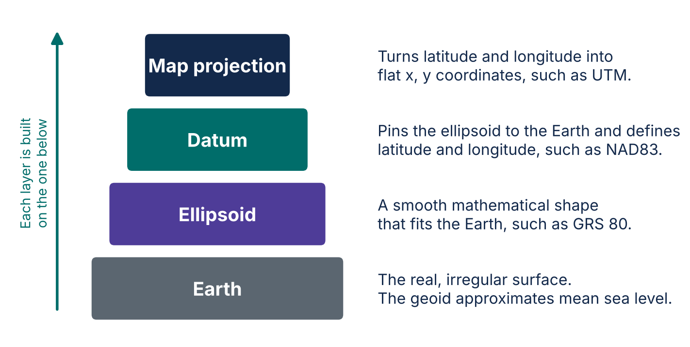
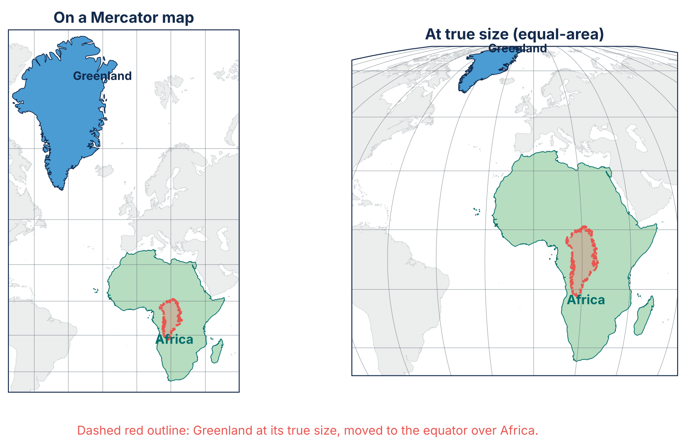
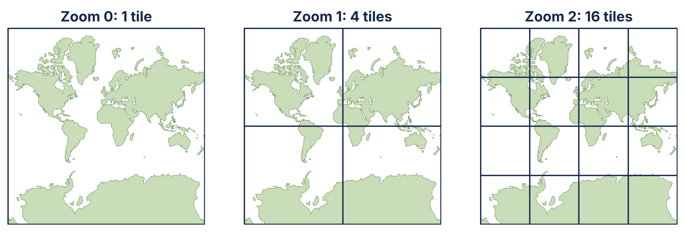
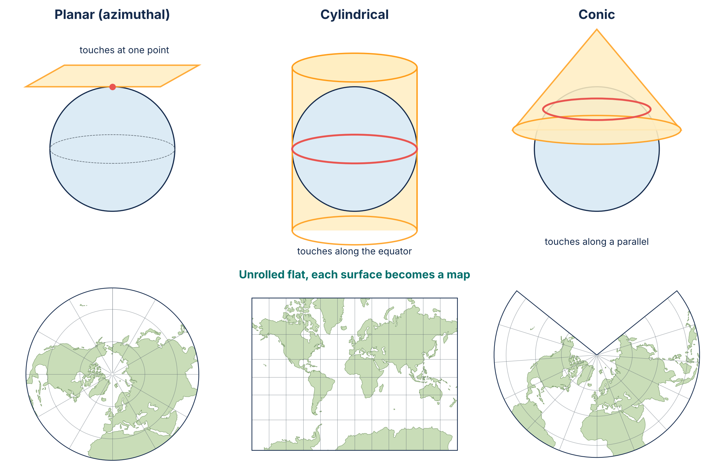
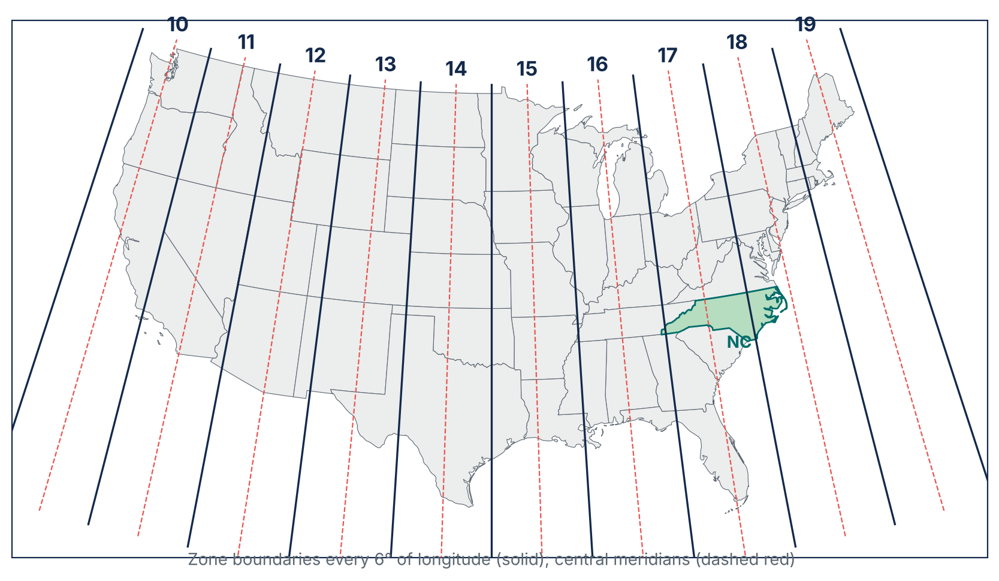
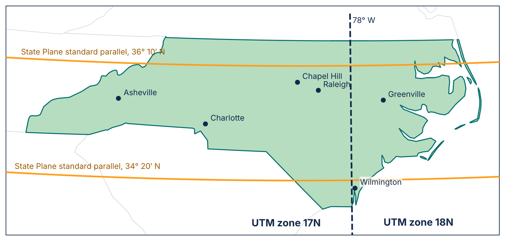

::: {.callout-note appearance="simple"}
## Learning objectives

By the end of this chapter you should be able to:

1.  Explain what a map projection is, and where it sits on top of an ellipsoid and a datum.
2.  Name the four properties a projection can preserve (shape, area, distance, and direction) and explain why no flat map preserves them all.
3.  Describe the three developable surfaces (the plane, the cylinder, and the cone) and tangent and secant projections, and explain how scale error grows away from standard lines.
4.  Explain why the Mercator and Web Mercator projections should not be used to compare or measure areas.
5.  Describe the Lambert Conformal Conic and Transverse Mercator projections, the UTM system, and the State Plane Coordinate System, and name the zones that cover North Carolina.
6.  Read an EPSG code and tell a geographic coordinate system from a projected one.
7.  Choose a projection for a study area and a measurement, and tell defining a projection from projecting data.
:::

Chapter 3 built the bottom three layers of location in a GIS: the real Earth, an ellipsoid that models it, and a datum that pins the ellipsoid to the ground and gives us latitude and longitude. This chapter adds the top layer (@fig-stack). A **map projection** converts latitude and longitude, angles on a curved surface, into flat *x, y* coordinates on a screen or a sheet of paper.

{#fig-stack fig-alt="Four stacked boxes, widest at the bottom, with an arrow pointing up beside them labeled each layer is built on the one below. From the bottom: Earth, the real, irregular surface, the geoid approximates mean sea level; Ellipsoid, a smooth mathematical shape that fits the Earth, such as GRS 80; Datum, pins the ellipsoid to the Earth and defines latitude and longitude, such as NAD83; Map projection, turns latitude and longitude into flat x, y coordinates, such as UTM."}

There is a catch, and it is the main idea of this chapter: **every flat map distorts the Earth**. You cannot flatten an orange peel without stretching or tearing it, and you cannot flatten the Earth without distorting shape, area, distance, or direction. Choosing a projection means choosing which errors you can live with. By the end of this chapter you will know how to make that choice for your own GIS work.

## What is a map projection? {#sec-what}

A **map projection** is a set of equations that converts latitude and longitude on the ellipsoid into *x, y* coordinates on a flat plane. Every projected map, every web map, and every measurement of distance or area in a GIS depends on one.

The classic way to picture a projection is with light. Put a light bulb inside a transparent globe, hold a screen against it, and the light casts the coastlines and the graticule onto the screen (@fig-light). Where the screen touches the globe, the image is exact. Farther away, the shadows stretch, and evenly spaced points on the globe spread farther and farther apart on the screen.

{#fig-light fig-alt="A cross-section of a globe as a pale blue circle, with a yellow light source at its center. A thick navy line, the map plane, touches the top of the circle. Orange rays run from the light through evenly spaced green dots on the upper half of the circle to red dots on the map plane. Near the top, where the plane touches the globe, labeled point of tangency, no distortion, the red dots are close to the green ones. Toward the edges the red dots spread farther and farther apart, labeled spread farther apart on the map."}

The light bulb is an analogy. Most modern projections are defined by equations, not by real shadows, but the analogy explains why distortion grows with distance from the place where the map surface touches the Earth.

::: {.callout-tip appearance="simple"}
## Think about it

Peel a clementine or an orange in as few pieces as you can, and try to press the peel flat on a table. Where does it tear? Where does it stretch? Every map projection makes the same kinds of compromises, just with mathematics instead of fingers.
:::

## Every projection distorts something {#sec-distortion}

### Four properties

A map can preserve four properties of the globe, each one named for the kind of projection that keeps it:

- **Shape.** A **conformal** projection keeps local angles true, so small shapes look right. A tiny circle on the globe is still a circle on the map, though it may be larger or smaller.
- **Area.** An **equal-area** (or *equivalent*) projection keeps relative size true. A county twice as large as another on the ground is twice as large on the map.
- **Distance.** An **equidistant** projection keeps true scale along certain lines, usually from one or two points. No projection keeps true distance between *every* pair of places.
- **Direction.** An **azimuthal** projection keeps true directions, or bearings, from a center point.

No flat map keeps all four. In particular, **no projection can be both conformal and equal-area**. Some projections preserve none of the four exactly, but keep every error moderate: these are **compromise** projections.

### Seeing distortion: Tissot's indicatrix

How can you *see* what a projection does? In 1859, the French mathematician Nicolas Auguste Tissot came up with an elegant tool, now called **Tissot's indicatrix**: draw identical small circles all over the globe, then project them. On the map, each circle becomes an ellipse whose size and shape show the distortion at that spot. If the circles stay round, shapes are preserved there; if they all cover the same area, area is preserved.

@fig-four-projections shows Tissot's circles, each 500 km across on the ground, on four world maps.

{#fig-four-projections fig-alt="Four world maps with red circles or ellipses spaced every 30 degrees. Mercator, conformal: a rectangular map where the circles stay round but grow much larger toward the top and bottom; caption, circles stay round, but grow toward the poles. Mollweide, equal-area: an oval map where every shape covers the same area, but those near the edges are squashed into thin tilted ellipses; caption, every circle covers the same area, but they stretch. Azimuthal equidistant: a round map centered on a yellow star at Chapel Hill, where the shapes near the center are round and those near the edge of the circle are stretched into long crescents; caption, distances from Chapel Hill, at the center, are true. Robinson, compromise: an oval-ish map with flat top and bottom, where the shapes grow and flatten moderately toward the poles; caption, nothing exact, every error is kept moderate."}

### Mercator and reality

The most famous map projection is the one Gerardus Mercator, a Flemish mapmaker, published in 1569 for sailors. On a **Mercator** map, a line of constant compass bearing, called a *rhumb line*, is a straight line. A navigator could draw a straight line from port to port, read its angle, and steer that compass course the whole way. The Mercator is conformal, so small shapes and angles are right, which is what made it so useful at sea.

The price is area. To keep shapes right while the meridians stay parallel, Mercator stretches the map north and south as much as it stretches east and west, and that stretch grows with latitude. On a Mercator map, the scale at any latitude is the *secant* of the latitude (1 ÷ cos), and areas are enlarged by the square of that. At 60° north or south, a place looks **four times** larger than it is. Near the poles, the enlargement goes to infinity, which is why Mercator maps are always cut off before the poles.

The classic example is Greenland and Africa (@fig-greenland). On a Mercator map they look about the same size. In fact, Africa, about 30 million km², is roughly **14 times** larger than Greenland, about 2.2 million km². Countries near the equator, like Brazil, Indonesia, and the Democratic Republic of the Congo, barely change size; countries far from it, like Canada, Russia, and Greenland, swell.

{#fig-greenland fig-alt="Two maps of the Atlantic side of the world, from Greenland to southern Africa. Left, On a Mercator map: blue Greenland at the top is huge, nearly as tall as Africa below it, which is green. A small dashed red outline of Greenland at its true size sits inside central Africa, covering only a narrow strip. Right, At true size, equal-area: Greenland at the top is a small blue shape, and green Africa is very large. The same dashed red outline of Greenland sits in the middle of Africa, small compared with the continent."}

**Use Mercator for navigation, not for comparing areas.**

::: {.callout-note .did-you-know appearance="simple" icon=false}
## Did you know..?

In 2017, the Boston Public Schools began replacing Mercator wall maps in their classrooms with the equal-area **Gall-Peters** projection. Teachers said the Mercator had shrunk Africa and South America in students' minds for generations. The Gall-Peters itself is controversial: when the historian Arno Peters promoted it in the 1970s as a fairer map, cartographers pointed out that a Scottish clergyman, James Gall, had published the same projection in 1855, and that it badly stretches shapes near the equator. Many cartographers would rather see a good compromise projection on the wall. Either way, the choice of a map projection turns out to be a choice about how people picture the world.
:::

### Web Mercator: for display, not measurement

Look at almost any web map, such as Google Maps, OpenStreetMap, Bing Maps, or an Esri basemap, and you are looking at **Web Mercator**, code **EPSG:3857**. It treats the Earth as a sphere while using WGS84 latitude and longitude, which makes the math fast. Its great strength is that the whole world fits in a square, which can be cut into square **tiles** at every zoom level: one tile at zoom 0, four at zoom 1, sixteen at zoom 2, and so on (@fig-tiles). Your browser only downloads the tiles you are looking at, which is why web maps scroll and zoom so smoothly.

{#fig-tiles fig-alt="Three square world maps on the Mercator projection, side by side. Zoom 0, 1 tile: one square. Zoom 1, 4 tiles: the same map divided into a 2 by 2 grid. Zoom 2, 16 tiles: a 4 by 4 grid."}

To make the world square, Web Mercator cuts the map off at about 85.05° north and south, so the North and South Poles are not on the map at all. And it inherits all of Mercator's area enlargement. Use it for:

- web basemaps, and
- smooth zooming and panning.

Avoid it for:

- measuring area or distance,
- comparing regions at different latitudes, and
- anything near the poles.

If you collect data from a web map, reproject it to an equal-area or a local projection, such as UTM or State Plane, before you calculate areas or distances.

## How projections are made {#sec-made}

### Three developable surfaces

A **developable surface** is a shape that can be unrolled flat without stretching or tearing. Three are used for map projections: the plane, the cylinder, and the cone (@fig-surfaces).

- **Planar** (or **azimuthal**): a flat plane touches the globe at one point. Distortion grows in rings around that point, so planar projections suit the polar regions, or maps centered on one place.
- **Cylindrical**: a cylinder wraps the globe. In its normal position it touches the equator, which suits the tropics, or a world map. Turned on its side, as in the Transverse Mercator below, it suits regions that run north to south.
- **Conic**: a cone sits over one hemisphere like a hat and touches it along a parallel. Conic projections suit mid-latitude regions that run east to west, such as the contiguous United States.

{#fig-surfaces fig-alt="Top row, three sketches. Planar, azimuthal: a flat sheet touching the top of a globe at one red point, labeled touches at one point. Cylindrical: a cylinder wrapped around a globe, touching it along a red line at the equator, labeled touches along the equator. Conic: a cone sitting on top of a globe like a hat, touching it along a red circle, labeled touches along a parallel. Below, labeled unrolled flat, each surface becomes a map: a round map of the Northern Hemisphere centered on the North Pole; a rectangular world map with a square grid; and a fan-shaped world map with curved parallels and meridians that meet at a point at the top."}

The line where a surface is sliced so it can be unrolled becomes the outer edge of the map.

### Tangent and secant

A projection surface can touch the globe in one place or cut through it (@fig-secant).

- A **tangent** surface touches the Earth along one line, or at one point for a planar projection.
- A **secant** surface cuts through the Earth along two lines, or along a circle for a planar projection.

Where the surface meets the Earth, scale is exact. These are the **standard lines** (or a standard point). When standard lines follow parallels of latitude, as on a conic projection, they are called **standard parallels**. The ratio of distance on the map to distance on the ground, compared with the map's stated scale, is the **scale factor**: exactly 1 on a standard line, less than 1 where the map shrinks the Earth, and more than 1 where it stretches it.

{#fig-secant fig-alt="Two cross-sections. Left, Tangent, touches at one place: an arc of the Earth's surface with an orange line, the map surface, touching it at one red point at the top, labeled standard point or line, scale is exact. Right, Secant, cuts through in two places: the orange map surface line cuts through the arc at two red points, labeled standard lines, scale is exact. Between them, two green points A and B on the arc are projected down to green squares a and b on the line, which are closer together. Outside the right standard line, two purple points D and E on the arc project out to purple squares d and e on the line, which are farther apart. Text reads: between the standard lines, ab is shorter than AB; outside them, de is longer than DE."}

Why cut through the Earth on purpose? A secant surface spreads the error across a wider area. A tangent surface is perfect on one line and gets steadily worse everywhere else. A secant surface is slightly too small between its standard lines and slightly too large outside them, which keeps the largest error over the whole map much smaller. Good projection design puts the standard lines so that the area you care about stays close to zero error.

### Projections are named for what they preserve

Putting it together, projections are grouped by the property they keep (@tbl-properties).

| Property preserved | Class | Examples | Typical use |
|:--|:--|:--|:--|
| Shape (local angles) | Conformal | Mercator, Lambert Conformal Conic, Transverse Mercator | Navigation, topographic and engineering maps |
| Area | Equal-area | Albers Equal-Area Conic, Mollweide | Thematic maps of density or land cover |
| Distance from one or two points | Equidistant | Azimuthal Equidistant, Equidistant Conic | Distances from a city or an airport |
| Direction from a center point | Azimuthal | Gnomonic, Azimuthal Equidistant | Polar maps, great-circle routes |
| None exactly; all errors moderate | Compromise | Robinson, Winkel Tripel | World maps for general reference |

: Projections are named for the property they preserve. No projection can be both conformal and equal-area. {#tbl-properties}

On a **gnomonic** projection, every great circle (Chapter 3) is a straight line. Navigators once used gnomonic charts to plot the shortest route between two ports, then copied it onto a Mercator chart as a series of short rhumb lines they could actually steer.

::: {.callout-note .did-you-know appearance="simple" icon=false}
## Did you know..?

For most of the twentieth century, the National Geographic Society, whose wall maps hung in classrooms across the country, used the Van der Grinten projection, which enlarges the polar regions almost as much as Mercator. In 1988 it switched to the Robinson projection, which Arthur Robinson had designed in 1963 by eye, adjusting the shape until the world simply *looked* right, rather than starting from an equation. Ten years later, in 1998, National Geographic switched again, to the **Winkel Tripel**, which has even less overall distortion and is still its standard world map.
:::

## Projections for the United States {#sec-us}

### Lambert Conformal Conic

The **Lambert Conformal Conic** projection, published by Johann Heinrich Lambert in 1772, uses a secant cone that cuts the ellipsoid along two standard parallels. Scale is exact on both, slightly too small between them, and too large outside them. For the contiguous United States, standard parallels at 33° N and 45° N keep the scale error within about 1 percent across most of the country (@fig-scale-error, left).

On the map, meridians are straight lines that converge toward a point beyond the pole, and parallels are arcs of circles centered on that point, which gives the map its fan shape. Because it is conformal, Lambert Conformal Conic keeps local angles and shapes. That is why it is used for U.S. aeronautical charts, where pilots need true angles, and for the State Plane zones of states that are wider east to west than north to south, like North Carolina and Tennessee.

### Transverse Mercator

The **Transverse Mercator** is the Mercator turned 90°. Instead of touching the equator, the cylinder touches the Earth along a chosen *central meridian*. Scale is true along that meridian, or along two lines parallel to it in the secant version, and error grows east and west of it (@fig-scale-error, right). Like the Mercator, it is conformal.

{#fig-scale-error fig-alt="Two maps of the contiguous United States shaded by scale error. Left, Lambert Conformal Conic, standard parallels at 33 and 45 degrees north: curved contour lines run east to west across the country. A blue band through the middle, from Kansas to Virginia, is about minus 0.5 percent. Lines marked 0 percent run across the northern and southern parts of the country. Beyond them the shading turns red, reaching plus 1 percent along the Canadian border and plus 3 percent at the southern tip of Texas and Florida. Right, Transverse Mercator, central meridian 96 degrees west, two lines of true scale: straight contour lines run north to south. A blue band through the Great Plains is about minus 0.5 to minus 1 percent, between two lines marked 0 percent. The error grows to plus 1 percent and then plus 3 percent and more toward both coasts, which are shaded deep red."}

A single Transverse Mercator for the whole country would be too distorted at the coasts. But in a narrow strip along its central meridian it is very accurate. So it is used in narrow zones: the State Plane zones of north–south states such as Illinois and Vermont, and the sixty zones of UTM.

### Universal Transverse Mercator (UTM)

The **Universal Transverse Mercator (UTM)** system divides the world, from 80° S to 84° N, into **60 zones**, each **6° of longitude** wide. The zones are numbered eastward from 180° longitude, so zone 1 runs from 180° W to 174° W. The contiguous United States falls in zones 10 to 19 (@fig-utm). Each zone has a north and a south half, such as 17N and 17S, on either side of the equator.

{#fig-utm fig-alt="A map of the contiguous United States on an equal-area projection, with ten slanted navy lines running north to south dividing it into zones numbered 10 to 19 from west to east. A dashed red line runs down the middle of each zone. North Carolina is shaded green and straddles the line between zones 17 and 18."}

Each zone is its own secant Transverse Mercator projection:

- The **scale factor on the central meridian is 0.9996**, so the two lines of true scale sit about 180 km on either side of it, and the error stays below about 1 part in 1,000 across the zone.
- Coordinates are in **meters**: an easting and a northing.
- The central meridian is given a **false easting of 500,000 m**, so every easting in the zone is positive. In the Northern Hemisphere, northings are measured from the equator; in the Southern Hemisphere, the equator is given a false northing of 10,000,000 m, so southern northings stay positive too.

A UTM coordinate needs its zone to make sense. Chapel Hill is at about 676,000 m E, 3,976,000 m N in zone 17N. The same numbers in zone 18N would land about 540 km farther east, in the Atlantic Ocean, because each zone measures its eastings from its own central meridian.

**North Carolina spans two zones**, split at 78° W: zone **17N** to the west, including Asheville, Charlotte, Chapel Hill, and Raleigh, and zone **18N** to the east, including Greenville, Wilmington, and the Outer Banks (@fig-nc-zones). Data that crosses a zone boundary is a common source of error. For a project that spans both zones, pick one zone for the whole study area, or use State Plane instead.

{#fig-nc-zones fig-alt="A map of North Carolina shaded green, with neighboring states in outline. A dashed vertical line at 78 degrees west runs through the eastern part of the state, just west of Wilmington; to its left is labeled UTM zone 17N and to its right UTM zone 18N. Asheville, Charlotte, Chapel Hill, and Raleigh are west of the line; Greenville and Wilmington are east of it. Two orange lines run across the state from west to east, labeled State Plane standard parallel 36 degrees 10 minutes north, near the northern border, and 34 degrees 20 minutes north, near the southern border."}

### The State Plane Coordinate System

The **State Plane Coordinate System (SPCS)** was designed in the 1930s by the U.S. Coast and Geodetic Survey, now the National Geodetic Survey, so that surveyors and engineers could work with flat *x, y* coordinates with very little distortion. It exists in two main versions, based on NAD27 and on NAD83.

- Each state is covered by one or more zones, about 120 in all, whose boundaries follow state and county lines.
- States that are wide east to west, like Tennessee, use Lambert Conformal Conic; states that are long north to south, like Illinois, use Transverse Mercator. The Alaska panhandle uses an oblique Mercator.
- Zones are kept small enough that scale error stays at **1 part in 10,000 or better**: no more than 1 meter in 10 kilometers.

**North Carolina has a single State Plane zone**, a Lambert Conformal Conic with standard parallels at 34° 20′ N and 36° 10′ N (@fig-nc-zones). In a GIS you will usually meet it as **EPSG:32119**, NAD83 / North Carolina in meters, or **EPSG:2264**, the same projection in U.S. survey feet. They are the same projection with different units, so always check which units a dataset uses. Most North Carolina state and county data, including NC OneMap's, is in State Plane feet.

::: {.callout-tip appearance="simple"}
## Think about it

Your project maps every stream in Dare County, on the Outer Banks. Which would you choose: UTM zone 17N, UTM zone 18N, or NC State Plane? What if your project covered the whole state?

Show the answer

For Dare County alone, UTM zone 18N or NC State Plane both work well; zone 17N would put the county outside its own zone. For the whole state, choose NC State Plane, which was designed to cover North Carolina in one zone.

:::

## Coordinate reference systems and EPSG codes {#sec-crs}

In software, a projection never travels alone. A **coordinate reference system (CRS)** bundles a datum, a projection with its parameters (the standard parallels, central meridian, scale factor, false easting, and so on), and the units.

There are two kinds of CRS:

- A **geographic coordinate system** gives positions in latitude and longitude, in **degrees**, on a datum (Chapter 3).
- A **projected coordinate system** gives positions in *x* and *y*, in **linear units** such as meters or feet, on a projection built on a datum.

Since there are thousands of coordinate reference systems, each is given a short numeric code. The **EPSG** registry, started by the European Petroleum Survey Group and now maintained by the International Association of Oil and Gas Producers (IOGP), lists them all, and QGIS, ArcGIS Pro, PostGIS, and most web tools use its codes (@tbl-epsg).

| EPSG code | Name | Type and use | Units |
|:--|:--|:--|:--|
| 4326 | WGS 84 | Geographic: GPS and web data | Degrees |
| 4269 | NAD83 | Geographic: U.S. federal data | Degrees |
| 3857 | WGS 84 / Pseudo-Mercator | Projected: web maps | Meters |
| 26917 | NAD83 / UTM zone 17N | Projected: NC west of 78° W | Meters |
| 26918 | NAD83 / UTM zone 18N | Projected: NC east of 78° W | Meters |
| 32119 | NAD83 / North Carolina | Projected: NC State Plane | Meters |
| 2264 | NAD83 / North Carolina (ftUS) | Projected: NC State Plane | U.S. survey feet |
| 5070 | NAD83 / Conus Albers | Projected: equal-area, contiguous U.S. | Meters |

: EPSG codes you will meet most often in North Carolina. {#tbl-epsg}

Two rules follow from this table:

1.  **Never measure distance or area in a geographic CRS.** A degree of longitude is 111 km at the equator and 90 km in Chapel Hill (Chapter 3), so "square degrees" mean nothing on the ground. Measure in a projected CRS in meters or feet.
2.  **Never measure in Web Mercator (3857).** It uses meters, but its meters are stretched, by about 24 percent in each direction at Chapel Hill's latitude and more farther north.

When layers won't line up, the first thing to check is whether each one has the correct CRS defined.

## Choosing a projection {#sec-choosing}

So what is the best projection? There is no single answer. The best projection depends on two questions: **where is your study area**, and **what will you measure?**

**1. Pick a projection designed for your area.** A local system keeps distortion smallest.

- Working in eastern North Carolina, east of 78° W? UTM zone 18N.
- Working in Chapel Hill, or across North Carolina? North Carolina State Plane.
- Working across North America or the contiguous United States? A North American Lambert Conformal Conic, or an Albers Equal-Area Conic if you are comparing areas.

**2. Pick a projection that preserves the properties you need, where you need them.**

- Measuring area, or mapping density? Choose **equal-area**.
- Measuring distance from a point? Choose **equidistant**, such as an azimuthal equidistant centered on that point.
- Measuring direction from a starting point? Choose **azimuthal**, centered on that point.
- Need shapes and angles to look right? Choose **conformal**. A conformal projection does not preserve area, so it is not a substitute for equal-area when you measure area.

**3. Using elevation data? Pick a projection whose horizontal units match your elevation units.** Slope and hillshade calculations divide a change in height by a distance across the ground. A digital elevation model with heights in feet on a projection in meters produces slopes that are off by a factor of about 3.3, the number of feet in a meter.

For a small study area, such as a county or a city, any good local projection works, and the differences among them are smaller than the errors in most data. The bigger your study area, the more the choice matters.

## Projections in QGIS and ArcGIS Pro {#sec-software}

Both programs reproject layers **on the fly**: each layer keeps its own CRS, and the software converts it to the map's CRS as it draws. In QGIS, the project's CRS is shown in the lower-right corner of the window; click it to change it. In ArcGIS Pro, the map's CRS is set in the map's Properties, on the Coordinate Systems tab. By default, both programs take the CRS of the first layer you add.

On-the-fly reprojection is convenient, but it can hide problems. Two tasks are easy to confuse:

- **Defining** a projection tells the software what CRS a layer is *already* in, when that information is missing or wrong, for example when a shapefile has lost its `.prj` file (Chapter 2). The coordinates don't change. In QGIS this is **Assign Projection** (or setting the CRS in Layer Properties); in ArcGIS Pro it is the **Define Projection** tool.
- **Projecting** (or reprojecting) a layer converts its coordinates into a new CRS and saves a new layer. In QGIS this is **Reproject Layer**; in ArcGIS Pro it is the **Project** tool, or **Project Raster** for rasters.

Defining the wrong CRS is a classic mistake. A layer in latitude and longitude that is wrongly defined as State Plane feet is read as a few feet from the projection's origin, so it shows up as a tiny speck far from where it belongs; in a world map, one wrongly defined in meters appears near 0° latitude and 0° longitude, in the ocean off West Africa. A layer in State Plane feet wrongly defined as degrees may not appear at all, because its numbers, in the millions, are far outside the range of latitude and longitude. If a layer shows up in the wrong place, check its defined CRS first. Project a layer, rather than relying on on-the-fly reprojection, before you measure lengths or areas, run overlay tools, or share the data.

## Check your understanding

::: {.content-visible when-format="html"}

1.  A map projection converts latitude and longitude into: <select class='webex-select'><option value='blank'></option><option value=''>A datum</option><option value=''>An ellipsoid</option><option value='answer'>Flat x, y coordinates</option><option value=''>Elevations</option></select>

2.  A projection that keeps local angles and small shapes true is called: <select class='webex-select'><option value='blank'></option><option value='answer'>Conformal</option><option value=''>Equal-area</option><option value=''>Equidistant</option><option value=''>Compromise</option></select>

3.  A projection can be both conformal and equal-area. <select class='webex-select'><option value='blank'></option><option value=''>TRUE</option><option value='answer'>FALSE</option></select>

4.  On a Mercator map, how many times too large does a country at 60° N appear? <input class='webex-solveme nospaces' size='3' data-answer='["4","four"]'/>

5.  Which developable surface best suits a mid-latitude region that runs east to west? <select class='webex-select'><option value='blank'></option><option value=''>Plane</option><option value=''>Cylinder</option><option value='answer'>Cone</option></select>

6.  Each UTM zone is how many degrees of longitude wide? <input class='webex-solveme nospaces' size='3' data-answer='["6"]'/>

7.  Chapel Hill is in which UTM zone? <select class='webex-select'><option value='blank'></option><option value=''>16N</option><option value='answer'>17N</option><option value=''>18N</option><option value=''>19N</option></select>

8.  You need to calculate the area of every county in the contiguous United States. Which CRS should you use? <select class='webex-select'><option value='blank'></option><option value=''>EPSG:4326, WGS 84</option><option value=''>EPSG:3857, Web Mercator</option><option value='answer'>EPSG:5070, Conus Albers</option><option value=''>EPSG:26917, UTM zone 17N</option></select>

<button>Show hint for question 4</button>

On a Mercator map, areas are enlarged by the square of the secant of the latitude. The secant of 60° is 1 ÷ cos 60° = 1 ÷ 0.5 = 2.

:::

::: {.content-visible unless-format="html"}
The interactive self-check questions for this chapter are in the online version of the book.
:::

## Summary

- A **map projection** is a set of equations that converts latitude and longitude into flat *x, y* coordinates. It sits on top of an ellipsoid and a datum.
- **Every flat map distorts** shape, area, distance, or direction. **Conformal** projections keep local shapes, **equal-area** projections keep area, **equidistant** projections keep distance from one or two points, and **azimuthal** projections keep direction from a center. No projection is both conformal and equal-area. **Tissot's indicatrix** shows the distortion.
- **Mercator** is conformal and great for navigation, but it enlarges areas toward the poles: four times at 60°. **Web Mercator** (EPSG:3857), the projection of web maps, is for display, not measurement.
- Projections are built on three **developable surfaces**: the plane, the cylinder, and the cone. A **tangent** surface touches the Earth; a **secant** surface cuts it, spreading the error. Scale is exact on **standard lines**, and error grows away from them.
- **Lambert Conformal Conic** suits mid-latitude regions that run east to west; **Transverse Mercator** suits regions that run north to south.
- **UTM** divides the world into 60 zones, 6° wide, each a secant Transverse Mercator in meters. North Carolina spans zones 17N and 18N, split at 78° W.
- The **State Plane Coordinate System** has about 120 zones, with error held to 1 part in 10,000. North Carolina's single zone is a Lambert Conformal Conic, EPSG:32119 in meters or 2264 in feet.
- A **coordinate reference system** bundles a datum, a projection, and units, and is identified by an **EPSG code**. **Geographic** systems are in degrees; **projected** systems are in meters or feet. Never measure in degrees or in Web Mercator.
- Choose a projection designed for your area and one that preserves what you will measure. **Define** a projection to fix missing CRS information; **project** a layer to convert its coordinates.

## Exercises

1.  **Tissot at home.** Open QGIS, add a world countries layer (Natural Earth works well), and change the project CRS to Mercator, Mollweide, Robinson, and an azimuthal equidistant centered on Chapel Hill. Describe how Greenland, Antarctica, and Africa change on each.
2.  **True size.** Use The True Size Of... (<https://www.thetruesize.com>) to drag North Carolina, Texas, and Greenland to the equator and to the Arctic. Describe what happens and explain why, using the word *conformal*.
3.  **Measure an area three ways.** In QGIS or ArcGIS Pro, calculate the area of North Carolina's counties in EPSG:3857, EPSG:32119, and EPSG:5070. Which answers agree? Which is far off, and by about how much? Why?
4.  **Find the zone.** Which UTM zone are each of these in: Asheville, Wilmington, Denver, Seattle, and your hometown? (Zone number = the whole number part of (longitude + 180) ÷ 6, plus 1.)
5.  **Read a CRS.** Look up EPSG:32119 at <https://epsg.io/32119>. Find its datum, projection, standard parallels, latitude of origin, central meridian, false easting, and units.
6.  **Choose a projection.** For each project, choose a projection or CRS and explain why: (a) the area of every wetland in Orange County, NC; (b) a map of flight distances from RDU airport; (c) a world map of population density; (d) a map of the Arctic Ocean's sea ice; (e) a statewide map of North Carolina for a highway department.
7.  **Wrong CRS.** A classmate's layer of North Carolina schools shows up as a tiny cluster in the ocean off West Africa, near 0° latitude and 0° longitude. What has gone wrong, and how would you fix it?
8.  **Units and slope.** You have a digital elevation model with elevations in feet, in a projection in meters. What will happen to a slope calculation? How would you fix it?

## Further reading and online resources

### Books and open textbooks

- *GIS Fundamentals: A First Text on Geographic Information Systems*, by Paul Bolstad [@bolstad2022]. Chapter 3, "Geodesy, Projections, and Coordinate Systems," covers developable surfaces, UTM, and State Plane in depth.
- *Understanding GIS through Sustainable Development Goals*, by Paul Holloway [@holloway2023]. Its chapter on coordinate systems and projections includes worked examples in QGIS and ArcGIS Pro.
- *Map Projections: A Working Manual*, by John P. Snyder [@snyder1987], USGS Professional Paper 1395. The standard reference for the mathematics and use of dozens of projections: <https://pubs.usgs.gov/publication/pp1395>.
- *Flattening the Earth: Two Thousand Years of Map Projections*, by John P. Snyder (University of Chicago Press, 1993), the history of map projections.
- *How to Lie with Maps*, by Mark Monmonier (3rd ed., University of Chicago Press, 2018). Its chapter on projections shows how a projection can shape a message.
- *Rhumb Lines and Map Wars: A Social History of the Mercator Projection*, by Mark Monmonier (University of Chicago Press, 2004), on the Mercator and the Peters debate.
- *The Nature of Geographic Information*, by David DiBiase and colleagues at Penn State. Chapter 2 covers plane coordinate systems, UTM, and State Plane: <https://www.e-education.psu.edu/natureofgeoinfo/c2.html>.
- *Intro to GIS and Spatial Analysis*, by Manuel Gimond. The chapter "Coordinate Systems" includes a gallery of projections: <https://mgimond.github.io/Spatial/chp09_0.html>.
- *Essentials of Geographic Information Systems*, by Jonathan Campbell and Michael Shin. Chapter 2 covers map projections: <https://open.umn.edu/opentextbooks/textbooks/67>.

### Understanding map projections

- USGS, *Map Projections*, a poster comparing the properties and uses of common projections: <https://pubs.usgs.gov/publication/70047422>.
- The GIS&T Body of Knowledge, "Map Projections," "Map Projection Properties," "Map Projection Classes," and "Plane Coordinate Systems": <https://gistbok.ucgis.org>.
- Axis Maps, "Cartography Guide: Map Projections": <https://www.axismaps.com/guide/map-projections>.
- PROJ, the open-source library behind QGIS's projections, with an illustrated list of every projection it supports: <https://proj.org/en/stable/operations/projections/index.html>.
- Wolfram MathWorld, "Map Projection," with the equations for common projections: <https://mathworld.wolfram.com/MapProjection.html>.
- Jason Davies, interactive map projection transitions and demos: <https://www.jasondavies.com/maps/>.
- Projection Wizard, a tool that recommends a projection for your area and purpose: <https://projectionwizard.org>.
- Map Projection Transitions, an animated tour of projections: <https://www.jasondavies.com/maps/transition/>.
- xkcd, "What your favorite map projection says about you": <https://xkcd.com/977/>.

### Mercator, Web Mercator, and the true size of countries

- The True Size Of..., drag countries around a Mercator map to see their real size: <https://www.thetruesize.com>.
- Neil Kaye's animated "Mercator projection vs. the true size of each country," widely shared since 2019. Search for "Neil Kaye true size Mercator."
- Engaging Data, "Mercator Puzzle Redux," a game of placing countries at their true size: <https://engaging-data.com/country-sizes-mercator/>.
- OpenStreetMap Wiki, "Web Mercator" and "Slippy map tilenames," on how web map tiles work: <https://wiki.openstreetmap.org/wiki/Slippy_map_tilenames>.
- *The Guardian*, "Boston public schools map switch aims to amend 500 years of distortion" (March 2017), on the switch to Gall-Peters.
- *The West Wing*, season 2, "Somebody's Going to Emergency, Somebody's Going to Jail" (2001), the famous scene in which cartographers argue for the Gall-Peters projection.

### UTM, State Plane, and coordinate reference systems

- NGS, State Plane Coordinate System of 2022 (SPCS2022) and the State Plane zones of 1983: <https://geodesy.noaa.gov/SPCS/>.
- NGS, *State Plane Coordinate System of 1983*, NOAA Manual NOS NGS 5, by James Stem: <https://geodesy.noaa.gov/library/pdfs/NOAA_Manual_NOS_NGS_0005.pdf>.
- epsg.io, a searchable list of coordinate reference systems; for example, North Carolina State Plane in meters: <https://epsg.io/32119>.
- The EPSG Geodetic Parameter Dataset, the official registry: <https://epsg.org>.
- Spatial Reference, another searchable list of coordinate systems with their definitions in many formats: <https://spatialreference.org>.

### Software and tutorials

- QGIS User Guide, "Working with Projections": <https://docs.qgis.org/latest/en/docs/user_manual/working_with_projections/working_with_projections.html>.
- QGIS, *A Gentle Introduction to GIS*, "Coordinate Reference Systems": <https://docs.qgis.org/latest/en/docs/gentle_gis_introduction/coordinate_reference_systems.html>.
- QGIS Training Manual, "Reprojecting and Transforming Data": <https://docs.qgis.org/latest/en/docs/training_manual/vector_analysis/reproject_transform.html>.
- ArcGIS Pro, "Define Projection" and "Project" tools: <https://pro.arcgis.com/en/pro-app/latest/tool-reference/data-management/define-projection.htm> and <https://pro.arcgis.com/en/pro-app/latest/tool-reference/data-management/project.htm>.
- ArcGIS Pro, "Specify a coordinate system for a map": <https://pro.arcgis.com/en/pro-app/latest/help/mapping/properties/specify-a-coordinate-system.htm>.
- Learn ArcGIS, "Choose the right projection": <https://learn.arcgis.com/en/projects/choose-the-right-projection/>.
- Natural Earth, free world data for trying out projections: <https://www.naturalearthdata.com>.
