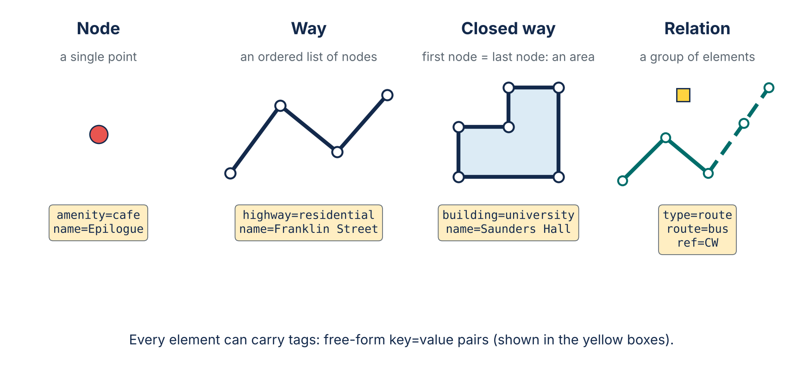
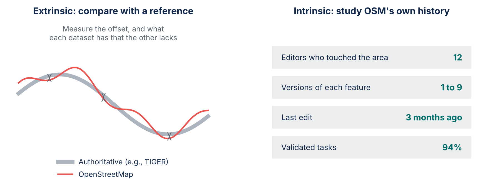
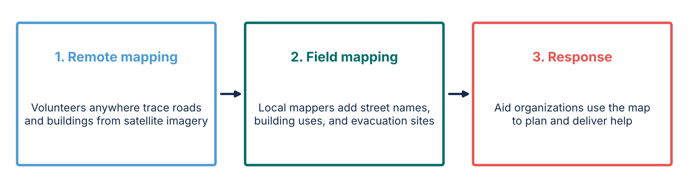

::: {.callout-note appearance="simple"}
## Learning objectives

By the end of this chapter you should be able to:

1.  Define spatial data quality as fitness for use, and name its seven elements.
2.  Explain what volunteered geographic information (VGI) is, why it appeared in the 2000s, and how its main types differ.
3.  Describe Big Data by its three Vs, and the FAIR principles for good data.
4.  Explain how OpenStreetMap is organized: its license, its users, and its data model of nodes, ways, relations, and tags.
5.  Compare extrinsic and intrinsic ways of measuring the quality of OpenStreetMap, and name the tools the community uses to check it.
6.  Use the 2015 Nepal earthquake to explain how crisis mapping works, and how a flood of new volunteers affects data quality.
:::

Chapter 9 divided data about people and places into two kinds: **authoritative data**, made by official agencies to documented standards, and **asserted data**, contributed by the public. This chapter is about the second kind, and its best-known example, OpenStreetMap.

OpenStreetMap is a free map of the world that anyone can edit. Every street, building, and footpath on the UNC campus in OpenStreetMap was added by a volunteer, some walking with a GPS, most tracing satellite imagery from a desk. The result is used by governments, the largest technology companies, and aid agencies. So how good is it? To answer that, we first need a way to describe the quality of any geographic dataset.

## Defining data quality {#sec-data-quality}

### Quality is fitness for use

There is no such thing as a perfect dataset. Every map leaves things out, generalizes shapes, and goes out of date. **Spatial data quality** is how well a dataset fits the use you have in mind. A road layer that is fine for a tourist map may be dangerous for routing ambulances. A building layer drawn from 2015 imagery may be good enough to estimate a city's population, and useless for finding houses built since.

Quality questions come from both sides of a dataset:

- As a **data consumer**, how do you judge the quality of data you download?
- As a **data creator**, how do you make data good, and tell others how good it is?

Many things can go wrong. A road may not exist, or may not connect to the road it crosses. An address may be in the wrong place. A building may be labeled a school after it closed. A layer may come with no metadata at all, or in a coordinate system you didn't expect (Chapter 4).

### Seven elements of quality

Van Oort [-@vanoort2006] compared the quality elements used in mapping standards around the world, and found seven that they share (@fig-quality-elements). They are now written into the international standard ISO 19157, *Geographic information: Data quality*.

![The seven elements of spatial data quality, after van Oort [-@vanoort2006].](../images/osm-data-quality/quality-elements.png){#fig-quality-elements fig-alt="Seven colored boxes. Lineage: where the data came from and what has been done to them. Positional accuracy: how close coordinates are to true positions. Attribute accuracy: how correct the non-spatial values are. Logical consistency: whether the data follow their own rules, such as closed polygons and connected roads. Completeness: what is missing, and what is there that shouldn't be. Temporal quality: how current the data are, and how accurate their dates. Usage, purpose, and constraints: what the data were made for, and limits on their use."}

Take a layer of fire hydrants as an example:

- **Lineage** is the history of the dataset. Who collected the hydrants, with what equipment, and how were the points processed and edited since?
- **Positional accuracy** is how close the coordinates are to the true locations. Is the hydrant where the map says it is, or across the street?
- **Attribute accuracy** is how correct the non-spatial values are. Is the feature labeled a hydrant, with the right flow rate?
- **Logical consistency** is whether the data agree with their own rules. Are hydrants on the water mains they connect to? In a road layer, do roads meet at intersections?
- **Completeness** is "a measure of the absence of data and the presence of excess data" [@vanoort2006, 23]. Are all the hydrants there, and are there any that were removed long ago?
- **Temporal quality** is whether the dates are right, and the data current. When was each hydrant last checked?
- **Usage, purpose, and constraints** tell users what the data were made for, and what they should not be used for.

The first and last elements are not measurements of the data at all. They are information *about* the data, which is why metadata matter so much. A dataset with poor positional accuracy can still be useful if its metadata tell you how poor. A dataset with no metadata leaves you guessing.

::: {.callout-tip appearance="simple"}
## Think about it

Which of the seven elements matters most for each of these uses: (a) routing an ambulance; (b) estimating the number of people in a flood zone from building footprints; (c) a historic map of the town in 1950? Is the answer the same for all three?
:::

## Volunteered geographic information {#sec-vgi}

### Anyone can be a data producer

Until the 2000s, almost all map data came from governments and a few companies, made by trained staff to written standards. Three developments changed that:

- **User-generated content.** "Web 2.0" sites let readers create content, not just read it: blogs, wikis, photo sharing, and social networks [@oreilly2005].
- **Cheap GPS.** Handheld receivers, and then phones, made it cheap and easy to record a location.
- **Mobile computing.** Fast internet access everywhere let people upload what they recorded, from wherever they were.

Together they produced what Goodchild [-@goodchild2007] called **volunteered geographic information (VGI)**: geographic data created by individuals, most of them not trained in mapping, and shared on the internet. Goodchild described the volunteers as "citizens as sensors," billions of people able to observe and report on the places around them.

VGI changed the quality question. When a government agency makes a map, you can judge it partly by the agency's reputation and standards. When anyone can contribute, quality can no longer be assumed from who made the data. It has to be measured.

### Types of VGI

VGI comes in three main forms, and the form affects its quality:

| Type | Examples | How location is recorded | Quality |
|---|---|---|---|
| **Location-based social media** | Geotagged posts and photos, check-ins | As a by-product: people are not trying to make a map | Very uneven; location may be the phone's, not the subject's |
| **Collaborative mapping** | OpenStreetMap, Wikimapia | Deliberately: mapping is the goal | Contributors can see and correct each other's work |
| **Citizen science** | eBird, iNaturalist, CoCoRaHS rain gauges, reports of flooded road crossings | By following a protocol set by scientists | Quality control is built into the protocol |

: The three main types of VGI. {#tbl-vgi-types}

Research on VGI has followed several strands. Some studies ask why people volunteer, and who they are. Others measure data quality, as we do below. Others study bias: OpenStreetMap contributors have been mostly young, male, urban, and from Europe and North America, and their interests shape what gets mapped and where. Others study VGI in disasters, the subject of the last part of this chapter.

### Big Data

VGI is one source of **Big Data**, datasets too large, too fast, or too varied for traditional tools. Big Data is usually defined by three Vs [@beyer2012]:

- **Volume**: from terabytes to petabytes, more than one computer can store or process.
- **Velocity**: data arrive continuously and must be handled in near real time.
- **Variety**: mixed formats, such as text, images, GPS traces, and sensor readings.

OpenStreetMap has all three: billions of nodes, edits arriving every minute, and everything from roads to opening hours. Most of the data from phones, vehicles, and sensors carries a location, so geographic data make up a large share of Big Data.

Some authors add a fourth V, **veracity**: can the data be trusted? That is this chapter's question. At this scale, no one can check every feature by hand, so quality checks have to be automated and statistical. More data does not mean better data.

### FAIR data

The **FAIR principles** [@wilkinson2016] say that good scientific data should be:

- **Findable**: data and metadata are easy to find, by people and by computers.
- **Accessible**: once found, users know how to get the data, including any login or permission needed.
- **Interoperable**: the data can be combined with other data, software, and workflows.
- **Reusable**: data and metadata are described well enough to be reused, or combined in new settings.

Many funders and journals now require FAIR data. FAIR doesn't guarantee that data are accurate, but good metadata let users judge quality for themselves. OpenStreetMap does well on findable, accessible, and reusable: it has an open license and a public API. It is weaker on consistent metadata, because contributors set their own tags.

## OpenStreetMap {#sec-osm}

### A free, editable map of the world

**OpenStreetMap (OSM)** was founded in 2004 by Steve Coast, then a student in London, to create free, open road data. It now maps far more than streets: buildings, land use, trails, shops, water points, and much more.

- **Anyone can edit.** You can add, change, or delete data, and your edits go live immediately. Each set of edits is saved as a **changeset**, with the editor's username and a comment.
- **The data are open.** OSM is published under the **Open Database License (ODbL)**. You can use, change, and share the data for any purpose, including commercial use, as long as you credit "© OpenStreetMap contributors" and share any database you build from it under the same license.
- **It is big.** OSM has more than 10 million registered accounts, and roughly 10 billion nodes. Only a small share of accounts have ever edited, and a much smaller core does most of the work.

::: {.callout-note .did-you-know appearance="simple" icon=false}
## Did you know..?

OpenStreetMap began because map data in Britain were expensive. The Ordnance Survey, the national mapping agency, charged for its data, so Steve Coast set out to build a free map from GPS traces he and his friends recorded on foot, by bicycle, and by car. Some of the first OSM mapping parties, in 2006, sent volunteers around a town with GPS receivers to map it in a weekend.
:::

### Who uses OpenStreetMap?

OSM is no longer a hobby project:

- **Governments.** The U.S. Census Bureau has compared OSM with its TIGER/Line road files (Chapter 9). Many national and local governments use or contribute to OSM.
- **Technology companies.** Apple, Meta, Microsoft, and Amazon all use OSM data. In 2022, Amazon, Meta, Microsoft, and TomTom founded the **Overture Maps Foundation**, which builds open map data partly on OSM.
- **Navigation and logistics.** Routing engines, delivery, and ride-hailing apps.
- **Humanitarian organizations.** The Red Cross and Médecins Sans Frontières use OSM to plan disaster response and health campaigns.
- **Researchers and students.** OSM is free, global, and consistent enough for spatial analysis anywhere.

There is also a public-good argument. Whoever makes the map decides which places exist on it. An open map, which anyone can improve, keeps that power from resting with one or two companies [@wroclawski2014].

### OSM's data model

OSM's data model is simple. It has three kinds of element, plus tags (@fig-osm-elements):

- A **node** is a single point, with a latitude and longitude. A node can stand alone, as a café or a hydrant, or be one of the vertices of a way.
- A **way** is an ordered list of nodes, forming a line such as a road or a stream. A **closed way**, whose first and last nodes are the same, forms an area, such as a building or a park.
- A **relation** groups elements and describes how they relate, such as all the roads of a bus route, or the outer and inner rings of a lake with islands.
- A **tag** is a `key=value` pair that describes an element, such as `highway=residential` or `name=Franklin Street`. Any element can carry any number of tags.

{#fig-osm-elements fig-alt="Four panels. Node: a single red point, tagged amenity=cafe and name=Epilogue. Way: a zigzag line through four nodes, tagged highway=residential and name=Franklin Street. Closed way: an L-shaped polygon whose outline returns to its first node, tagged building=university and name=Saunders Hall. Relation: a line and a point grouped together, tagged type=route, route=bus, ref=CW. A note says every element can carry tags, free-form key=value pairs."}

All of the meaning is in the tags, and there is no fixed list of them. Anyone can invent a tag, and the community agrees on conventions and documents them on the OSM Wiki. That flexibility lets OSM map almost anything. It also creates inconsistency, a logical consistency problem in van Oort's terms: one mapper tags a path `highway=footway`, another `highway=path`, a third `highway=track`. Because the data structure is loose, the community has to define and enforce its own quality standards.

## Measuring the quality of OSM {#sec-osm-quality}

### Extrinsic and intrinsic measures

There are two ways to measure the quality of OSM (@fig-extrinsic-intrinsic):

- **Extrinsic** measures compare OSM with an **authoritative** reference dataset, such as the Ordnance Survey's maps in Britain or TIGER/Line in the United States. You can measure how far OSM roads are from the reference roads (positional accuracy), and what each dataset has that the other lacks (completeness).
- **Intrinsic** measures use only OSM's own history: how many people edited an area, how many versions each feature has, how recently it was edited, and whether the work was checked by a second mapper.

{#fig-extrinsic-intrinsic fig-alt="Left: a thick gray authoritative road line and a thin red OpenStreetMap line that wanders close to it, crossing it at three points; the caption says measure the offset, and what each dataset has that the other lacks. Right: four rows of intrinsic measures: editors who touched the area, 12; versions of each feature, 1 to 9; last edit, 3 months ago; validated tasks, 94 percent."}

The early studies were extrinsic. Haklay [-@haklay2010] compared OSM's roads in England with the Ordnance Survey's. He found them "fairly accurate": OSM's roads were, on average, within about 6 meters of the Ordnance Survey's, and about 80 percent of the motorways overlapped. Completeness was uneven, though. Wealthy and central areas were well mapped, while poorer and rural areas lagged. Later studies found the same in other countries, and found high completeness for building footprints in Munich [@fan2014].

Extrinsic measures have a limit: they need a trusted reference, and in the places where OSM matters most, there often isn't one. That is why intrinsic measures are useful. Haklay and colleagues [-@haklay2010linus] found that the more people had mapped an area, the more accurate its roads were. This is unique to collaborative data. A traditional dataset has one producer, so there is no crowd to count.

::: {.callout-note .did-you-know appearance="simple" icon=false}
## Did you know..?

In open-source software, **Linus's Law** says that "given enough eyeballs, all bugs are shallow." It was named for Linus Torvalds, who created Linux. Haklay and colleagues [-@haklay2010linus] tested it on maps. In London, the positional accuracy of OSM roads improved quickly as the first contributors mapped an area, and once about 15 contributors had mapped a square kilometer, the roads were reliably accurate.
:::

### Tools for checking OSM

Quality control in OSM happens after edits are made, through software and people:

- **Osmose** and **KeepRight** run automated checks across the database, flagging problems such as roads that don't connect, buildings that overlap, and missing or conflicting tags.
- **OSMCha** (OSM Changeset Analyzer) lets experienced mappers review recent changesets, to catch vandalism and mistakes.
- **MapRoulette** turns lists of detected errors into small fix-it tasks that anyone can do in a few minutes.
- The **HOT Tasking Manager** divides a mapping project into small squares. When one mapper finishes a square, a second, experienced mapper **validates** it.
- The **ohsome** dashboard, from the Heidelberg Institute for Geoinformation Technology (HeiGIT), shows how much was mapped in an area over time, an intrinsic quality signal.

Your GIS also checks data quality. ArcGIS Pro and QGIS can validate geometry and find features that break topology rules (QGIS's *Check Validity* and *Topology Checker*, ArcGIS Pro's *Check Geometry* and topology rules).

::: {.callout-tip appearance="simple"}
## Think about it

Open OpenStreetMap at openstreetmap.org and zoom to a place you know well, such as your hometown or your street. What is mapped, and what is missing? Which of van Oort's quality elements would you worry about if you used it for a project there?
:::

## Crisis mapping {#sec-crisis-mapping}

### Haiti, 2010

On 12 January 2010, a magnitude 7.0 earthquake struck near Port-au-Prince, Haiti. Before the earthquake, Port-au-Prince was nearly blank in OpenStreetMap. Within days, satellite companies released new imagery, and hundreds of volunteers around the world began tracing roads, buildings, and camps for displaced people. Within weeks, OSM had the most detailed map of the city available anywhere, and aid workers on the ground used it [@zook2010]. It was the first large test of **crisis mapping**, mapping by volunteers to support disaster response.

### The Humanitarian OpenStreetMap Team

A small group of OSM mappers had formed the **Humanitarian OpenStreetMap Team (HOT)** in 2009. The Haiti response turned it into a formal organization in 2010. HOT is activated when a disaster or other humanitarian need is declared, and it works with partners such as the Red Cross and Médecins Sans Frontières. It has an elected board, working groups for activation, communications, training, technology, and more, and local mapping communities in the affected countries.

HOT's work happens in three steps (@fig-hot-workflow):

{#fig-hot-workflow fig-alt="Three boxes joined by arrows. 1, Remote mapping: volunteers anywhere trace roads and buildings from satellite imagery. 2, Field mapping: local mappers add street names, building uses, and evacuation sites. 3, Response: aid organizations use the map to plan and deliver help."}

1.  **Remote mapping.** Volunteers anywhere in the world trace roads and buildings from satellite imagery, using the Tasking Manager so that they don't overlap. This step is fast and can involve thousands of people. But remote mappers can't see street names, or what a building is used for.
2.  **Field mapping.** Local mappers, who know the place, add names, building uses, and evacuation sites, and check the remote work on the ground. This step is also quality control.
3.  **Response.** Aid organizations use the map to plan routes, count buildings, estimate populations, and deliver help.

::: {.callout-note .did-you-know appearance="simple" icon=false}
## Did you know..?

You don't need a disaster to map for a cause. **Missing Maps**, founded in 2014 by HOT, the American and British Red Cross, and Médecins Sans Frontières, maps the places most at risk *before* disasters happen. Many of its volunteers map at **mapathons**, events where people trace imagery together for a few hours, often on college campuses.
:::

### Nepal, 2015

On 25 April 2015, a magnitude 7.8 earthquake struck central Nepal, followed by a magnitude 7.3 aftershock on 12 May. Nearly 9,000 people died, and more than half a million homes were destroyed or damaged. Many of the hardest-hit districts were rural and mountainous, hard to reach, and poorly mapped. Responders needed up-to-date maps of roads, villages, and helicopter landing sites within days.

HOT activated within hours. **Kathmandu Living Labs**, a civic technology group in Kathmandu, became the local hub, linking remote volunteers with responders in Nepal. HOT called for new volunteers, mapathons, and donations, and the call worked: universities, companies, and community groups around the world held mapathons, and thousands of people created OSM accounts for the first time. Daily edits in Nepal jumped about tenfold after the earthquake, and volunteers edited roads across the central districts in under three weeks.

Parr [-@parr2015] counted the contributors who had mapped in Nepal by the year they joined OSM (@fig-nepal-contributors). In the ten years before the earthquake, 8,725 people had mapped there. In the 12 days after it, 9,989 more joined. Newcomers suddenly made up more than half of everyone who had ever mapped the country.

![Contributors to OpenStreetMap in Nepal, by the year they joined. Data from Parr [-@parr2015].](../images/osm-data-quality/nepal-contributors.png){#fig-nepal-contributors fig-alt="A bar chart. Contributors who mapped in Nepal, by the year they joined OSM: 22 in 2005, 84 in 2006, 215 in 2007, 553 in 2008, 627 in 2009, 621 in 2010, 559 in 2011, 937 in 2012, 1,629 in 2013, 1,690 in 2014, 1,788 in 2015 before the quake, and 9,989 in 2015 after the quake. A note says 8,725 contributors joined in the ten years before the earthquake."}

### The problem of success

The flood of new volunteers created tension within HOT. On its public mailing list, one experienced member wrote in April 2015 that they were "finding totally inexperienced mappers (some with no completed tiles and others with only one or two completed tiles) messing around with validating tiles or unlocking already validated tiles and working on them," at a time when "people's lives are at stake." Another wrote in May: "We need more people. At the same time, we need to adapt in various ways to crowdsourcing as we see various problems arising."

That is the dilemma of open data in a crisis. The response needed more mappers, not fewer, but beginners make mistakes, and a mistake in a crisis map can send a truck down a road that doesn't exist.

The newcomers' work also looked different (@fig-nepal-edits). On average, each newcomer edited about half as many features as an earlier contributor, and changed or deleted far fewer existing ones. Newcomers mostly added new features. Experienced mappers did most of the correcting, and a small core of them did a very large share of it. The quality of the map depended on that core.

![How contributors who joined before the earthquake compare with those who joined in the 12 days after it. Data from Parr [-@parr2015].](../images/osm-data-quality/nepal-edits.png){#fig-nepal-edits fig-alt="Three pairs of bars, blue for contributors who joined before 25 April 2015 and red for those who joined 25 April to 6 May 2015. Features per contributor, created, modified, or deleted: 223.5 and 108.6. Existing features changed per contributor, modified or deleted: 63.1 and 14.1. Changes to existing features as a share of a contributor's edits: 20.1 percent and 12.6 percent."}

HOT's answer was both social and technical:

- **Social.** HOT improved its training guides at LearnOSM, and asked experienced mappers to review newcomers' work.
- **Technical.** The Tasking Manager gained a separate validation step, and flags for experienced mappers. A square is marked done only after a second, experienced mapper checks it.

The result was a new layer of data reviewers, the **validators**. It is a familiar pattern for quality control in open projects: open contribution, followed by expert review. It keeps the door open to beginners while protecting the data that responders rely on.

## Getting involved {#sec-osm-involved}

OpenStreetMap is one of the few datasets in this book that you can improve yourself:

- **Use the data.** Download extracts for a country, state, or region from Geofabrik (download.geofabrik.de) as shapefiles or in OSM's own formats. In QGIS, the **QuickOSM** plugin downloads features for the map's extent by tag, such as every `amenity=hospital` in a county.
- **Join OSM.** Create a free account at openstreetmap.org.
- **Start editing.** The **iD** editor runs in your web browser and needs no installation; it includes a short walkthrough. **JOSM** is a desktop editor for advanced work.
- **Map for a cause.** Pick a project in the HOT Tasking Manager (tasks.hotosm.org), or join a mapathon.
- **Meet the community.** State of the Map US is held every year, and the OSM community forum is at community.openstreetmap.org.

Whatever you use OSM for, credit it: "© OpenStreetMap contributors."

## Check your understanding

::: {.content-visible when-format="html"}

1.  Which quality element describes where a dataset came from and how it was processed? <select class='webex-select'><option value='blank'></option><option value='answer'>Lineage</option><option value=''>Completeness</option><option value=''>Logical consistency</option><option value=''>Temporal quality</option></select>

2.  Roads in a layer cross each other without meeting at intersections. Which quality element is the problem? <select class='webex-select'><option value='blank'></option><option value=''>Positional accuracy</option><option value=''>Attribute accuracy</option><option value='answer'>Logical consistency</option><option value=''>Lineage</option></select>

3.  Who coined the term "volunteered geographic information"? <select class='webex-select'><option value='blank'></option><option value=''>Steve Coast</option><option value='answer'>Michael Goodchild</option><option value=''>Muki Haklay</option><option value=''>Linus Torvalds</option></select>

4.  Geotagged photos on social media are an example of which type of VGI? <select class='webex-select'><option value='blank'></option><option value='answer'>Location-based social media</option><option value=''>Collaborative mapping</option><option value=''>Citizen science</option><option value=''>Authoritative data</option></select>

5.  In what year was OpenStreetMap founded? <input class='webex-solveme nospaces' size='5' data-answer='["2004"]'/>

6.  In OSM, a closed way whose first and last nodes are the same forms: <select class='webex-select'><option value='blank'></option><option value=''>A point</option><option value=''>A relation</option><option value='answer'>An area</option><option value=''>A tag</option></select>

7.  Counting how many contributors have edited an area is an intrinsic measure of quality. <select class='webex-select'><option value='blank'></option><option value='answer'>TRUE</option><option value=''>FALSE</option></select>

8.  How many people joined OSM and mapped in Nepal in the 12 days after the 2015 earthquake? <input class='webex-solveme nospaces' size='6' data-answer='["9989","9,989"]'/>

<button>Show hint for question 7</button>

Intrinsic measures use only OSM's own history; extrinsic measures compare OSM with another dataset.

:::

::: {.content-visible unless-format="html"}
The interactive self-check questions for this chapter are in the online version of the book.
:::

## Summary

- **Spatial data quality** is fitness for use. Van Oort's seven elements are **lineage**, **positional accuracy**, **attribute accuracy**, **logical consistency**, **completeness**, **temporal quality**, and **usage, purpose, and constraints**.
- **Volunteered geographic information** appeared in the 2000s with Web 2.0, cheap GPS, and mobile internet. It comes as location-based social media, collaborative mapping, and citizen science. Its quality has to be measured, not assumed.
- **Big Data** is defined by volume, velocity, and variety; veracity is the quality question. The **FAIR** principles call for data that are findable, accessible, interoperable, and reusable.
- **OpenStreetMap** was founded in 2004. It is open under the **ODbL**, used by governments, technology companies, and aid agencies, and built from **nodes**, **ways**, **relations**, and free-form **tags**.
- **Extrinsic** measures compare OSM with authoritative data; **intrinsic** measures use OSM's own history. OSM's roads are often accurate, completeness is uneven, and areas with more editors tend to be better mapped.
- Tools such as Osmose, OSMCha, MapRoulette, and the HOT Tasking Manager check OSM's quality after edits are made.
- **Crisis mapping** began in Haiti in 2010 and led to the **Humanitarian OpenStreetMap Team**. In Nepal in 2015, newcomers outnumbered all earlier mappers, and **validation** by experienced mappers protected the map's quality.

## Exercises

1.  **Quality elements.** Find the metadata for a dataset you have used in this course (for example a TIGER/Line file or a layer from NC OneMap). Which of van Oort's seven elements does it describe? Which are missing?
2.  **Tag a feature.** Look up a building and a road you know on openstreetmap.org. Click each (or use the *Query features* tool) and list its tags. Are any important attributes missing? Look up the recommended tags on the OSM Wiki.
3.  **Extrinsic comparison.** Download OSM roads for Orange County, NC, from Geofabrik or with QuickOSM, and the TIGER/Line roads for the same county. Display them together and zoom in on three places: downtown Chapel Hill, a new subdivision, and a rural area. Where do they disagree? Which dataset is more complete in each place?
4.  **Intrinsic history.** Pick a building on the UNC campus in OSM and view its history (*View History* on the feature page). How many versions does it have? How many different people edited it, and when?
5.  **Map something.** Create an OSM account and complete the iD walkthrough. Then add or fix one feature near where you live, with a clear changeset comment. Or map one square on a HOT Tasking Manager project.
6.  **Crisis mapping.** Read the Nepal case in this chapter. Write one paragraph on how you would balance openness and data quality if you ran the next activation.

## Further reading and online resources

### Readings

- Goodchild, "Citizens as Sensors: The World of Volunteered Geography" [@goodchild2007], the article that named VGI.
- Haklay, "How Good Is Volunteered Geographical Information?" [@haklay2010], the first large comparison of OSM with authoritative data.
- Haklay and others, "How Many Volunteers Does It Take to Map an Area Well?" [@haklay2010linus], on Linus's Law and the number of contributors.
- Parr, "Crisis Mapping and the Nepal Earthquake: The Impact of New Contributors" [@parr2015], the source of the Nepal figures in this chapter.
- Zook and others, "Volunteered Geographic Information and Crowdsourcing Disaster Relief: A Case Study of the Haitian Earthquake" [@zook2010].
- Wilkinson and others, "The FAIR Guiding Principles for Scientific Data Management and Stewardship" [@wilkinson2016]: <https://www.nature.com/articles/sdata201618>.
- *GIS Fundamentals: A First Text on Geographic Information Systems*, by Paul Bolstad [@bolstad2022]. Its chapter on spatial data standards and quality covers accuracy measures.
- GO FAIR, the FAIR principles explained: <https://www.go-fair.org/fair-principles/>.
- ISO 19157-1, *Geographic information: Data quality*: <https://www.iso.org/standard/78900.html>.

### OpenStreetMap

- OpenStreetMap: <https://www.openstreetmap.org>.
- OpenStreetMap Wiki, the community's documentation, including tags: <https://wiki.openstreetmap.org>.
- OSM Wiki, "Elements," on nodes, ways, and relations: <https://wiki.openstreetmap.org/wiki/Elements>.
- OSM Wiki, "Map features," the most common tags: <https://wiki.openstreetmap.org/wiki/Map_features>.
- OSM Wiki, "Stats," on users and data: <https://wiki.openstreetmap.org/wiki/Stats>.
- OpenStreetMap Foundation, copyright and license (ODbL): <https://www.openstreetmap.org/copyright>.
- LearnOSM, beginner guides to mapping: <https://learnosm.org>.
- OpenStreetMap community forum: <https://community.openstreetmap.org>.
- OpenStreetMap US, including State of the Map US: <https://www.openstreetmap.us>.
- Geofabrik downloads, free OSM extracts: <https://download.geofabrik.de>.
- Overpass Turbo, for querying OSM data by tag in the browser: <https://overpass-turbo.eu>.
- QuickOSM plugin for QGIS: <https://plugins.qgis.org/plugins/QuickOSM/>.
- JOSM, the Java OpenStreetMap editor: <https://josm.openstreetmap.de>.
- Overture Maps Foundation: <https://overturemaps.org>.

### Quality tools

- Osmose: <https://osmose.openstreetmap.fr>.
- KeepRight: <https://www.keepright.at>.
- OSMCha: <https://osmcha.org>.
- MapRoulette: <https://maproulette.org>.
- ohsome dashboard, from HeiGIT: <https://ohsome-dashboard.heigit.org>.

### Humanitarian mapping

- Humanitarian OpenStreetMap Team: <https://www.hotosm.org>.
- HOT Tasking Manager: <https://tasks.hotosm.org>.
- Missing Maps: <https://www.missingmaps.org>.
- Kathmandu Living Labs: <https://kathmandulivinglabs.org>.
- YouthMappers, a network of university mapping chapters: <https://www.youthmappers.org>.
