::: {.callout-note appearance="simple"}
## Learning objectives

By the end of this chapter you should be able to:

1.  Describe what QGIS is, what "free and open source" means for it, and how it grew from a one-person project in 2002 into one of the most widely used GIS programs in the world.
2.  Choose and install a QGIS release, and find your way around the QGIS window.
3.  Add data to a project from files, a CSV of coordinates, and web basemaps.
4.  Enter data: create a new layer, digitize features, and edit and calculate attributes.
5.  Make a basic map: symbolize and label layers, then build a print layout with a title, legend, scale bar, north arrow, and source.
6.  Find and run analysis tools in the Processing Toolbox, and extend QGIS with plugins.
:::

The chapters so far have explained the ideas of GIS: data models, coordinate systems, queries, joins, and analysis. This chapter is about one of the tools you will use to put those ideas to work. QGIS is a free, open-source desktop GIS that runs on Windows, macOS, and Linux. It can do nearly everything this book describes, and because it costs nothing, you can install it on any computer and keep using it after the course ends. [Chapter 21](arcgis-pro.qmd) introduces ArcGIS Pro, the other GIS program used in this course.

The screenshots in this chapter come from QGIS 3.34 on Linux, using North Carolina's 100 counties and their 2025 population estimates from Chapter 11. Newer versions, and QGIS on Windows and macOS, look much the same; menus and buttons may move a little between versions, but the workflow does not change.

## What is QGIS? {#sec-what-is-qgis}

QGIS is a desktop geographic information system: a program for viewing, creating, editing, analyzing, and mapping geographic data. Its name is pronounced "Q-G-I-S," letter by letter, and comes from its original name, *Quantum GIS*. Its core features are much like those of any GIS:

- **Viewing** vector and raster data in almost any format, in any coordinate system, reprojected on the fly into the project's coordinate system (Chapter 4).
- **Editing**: creating new layers, drawing features, and entering and calculating attributes.
- **Analysis**: hundreds of tools for selection, overlay, buffers, raster analysis, interpolation, and more, in the Processing Toolbox.
- **Cartography**: symbology, labels, and print layouts for making finished maps.

### Free and open source

QGIS is **open source** software, released under the GNU General Public License (GPL). Its source code is public, anyone can read or change it, and anyone may copy and share it, as long as the copies stay under the same license. "Free" here means two things: *free as in free beer*, because it costs nothing, and *free as in freedom*, because no company controls who may use it or how. QGIS is developed by a worldwide community of volunteers and paid developers, and is funded by donations, sponsors (including governments and companies that rely on it), and paid contracts for new features.

QGIS doesn't do everything itself. Like most open-source GIS, it is built on shared libraries that many other programs use too:

- **GDAL**, the Geospatial Data Abstraction Library, reads and writes hundreds of raster and vector formats. ArcGIS Pro, Google Earth, and R's `sf` package use it as well.
- **PROJ** converts coordinates between coordinate systems.
- **GEOS** performs geometric operations, such as buffers, intersections, and unions.
- **Qt**, a toolkit for building desktop programs, draws the windows and buttons. QGIS itself is written mostly in C++, and can be extended with Python.

QGIS is a project of the Open Source Geospatial Foundation (**OSGeo**), a nonprofit that supports open-source geospatial software such as GDAL, PROJ, GEOS, PostGIS, and GRASS GIS. Organizations that use QGIS include national mapping agencies, cities, counties, and state governments, and newsrooms such as *The Economist*.

## A short history {#sec-qgis-history}

QGIS began in early 2002, when Gary Sherman started developing a program he called *Quantum GIS*. The first public release, version 0.0.1, followed in July 2002. Other developers joined, and over the next two decades the program grew into a full GIS used around the world (@fig-qgis-timeline).

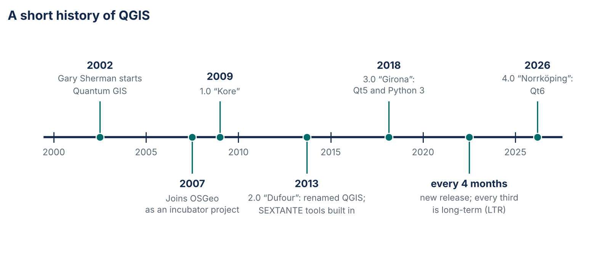{#fig-qgis-timeline fig-alt="A timeline from 2000 to 2026. 2002: Gary Sherman starts Quantum GIS. 2007: joins OSGeo as an incubator project. 2009: version 1.0 Kore. 2013: version 2.0 Dufour, renamed QGIS, with the SEXTANTE tools built in. 2018: version 3.0 Girona, on Qt5 and Python 3. Every four months a new release, and every third is long-term. 2026: version 4.0 Norrköping, on Qt6."}

- **2007.** QGIS became an incubator project of the new Open Source Geospatial Foundation, which gave it a home, legal support, and visibility.
- **2009.** Version 1.0, code-named "Kore," was released in January 2009.
- **2013.** Version 2.0, "Dufour," brought new symbology and labeling, and built in the SEXTANTE geoprocessing framework, now called **Processing**, with hundreds of analysis tools. The project officially dropped "Quantum" from its name, which had long been shortened to QGIS anyway.
- **2018.** Version 3.0, "Girona," was a major rewrite, moving to new versions of Qt and to Python 3. GeoPackage became the default format for new layers.
- **2026.** Version 4.0, "Norrköping," moved QGIS to Qt6, the newest version of its toolkit.

Every QGIS release has a version number and a code name, usually the name of a town or city: Kore, Dufour, Girona, Madeira, Prizren, Solothurn, Norrköping, and so on.

::: {.callout-note .did-you-know appearance="simple" icon=false}
## Did you know..?

QGIS can be extended with plugins, small add-ons that anyone can write and share. The official QGIS plugin repository lists more than 2,000 of them, contributed by the community: tools for geocoding, downloading OpenStreetMap data, making web maps, drawing elevation profiles, and almost anything else a GIS user has needed and decided to build. Each one is free to install from inside QGIS.
:::

### Long-term and latest releases

A new version of QGIS is released every four months. Every third release (one a year) is a **long-term release** (**LTR**), which gets bug fixes, but no new features, for about a year, until the next LTR replaces it. The others, called the *latest release* (LR), get the newest features first. Bug-fix updates to both come out monthly.

For coursework, install the **LTR** unless your instructor tells you otherwise. It is the most stable version, and the one that tutorials and lab instructions are usually written for. If you need a brand-new feature, install the latest release; you can install both side by side.

### Installing QGIS

Download QGIS from <https://qgis.org/download/>. The site detects your operating system:

- **Windows**: download the standalone installer (an `.msi` file) for the LTR and run it. Installing as an administrator is easiest. Advanced users can use the OSGeo4W network installer instead, which installs QGIS alongside other open-source tools.
- **macOS**: download the `.dmg` file, open it, and drag QGIS to the Applications folder. The first time you open it, macOS may ask you to confirm that you want to open an app downloaded from the internet.
- **Linux**: install the QGIS package from your distribution, or, for the newest version, from the QGIS repositories (instructions are on the download page).

QGIS keeps your settings, plugins, and customizations in a **user profile**. If a setting or plugin breaks QGIS, you can start fresh by creating a new profile (Settings ▸ User Profiles ▸ New Profile) without reinstalling.

## The QGIS window {#sec-qgis-window}

When you open QGIS, you see a welcome page listing recent projects and templates. Choose **New Empty Project**, or open a recent one. @fig-qgis-interface shows the main window with a few layers added.

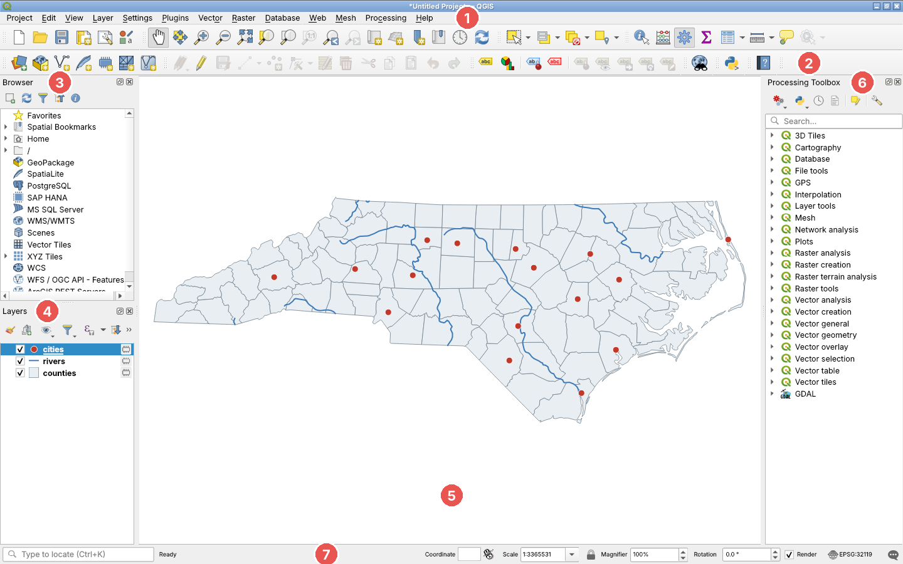{#fig-qgis-interface fig-alt="A screenshot of the QGIS window with a map of North Carolina counties, rivers, and cities. Numbered callouts mark the menu bar across the top, two rows of toolbar buttons below it, the Browser panel at upper left listing data sources, the Layers panel at lower left listing cities, rivers, and counties, the large map canvas in the middle, the Processing Toolbox panel on the right listing tool groups, and the status bar along the bottom with the coordinate, scale, and CRS."}

1.  The **menu bar** holds every command, grouped by purpose: Project, Edit, View, Layer, Settings, Plugins, Vector, Raster, Database, Web, Mesh, Processing, and Help.
2.  **Toolbars** give one-click access to common commands: opening and saving projects, navigating the map, selecting features, editing, and labeling. Right-click any toolbar to turn toolbars on and off.
3.  The **Browser panel** shows your computer's folders, databases, and web services. It is the fastest way to find and add data: drag a layer from the Browser onto the map.
4.  The **Layers panel** lists the layers in the project. Layers draw from the bottom up, so a layer at the top of the list draws on top of the ones below. Check or uncheck a layer to show or hide it, drag layers to reorder them, and right-click a layer for its options.
5.  The **map canvas** displays the layers.
6.  The **Processing Toolbox** holds the analysis tools (@sec-qgis-processing).
7.  The **status bar** shows the map coordinates under the cursor, the map scale, and, at the far right, the project's coordinate reference system (CRS). Click the CRS button to change it.

Panels can be moved, docked, stacked as tabs, or closed. To get a closed panel back, use **View ▸ Panels**. Other useful panels include **Layer Styling** (for changing symbology as you watch), **Identify Results**, and **Log Messages**.

### Navigating the map

| To do this | Use |
|---|---|
| Move around the map | **Pan** tool (the hand), or hold the spacebar or mouse wheel and drag |
| Zoom in and out | Mouse wheel, or the **Zoom In** and **Zoom Out** tools |
| Show a whole layer | Right-click the layer ▸ **Zoom to Layer(s)** |
| Show all layers | **Zoom Full** (Ctrl+Shift+F) |
| Go back to the previous view | **Zoom Last** |
| See a feature's attributes | **Identify Features** tool, then click the feature |

: Navigating the map canvas. {#tbl-qgis-navigation}

## Projects and data {#sec-qgis-projects}

A QGIS **project** is saved as a `.qgz` file. The project stores the list of layers, their symbology and labels, the coordinate system, and print layouts, but **not the data itself**. Each layer in a project is a *link* to a file, database, or web service. If you move or rename a data file, the project can't find it, and QGIS asks you to locate it the next time you open the project.

Good habits prevent most problems:

- **Keep each project and its data in one folder**, with the data in a subfolder. QGIS saves links as relative paths by default, so you can then move or share the whole folder.
- **Use short file and folder names without spaces or special characters**, such as `nc_density` rather than `NC Density (final)!`.
- **Save often** (Ctrl+S). Unlike a word processor, QGIS doesn't save automatically.
- **Copy data from a USB drive or network share to your computer** before working with it.

### File formats

QGIS reads almost any format, but two are most common for vector data:

- The **GeoPackage** (`.gpkg`) is the default format in QGIS. It is a single file, based on the SQLite database, that can hold many vector layers, rasters, and tables. It has no limit on field name length and no 2 GB size limit.
- The **shapefile** (`.shp`) is an older Esri format that nearly every GIS reads. One "shapefile" is really several files with the same name (`.shp`, `.shx`, `.dbf`, `.prj`, and often others) that must always be kept together. Field names are limited to 10 characters.

For new data, use GeoPackage. To convert a layer, right-click it in the Layers panel and choose **Export ▸ Save Features As…**, pick the format and coordinate system, and give it a file name.

## Adding data {#sec-qgis-adding-data}

There are three ways to add data to a project:

- **Drag** a file or layer from the Browser panel (or from your computer's file manager) onto the map.
- Open the **Data Source Manager** (Layer ▸ Data Source Manager, or Ctrl+L). Its tabs cover every kind of source: vector files, rasters, delimited text, GeoPackages, databases, and web services.
- Use **Layer ▸ Add Layer** and choose the kind of layer.

When the first layer is added to an empty project, the project takes on that layer's coordinate system. Layers in other coordinate systems are reprojected on the fly to match. Check the project's CRS in the status bar, and change it if it isn't suitable for your map (Chapter 4).

### Points from a table of coordinates

Spreadsheets of coordinates are one of the most common ways to get new data into a GIS: field observations, store locations, or stations with a latitude and longitude for each row. Save the table as a CSV file, then open the **Delimited Text** tab of the Data Source Manager (@fig-qgis-delimited-text):

1.  Choose the CSV file. QGIS reads the first rows and shows a preview.
2.  Under **File Format**, choose CSV.
3.  Under **Geometry Definition**, choose **Point coordinates**, and set the **X field** to the longitude and the **Y field** to the latitude.
4.  Set the **Geometry CRS** to the coordinate system of the coordinates. Latitude and longitude from a GPS or a web map are almost always WGS 84 (`EPSG:4326`).
5.  Click **Add**.

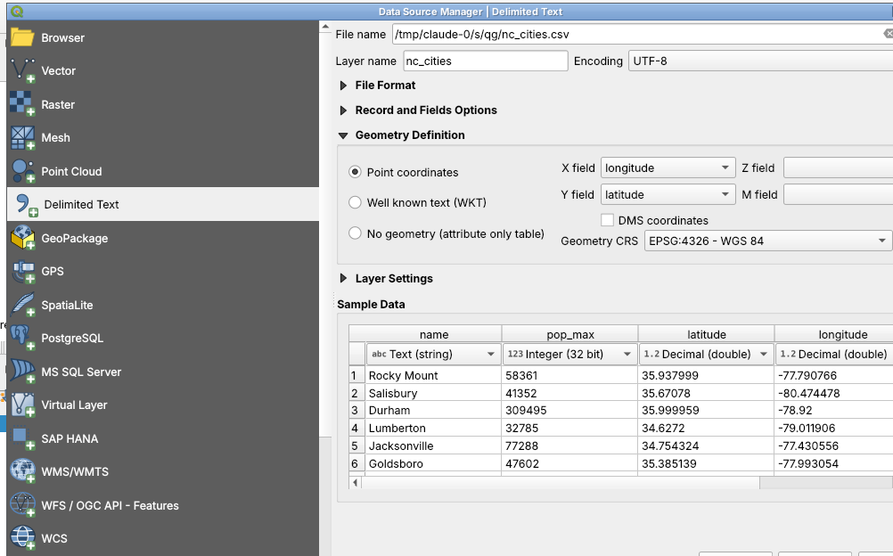{#fig-qgis-delimited-text fig-alt="The Data Source Manager dialog with Delimited Text selected in the list of sources on the left. The file name is nc_cities.csv, the format is CSV, the geometry definition is point coordinates with the X field set to longitude and the Y field set to latitude, and the geometry CRS is EPSG:4326, WGS 84. A sample data table shows city names, populations, latitudes, and longitudes."}

::: {.callout-tip appearance="simple"}
## Think about it

The most common mistake in adding a CSV is swapping the coordinates. Longitude is **X** (east–west) and latitude is **Y** (north–south). In North Carolina, longitudes are around −75 to −84 and latitudes around 34 to 37. If your points land in Antarctica, or off the coast of Africa near 0°, 0°, check the X and Y fields, and check that western longitudes are negative.
:::

The new layer is a *delimited text layer*, read from the CSV each time. To edit it or use it in analysis, save it as a GeoPackage (Export ▸ Save Features As…).

### Basemaps and web services

A **basemap** is a background map, such as streets or aerial imagery, that gives context to your own layers. In the Browser panel, expand **XYZ Tiles** and double-click **OpenStreetMap** to add OpenStreetMap as a basemap. The Browser also connects to web services in standard formats, such as WMS and WMTS (map images), WFS and OGC API – Features (vector data), and ArcGIS REST services. Many state and federal agencies, including NC OneMap, publish their data this way.

## Entering data {#sec-qgis-entering-data}

Sometimes the data you need doesn't exist yet: field sites, a new trail, or the buildings on a campus map. You create a new layer, then draw (**digitize**) its features and type in their attributes.

### Creating a new layer

Choose **Layer ▸ Create Layer ▸ New GeoPackage Layer** (@fig-qgis-new-geopackage). Then:

1.  **Database**: choose a new or existing `.gpkg` file. One GeoPackage can hold many layers.
2.  **Table name**: the name of the new layer, such as `field_sites`.
3.  **Geometry type**: Point, Line, Polygon, or one of their multi-part versions. A layer holds only one geometry type.
4.  **CRS**: the coordinate system for the layer. Choose a projected coordinate system suited to your area, such as NAD83 / North Carolina (`EPSG:32119`), so that lengths and areas are in meters.
5.  **New Field**: type a field name, choose its type, and click **Add to Fields List**. Repeat for each field. The common types are Text (string), Whole Number (integer), Decimal Number (real), and Date.
6.  Click **OK**.

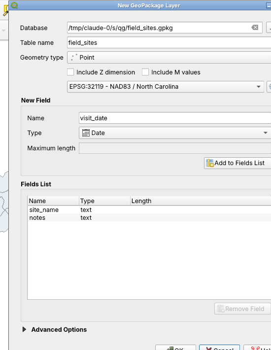{#fig-qgis-new-geopackage fig-alt="The New GeoPackage Layer dialog. The database is field_sites.gpkg, the table name is field_sites, the geometry type is Point, and the CRS is EPSG:32119, NAD83 / North Carolina. Under New Field, the name visit_date and the type Date are entered. The fields list shows site_name and notes, both text."}

QGIS adds an `fid` field automatically. It is the feature ID, a unique number for each feature, which QGIS fills in for you.

::: {.callout-tip appearance="simple"}
## Think about it

Choose field types carefully, because they are hard to change later. A ZIP Code or county FIPS code looks like a number, but it should be stored as text: 01003 stored as a number becomes 1003, losing the leading zero, and nobody will ever add two ZIP Codes together. What type would you use for a phone number? A count of trees? A percentage?
:::

### Digitizing features

To add features to a layer, you must first put it in edit mode (@fig-qgis-digitize):

1.  Select the layer in the Layers panel, and click **Toggle Editing** (the pencil). A pencil icon appears next to the layer's name.
2.  Click **Add Point Feature** (for a line or polygon layer, **Add Line Feature** or **Add Polygon Feature**).
3.  Click the map where the feature goes. For a line or polygon, click once for each vertex, and right-click to finish.
4.  An attribute form opens. Type the attributes and click **OK**.

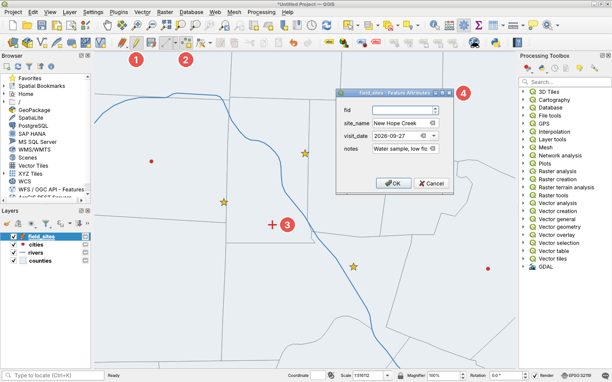{#fig-qgis-digitize fig-alt="A screenshot of QGIS zoomed in near Durham, with three star symbols for existing field sites, a river, county boundaries, and a red cross where a new point was clicked. Callouts mark the Toggle Editing button and the Add Point Feature button on the toolbar. A Feature Attributes form for the field_sites layer is open, with site_name New Hope Creek, visit_date 2026-09-27, and notes Water sample, low flow."}

Edits are kept in memory until you save them. Click **Save Layer Edits** to write them to the file, and click **Toggle Editing** again when you are done; QGIS asks whether to save any unsaved edits. Until you save, **Undo** (Ctrl+Z) can take back mistakes.

A few more tools make digitizing accurate:

- **Snapping** (Project ▸ Snapping Options, or the magnet on the Snapping toolbar) makes a new vertex jump to a nearby vertex or segment within a tolerance, so that shared boundaries line up exactly and no slivers or gaps form (Chapter 13).
- The **Vertex Tool** moves, adds, and deletes the vertices of existing features.
- Digitizing over a **basemap** or a georeferenced image (Chapter 9) lets you trace features, such as buildings or trails, from imagery.

### The attribute table

Every vector layer has an **attribute table**, with one row per feature and one column per field (@fig-qgis-attribute-table). Open it by right-clicking the layer and choosing **Open Attribute Table**, or by pressing F6. In the table you can:

- Sort by any column, by clicking its header.
- Select features, by clicking row numbers. Selected rows are highlighted on the map, too.
- Edit values, once the layer is in edit mode (the pencil at the upper left of the table).
- Add and delete fields, in edit mode.
- Show only selected features, or features matching a filter, using the menu at the lower left.

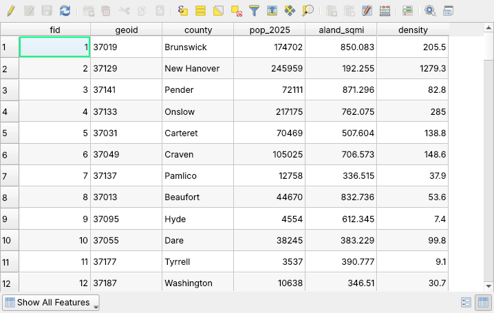{#fig-qgis-attribute-table fig-alt="An attribute table with a toolbar of editing and selection buttons across the top, and columns fid, geoid, county, pop_2025, aland_sqmi, and density. The first rows are Brunswick, New Hanover, Pender, Onslow, Carteret, Craven, Pamlico, Beaufort, Hyde, Dare, and Tyrrell counties."}

### Calculating fields

The **Field Calculator** fills a field with values computed from an **expression**: a formula made of fields, numbers, operators, and functions. Open it from the attribute table's toolbar (the abacus button). You can create a new field or update an existing one (@fig-qgis-field-calculator).

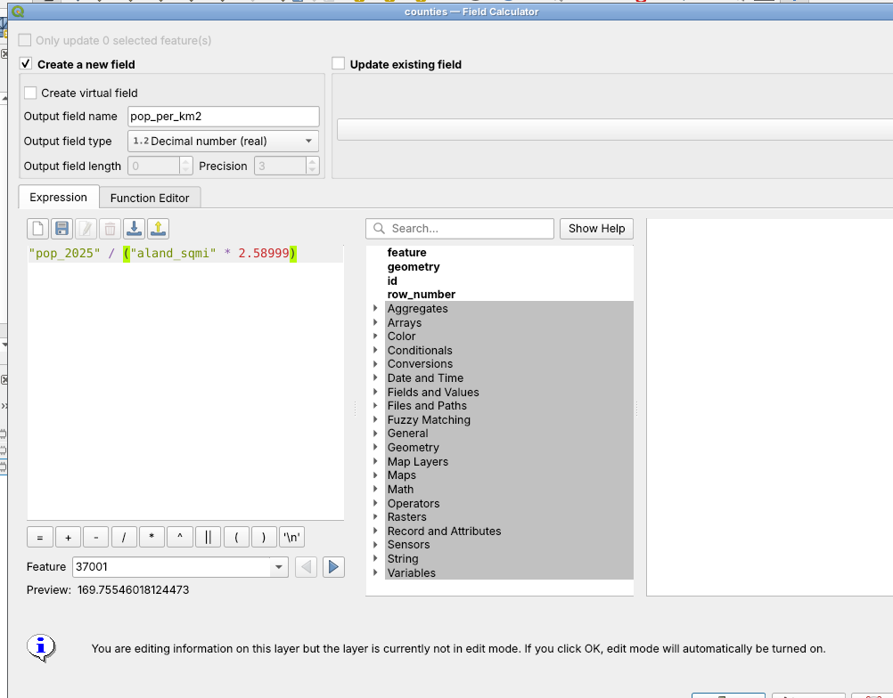{#fig-qgis-field-calculator fig-alt="The Field Calculator dialog with Create a new field checked, the output field name pop_per_km2, and the type Decimal number. The expression box contains pop_2025 divided by the quantity aland_sqmi times 2.58999. A list of functions is on the right, and the preview at the bottom shows 169.755."}

Expressions follow a few rules:

- Field names go in **double quotes**: `"pop_2025"`.
- Text values go in **single quotes**: `"county" = 'Orange'`.
- Arithmetic uses `+ - * /`, and comparison uses `= < > <= >= <>`, as in the SQL queries of Chapter 5.
- Geometry functions start with `$`: `$area` and `$length` give each feature's area and length, in the units set under Project ▸ Properties ▸ General (by default, calculated on the ellipsoid, so they are accurate in any projection).

Expressions are used throughout QGIS, not just in the Field Calculator: to select features (Select Features by Expression), to filter a layer, to label features, and to control symbology. The *data-defined override* button next to many settings lets an expression control that setting, feature by feature.

### Joins

To attach a table of attributes, such as census data, to a layer, use the layer's **Properties ▸ Joins** tab, and click **+** to choose the table and the matching fields (Chapter 6). For a join by location, use **Join Attributes by Location** in the Processing Toolbox (Chapter 7).

## Selecting and querying {#sec-qgis-selecting}

QGIS offers several ways to select features (Chapter 5):

- The **Select Features** tool on the toolbar selects features by clicking or dragging a rectangle on the map.
- **Select Features by Expression** (the ε on the Selection toolbar) selects features matching an expression, such as `"density" > 500`.
- **Select by Location** (Vector ▸ Research Tools, or the Processing Toolbox) selects features in one layer by their spatial relationship to another, such as the cities within a county.
- A **filter** (right-click the layer ▸ Filter…) hides every feature that doesn't match a query. Unlike a selection, it affects the whole project until you remove it, so be careful: a filtered layer looks like the whole dataset.

To save a selection as a new layer, right-click the layer and choose **Export ▸ Save Selected Features As…**.

## Making a basic map {#sec-qgis-basic-map}

Making a map in QGIS follows the same steps every time (@fig-map-workflow): add the data, check the coordinate system, style the layers, label them, and arrange the map with its supporting elements on a page.

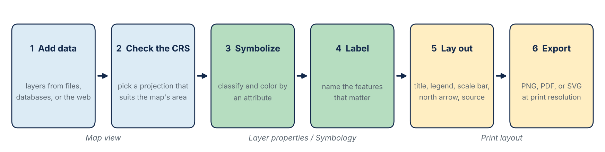{#fig-map-workflow fig-alt="A flowchart of six steps: 1, add data, layers from files, databases, or the web; 2, check the CRS, pick a projection that suits the map's area; 3, symbolize, classify and color by an attribute; 4, label, name the features that matter; 5, lay out, title, legend, scale bar, north arrow, source; 6, export, PNG, PDF, or SVG at print resolution. Steps 1 and 2 happen in the map view, 3 and 4 in layer properties, and 5 and 6 in the print layout."}

### Symbology

A layer's **symbology** controls how it is drawn. Double-click a layer (or right-click ▸ Properties) and choose the **Symbology** tab (@fig-qgis-symbology). The menu at the top chooses the kind of renderer:

- **Single Symbol** draws every feature the same way.
- **Categorized** gives each unique value of a field its own symbol, for nominal data such as land use or road type.
- **Graduated** groups a numeric field into classes and gives each class a color or size, for choropleth maps and proportional symbols.
- **Rule-based** draws features by a set of expressions you write.
- **Heatmap** (for points) draws a kernel density surface (Chapter 12).

To make the choropleth map of population density:

1.  Choose **Graduated**, and set **Value** to `density`.
2.  Choose a **Color ramp**, such as Greens.
3.  Set the **Mode** (the classification method) to Natural Breaks (Jenks) and **Classes** to 5 (Chapter 11).
4.  Click **Classify**, then **OK** or **Apply**.

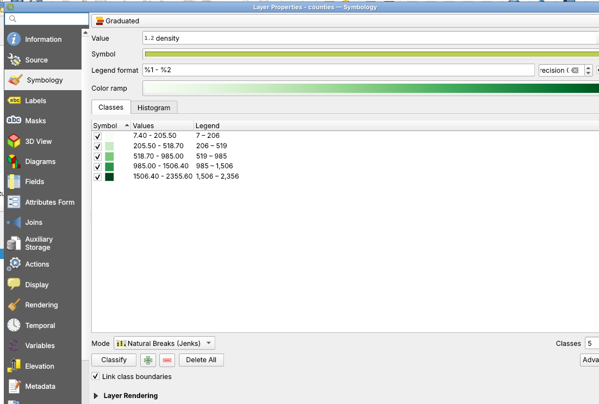{#fig-qgis-symbology fig-alt="The Layer Properties dialog with the Symbology tab selected in the list on the left. The renderer is Graduated, the value is density, the color ramp runs from white to dark green, and the classes table shows five classes: 7 to 206, 206 to 519, 519 to 985, 985 to 1,506, and 1,506 to 2,356. The mode is Natural Breaks (Jenks) with 5 classes."}

The **Histogram** tab shows the data's distribution with the class breaks, which helps you judge a classification. You can edit a class's range or legend label by double-clicking it. The **Layer Styling** panel (F7) offers the same settings in a panel, and shows each change on the map as you make it.

### Labels

To label features, open the layer's properties and choose the **Labels** tab (@fig-qgis-labels). Choose **Single Labels**, set **Value** to the field to show (here, the city `name`), and set the font, size, and color. Two settings make labels much easier to read:

- A **buffer** (a thin halo of white around each letter) separates the text from the features underneath.
- **Placement** controls where labels go: around points, along lines, or inside polygons.

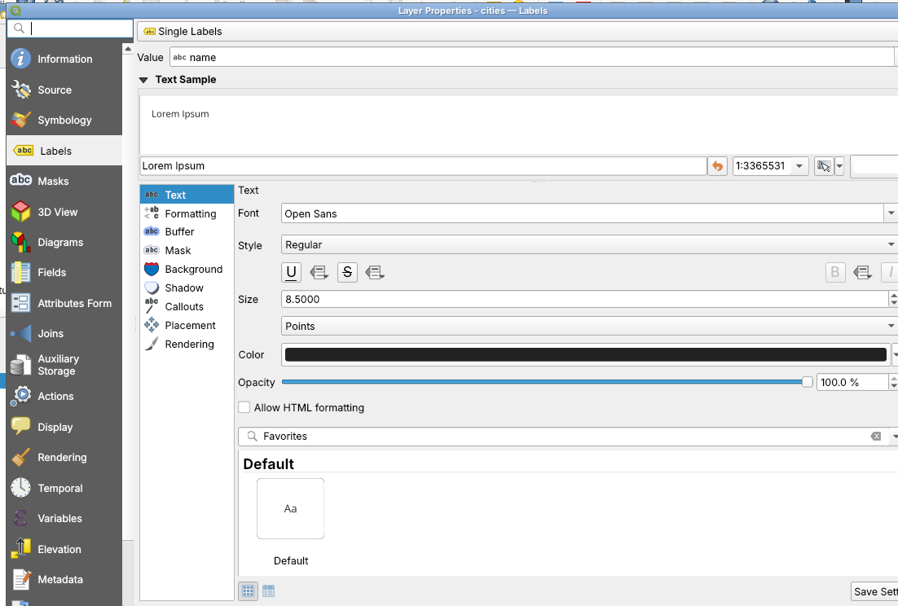{#fig-qgis-labels fig-alt="The Layer Properties dialog with the Labels tab selected. The mode is Single Labels and the value is name. The Text settings show the font Open Sans, style Regular, size 8.5 points, and a dark gray color, with other settings tabs for Formatting, Buffer, Mask, Background, Shadow, Callouts, Placement, and Rendering."}

QGIS places labels to avoid overlaps, and leaves out labels that don't fit. @fig-qgis-styled-map shows the result.

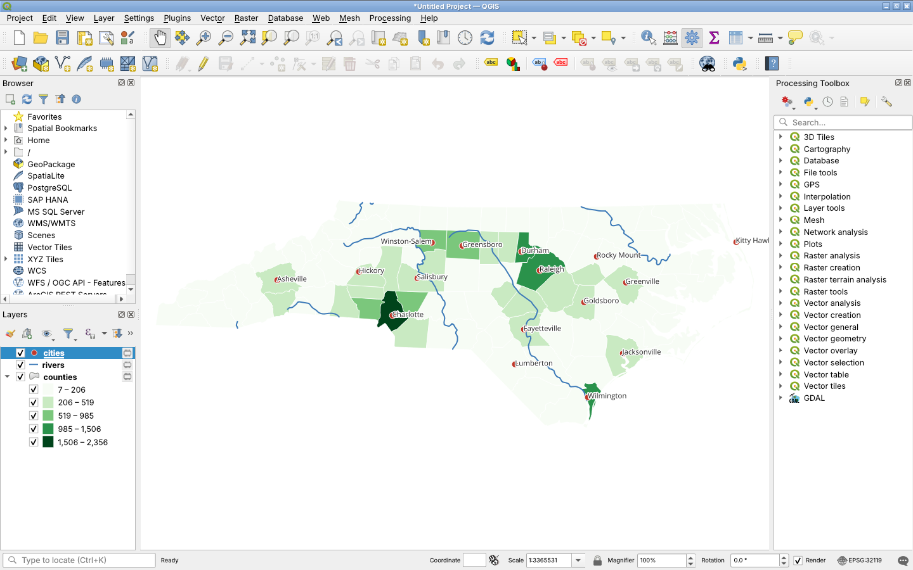{#fig-qgis-styled-map fig-alt="The QGIS window showing North Carolina counties in five shades of green, darkest around Charlotte, Raleigh, Durham, and Wilmington, with blue rivers and red city points labeled Asheville, Hickory, Charlotte, Winston-Salem, Greensboro, Durham, Raleigh, Fayetteville, Wilmington, and others. The Layers panel shows the legend for the five density classes."}

### The print layout

The map canvas is for working. To make a finished map, for a report, a poster, or a web page, use a **print layout**: a page on which you arrange the map and its supporting elements. Choose **Project ▸ New Print Layout**, give it a name, and the layout window opens (@fig-qgis-print-layout).

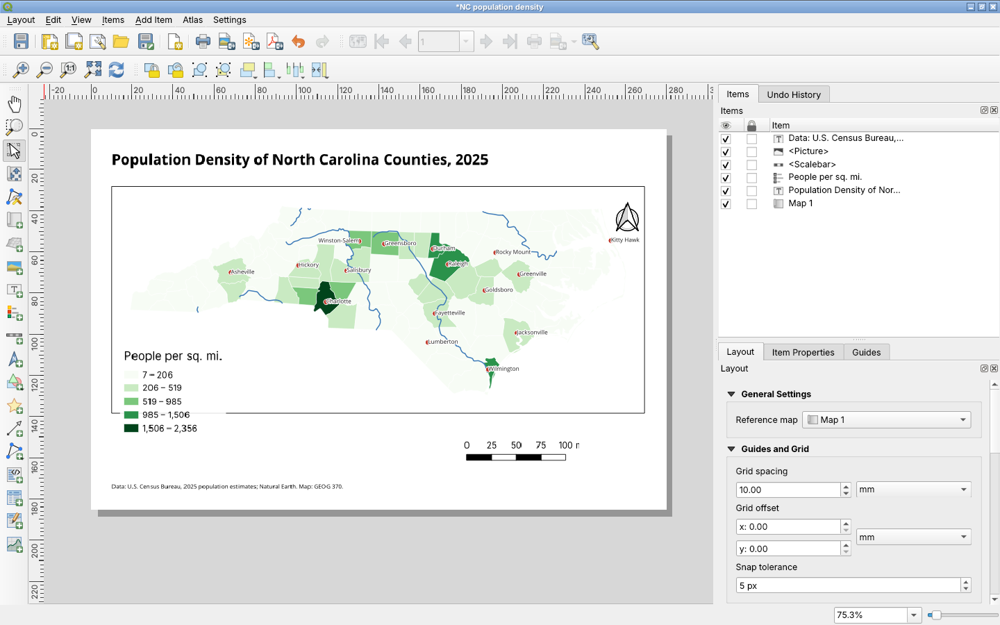{#fig-qgis-print-layout fig-alt="The QGIS print layout window. A landscape page holds a title, Population Density of North Carolina Counties, 2025; the map of counties, rivers, and cities; a legend titled People per sq. mi.; a scale bar from 0 to 100 miles; a north arrow; and a source line. Toolbars for adding items run down the left side, and the Items and Item Properties panels are on the right."}

Add each element from the **Add Item** menu (or the toolbar on the left), then drag on the page to place it:

1.  **Add Map**: draw a rectangle for the map. It shows the current map canvas. In **Item Properties**, set its scale, or use the **Move Item Content** tool to pan the map inside its frame.
2.  **Add Label**: for the title, and again for the source and author. Type the text in Item Properties, and set the font.
3.  **Add Legend**: the legend lists every layer. In Item Properties, uncheck **Auto update** to remove layers that don't need explaining, rename entries, and change the title.
4.  **Add Scale Bar**: choose the style, the units (such as miles), and the length of each segment, so that it ends at a round number.
5.  **Add North Arrow**: choose an arrow from the gallery of pictures. On a small-scale map in a projection where north varies across the map, it can be left off.

Use the **Items** panel to select, hide, lock, and reorder items. Lock the map once it is placed, so that you don't move it by accident. When the layout is done, export it with **Layout ▸ Export as Image** (PNG), **Export as PDF**, or **Export as SVG** (for further editing in a drawing program). For printing, export at 300 dots per inch. @fig-qgis-final-map is the exported map.

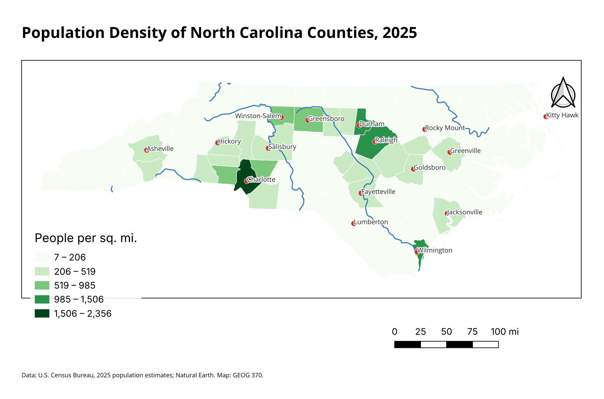{#fig-qgis-final-map fig-alt="A finished map titled Population Density of North Carolina Counties, 2025. Counties are shaded in five greens, with a legend titled People per sq. mi. from 7 to 206 up to 1,506 to 2,356. Rivers are blue, and red points mark labeled cities. A north arrow is at upper right, a scale bar from 0 to 100 miles at lower right, and a source line at the bottom credits the U.S. Census Bureau and Natural Earth."}

A layout is saved in the project, so you can come back to it, change the data or symbology, and export again. Every element should earn its place: a map for a class or a report almost always needs a title, legend, scale bar, and source, but a decorative north arrow or a busy border can usually go.

## The Processing Toolbox {#sec-qgis-processing}

Most analysis in QGIS happens in the **Processing Toolbox** (Processing ▸ Toolbox, or Ctrl+Alt+T). It holds hundreds of tools, called *algorithms*, grouped by purpose: Vector geometry, Vector overlay, Vector selection, Raster analysis, Interpolation, and more. Besides QGIS's own tools, it includes tools from GDAL and, when installed, from GRASS GIS. The quickest way to find a tool is to type its name in the search box at the top.

Double-click a tool to open its dialog (@fig-qgis-buffer):

- The **Parameters** tab asks for the inputs and settings. Each setting has a default, and the help text on the right explains them.
- The output can be a **temporary layer**, kept in memory until you close the project (marked with a chip icon in the Layers panel), or saved to a file. Save outputs you want to keep: a temporary layer disappears when QGIS closes.
- The **Log** tab shows the tool's progress, messages, and errors.
- **Run as Batch Process** runs the tool on many inputs at once.

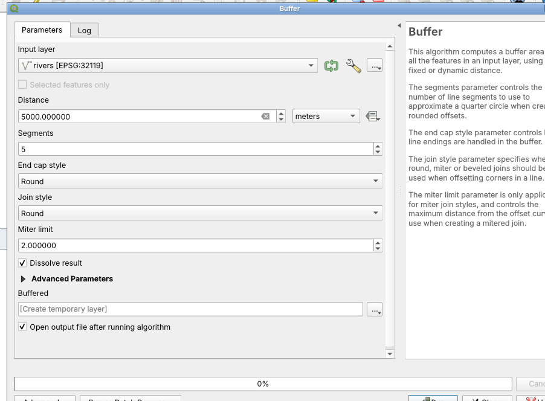{#fig-qgis-buffer fig-alt="The Buffer dialog from the Processing Toolbox. The input layer is rivers, the distance is 5,000 meters, segments 5, end cap style round, join style round, miter limit 2, and Dissolve result is checked. The output is a temporary layer. A help panel on the right describes the buffer algorithm, and Run and Close buttons are at the bottom."}

Every tool you run is recorded in **Processing ▸ History**, where you can rerun it or see its settings. To chain tools into a repeatable workflow, a cartographic model (Chapter 13), use the **Model Designer** (Processing ▸ Model Designer), which lets you draw the flowchart and run it as a single tool. For more control, the **Python console** (Plugins ▸ Python Console) runs any tool, and almost anything else in QGIS, from Python code.

## Plugins {#sec-qgis-plugins}

**Plugins** add features to QGIS. Open **Plugins ▸ Manage and Install Plugins**, search for a plugin by name or keyword, and click **Install Plugin**. Its tools then appear in a menu, a toolbar, or the Processing Toolbox. A few widely used plugins are:

- **QuickMapServices**, which adds dozens of basemaps.
- **qgis2web**, which exports a project as an interactive web map.
- **MMQGIS**, a collection of tools for geocoding, combining layers, and animation.
- **Profile Tool**, which draws elevation profiles along a line.

Plugins are written by many different people. Some are maintained for years and others are abandoned, so check a plugin's description, rating, and last update before relying on it.

## Getting help {#sec-qgis-help}

- **Help buttons.** Almost every dialog has a Help button that opens the matching page of the QGIS User Manual.
- **The QGIS documentation** at <https://docs.qgis.org> includes the User Manual, the *Training Manual* (a full course in QGIS), and *A Gentle Introduction to GIS*.
- **Tutorials** by the community, such as Ujaval Gandhi's *QGIS Tutorials and Tips*, walk through specific tasks step by step.
- **Questions** can be searched and asked on GIS Stack Exchange, with the `qgis` tag.
- **Error messages** appear in the message bar at the top of the map, and in more detail in the Log Messages panel. Searching for the exact text of an error message usually finds someone who has had the same problem.

## Check your understanding

::: {.content-visible when-format="html"}

1.  QGIS is released under which kind of license? <select class='webex-select'><option value='blank'></option><option value=''>A yearly subscription</option><option value=''>A free trial that expires</option><option value='answer'>The GNU General Public License, an open-source license</option><option value=''>A license only for students</option></select>

2.  For coursework, which QGIS release should you usually install? <select class='webex-select'><option value='blank'></option><option value='answer'>The long-term release (LTR)</option><option value=''>The nightly development build</option><option value=''>Version 1.0</option><option value=''>The oldest available version</option></select>

3.  A QGIS project file (`.qgz`) contains copies of all the data in the project. <select class='webex-select'><option value='blank'></option><option value=''>TRUE</option><option value='answer'>FALSE</option></select>

4.  When adding a CSV of latitudes and longitudes, the X field should be the: <select class='webex-select'><option value='blank'></option><option value=''>Latitude</option><option value='answer'>Longitude</option><option value=''>Elevation</option><option value=''>Feature ID</option></select>

5.  Before you can digitize new features in a layer, you must: <select class='webex-select'><option value='blank'></option><option value=''>Open the print layout</option><option value='answer'>Turn on editing with Toggle Editing</option><option value=''>Export the layer as a shapefile</option><option value=''>Install a plugin</option></select>

6.  In a QGIS expression, how is a field name written? <select class='webex-select'><option value='blank'></option><option value=''>In single quotes: 'density'</option><option value='answer'>In double quotes: "density"</option><option value=''>In square brackets: [density]</option><option value=''>With a dollar sign: $density</option></select>

7.  Which renderer makes a choropleth map from a numeric field? <select class='webex-select'><option value='blank'></option><option value=''>Single Symbol</option><option value=''>Categorized</option><option value='answer'>Graduated</option><option value=''>Point Displacement</option></select>

8.  Where do you add a title, legend, and scale bar to make a finished map? <select class='webex-select'><option value='blank'></option><option value=''>The Browser panel</option><option value=''>The attribute table</option><option value='answer'>A print layout</option><option value=''>The Processing Toolbox</option></select>

9.  What happens to a temporary layer made by a Processing tool when you close QGIS without saving it to a file? <select class='webex-select'><option value='blank'></option><option value=''>It is saved in the project automatically</option><option value='answer'>It is lost</option><option value=''>It becomes a shapefile</option><option value=''>It is uploaded to the QGIS website</option></select>

:::

::: {.content-visible unless-format="html"}
The interactive self-check questions for this chapter are in the online version of the book.
:::

## Summary

- **QGIS** is a free and **open-source** desktop GIS for Windows, macOS, and Linux, licensed under the GNU GPL and built on shared libraries: GDAL for formats, PROJ for coordinates, GEOS for geometry, and Qt for the interface.
- Gary Sherman started *Quantum GIS* in 2002. It joined OSGeo in 2007, reached 1.0 in 2009, became QGIS with version 2.0 in 2013, and moved to Qt6 with version 4.0 in 2026. A new version comes out every four months; install the **long-term release** (LTR) for stability.
- The QGIS window has a menu bar, toolbars, the **Browser** and **Layers** panels, the map canvas, the **Processing Toolbox**, and a status bar showing the coordinates, scale, and project CRS.
- A **project** (`.qgz`) stores links to data, not the data. Keep projects and data in one folder, use simple file names, and save often. Use **GeoPackage** for new data.
- Add data by dragging from the Browser or with the **Data Source Manager**. Add a CSV of coordinates as delimited text, with longitude as X and latitude as Y.
- To enter data, create a layer, **toggle editing**, **digitize** features, and fill in the attribute form. Edit and compute attributes in the **attribute table** and the **Field Calculator**.
- Make a map by setting **symbology** and **labels** in layer properties, then arranging the map, title, legend, scale bar, north arrow, and source in a **print layout**, and exporting it.
- Run analysis tools from the **Processing Toolbox**, chain them in the Model Designer, and extend QGIS with **plugins**.

## Exercises

1.  **Install and explore.** Install the QGIS LTR. Which version and code name did you install? Open the Help ▸ About dialog to check. Find the Browser, Layers, and Processing Toolbox panels, then close one and get it back with View ▸ Panels.
2.  **A basemap and your campus.** Add the OpenStreetMap basemap, and zoom to your campus. What is the project's CRS? What is the scale when the whole campus fills the screen?
3.  **Points from a spreadsheet.** Make a CSV with the names, latitudes, and longitudes of five places you have visited (look up the coordinates in a web map). Add it as a delimited text layer, check that the points land in the right places, and save it as a GeoPackage.
4.  **Digitize.** Create a new GeoPackage polygon layer in NAD83 / North Carolina (`EPSG:32119`) with a text field `name`. Digitize three buildings on campus over the basemap, and add an `area_m2` field calculated with `$area`. Which building is largest?
5.  **A choropleth map.** Download North Carolina county boundaries and a table of county populations (Chapter 8). Join them, calculate population density, and make a graduated map with five classes. Compare natural breaks and quantile classes (Chapter 11). Then make a print layout with a title, legend, scale bar, and source, and export it as a PDF.
6.  **A plugin.** Install a plugin from the list in @sec-qgis-plugins or one you find yourself. What does it do? Who wrote it, and when was it last updated?

## Further reading and online resources

### QGIS documentation

- QGIS project home and downloads: <https://qgis.org>.
- QGIS User Manual (latest LTR): <https://docs.qgis.org/latest/en/docs/user_manual/>.
- QGIS Training Manual, a complete self-paced course: <https://docs.qgis.org/latest/en/docs/training_manual/>.
- *A Gentle Introduction to GIS*, from the QGIS documentation: <https://docs.qgis.org/latest/en/docs/gentle_gis_introduction/>.
- QGIS User Manual, "Working with Vector Data" (symbology, labels, attribute tables, editing): <https://docs.qgis.org/latest/en/docs/user_manual/working_with_vector/index.html>.
- QGIS User Manual, "Laying out the maps" (print layouts): <https://docs.qgis.org/latest/en/docs/user_manual/print_layout/index.html>.
- QGIS User Manual, "QGIS processing framework": <https://docs.qgis.org/latest/en/docs/user_manual/processing/index.html>.
- QGIS release schedule and roadmap: <https://www.qgis.org/resources/roadmap/>.
- QGIS plugin repository: <https://plugins.qgis.org>.
- QGIS changelogs, with illustrated lists of new features in each version: <https://changelog.qgis.org>.

### Tutorials and courses

- *QGIS Tutorials and Tips*, by Ujaval Gandhi: <https://www.qgistutorials.com/en/>.
- Spatial Thoughts, free QGIS courses including *Introduction to QGIS*: <https://courses.spatialthoughts.com>.
- *Intro to GIS and Spatial Analysis*, by Manuel Gimond, free online, with QGIS examples: <https://mgimond.github.io/Spatial/>.

### Community and history

- QGIS on Wikipedia, including a table of every version and its code name: <https://en.wikipedia.org/wiki/QGIS>.
- The Open Source Geospatial Foundation (OSGeo): <https://www.osgeo.org>.
- GIS Stack Exchange, questions tagged `qgis`: <https://gis.stackexchange.com/questions/tagged/qgis>.
- QGIS source code on GitHub: <https://github.com/qgis/QGIS>.
- GDAL, the format library behind QGIS: <https://gdal.org>.
- PROJ, the coordinate transformation library: <https://proj.org>.
- QField, the mobile app for collecting data with QGIS projects in the field: <https://qfield.org>.

### Data used in this chapter

- North Carolina county populations, U.S. Census Bureau Population Estimates Program (see Chapter 11).
- County boundaries, cities, and rivers: Natural Earth, public domain: <https://www.naturalearthdata.com>.
