::: {.callout-note appearance="simple"}
## Learning objectives

By the end of this chapter you should be able to:

1.  Describe a raster by its cells, cell size, extent, and NoData values.
2.  Combine rasters with map algebra, and predict how NoData passes through.
3.  Line up rasters before analysis by resampling, and by setting the cell size, extent, and snap raster.
4.  Classify a raster function by its scope: local, neighborhood, zonal, or global.
5.  Use mathematical, logical, reclassification, and conditional functions.
6.  Compute neighborhood and zonal statistics, and aggregate a raster to a coarser cell size.
:::

Chapter 14 ended with a glimpse of raster overlay. This chapter takes rasters on their own terms. A raster stores the world as a grid, and almost every raster tool does the same thing: it repeats one operation cell by cell. What changes from tool to tool is *which* input cells feed each output cell, and *what* is done with them. Once you see that, the long list of raster tools in ArcGIS Pro and QGIS becomes much easier to understand.

## Raster basics {#sec-raster-basics}

### Cells, cell size, and extent

A **raster** represents the world as a regular grid of **cells** (also called pixels, short for *picture elements*). Each cell holds a value, such as an elevation, a temperature, or a land-cover code. Two numbers describe the grid (@fig-raster-model):

- **Cell size**, also called resolution, is the ground length of one side of a cell, such as 30 m or 1 km.
- **Extent** is the ground area the whole grid covers, from its lower-left to its upper-right corner.

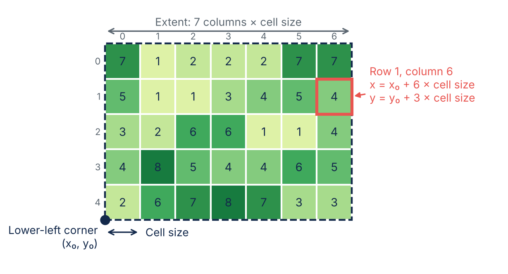{#fig-raster-model fig-alt="A grid of 5 rows and 7 columns of green cells with numbers. A dot marks the lower-left corner, labeled x zero, y zero. An arrow under the first cell is labeled cell size, and an arrow across the top says the extent is 7 columns times the cell size. The cell in row 1, column 6 is outlined in red, with its x equal to x zero plus 6 cell sizes and its y equal to y zero plus 3 cell sizes."}

The software does not store coordinates for every cell. It stores the location of one corner and the cell size, and works out any cell's position from its row and column. So a raster 100 cells wide with 30 m cells has an extent 3 km wide. It also explains why the cell size matters so much: change it, and every cell's footprint changes.

### What's in a cell?

A cell can hold a whole number (such as a land-cover code), a decimal (such as rainfall in inches), or, in some formats, text. Most rasters hold one value per cell. **Multiband** rasters, such as satellite images, hold one value per band in each cell, for example red, green, blue, and near-infrared.

Cell values are either **categorical** (also called discrete or thematic), where numbers are codes for classes such as land cover or soil type, or **continuous**, where numbers are measurements, such as elevation or temperature. Many choices in this chapter depend on which kind you have.

### NoData

A cell is never truly empty. A cell without a measurement holds a special code, **NoData** (Null in some software). There are two rules for NoData:

1.  **NoData in, NoData out.** In map algebra, any operation that touches a NoData cell writes NoData to the output: 5 + NoData = NoData.
2.  **Statistics skip NoData.** The mean of 2, 4, and NoData is 3, not 2.

The difference between NoData and 0 matters. In an elevation raster, 0 means sea level; NoData means "unknown." If missing values are stored as 0, every mean that includes them is too low, and the map is wrong.

::: {.callout-note .did-you-know appearance="simple" icon=false}
## Did you know..?

The National Land Cover Database (NLCD) maps the lower 48 states with 30 m cells. Each cell covers 900 m², about one-sixth of a football field, so the lower 48's roughly 8 million km² takes about 9 billion cells. The land-cover codes used later in this chapter, such as 41 for deciduous forest and 82 for cultivated crops, are NLCD codes.
:::

## Combining rasters {#sec-combining-rasters}

### Map algebra

**Map algebra** treats rasters as variables in an equation, and evaluates it cell by cell [@tomlin1990]. In @fig-map-algebra-add, each cell of raster C is the sum of the cells at the same position in A and B. The top-left cell is 1 + (−1) = 0. The bottom-right cell of B is NoData, so the bottom-right cell of C is NoData too, whatever A holds.

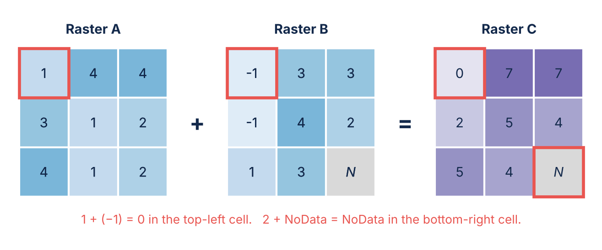{#fig-map-algebra-add fig-alt="Three 3 by 3 grids of numbers. Raster A plus raster B equals raster C. The top-left cells are outlined: 1 plus negative 1 equals 0. The bottom-right cell of B is N, for NoData, so the bottom-right cell of C is also N."}

An operation with one input raster, such as A × 2 or the square root of A, is **unary**. One with two input rasters, such as A + B, is **binary**. (A constant such as 2 is not a raster, so it doesn't count as an input.)

### When the grids don't line up

Map algebra assumes the rasters line up exactly: the same cell size, the same extent, and cells in the same places. Real data rarely do (@fig-mismatch).

- **Mismatched cell sizes.** A coarse cell sits over parts of many fine cells. Which of them should it be added to? There is no one answer.
- **Different extents.** Outside the overlap, one input has no cells at all, so the output there can only be NoData.

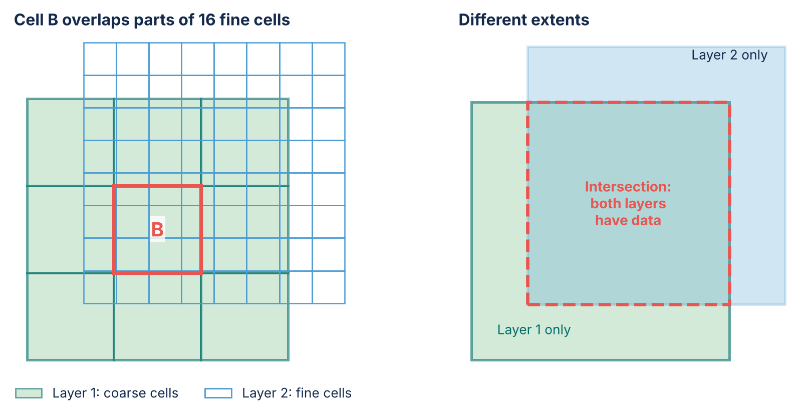{#fig-mismatch fig-alt="Left: a 3 by 3 grid of large green cells with a finer blue grid offset on top. The center large cell, B, outlined in red, overlaps parts of 16 small cells. Right: a green square and a blue square overlap; the overlap, outlined with a red dashed line, is labeled Intersection: both layers have data. The rest is labeled Layer 1 only or Layer 2 only."}

### Resampling

**Resampling** rebuilds a raster on a new grid, so that every layer shares one cell size and one set of cell positions. For each new cell, it decides what value the cell should get. There are three standard methods (@tbl-resampling):

| Method | How it picks the new value | Use it for |
|---|---|---|
| Nearest neighbor | Copies the value of the closest input cell center | Categories: land cover, soils, zones |
| Bilinear | Distance-weighted mean of the 4 nearest cells | Continuous surfaces: elevation, temperature |
| Cubic convolution | A smooth curve through the 16 nearest cells | Continuous surfaces where smoothness matters |

: Resampling methods. {#tbl-resampling}

Nearest neighbor never invents values, so it is the only safe choice for categories: you can't average forest and water. Bilinear and cubic blend nearby cells, which gives smoother surfaces for continuous data, but creates values that were never measured. On a land-cover raster, they produce nonsense such as class 2.25 (@fig-resampling).

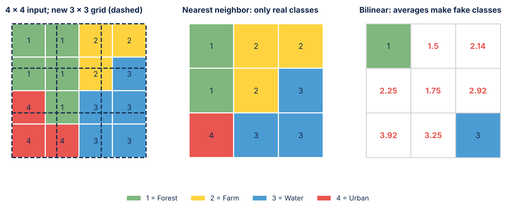{#fig-resampling fig-alt="Left: a 4 by 4 grid of land-cover classes 1 to 4, with a dashed 3 by 3 grid over it. Middle: the nearest neighbor result, a 3 by 3 grid of real classes 1, 2, 3, and 4. Right: the bilinear result, where only two cells are whole classes; the others are values such as 1.5, 2.14, 2.25, and 3.92, shown in red."}

### Cell size, extent, and snap raster

Three settings make the grids line up before any map algebra runs. In ArcGIS Pro they are **environment settings**, used by every raster tool; QGIS asks for them in each tool's dialog.

1.  **Cell size.** Choose one output cell size, usually the coarsest input. Resampling to finer cells adds no real detail.
2.  **Extent.** *Intersection* keeps only the area where every input has data; *union* keeps everything, with NoData in the gaps. Intersection is the safer default.
3.  **Snap raster.** Even with the same cell size, two grids can be offset by part of a cell. Snapping aligns the output's cell edges to one input's grid.

The output can only be as detailed as its coarsest input (@fig-cell-size). If you add a 30 m land-use raster to a 1 km elevation raster, the result is a blocky 1 km grid, and choosing 30 m output cells would only copy each 1 km value into a thousand smaller cells. If you need 30 m results, find a better elevation source, such as a 10 m or 30 m digital elevation model from USGS 3DEP.

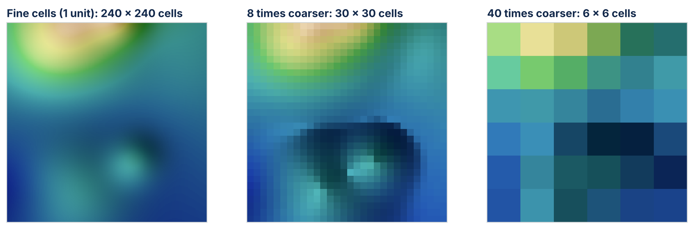{#fig-cell-size fig-alt="Three shaded terrain maps of the same area. Left: 240 by 240 cells, smooth. Middle: 30 by 30 cells, visibly blocky. Right: 6 by 6 cells, only large colored squares, with almost no recognizable terrain."}

## The scope of raster functions {#sec-raster-scope}

**Scope** is the set of input cells that feed each output cell. Chapter 14 introduced local, neighborhood, and global scope; rasters add a fourth, **zonal** (@fig-scopes):

- **Local** functions use only the input cell at the same location. Adding 4 to every cell is local: 10 becomes 14.
- **Neighborhood** (focal) functions use a window of cells around each location, usually 3 × 3. The window's result is written to its center cell, and then the window moves.
- **Zonal** functions use every cell in the same zone, where zones come from a second layer. Each cell in zone *a* gets the mean of all cells in zone *a*.
- **Global** functions can use every cell in the raster. The global maximum is written to every cell; more useful global functions, such as distance to the nearest road, give a different answer for each cell but still need to look everywhere.

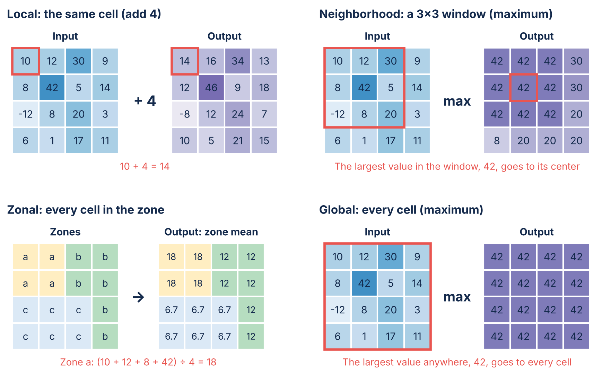{#fig-scopes fig-alt="Four panels, each with a 4 by 4 input grid and an output grid. Local: add 4 to each cell; the top-left 10 becomes 14. Neighborhood: a 3 by 3 window outlined in red has a maximum of 42, written to its center. Zonal: a zone grid with zones a, b, and c, and an output where zone a cells are 18, zone b cells are 12, and zone c cells are 6.7. Global: the whole input is outlined, and every output cell is 42."}

Notice the edge cells in the neighborhood example: a window centered on a corner holds only four cells, so edge cells always have fewer neighbors.

::: {.callout-tip appearance="simple"}
## Think about it

Is each of these local, neighborhood, zonal, or global? Converting elevation from feet to meters; smoothing a noisy elevation surface; computing the mean elevation of each county; finding the distance from every cell to the nearest hospital.
:::

## Local functions {#sec-local-functions}

### Mathematical functions

Mathematical functions are the most common map algebra. You write rasters as letters in an **expression**, such as `A * B`, `(A * 2) / B`, or `A + B + C`, and the tool evaluates it cell by cell. You can also apply functions to a single raster: absolute value, exponents and logarithms, sine and cosine, rounding, square roots, and powers. In ArcGIS Pro, the **Raster Calculator** tool evaluates expressions; in QGIS, it is also called the Raster Calculator.

Watch two things. Trigonometric functions expect radians in most software, so convert slope or aspect in degrees first. And when you combine variables with different units, one can dominate. Multiplying elevation (100 to 1,000 m) by slope (0 to 31 degrees) gives a result driven mostly by elevation. **Rescale** both to the same range, such as 0 to 1, first (@fig-elevation-slope).

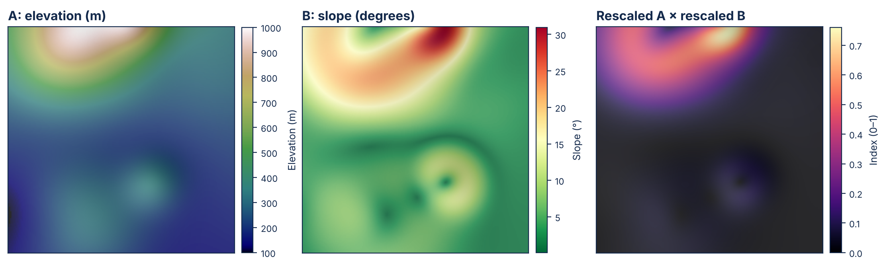{#fig-elevation-slope fig-alt="Three maps of the same area. A: elevation from 100 to 1,000 meters, highest at the top. B: slope in degrees, steepest in a band near the top. Rescaled A times rescaled B: bright only near the top, where the land is both high and steep, and dark elsewhere."}

### Logical functions

**Relational** operators compare two rasters, or a raster and a constant, cell by cell: less than, greater than, equal, and not equal. They write 1 where the comparison is true and 0 where it is false. **Boolean** operators, such as AND, OR, and NOT, combine those 0s and 1s (@fig-logical).

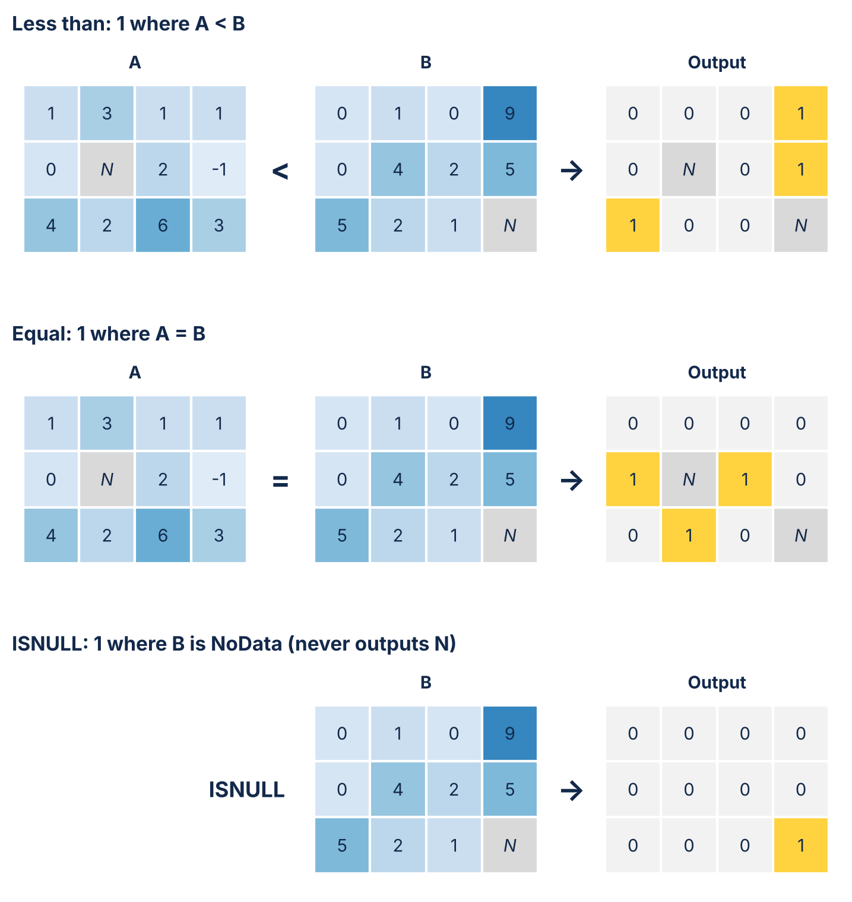{#fig-logical fig-alt="Three rows. Less than: A compared with B gives an output of 1s where A is smaller, 0s elsewhere, and N where either input is N. Equal: 1s where A and B hold the same value. ISNULL: applied to B alone, 1 in the one cell where B is NoData and 0 everywhere else."}

Typical uses:

- Find buildable land: `Slope < 15`.
- Find land-cover change: `LC2010 != LC2020` gives 1 wherever the class changed.
- Find cells between two values: `(Slope > 5) AND (Slope < 15)`.

For continuous data, avoid testing equality: 1.30000 and 1.30001 are not equal. Test whether the difference is small instead.

**ISNULL** is unary: it writes 1 where a cell is NoData and 0 everywhere else. It is the one test that never outputs NoData, which makes it the tool for finding gaps. (You can't find NoData with `A = NoData`, since any comparison with NoData gives NoData.)

### Reclassification

**Reclassification** replaces each cell's value with a new value from a rule you supply (@fig-reclass). It is local and unary, and one of the most used raster tools.

- **By table**, each exact value maps to a new value. Use this for categorical data, such as converting land-cover codes to a suitability score.
- **By ranges**, every value within a range maps to one new value. Use this for continuous data, such as slope.

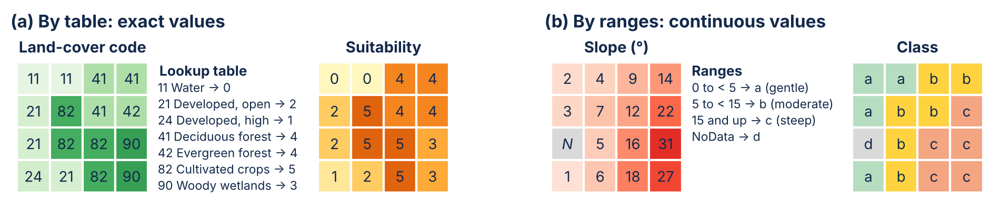{#fig-reclass fig-alt="Left: a 4 by 4 grid of NLCD land-cover codes, a lookup table (11 water to 0, 21 developed open to 2, 24 developed high to 1, 41 deciduous forest to 4, 42 evergreen forest to 4, 82 cultivated crops to 5, 90 woody wetlands to 3), and the resulting suitability grid. Right: a 4 by 4 grid of slopes in degrees, a list of ranges (0 to under 5 is a, 5 to under 15 is b, 15 and up is c, NoData is d), and the resulting class grid."}

Watch the boundaries: is a slope of exactly 5 in class *a* or *b*? Software has a rule, and you should check it. Write ranges so that every value falls into exactly one class.

### Conditional functions

The **conditional** function, CON in ArcGIS Pro, is the raster version of if-then-else. It takes a condition, a value or raster to use where the condition is true, and one to use where it is false. In @fig-conditional, the expression is `Con(A == 1, B, C)`: where A is 1, copy B; everywhere else, copy C. A decides, but its values never appear in the output.

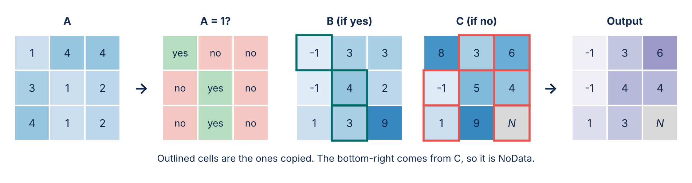{#fig-conditional fig-alt="Five 3 by 3 grids. A, then a yes/no grid for A equals 1, then B with the yes cells outlined in green, C with the no cells outlined in red, and the output. The output is negative 1, 3, 6 in the top row; negative 1, 4, 4 in the middle; and 1, 3, N in the bottom. The bottom-right came from C, which is NoData there."}

The output's bottom-right cell is NoData because it comes from C, which is NoData there. B has a value in that cell, but B wasn't chosen. A common pattern fills gaps: `Con(IsNull(A), 0, A)` replaces NoData with 0 and keeps every other value.

## Beyond local {#sec-beyond-local}

### Neighborhood functions

A **neighborhood function** computes a statistic from a window of cells and writes it to the center cell (@fig-neighborhood-stats). The window is usually 3 × 3, but can be larger, a circle, or an annulus. In ArcGIS Pro, the tool is **Focal Statistics**; in QGIS, it is *r.neighbors* (from GRASS).

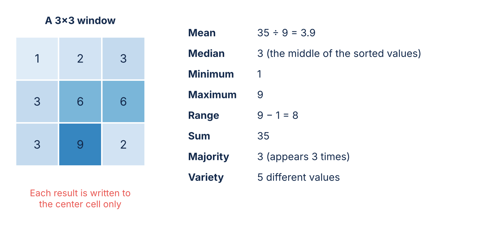{#fig-neighborhood-stats fig-alt="A 3 by 3 window with values 1, 2, 3 / 3, 6, 6 / 3, 9, 2, and a list: mean 35 divided by 9 equals 3.9; median 3; minimum 1; maximum 9; range 8; sum 35; majority 3, appearing 3 times; variety, 5 different values."}

Choose the statistic to fit the data. Mean and median smooth continuous surfaces; maximum and minimum find peaks and pits; **majority** suits categories, since a mean of land-cover codes is meaningless. Slope and aspect are neighborhood functions too: they fit a surface through the window and report how steep it is and which way it faces (Chapter 13).

### The moving window

Neighborhood functions run by sliding the window across the raster one cell at a time, left to right and top to bottom. A **majority filter** uses this to clean up classified satellite images, which often have single misclassified cells, called "salt and pepper" noise (@fig-majority-filter). Each cell takes the value shared by most of its neighbors; if there's no majority, it keeps its value.

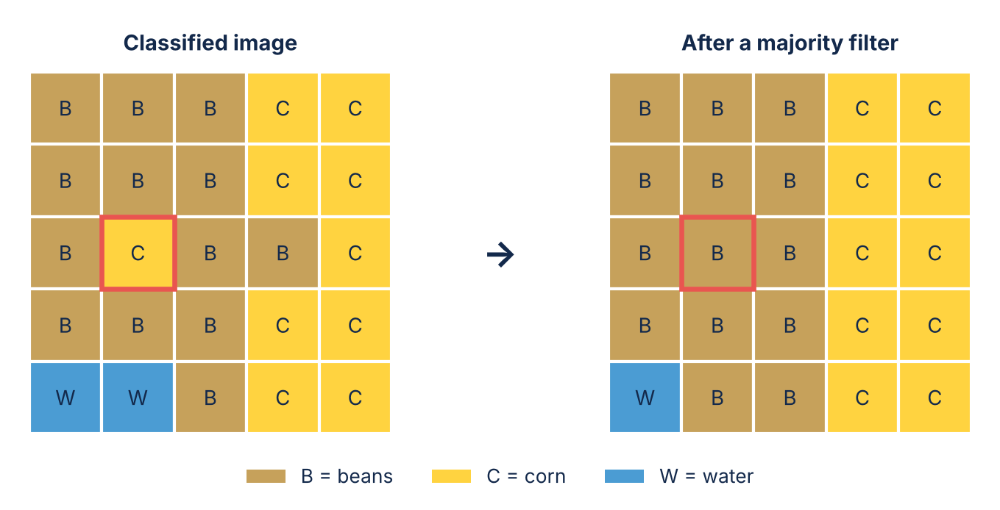{#fig-majority-filter fig-alt="Two 5 by 5 grids of crop classes: B for beans, C for corn, W for water. Left: a single corn cell, outlined in red, is surrounded by beans. Right, after the filter: that cell is beans. A beans cell between corn cells has become corn, and a water cell at the bottom has become beans."}

Filters have side effects. Here, two other cells changed as well, including a water cell on the edge of a small water body. That is why filters are used with care, and checked afterward.

### Aggregation

**Aggregation** (rescaling to a coarser cell size) groups blocks of cells and writes one value per block (@fig-aggregate). It is the cleanest way to bring a fine raster to a coarser one's cell size. In ArcGIS Pro, the tool is **Aggregate**; in QGIS, set the resolution and a resampling method such as *average* in the **Align Rasters** tool.

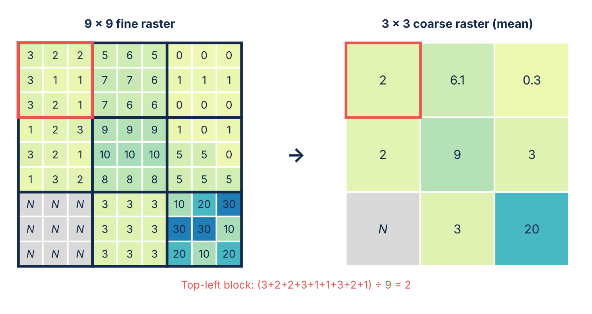{#fig-aggregate fig-alt="Left: a 9 by 9 grid of numbers divided into nine 3 by 3 blocks; the lower-left block is all NoData. Right: the 3 by 3 result. Top row: 2, 6.1, 0.3. Middle row: 2, 9, 3. Bottom row: N, 3, 20. The top-left block and cell are outlined in red: the mean of 3, 2, 2, 3, 1, 1, 3, 2, 1 is 2."}

Use the mean or sum for continuous data, such as rainfall or population, and the majority for categories.

### Zonal functions

**Zonal** functions compute a statistic for every cell in a zone. Every neighborhood statistic (mean, sum, maximum, majority, and so on) can be computed by zone instead of by window. Zones can come from a raster, as in @fig-scopes, or from polygons, such as counties or watersheds. ArcGIS Pro's **Zonal Statistics** writes the result to a raster; **Zonal Statistics as Table** writes one row per zone. QGIS's **Zonal statistics** tool adds the results as fields in a polygon layer.

When the zones are polygons, the software converts them to cells behind the scenes. A polygon smaller than a cell may get no cells at all, and drop out of the results. Use a cell size that is small relative to your smallest polygon.

### Global functions: distance

The most useful global functions measure **distance** (@fig-distance). Euclidean distance gives every cell its straight-line distance to the nearest source cell, such as a river or a road. To know which source is nearest, the tool has to consider all of them, so the scope is global. **Cost distance** works the same way, but accumulates a cost, such as travel time across terrain, rather than meters.

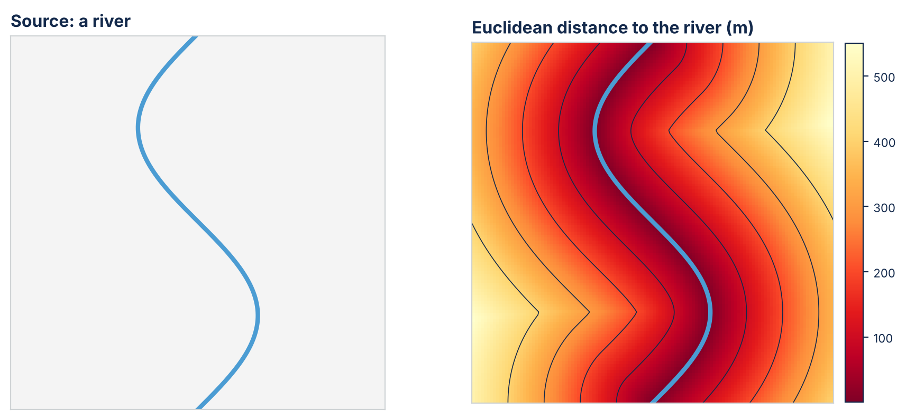{#fig-distance fig-alt="Left: a winding blue river on a blank background. Right: the same river over a distance surface, dark red near the river and fading to pale yellow far away, with contour lines every 100 meters parallel to the river."}

Distance rasters are often reclassified (into bands such as 0–100 m and 100–500 m) and combined with other layers in a suitability model, the raster version of the buffer and overlay workflow in Chapter 14.

## Check your understanding

::: {.content-visible when-format="html"}

1.  A raster is 200 cells wide with a 30 m cell size. How wide is its extent, in meters? <input class='webex-solveme nospaces' size='5' data-answer='["6000","6,000"]'/>

2.  What is 5 + NoData in map algebra? <select class='webex-select'><option value='blank'></option><option value=''>5</option><option value=''>0</option><option value='answer'>NoData</option><option value=''>An error</option></select>

3.  Which resampling method should you use for a land-cover raster? <select class='webex-select'><option value='blank'></option><option value='answer'>Nearest neighbor</option><option value=''>Bilinear</option><option value=''>Cubic convolution</option><option value=''>Any of them</option></select>

4.  You add a 30 m land-use raster to a 1 km elevation raster. Which output cell size should you usually choose? <select class='webex-select'><option value='blank'></option><option value=''>30 m</option><option value='answer'>1 km</option><option value=''>500 m</option><option value=''>15 m</option></select>

5.  Computing the distance from every cell to the nearest river has which scope? <select class='webex-select'><option value='blank'></option><option value=''>Local</option><option value=''>Neighborhood</option><option value=''>Zonal</option><option value='answer'>Global</option></select>

6.  What is the mean of the 3 × 3 window 1, 2, 3 / 3, 6, 6 / 3, 9, 2, to one decimal? <input class='webex-solveme nospaces' size='4' data-answer='["3.9"]'/>

7.  In `Con(A == 1, B, C)`, where A is 4, the output takes the value from: <select class='webex-select'><option value='blank'></option><option value=''>A</option><option value=''>B</option><option value='answer'>C</option><option value=''>NoData</option></select>

8.  ISNULL can output NoData. <select class='webex-select'><option value='blank'></option><option value=''>TRUE</option><option value='answer'>FALSE</option></select>

:::

::: {.content-visible unless-format="html"}
The interactive self-check questions for this chapter are in the online version of the book.
:::

## Summary

- A **raster** is a grid of **cells**. The **cell size** and the corner of the **extent** locate every cell. Values can be **categorical** or **continuous**.
- **NoData** means "no value." It passes through map algebra (NoData in, NoData out), and statistics skip it. Don't store missing data as 0.
- **Map algebra** combines rasters cell by cell. **Unary** operations have one input raster; **binary** ones have two.
- Before combining rasters, line up the grids: **resample** to one cell size (nearest neighbor for categories, bilinear or cubic for surfaces), choose an **extent**, and set a **snap raster**. The output is only as detailed as its coarsest input.
- Raster functions have four scopes: **local** (one cell), **neighborhood** (a moving window), **zonal** (all cells in a zone), and **global** (every cell).
- Local functions include **math**, **logical** (relational and Boolean), **reclassification**, and **conditional** (CON) functions.
- **Neighborhood** functions compute statistics in a moving window, such as a **majority filter**. **Aggregation** rescales to coarser cells. **Zonal** functions summarize by zone. **Distance** is the most common global function.

## Exercises

1.  **Extent.** A DEM has 3,601 columns and 3,601 rows of 1-arc-second cells. About how far across is it in degrees? At the equator, about how many kilometers?
2.  **Map algebra by hand.** For A and B in @fig-map-algebra-add, compute A − B and A × B. Where does NoData appear?
3.  **Resampling.** In QGIS or ArcGIS Pro, download an NLCD land-cover raster for your county from the MRLC viewer, and resample it to 300 m twice, once with nearest neighbor and once with bilinear. Open the attribute tables or histograms. What happened to the classes?
4.  **Suitability.** Using a DEM for Orange County, NC, from USGS 3DEP or NC OneMap, compute slope, then find the cells with a slope under 10 degrees and an elevation above 150 m. Write the expression you used.
5.  **Fill the gaps.** Write a CON expression that replaces NoData in a rainfall raster with the raster's global mean, and leaves every other value unchanged.
6.  **Zonal statistics.** Compute the mean elevation of each county in North Carolina with Zonal Statistics as Table. Which county is highest, and which is lowest?

## Further reading and online resources

### Books

- *GIS Fundamentals*, by Paul Bolstad [@bolstad2022]. The chapter on raster analyses covers map algebra, scope, and resampling.
- *Geographic Information Systems and Cartographic Modeling*, by C. Dana Tomlin [@tomlin1990], the source of map algebra and its local, focal, and zonal functions.
- *GIS for Environmental Applications*, by Xuan Zhu, has clear chapters on raster analysis and suitability modeling.
- *Intro to GIS and Spatial Analysis*, by Manuel Gimond, free online, includes chapters on raster data and map algebra: <https://mgimond.github.io/Spatial/>.

### ArcGIS Pro

- Esri, "Understanding Map Algebra": <https://pro.arcgis.com/en/pro-app/latest/help/analysis/spatial-analyst/mapalgebra/what-is-map-algebra.htm>.
- Esri, "Raster Calculator" tool reference: <https://pro.arcgis.com/en/pro-app/latest/tool-reference/spatial-analyst/raster-calculator.htm>.
- Esri, "Con" tool reference: <https://pro.arcgis.com/en/pro-app/latest/tool-reference/spatial-analyst/con-.htm>.
- Esri, "Focal Statistics": <https://pro.arcgis.com/en/pro-app/latest/tool-reference/spatial-analyst/focal-statistics.htm>.
- Esri, "Zonal Statistics as Table": <https://pro.arcgis.com/en/pro-app/latest/tool-reference/spatial-analyst/zonal-statistics-as-table.htm>.
- Esri, "Cell size and resampling in analysis": <https://pro.arcgis.com/en/pro-app/latest/help/analysis/spatial-analyst/performing-analysis/cell-size-and-resampling-in-analysis.htm>.

### QGIS

- QGIS User Guide, "Raster Calculator": <https://docs.qgis.org/latest/en/docs/user_manual/working_with_raster/raster_analysis.html>.
- QGIS User Guide, "Raster analysis" algorithms (Reclassify by table, Zonal statistics): <https://docs.qgis.org/latest/en/docs/user_manual/processing_algs/qgis/rasteranalysis.html>.
- QGIS Training Manual, "Raster analysis" lessons: <https://docs.qgis.org/latest/en/docs/training_manual/rasters/index.html>.

### Data and other resources

- Multi-Resolution Land Characteristics Consortium (NLCD): <https://www.mrlc.gov>.
- USGS 3D Elevation Program (3DEP): <https://www.usgs.gov/3d-elevation-program>.
- USGS EarthExplorer, for Landsat and elevation data: <https://earthexplorer.usgs.gov>.
- The GIS&T Body of Knowledge, "Map Algebra" and "Raster Data Models": <https://www.ucgis.org/site/gis-t-body-of-knowledge>.
