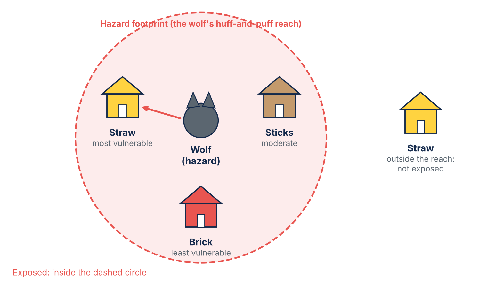
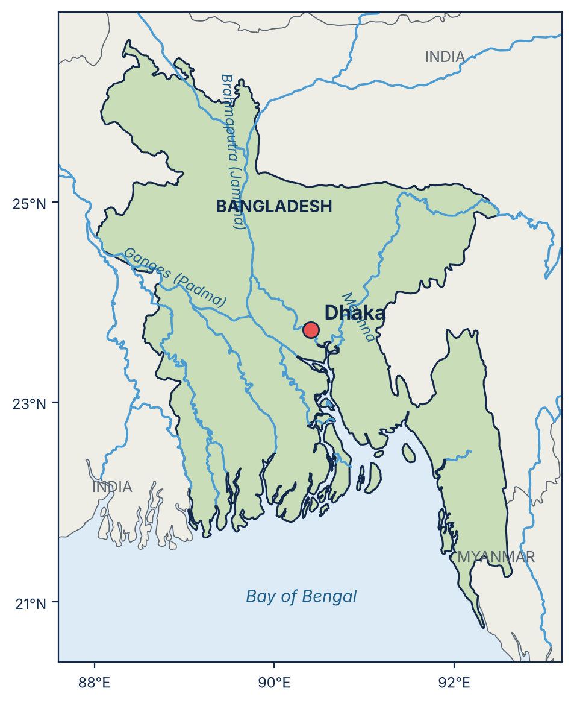
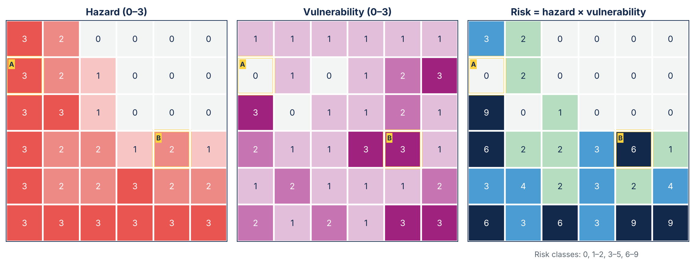

::: {.callout-note appearance="simple"}
## Learning objectives

By the end of this chapter you should be able to:

1.  Define hazard, exposure, vulnerability, and risk, and explain how they combine.
2.  Explain how resilience and coping capacity reduce risk.
3.  Describe how a GIS study maps flood hazard from flood frequency and depth.
4.  Describe how physical, social, and coping-capacity indicators are combined into a vulnerability index.
5.  Derive weights from a pairwise comparison matrix with the Analytic Hierarchy Process, and check them with the consistency ratio.
6.  Calculate risk as hazard times vulnerability, and name the limitations of a risk index.
:::

Hurricanes, floods, wildfires, and earthquakes are natural events. Disasters are what happen when those events meet people, homes, and roads that can't withstand them. Two towns can face the same storm and suffer very different losses, because of where people live, how their homes are built, and what resources they have. **Risk analysis** maps those differences, so that money for levees, shelters, and warnings goes where it will prevent the most harm. This chapter defines the vocabulary of risk, then follows a published study of flood risk in Dhaka, Bangladesh, that puts the suitability methods of Chapter 20 to work.

## What is risk? {#sec-what-is-risk}

**Risk** is the estimated impact that a hazard would have on people, services, facilities, and structures in a community. It depends on three factors:

- **Hazard**: what could cause harm, and how likely and severe it is.
- **Exposure**: who and what is in its path.
- **Vulnerability**: how easily the exposed people and things are harmed.

In its simplest form:

$$
\text{Risk} = \text{Hazard} \times \text{Vulnerability} \times \text{Exposure}
$$

The multiplication matters. If any one factor is zero, there is no risk. A hurricane over the open ocean is a hazard, but nothing is exposed to it. A flood over empty land harms no one. Disaster researchers often summarize this idea as "disasters are not natural": the event is natural, but the losses depend on people's choices about where and how to live, and on who has the resources to protect themselves [@wisner2004].

To keep the vocabulary concrete, we use a familiar story: the Three Little Pigs (@fig-three-pigs).

{#fig-three-pigs fig-alt="A diagram. A gray wolf symbol, labeled wolf, hazard, sits in the middle of a large dashed red circle labeled hazard footprint, the wolf's huff-and-puff reach. Inside the circle are three houses: a yellow straw house labeled most vulnerable, with a red arrow from the wolf pointing at it; a brown stick house labeled moderate; and a red brick house labeled least vulnerable. Outside the circle, to the right, is another yellow straw house labeled outside the reach, not exposed."}

### Hazard

A **hazard** is an act or phenomenon that has the potential to produce harm: a wildfire, hurricane, flood, earthquake, or disease outbreak. In the story, the wolf is the hazard. On his own he is only a *potential* source of harm. Whether he causes damage depends on who is in his path, and how well they are protected.

In a GIS, a hazard is usually mapped as a **hazard footprint**, the area it can reach, with its likelihood and severity: a 100-year floodplain, a wildfire perimeter, a zone of strong earthquake shaking.

### Exposure

**Exposure** is the people, property, systems, or functions that could be lost because of a hazard: people, buildings, roads, power lines, crops. In @fig-three-pigs, the dashed circle is the wolf's huff-and-puff reach. All three pigs' houses are inside it, so all three are exposed. A straw house a mile away is just as weak, but it is not exposed, so its risk is low.

Exposure is usually measured by **overlay** (Chapter 14): the hazard footprint is intersected with population, buildings, and infrastructure. How many people live in the floodplain? Which hospitals are inside the evacuation zone?

### Vulnerability

**Vulnerability** is the susceptibility to physical injury, harm, damage, or economic loss. All three pigs face the same wolf, but the brick house holds while the straw house blows away. The difference is not the hazard; it is the vulnerability of each household.

In real places, vulnerability comes from building quality, income, age, health, literacy, and access to warnings and services. Two kinds are often separated:

- **Physical vulnerability**: properties of the land and buildings, such as low elevation, weak construction, or closeness to a river.
- **Social vulnerability**: properties of the people, such as poverty, age, disability, language, or lack of a car, that make it harder to prepare, evacuate, and recover [@cutter2003].

### Calculating risk

Now put the pieces together. All three houses face the same wolf, and all three are inside his reach, so hazard and exposure are equal. Only vulnerability differs. The straw house is the most vulnerable, so it carries the greatest risk.

| House | Hazard | Exposure | Vulnerability | Risk |
|---|:---:|:---:|:---:|---|
| Straw (inside the circle) | Wolf | Yes | High | Greatest |
| Sticks | Wolf | Yes | Moderate | Moderate |
| Brick | Wolf | Yes | Low | Least |
| Straw (outside the circle) | Wolf | No | High | None |

: Risk in the Three Little Pigs. {#tbl-pigs}

Because risk is a product, lowering *any* factor lowers it. We usually can't stop a hurricane, but zoning can keep homes out of the floodplain (exposure), and building codes can make them stronger (vulnerability).

::: {.callout-tip appearance="simple"}
## Think about it

Pick a hazard that affects your hometown. What is its footprint? Who and what is exposed? Which neighborhoods or groups are most vulnerable, and why?
:::

## Resilience and coping capacity {#sec-resilience}

Hazard, exposure, and vulnerability push risk up. Other factors pull it down (@fig-risk-framework). In a framework developed for earthquake risk [@davidson1997] and adapted for floods by Dewan [-@dewan2013], **capacity and measures** reduce risk: physical planning such as levees and land-use rules, social capacity such as community organizations, economic capacity such as savings and insurance, and management such as warning systems and emergency response.

![A framework for disaster risk. Hazard, exposure, and vulnerability push risk up; capacity and measures pull it down. After Davidson [-@davidson1997] and Dewan [-@dewan2013].](../images/risk-analysis/risk-framework.png){#fig-risk-framework fig-alt="Four large arrows. Three point up: red, hazard, how likely and how severe; orange, exposure, who and what is in harm's way; and purple, vulnerability, how easily they are harmed. Above them: push risk up. Separated by a line, a green arrow points down: capacity and measures, planning, social and economic capacity, management. Above it: pulls risk down."}

The United Nations Office for Disaster Risk Reduction defines two related terms [@undrr2017]:

- **Resilience** is "the ability of a system, community or society exposed to hazards to resist, absorb, accommodate, adapt to, transform and recover from the effects of a hazard in a timely and efficient manner."
- **Coping capacity** is "the ability of people, organizations and systems, using available skills and resources, to manage adverse conditions, risk or disasters."

Coping capacity acts during and right after an event: reaching a shelter, reading a warning, drawing on savings. Resilience is broader, and includes learning and adapting afterward, for example by raising homes or changing land-use rules.

::: {.callout-note .did-you-know appearance="simple" icon=false}
## Did you know..?

In the United States, you can look up risk for every county and census tract. FEMA's **National Risk Index** estimates the expected annual loss from 18 natural hazards, from tornadoes to tsunamis, and adjusts it for each community's social vulnerability and resilience [@fema2023nri]. The CDC's **Social Vulnerability Index** ranks every census tract on 16 census variables, such as poverty, age, disability, and lack of a vehicle, to help emergency planners find the people who will need the most help [@flanagan2011]. Both are built from the same ACS data you met in Chapter 9.
:::

## Case study: flood risk in Dhaka {#sec-dhaka}

### Floods in a megacity

Bangladesh sits on the delta of three great rivers: the Ganges (called the Padma in Bangladesh), the Brahmaputra (Jamuna), and the Meghna (@fig-dhaka-locator). Much of the country is only a few meters above sea level, and flooding during the summer monsoon is a regular part of life. Dhaka, the capital, is surrounded by rivers, and major floods struck the city in 1988, 1998, 2004, and 2007. In July 2020, about a quarter of the country was under water.

{#fig-dhaka-locator fig-alt="A map of Bangladesh in green, surrounded by India, with Myanmar in the southeast and the Bay of Bengal to the south. Blue rivers cross it: the Brahmaputra, or Jamuna, flows south from the north; the Ganges, or Padma, flows southeast from the west; they join and flow into the Meghna, which reaches the bay. A red dot marks Dhaka in the center of the country, just east of where the rivers meet."}

Our case study is Ashraf Dewan's book *Floods in a Megacity* [@dewan2013], which uses remote sensing and GIS to map flood hazard, vulnerability, and risk across Dhaka. It follows three steps (@fig-dhaka-workflow):

1.  **Determine the hazard**: how often, and how deeply, each part of the city floods.
2.  **Measure vulnerability**: the physical, social, and economic conditions that make some places suffer more, minus their coping capacity.
3.  **Calculate risk**: hazard times vulnerability.

![The Dhaka flood risk workflow, after Dewan [-@dewan2013].](../images/risk-analysis/dhaka-workflow.png){#fig-dhaka-workflow fig-alt="A flowchart in three columns. Step 1, hazard: flood frequency 1988 to 2007 and floodwater depth are overlaid to make flood hazard in 4 classes. Step 2, vulnerability: physical (elevation, land use, channel, geology) and social (demographic, economic, infrastructure) layers combine, with AHP weights and WLC, into composite vulnerability; coping capacity (awareness, literacy, wealth, services) is subtracted. Step 3, risk: flood hazard and composite vulnerability both feed flood risk by community, with the label risk equals hazard times vulnerability."}

### Step 1: flood hazard

The hazard map is built from two layers, both derived from satellite images of past floods:

- **Flood frequency**: how many of the four observed floods reached each location, classed as no flood, low, medium, and high.
- **Floodwater depth**: the deepest water each location reached, classed from no water to deep.

Damage to buildings, roads, and health rises sharply as water gets deeper, and a place that floods every few years has little time to recover. Overlaying the two classed layers gives a **flood hazard** map with four classes, from no hazard to high hazard. A place that floods often and deeply has the highest hazard. The high-hazard areas are the low-lying fringes of the city; the higher ground in the center and north shows little or no hazard.

### Who lives there?

Dhaka has grown extraordinarily fast (@tbl-dhaka). Its population rose about twentyfold in 50 years, from 0.7 million in 1961 to 14.5 million in 2011. Much of that growth happened through unplanned settlement on low, flood-prone land.

| Year | Households | Population | Density (per km²) | Literacy (%) | Household size |
|---|---:|---:|---:|---:|---:|
| 1961 | 127,710 | 718,766 | 5,796 | – | 5.6 |
| 1974 | 341,167 | 2,068,353 | 6,156 | – | 6.1 |
| 1981 | 527,311 | 3,440,147 | 8,547 | 57.0 | 6.0 |
| 1991 | 1,088,378 | 6,487,459 | 4,795 | 62.3 | 5.4 |
| 2001 | 1,920,682 | 9,672,763 | 7,055 | 65.1 | 4.6 |
| 2011 | 3,232,683 | 14,509,100 | 10,484 | 67.3 | 4.1 |

: Demographics of Dhaka. A dash means no data. The 1991 drop in density reflects a larger census boundary. Source: Bangladesh Bureau of Statistics censuses, in Dewan [-@dewan2013, Table 3.1]. {#tbl-dhaka}

Dewan names ten causes of Dhaka's flood vulnerability. Some are physical: low elevation, unplanned urbanization, dilapidated drainage, and poor flood control. Others are social: high population density, extreme poverty, low flood preparedness, weak governance, and no tools for communicating risk. Climate change makes several of them worse. Waste dumped in canals and ponds blocks drainage, and new building on the floodplain fills the low land that once stored floodwater.

### Step 2: vulnerability

Vulnerability is mapped as three indices, each a weighted linear combination of indicator layers (Chapter 20), with weights set by the Analytic Hierarchy Process (@sec-ahp). @fig-dhaka-weights charts the top-level weights.

![The AHP weights of the three indices in the Dhaka study. Data: Dewan [-@dewan2013], Tables 6.4–6.6.](../images/risk-analysis/weights.png){#fig-dhaka-weights fig-alt="Three bar charts of weights that sum to 1. Physical vulnerability: elevation 0.483, land use 0.316, distance to channel 0.145, geology 0.056. Social vulnerability: demographic 0.557, economic 0.320, infrastructure and lifelines 0.123. Coping capacity: flood awareness 0.464, literacy 0.267, housing price 0.160, shelters 0.069, hospitals 0.040."}

**Physical vulnerability** uses four biophysical layers: elevation, land use, distance to the nearest active river channel, and geology. Elevation carries almost half the weight (0.483), which makes sense in a city where a meter or two decides whether a street floods. Within each criterion, the classes are weighted too. Built-up land and land below 4 m get the highest class weights, so low, dense neighborhoods near rivers come out as most vulnerable.

**Social vulnerability** describes the people who live in flood-prone areas, using census indicators for each tract in three groups:

- **Demographic** (weight 0.557): population density, the very young and the old, and women, who in Dhaka often have less access to resources during floods.
- **Economic** (0.320): illiteracy, housing type, and poverty. A **katcha house**, a makeshift dwelling of mud, bamboo, or recycled and found materials, gets the highest weight within housing type (0.690), because it is the most likely to be destroyed.
- **Infrastructure and lifelines** (0.123): road density, drinking water sources, and sanitation. Within this group, water sources (0.458) and sanitation (0.416) far outweigh road density (0.126), because contaminated water and poor sanitation drive the disease outbreaks that follow floods.

**Coping capacity** measures resilience with five indicators. Flood frequency is used as a measure of *awareness*, since people who flood often tend to be better prepared, and it gets nearly half the weight (0.464). Literacy comes next (0.267), because it affects whether people understand and act on warnings. Housing price stands in for wealth (0.160), and shelters (0.069) and hospitals (0.040) measure access to services.

The three indices are combined into one **composite vulnerability index**: physical plus social vulnerability, *minus* coping capacity. More capacity means lower overall vulnerability. Places that are physically exposed, socially disadvantaged, and short on coping resources come out as the most vulnerable.

## Setting the weights: AHP and WLC {#sec-ahp}

Two methods do the heavy lifting in the Dhaka study, and in many suitability and risk models.

### Weighted Linear Combination

**Weighted linear combination (WLC)**, from Chapter 20, multiplies each standardized layer by its weight and adds them, cell by cell or tract by tract:

$$
S = \sum_i w_i \, x_i
$$

For example, a built-up cell below 4 m picks up 0.316 × 0.484 from land use (the criterion weight times the class weight) and 0.483 × 0.482 from elevation: about 0.39 from those two criteria alone, before distance and geology are added. A wetland on high ground would score far lower.

### The Analytic Hierarchy Process

WLC needs weights. Asking someone to rank ten factors at once is hard. The **Analytic Hierarchy Process (AHP)**, developed by Thomas Saaty [-@saaty1977; -@saaty1980], asks a series of easier questions instead: comparing *two* criteria at a time, how much more important is one than the other? Answers use a scale from 1 to 9:

| Value | Meaning |
|:---:|---|
| 1 | Equally important |
| 3 | Moderately more important |
| 5 | Strongly more important |
| 7 | Very strongly more important |
| 9 | Extremely more important |

: Saaty's scale for pairwise comparison. 2, 4, 6, and 8 fall in between. {#tbl-saaty}

The answers fill a **pairwise comparison matrix**. Each cell answers: how much more important is the *row* criterion than the *column* criterion? The diagonal is 1, and the lower half holds the reciprocals of the upper half. @tbl-ahp is a small example with three of the Dhaka criteria. (The judgments are made up for teaching; they are not Dewan's.)

| Criterion | Land use | Elevation | Distance to river | Weight |
|---|:---:|:---:|:---:|:---:|
| Land use | 1 | 3 | 5 | 0.65 |
| Elevation | 1/3 | 1 | 2 | 0.23 |
| Distance to river | 1/5 | 1/2 | 1 | 0.12 |

: A pairwise comparison matrix for three criteria, and the weights it gives. Illustrative values. {#tbl-ahp}

Read across each row: land use is 3 times as important as elevation, and 5 times as important as distance to the river. To get the weights:

1.  Take the **geometric mean** of each row: for land use, $\sqrt[3]{1 \times 3 \times 5} = 2.47$; for elevation, $\sqrt[3]{1/3 \times 1 \times 2} = 0.87$; for distance, $\sqrt[3]{1/5 \times 1/2 \times 1} = 0.46$.
2.  **Normalize**: divide each by their total (3.80), so the weights sum to 1. This gives 0.65, 0.23, and 0.12.

(Saaty's original method uses the matrix's principal eigenvector, which gives nearly the same weights.)

People are not always consistent. Someone might say A beats B, B beats C, and C beats A. AHP's **consistency ratio (CR)** measures how far the judgments are from perfectly consistent. Saaty's rule of thumb is that a CR below 0.10 is acceptable; above that, the judgments should be revisited. The example's CR is 0.003, well below the limit.

Finally, WLC applies the weights:

$$
S = 0.65 \times \text{land use} + 0.23 \times \text{elevation} + 0.12 \times \text{distance}
$$

In a real study, several experts or stakeholders make the comparisons, and their judgments are combined. AHP is used far beyond GIS, in business and government decisions of all kinds. Free calculators, such as AHP-OS, do the arithmetic for you.

::: {.callout-tip appearance="simple"}
## Think about it

Fill in a pairwise comparison matrix for three criteria for choosing an apartment: rent, distance to campus, and size. Compute the weights. Would a roommate's matrix give the same answer?
:::

## Step 3: calculating risk {#sec-calculating-risk}

With a hazard map and a composite vulnerability map, the final step multiplies them, community by community:

$$
\text{Risk} = \text{Hazard} \times \text{Vulnerability}
$$

The highest risk falls where high hazard meets high vulnerability. Risk is *not* the same as hazard. Some high-hazard areas have moderate risk, because their residents are less vulnerable; some moderate-hazard areas rank high, because vulnerability there is severe. @fig-town-risk shows the same effect in a made-up town of 36 communities.

{#fig-town-risk fig-alt="Three 6 by 6 grids of numbers. Hazard, in reds from 0 to 3, is highest, 3, along the left column and bottom row. Vulnerability, in purples from 0 to 3, is scattered. Risk, hazard times vulnerability, ranges from 0 to 9 in greens and blues. Community A, outlined in yellow on the left side, has hazard 3, vulnerability 0, and risk 0. Community B, outlined in yellow on the right, has hazard 2, vulnerability 3, and risk 6, dark blue."}

In Dhaka, the resulting flood risk map, by community, answers a planner's practical question: where would an investment in flood control, shelters, or early warning reduce the most harm?

### Limitations

Every model simplifies, and a risk index has limits worth naming before anyone uses it for decisions:

- **Expert judgment.** The AHP weights reflect the analysts' comparisons. A different panel could produce a different map. A sensitivity analysis that varies the weights (Chapter 20) shows how stable the result is.
- **Aggregation.** Indicators are averaged over tracts and communities, which hides differences between neighboring households. Assuming every household shares its tract's average is the ecological fallacy (Chapter 8).
- **Past floods only.** The hazard layer is built from the 1988–2007 floods. It does not model climate change, or new embankments built since.
- **Data age.** The census inputs date to 2011, in a city that grew twentyfold in 50 years.
- **Relative, not absolute.** The index ranks places from low to high risk. It does not estimate losses in money or lives.

Each of these is a kind of uncertainty, the subject of Chapter 12.

## Risk analysis in ArcGIS Pro and QGIS {#sec-risk-software}

A risk model uses the same tools as a suitability model (@tbl-suitability-tools in Chapter 20):

- **Exposure**: overlay the hazard footprint with population or buildings using Intersect, a spatial join (Chapter 7), or Zonal Statistics (Chapters 14 and 17).
- **Standardize indicators**: Reclassify or Rescale by Function, or the Field Calculator for tables.
- **Weight and combine**: Weighted Overlay, Weighted Sum, or the Raster Calculator in ArcGIS Pro; the Raster Calculator or Field Calculator in QGIS. Compute AHP weights in a spreadsheet or an online calculator.
- **Risk**: multiply hazard and vulnerability with the Raster Calculator or Field Calculator, and map the result with careful classing (Chapter 8).

## Check your understanding

::: {.content-visible when-format="html"}

1.  An act or phenomenon that has the potential to produce harm is a: <select class='webex-select'><option value='blank'></option><option value='answer'>Hazard</option><option value=''>Risk</option><option value=''>Vulnerability</option><option value=''>Resilience</option></select>

2.  In the Three Little Pigs, the building material of each house sets its: <select class='webex-select'><option value='blank'></option><option value=''>Hazard</option><option value=''>Exposure</option><option value='answer'>Vulnerability</option><option value=''>Coping capacity</option></select>

3.  A very weak house far outside a flood zone has low risk because it is not: <select class='webex-select'><option value='blank'></option><option value=''>Vulnerable</option><option value='answer'>Exposed</option><option value=''>Resilient</option><option value=''>Weighted</option></select>

4.  If any one of hazard, exposure, or vulnerability is zero, risk is zero. <select class='webex-select'><option value='blank'></option><option value='answer'>TRUE</option><option value=''>FALSE</option></select>

5.  In the Dhaka study, which physical criterion has the largest weight? <select class='webex-select'><option value='blank'></option><option value='answer'>Elevation</option><option value=''>Land use</option><option value=''>Geology</option><option value=''>Distance to channel</option></select>

6.  In AHP, a 5 in the pairwise comparison matrix means the row criterion is: <select class='webex-select'><option value='blank'></option><option value=''>Equally important</option><option value=''>Moderately more important</option><option value='answer'>Strongly more important</option><option value=''>Extremely more important</option></select>

7.  An AHP consistency ratio is usually considered acceptable below: <input class='webex-solveme nospaces' size='5' data-answer='["0.1","0.10",".1",".10"]'/>

8.  A community with hazard 2 and vulnerability 3 has a risk of: <input class='webex-solveme nospaces' size='3' data-answer='["6"]'/>

:::

::: {.content-visible unless-format="html"}
The interactive self-check questions for this chapter are in the online version of the book.
:::

## Summary

- **Risk** is the estimated impact of a hazard on a community: **hazard** × **vulnerability** × **exposure**. If any factor is zero, there is no risk, so lowering any factor lowers risk.
- A **hazard** has the potential to cause harm. **Exposure** is who and what is in its path, usually found by overlaying the hazard footprint with people and assets. **Vulnerability** is how easily they are harmed, from physical and social causes.
- **Resilience** and **coping capacity** pull risk down. In Dhaka, flood awareness and literacy carried most of the coping-capacity weight.
- The Dhaka study mapped **hazard** from flood frequency and depth, built **physical**, **social**, and **coping capacity** indices into a **composite vulnerability index**, and multiplied hazard by vulnerability to map **flood risk** by community.
- The **Analytic Hierarchy Process** turns pairwise comparisons on a 1–9 scale into weights, and checks them with the **consistency ratio** (acceptable below 0.10). **Weighted linear combination** adds the weighted layers into one index.
- Risk indices depend on expert judgment, aggregation, past events, and the age of their data, and they rank places relative to one another rather than estimating losses.

## Exercises

1.  **Vocabulary.** For a wildfire near a town in the western United States, name the hazard, two kinds of exposure, and three factors that would raise vulnerability. Name one form of coping capacity.
2.  **AHP by hand.** Three criteria have the comparisons A vs. B = 2, A vs. C = 4, and B vs. C = 2. Fill in the full matrix, and compute the weights with row geometric means. Is this matrix perfectly consistent? (Hint: does A vs. C equal A vs. B times B vs. C?)
3.  **National Risk Index.** Look up Orange County, North Carolina, and a coastal county such as Dare County in FEMA's National Risk Index. Which hazards drive each county's risk? How do the two counties' social vulnerability and community resilience ratings compare?
4.  **Social vulnerability.** Download the CDC/ATSDR Social Vulnerability Index for North Carolina census tracts, and join it to tract boundaries (Chapter 6). Overlay the FEMA 1% annual chance floodplain from NC's Flood Risk Information System. Which tracts are both highly vulnerable and flood-prone?
5.  **Sensitivity.** In the Dhaka physical vulnerability weights, swap the weights of elevation and land use. Recalculate the score for built-up land below 4 m (class weights 0.484 and 0.482). Does it change? Why might this matter less than it seems?
6.  **Limitations.** You are a planner in Dhaka with money for ten new flood shelters. Which limitation of the risk model would worry you most, and what additional data would you collect?

## Further reading and online resources

### Books and papers

- *Floods in a Megacity: Geospatial Techniques in Assessing Hazards, Risk and Vulnerability*, by Ashraf Dewan [@dewan2013], the case study in this chapter: <https://link.springer.com/978-94-007-5874-2>.
- *At Risk: Natural Hazards, People's Vulnerability and Disasters*, by Ben Wisner, Piers Blaikie, Terry Cannon, and Ian Davis [@wisner2004], the classic account of why disasters are not natural.
- Susan Cutter and colleagues, "Social vulnerability to environmental hazards" [@cutter2003], which introduced the Social Vulnerability Index (SoVI).
- Barry Flanagan and colleagues, "A social vulnerability index for disaster management" [@flanagan2011], the paper behind the CDC/ATSDR SVI.
- Thomas Saaty, "A scaling method for priorities in hierarchical structures" [@saaty1977], and *The Analytic Hierarchy Process* [@saaty1980].
- Jacek Malczewski, "GIS-based multicriteria decision analysis: A survey of the literature" [@malczewski2006].
- *GIS Fundamentals*, by Paul Bolstad [@bolstad2022].

### Risk data and maps for the United States

- FEMA, National Risk Index: <https://hazards.fema.gov/nri>, "Learn More": <https://hazards.fema.gov/nri/learn-more>, and its technical documentation [@fema2023nri]: <https://www.fema.gov/sites/default/files/documents/fema_national-risk-index_technical-documentation.pdf>.
- CDC/ATSDR Social Vulnerability Index: <https://atsdr.cdc.gov/place-health/php/svi/>, and its data download: <https://www.atsdr.cdc.gov/place-health/php/svi/svi-data-documentation-download.html>.
- University of South Carolina Hazards and Vulnerability Research Institute, SoVI: <https://sc.edu/study/colleges_schools/artsandsciences/centers_and_institutes/hvri/data_and_resources/sovi/index.php>.
- FEMA Flood Map Service Center: <https://msc.fema.gov/portal/home>.
- NC Flood Risk Information System (FRIS): <https://fris.nc.gov/fris/>.
- NOAA Sea Level Rise Viewer: <https://coast.noaa.gov/slr/>.
- NOAA NCEI, Billion-Dollar Weather and Climate Disasters: <https://www.ncei.noaa.gov/access/billions/>.
- U.S. Climate Resilience Toolkit: <https://toolkit.climate.gov/>.
- NC Emergency Management: <https://www.ncdps.gov/our-organization/emergency-management>, and ReadyNC: <https://www.readync.gov/>.

### Global risk and disaster data

- UNDRR, Terminology on Disaster Risk Reduction [@undrr2017]: <https://www.undrr.org/terminology>.
- PreventionWeb, the global knowledge platform for disaster risk reduction: <https://www.preventionweb.net/>.
- INFORM Risk Index, a global, open-source risk assessment for humanitarian crises: <https://drmkc.jrc.ec.europa.eu/inform-index>.
- Copernicus Emergency Management Service (rapid mapping of disasters): <https://emergency.copernicus.eu/>.
- Dartmouth Flood Observatory, a global archive of large floods: <https://floodobservatory.colorado.edu/>.
- Bangladesh Flood Forecasting and Warning Centre: <http://www.ffwc.gov.bd/>.

### Tools

- AHP Online System (AHP-OS): <https://bpmsg.com/ahp/>.
- Esri, "How Weighted Overlay works": <https://pro.arcgis.com/en/pro-app/latest/tool-reference/spatial-analyst/how-weighted-overlay-works.htm>.
- Esri, "Weighted Sum": <https://pro.arcgis.com/en/pro-app/latest/tool-reference/spatial-analyst/weighted-sum.htm>.
- QGIS Tutorials and Tips, "Multi Criteria Overlay Analysis (QGIS3)": <https://www.qgistutorials.com/en/docs/3/multi_criteria_overlay.html>.
