::: {.callout-note appearance="simple"}
## Learning objectives

By the end of this chapter you should be able to:

1.  Define spatial analysis, and break a problem into a chain of spatial operations, as a cartographic model.
2.  Tell local, neighborhood, and global operations apart by their spatial scope.
3.  Use selection, joins, reclassification, and dissolve to prepare layers for analysis.
4.  Create fixed, dissolved, multiple-ring, and variable-distance buffers, and spot the problems they can cause.
5.  Explain what overlay does to geometry and attributes, and choose between clip, intersect, and union.
6.  Recognize sliver polygons, and describe how map algebra performs overlay on rasters.
:::

So far, this book has been about getting data into a GIS and mapping it well. This chapter turns to answering questions with it. Most GIS questions, from "which homes are in the flood zone?" to "where should the new clinic go?", are answered with a small set of tools used over and over: selection, joins, reclassification, dissolve, buffers, and overlay. The art is in chaining them together.

## What is spatial analysis? {#sec-what-is-spatial-analysis}

### A problem: where would Batman live?

Start with a light problem. Suppose Batman is moving to Austin, Texas. He has two requirements:

- **Limestone soils**, soft enough to dig a Batcave, and prone to forming caves on their own.
- **A high-crime area nearby**, so that he can fight crime.

Austin is a good choice. It sits on the Balcones Escarpment, where limestone is common, and it is home to one of the largest urban bat colonies in North America. To find the best site, we need two data layers, soils and ZIP Codes, and a table of crimes by ZIP Code. Then we solve the problem in four steps (@fig-batcave-model):

1.  **Select** the limestone soils from the soils layer, to create a new layer.
2.  **Table join** the crime table to the ZIP Code layer, on the ZIP Code (Chapter 6).
3.  **Select** the ZIP Code with the most crimes, to create a new layer.
4.  **Spatial join** the limestone layer to the highest-crime ZIP Code, to find the closest limestone area (Chapter 7).

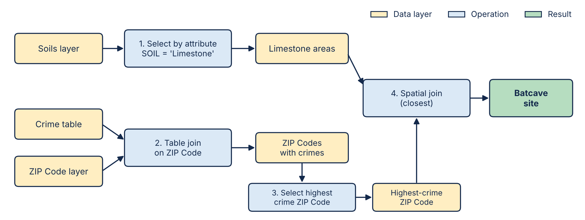{#fig-batcave-model fig-alt="A flowchart. The soils layer goes into step 1, select by attribute SOIL equals Limestone, producing limestone areas. The crime table and ZIP Code layer go into step 2, table join on ZIP Code, producing ZIP Codes with crimes, which go into step 3, select highest-crime ZIP Code, producing the highest-crime ZIP Code. The limestone areas and the highest-crime ZIP Code go into step 4, spatial join on closest, producing the Batcave site."}

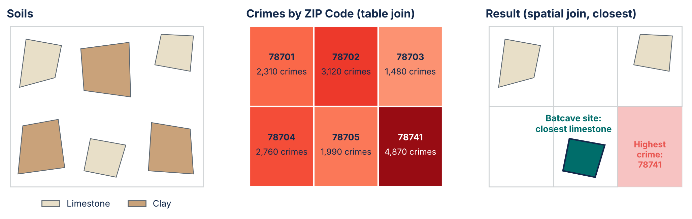{#fig-batcave-map fig-alt="Three maps of the same made-up city. Left: scattered limestone and clay soil polygons. Middle: six ZIP Code squares shaded by crime count, from 1,480 to 4,870; 78741 in the lower right is darkest. Right: ZIP Code 78741 is highlighted, and the limestone polygon closest to it, in the neighboring ZIP Code, is dark green and labeled Batcave site."}

The answer depends on our choices. If we used crimes *per person* rather than total crimes (Chapter 11), a different ZIP Code might win, and so might a different site. The same workflow, with different criteria, is used to site real facilities, such as schools, clinics, and landfills.

::: {.callout-note .did-you-know appearance="simple" icon=false}
## Did you know..?

Austin really is a good place for bats. From March to October, about 1.5 million Mexican free-tailed bats live under the Congress Avenue Bridge downtown, and at dusk they stream out in a cloud to hunt insects. The colony moved in after the bridge was rebuilt in 1980 with narrow crevices underneath, just the right size for roosting. Crowds now gather every summer evening to watch.
:::

### Spatial operations and cartographic models

Bolstad defines **spatial analysis** as the "application of operations to coordinate data and related attribute data, often to solve a problem" [@bolstad2022]. Two things stand out in that definition. Operations work on both the geometry (*coordinate data*) and the table (*attribute data*), and they usually change both. And analysis is driven by a *problem*, not by the tools.

A **spatial operation**, also called a spatial function, takes one or more input layers and produces an output layer. Real problems are solved by chaining operations, each output becoming the next input. Planning such a chain is called **cartographic modeling**, a term introduced by Dana Tomlin [@tomlin1990]. A flowchart like @fig-batcave-model is the plan: the inputs, the operations, the intermediate layers, and the final output.

**Sketch the model before you open the software.** Then build it in a tool such as ArcGIS Pro's **ModelBuilder** or QGIS's **Model Designer**, which let you draw the flowchart and run it. A model documents every step, and can be rerun when the data change.

## Spatial scope {#sec-spatial-scope}

**Spatial scope** is "the extent or area of the input data that are used in determining the values at output locations" [@bolstad2022]. It tells you which input locations feed each output value. There are three kinds (@fig-spatial-scope):

- **Local** operations use only the input at the same location. Utah's population density uses only Utah's population and area; its neighbors' values don't matter.
- **Neighborhood** operations use the input at a location and at nearby locations. Counting the states that border Utah is a neighborhood operation: the answer, 6, depends on which states touch it. Buffers and moving windows are neighborhood operations.
- **Global** operations use every location in the layer. Ranking the states by population is global: Utah's rank depends on every other state's value. Changing any one input can change every output.

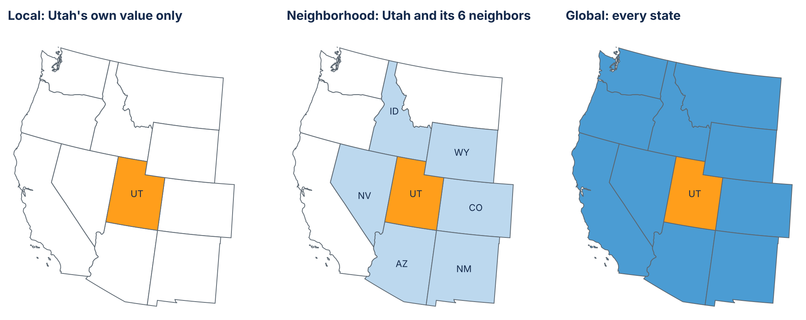{#fig-spatial-scope fig-alt="Three maps of the western United States. Local: only Utah is shaded. Neighborhood: Utah and its six neighbors, Idaho, Wyoming, Colorado, New Mexico, Arizona, and Nevada, are shaded. Global: every western state is shaded."}

Utah's six neighbors include New Mexico, which it touches only at the Four Corners. Counted in rook's case (Chapter 12), Utah would have five. The same three scopes appear in raster analysis as local, focal, and global functions (@sec-map-algebra).

## Preparing layers {#sec-preparing-layers}

### Selection

**Selection** is usually the first step. An **attribute query** selects features by their values in the table, such as `SOIL = 'Limestone'` (Chapter 5). A **spatial query** selects them by location, such as the ZIP Codes that touch a river (Chapter 7). Both combine conditions with `AND`, `OR`, and `NOT`. Export the selection to a new layer to feed the next operation.

### Joins

**Joins** attach attributes from one dataset to another. A **table join** links records through a shared key, such as a ZIP Code (Chapter 6). A **spatial join** links them by location, such as *contains*, *intersects*, or *closest*, and works when the layers share no key (Chapter 7). The Batcave problem uses both.

### Reclassification

**Reclassification** groups values into fewer, more meaningful classes, such as elevation into *low* (below 500 m), *medium*, and *high* (above 1,500 m). It is a local operation: each feature's new class depends only on its own value. In suitability models, each input layer is usually reclassified onto a common scale, such as 1 (poor) to 5 (good), before the layers are combined.

### Dissolve

**Dissolve** merges features that share a value in a field, removing the boundaries between them (@fig-dissolve). Dissolving U.S. states on their Census region turns 49 polygons into 4. Dissolve is how you aggregate to a coarser unit: counties to states, or parcels to zoning districts.

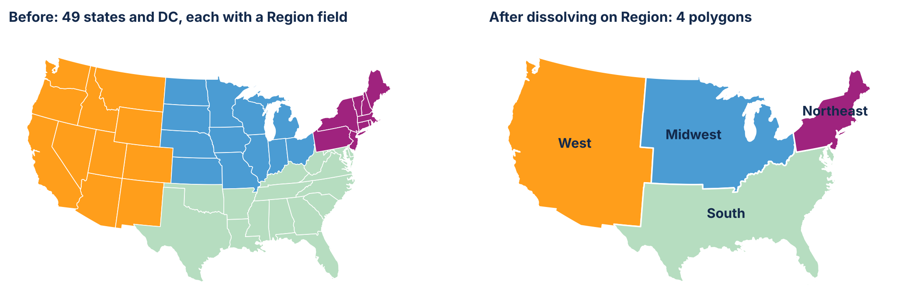{#fig-dissolve fig-alt="Two maps of the lower 48 states. Before: each state is outlined and colored by its Census region, West, Midwest, South, or Northeast. After: the internal state boundaries are gone, leaving four large region polygons, each labeled."}

The benefit is a simpler map and a smaller dataset; the cost is the detail of the merged features. When you dissolve, you can keep **summary statistics**, such as the sum of population, so that the new polygons carry totals of the old ones.

## Buffers {#sec-buffers}

### Proximity

**Proximity functions** work with distance. The main one is the **buffer**: the region within a specified distance of a feature. You can buffer points, lines, or polygons, to answer questions such as "which homes are within 500 meters of a highway?"

There are several kinds of buffer (@fig-buffer-types):

- **Fixed buffers** use one distance for every feature. Where buffers overlap, they stay separate polygons, so an area near two features is covered twice.
- **Dissolved buffers** merge overlapping buffers into one region. Use them when you want the total area within the distance, and don't care which feature each part came from.
- **Multiple-ring** (nested) buffers create rings at several distances, such as 1, 2, and 3 kilometers, for questions about distance bands.
- **Variable-distance buffers** take each feature's distance from a field, so that larger rivers or busier roads get wider buffers (@fig-line-buffers, right).

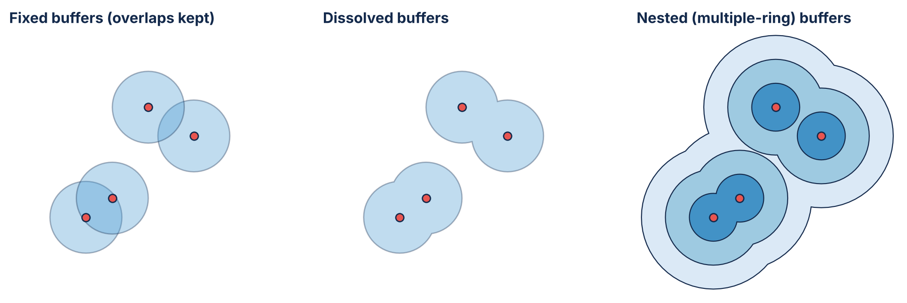{#fig-buffer-types fig-alt="Three panels with the same four red points. Fixed buffers: four separate translucent circles, two pairs of which overlap, with the overlaps darker. Dissolved buffers: the overlapping circles are merged into two blob-shaped polygons with no internal lines. Nested buffers: three rings around the points at increasing distances, each ring merged with its neighbors."}

### Line and polygon buffers

A line buffer extends the same distance on both sides of the line. Where lines loop back or run close together, their buffers merge, and the merged buffer can surround an area that is farther than the buffer distance from every line (@fig-line-buffers, left). This hole is *not* in the buffer. Polygons can also be buffered outward or inward (a negative distance). Check the output for holes and islands before using it in the next step.

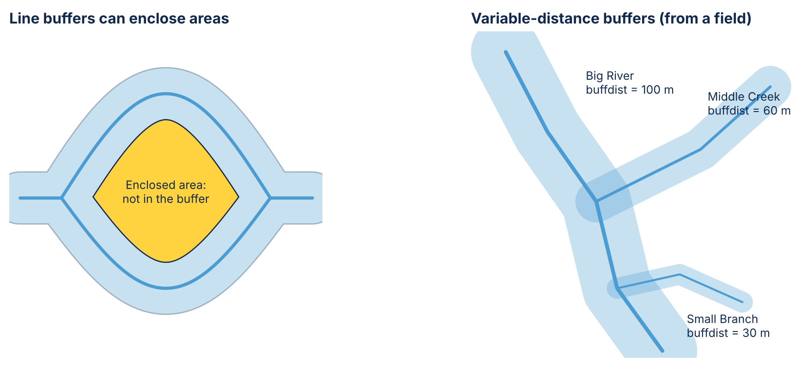{#fig-line-buffers fig-alt="Left: a stream splits into two curving branches that rejoin; their blue buffer forms a ring around a yellow lens-shaped area labeled Enclosed area: not in the buffer. Right: three joined rivers with buffers of different widths: Big River 100 meters, Middle Creek 60 meters, and Small Branch 30 meters."}

Buffers must be built in a **projected coordinate system**, or with a *geodesic* option, so that the distance is in real meters or feet (Chapters 4 and 7).

::: {.callout-tip appearance="simple"}
## Think about it

A city requires a 30-meter vegetated buffer along every stream, and 60 meters along rivers. A developer's parcel has a stream on two sides. How would you find the buildable area of the parcel? Which buffer type, and which overlay operation, would you use?
:::

## Overlay {#sec-overlay}

### Combining layers by location

**Overlay** combines two or more layers at the same locations. Boundaries from each layer are stacked, and wherever they cross, polygons are split. Each output polygon carries the attributes of every input polygon it came from (@fig-polygon-overlay). So overlay changes both the geometry and the table.

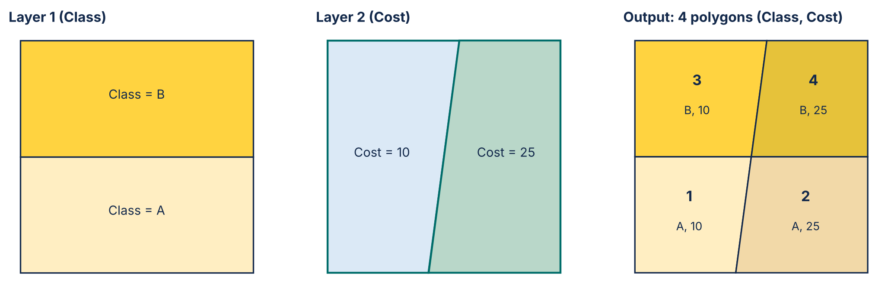{#fig-polygon-overlay fig-alt="Three panels. Layer 1: a square split horizontally into Class A at the bottom and Class B at the top. Layer 2: the same square split by a slanted line into Cost 10 on the left and Cost 25 on the right. Output: the square split into four polygons, numbered 1 to 4: 1 is A, 10; 2 is A, 25; 3 is B, 10; 4 is B, 25."}

The layers **must share a coordinate system**, or their features won't line up. (ArcGIS Pro and QGIS will project on the fly for display, but the tools may still give unexpected results; reproject first.)

The type of the output decides what can be kept. In a **point-in-polygon** overlay, each point inherits the attributes of the polygon it falls in, such as each crime point gaining the name and type of its county (@fig-point-in-polygon). There is no conflict, because each point is in one county. Going the other way, from points to a polygon, the polygon can hold only one value per field, so you need a rule: a count, a sum, the majority, or the first.

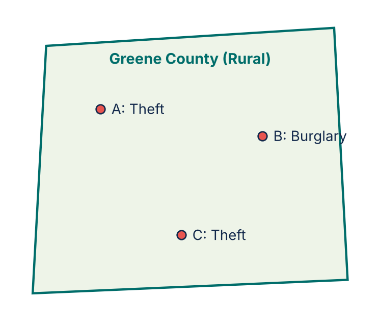{#fig-point-in-polygon width=55% fig-alt="A county polygon labeled Greene County, Rural, containing three red points: A, theft; B, burglary; C, theft."}

### Clip, intersect, and union

Three overlay operations are used most (@fig-clip-intersect-union):

- **Clip** keeps only the parts of the data layer that fall inside the bounding layer, like a cookie cutter. The output has only the data layer's attributes. Use it to cut statewide data down to a county or study area.
- **Intersect** keeps only the areas covered by *both* layers, and the output has attributes from both. Swapping the inputs gives the same areas. Intersect is the overlay version of a Boolean `AND`. For example, intersecting road centerlines with the 100-year floodplain gives the road segments at risk of flooding, with the road's name and the flood zone in each record.
- **Union** keeps *all* areas from both layers, split where they overlap, with attributes from both. Where one layer is absent, its fields are blank. Union is the overlay version of `OR`. In ArcGIS Pro, both inputs must be polygons.

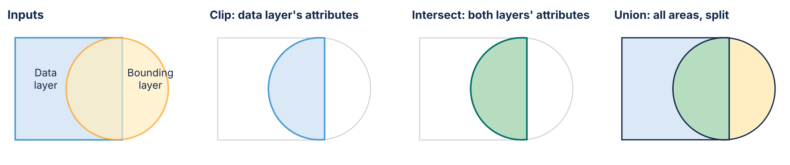{#fig-clip-intersect-union fig-alt="Four panels. Inputs: a blue rectangle, the data layer, overlapping an orange circle, the bounding layer. Clip: only the half-circle of the rectangle inside the circle remains, in blue. Intersect: the same half-circle, in green, meaning it carries both layers' attributes. Union: the whole rectangle and the whole circle, split into three pieces: the rectangle only, the overlap, and the circle only."}

| Operation | Keeps | Attributes from | Like |
|---|---|---|---|
| Clip | The data layer inside the bounding layer | The data layer only | A cookie cutter |
| Intersect | Areas in both layers | Both layers | `AND` |
| Union | All areas in either layer | Both layers (blank where absent) | `OR` |

: Clip, intersect, and union. {#tbl-overlay}

Other overlay tools include **Erase** (keep the parts of the data layer *outside* the other layer) and **Identity** (keep all of the input layer, with the attributes of the other layer where they overlap).

### Slivers

Vector overlay has a well-known problem. When two layers contain the same boundary, such as a county line, digitized at different times or scales, the two versions never match exactly. Overlay splits polygons wherever they cross, so the result is full of **slivers**: thin, tiny polygons along the shared boundary that represent nothing real (@fig-slivers).

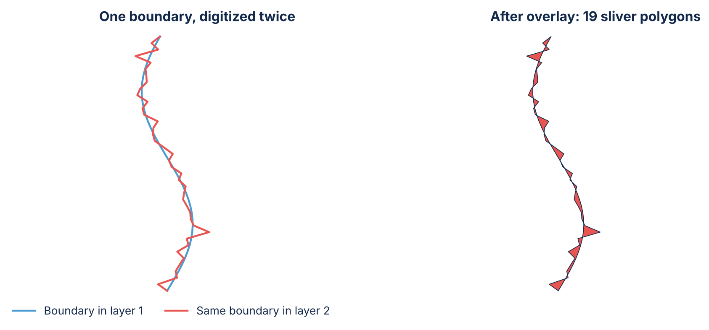{#fig-slivers fig-alt="Left: a smooth blue line and a jagged red line that follow the same boundary but cross each other many times. Right: the red sliver polygons created between them after overlay, a chain of tiny slivers along the boundary."}

Fixes include:

- setting a **snapping** or **cluster tolerance** when you run the overlay, so that vertices closer than the tolerance are treated as the same;
- using the **same source** for shared boundaries in every layer;
- removing polygons below a minimum area afterward, for example with ArcGIS Pro's **Eliminate** tool, which merges each sliver into its neighbor.

## Raster overlay: map algebra {#sec-map-algebra}

Rasters can be overlaid too, and more simply. Because every input uses the same grid of cells, overlay is done **cell by cell**, with **map algebra**, a framework also developed by Tomlin [@tomlin1990]. Its functions follow the same scopes as vector operations (@fig-map-algebra):

- **Local** functions use the same cell in each input, such as adding a slope score and a soil score.
- **Focal** functions use a moving window around each cell, such as the mean of a 3×3 window.
- **Zonal** functions summarize the cells within each zone, such as the mean elevation of each watershed.
- **Global** functions use every cell, such as the distance from each cell to the nearest road.

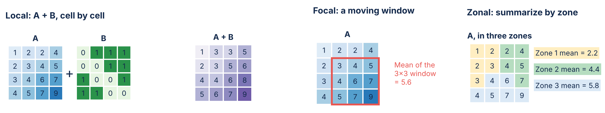{#fig-map-algebra fig-alt="Small grids of numbers. Local: raster A plus raster B equals raster A plus B, cell by cell. Focal: a 3 by 3 window outlined in red on raster A, with its mean, 5.6. Zonal: raster A colored into three zones, with the mean of each zone: 2.2, 4.4, and 5.8."}

Raster overlay produces **no slivers**, since every layer shares one grid. The price is precision: no boundary can be more precise than the cell size. Chapter 14 covers raster analysis in detail.

## Other kinds of spatial analysis {#sec-other-analysis}

Overlay and proximity are only part of the toolkit. Other families of methods include:

- **Network analysis**: shortest routes, closest facilities, and service areas along roads or utility lines.
- **Interpolation**: estimating values between sample points, such as temperatures from weather stations (Chapters 16 and 17).
- **Spatial statistics**: testing whether patterns, such as clusters of disease, are more concentrated than chance would produce, with measures such as Moran's I and Getis-Ord Gi\*.
- **Terrain analysis**: deriving slope, aspect, and viewsheds from elevation data (Chapter 15).

## Check your understanding

::: {.content-visible when-format="html"}

1.  Ranking every state by population is an example of which spatial scope? <select class='webex-select'><option value='blank'></option><option value=''>Local</option><option value=''>Neighborhood</option><option value='answer'>Global</option><option value=''>Zonal</option></select>

2.  Computing each state's population density from its own population and area is: <select class='webex-select'><option value='blank'></option><option value='answer'>Local</option><option value=''>Neighborhood</option><option value=''>Global</option><option value=''>Focal</option></select>

3.  Which operation merges features that share a value in a field? <select class='webex-select'><option value='blank'></option><option value=''>Buffer</option><option value='answer'>Dissolve</option><option value=''>Clip</option><option value=''>Intersect</option></select>

4.  Which buffer type merges overlapping buffers into one region? <select class='webex-select'><option value='blank'></option><option value=''>Fixed</option><option value='answer'>Dissolved</option><option value=''>Variable-distance</option><option value=''>Nested</option></select>

5.  Which overlay keeps only the areas in both layers, with attributes from both? <select class='webex-select'><option value='blank'></option><option value=''>Clip</option><option value='answer'>Intersect</option><option value=''>Union</option><option value=''>Erase</option></select>

6.  Clip output carries attributes from both layers. <select class='webex-select'><option value='blank'></option><option value=''>TRUE</option><option value='answer'>FALSE</option></select>

7.  Two layers of two polygons each are overlaid, and every boundary crosses every other once, as in @fig-polygon-overlay. How many output polygons are there? <input class='webex-solveme nospaces' size='2' data-answer='["4"]'/>

8.  Thin polygons created where two versions of the same boundary don't match are called: <select class='webex-select'><option value='blank'></option><option value=''>Buffers</option><option value='answer'>Slivers</option><option value=''>Zones</option><option value=''>Holes</option></select>

:::

::: {.content-visible unless-format="html"}
The interactive self-check questions for this chapter are in the online version of the book.
:::

## Summary

- **Spatial analysis** applies operations to geometry and attributes to solve a problem. Each **spatial operation** turns inputs into an output; a **cartographic model** chains them, and tools such as ModelBuilder make it repeatable.
- **Spatial scope** is **local** (the same location), **neighborhood** (the location and nearby ones), or **global** (every location).
- **Selection**, **joins**, **reclassification**, and **dissolve** prepare layers for analysis. Dissolve merges features with a shared value, and can carry summary statistics.
- A **buffer** is the area within a distance of a feature. Buffers can be **fixed**, **dissolved**, **multiple-ring**, or **variable-distance**; line buffers can enclose areas outside the buffer.
- **Overlay** splits polygons where layers cross and combines their attributes. **Clip** cuts like a cookie cutter, **intersect** keeps what is in both (`AND`), and **union** keeps everything (`OR`). Layers must share a coordinate system.
- Inconsistent shared boundaries produce **slivers**; snapping tolerances, common sources, and Eliminate fix them.
- **Map algebra** overlays rasters cell by cell with **local**, **focal**, **zonal**, and **global** functions, with no slivers, but no more precision than the cell size.

## Exercises

1.  **Draw a model.** Sketch a cartographic model for this problem: find the parcels in Orange County, NC, that are larger than 5 acres, within 1 mile of a major road, and outside the 100-year floodplain. Name the data layers, each operation, and each intermediate layer.
2.  **Scope.** Classify each operation as local, neighborhood, or global: (a) converting elevation from feet to meters; (b) finding each county's highest-population neighbor; (c) computing each county's share of the state's population; (d) the average slope in a 3×3 window.
3.  **Buffers.** In QGIS or ArcGIS Pro, buffer the schools in a county by 1 mile, once without dissolving and once with. Compare the number of polygons and the total area. Which would you use to find the share of the county within a mile of a school, and why?
4.  **Clip, intersect, union.** Download a county boundary and the FEMA flood zones (from the FEMA Flood Map Service Center or NC Flood Risk Information System) for part of it. Clip, intersect, and union them, and compare the attribute tables of the three outputs.
5.  **Roads at risk.** Intersect a road layer with the 100-year floodplain. What is the total length of road in the floodplain? Which road segments are longest?
6.  **Slivers.** Overlay two versions of a county boundary from different sources (for example, TIGER/Line and NC OneMap). How many slivers do you get? Try again with a cluster tolerance of 5 meters.

## Further reading and online resources

### Books

- *GIS Fundamentals: A First Text on Geographic Information Systems*, by Paul Bolstad [@bolstad2022]. The chapter on basic spatial analysis covers selection, dissolve, buffers, and overlay.
- *Geographic Information Systems and Cartographic Modeling*, by C. Dana Tomlin [@tomlin1990], the original account of map algebra.
- *The Esri Guide to GIS Analysis, Volume 1: Geographic Patterns and Relationships*, by Andy Mitchell [@mitchell2020], a clear, practical guide to overlay and proximity.
- *Geospatial Analysis: A Comprehensive Guide*, by Michael de Smith, Michael Goodchild, and Paul Longley, free online: <https://www.spatialanalysisonline.com>.
- *Intro to GIS and Spatial Analysis*, by Manuel Gimond, free online: <https://mgimond.github.io/Spatial/>.

### ArcGIS Pro

- Esri, "An overview of the Overlay toolset": <https://pro.arcgis.com/en/pro-app/latest/tool-reference/analysis/an-overview-of-the-overlay-toolset.htm>.
- Esri, "Buffer" tool reference: <https://pro.arcgis.com/en/pro-app/latest/tool-reference/analysis/buffer.htm>.
- Esri, "Multiple Ring Buffer" tool reference: <https://pro.arcgis.com/en/pro-app/latest/tool-reference/analysis/multiple-ring-buffer.htm>.
- Esri, "Dissolve" tool reference: <https://pro.arcgis.com/en/pro-app/latest/tool-reference/data-management/dissolve.htm>.
- Esri, "What is ModelBuilder?": <https://pro.arcgis.com/en/pro-app/latest/help/analysis/geoprocessing/modelbuilder/what-is-modelbuilder-.htm>.

### QGIS

- QGIS User Guide, "Vector overlay" algorithms (Clip, Intersection, Union, Difference): <https://docs.qgis.org/latest/en/docs/user_manual/processing_algs/qgis/vectoroverlay.html>.
- QGIS User Guide, "Vector geometry" algorithms (Buffer, Dissolve, Multi-ring buffer): <https://docs.qgis.org/latest/en/docs/user_manual/processing_algs/qgis/vectorgeometry.html>.
- QGIS User Guide, "The graphical modeler": <https://docs.qgis.org/latest/en/docs/user_manual/processing/modeler.html>.
- QGIS Tutorials, "Performing Spatial Queries" and other analysis tutorials: <https://www.qgistutorials.com/en/>.

### Other resources

- The GIS&T Body of Knowledge, "Overlay & Combination Operations," "Buffers," and "Cartographic Modeling": <https://www.ucgis.org/site/gis-t-body-of-knowledge>.
- Bat Conservation International: <https://www.batcon.org>.
