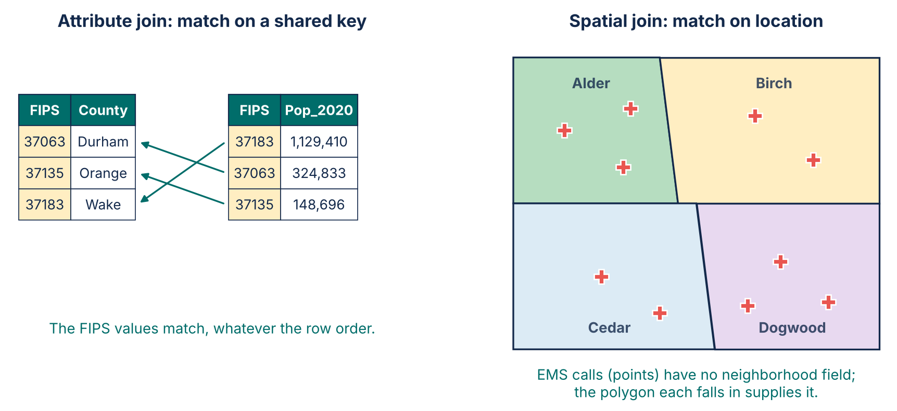
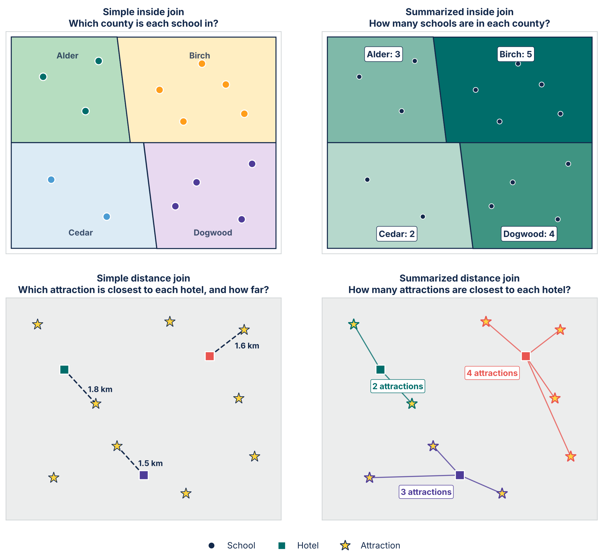
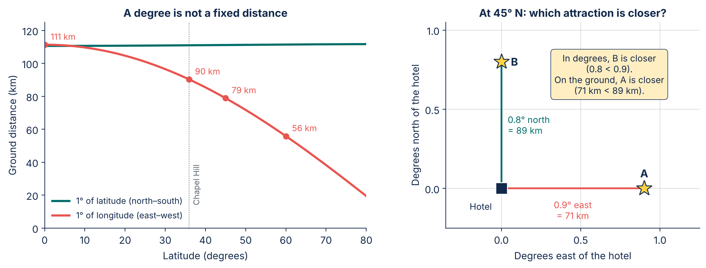
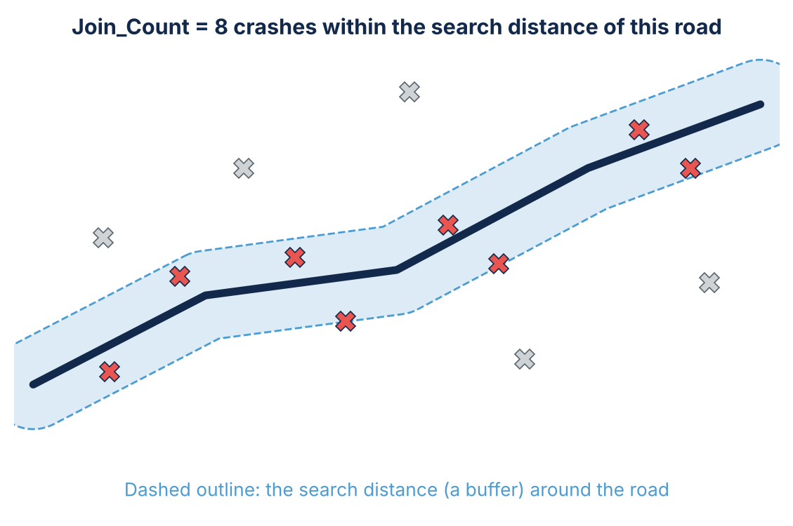

::: {.callout-note appearance="simple"}
## Learning objectives

By the end of this chapter you should be able to:

1.  Explain how a spatial join differs from an attribute join, and recognize questions that need one.
2.  Tell the four kinds of spatial join apart: simple or summarized, inside or distance.
3.  Use cardinality to decide between a simple and a summarized join.
4.  Explain why a distance join must be run on projected data, and why projecting on the fly is not enough.
5.  Plan a spatial join by naming the destination layer, the relationship, and the cardinality before opening a tool.
6.  Run spatial joins in QGIS and ArcGIS Pro, and read their output.
:::

Chapter 6 joined tables that share a key, such as a census table and census tracts that both carry a GEOID. Many questions involve two layers with no shared field at all:

- **How many EMS calls happened in each neighborhood?** The calls are points with an address and a time. The neighborhoods are polygons with a name. Neither table holds the other's ID.
- **How many students attend school in each district?** The schools are points with an enrollment count. The districts are polygons.
- **How much revenue does a coffee chain earn in each sales region?** Revenue is recorded at each store, a point. The regions are polygons.

In each case, the only thing linking the two layers is *where* their features are. A call belongs to the neighborhood it falls in; a school belongs to the district that contains it. A **spatial join** uses that location to match the records, and then appends attributes just like the joins in Chapter 6.

## What is a spatial join? {#sec-spatial-join}

### Location instead of a key

An attribute join matches records whose key fields hold the same value (@fig-attribute-vs-spatial, left). A **spatial join** matches features whose geometries have a spatial relationship (@fig-attribute-vs-spatial, right). Instead of asking "does this FIPS code equal that one?", the software asks "does this point fall inside that polygon?" or "which of these airports is closest to this city?"

{#fig-attribute-vs-spatial fig-alt="Left, two small tables of North Carolina counties and populations linked by arrows between matching FIPS codes in different row orders. Right, four colored polygons named Alder, Birch, Cedar, and Dogwood, with red cross symbols for EMS calls scattered inside them."}

Everything else about a join stays the same:

- The **destination layer** (ArcGIS calls it the target features) is the one whose features you keep, and to which fields are added.
- The **source layer** (the join features) supplies the fields.
- The output is one table: every field of the destination layer, followed by the fields of the matching source feature. Destination features with no match are kept, with NULL in the new fields, unless you ask for matched features only.

Unlike an attribute join in the *Joins* tab, a spatial join usually writes a **new layer**. Your original layers are not changed.

### Spatial relationships

Every spatial join needs a rule for deciding which source features match a destination feature. The rules come in two families:

- **Inside** relationships test containment or overlap: a point inside a polygon, a line crossing a polygon, a polygon within another polygon. In this chapter we call a join that uses them an **inside join**.
- **Distance** relationships test proximity: the closest feature, or every feature within a set distance. A join that uses them is a **distance join**.

The software calls these rules **spatial predicates** (QGIS's *geometric predicates*, ArcGIS Pro's *match options*). The names you will see in the tool dialogs are:

| Predicate | True when the two geometries... |
|-----------|---------------------------------|
| *intersects* | share any point at all (the most general test) |
| *contains* | one has the other entirely inside it |
| *within* (*are within*) | one lies entirely inside the other (the reverse of *contains*) |
| *touches* | share a boundary, but their interiors don't overlap |
| *overlaps* | share some, but not all, of their area, and are the same kind of geometry |
| *crosses* | a line passes through a polygon or across another line |
| *equals* | are exactly the same geometry |
| *disjoint* | share no point at all |
| *within a distance* | are closer than a set distance |
| *closest* (nearest neighbor) | are the nearest pair |

: Spatial predicates in QGIS and ArcGIS Pro. {#tbl-predicates}

For points in polygons, *intersects* and *within* give almost the same answer. They differ only for a point that sits exactly on a boundary, which *intersects* counts and *within* does not.

::: {.callout-note .did-you-know appearance="simple" icon=false}
## Did you know..?

To test whether a point is inside a polygon, most GIS software draws an imaginary line from the point out to infinity and counts how many times it crosses the polygon's edge. An odd number of crossings means the point is inside; an even number means it is outside. The *ray-casting* test works for any polygon, however twisted, and it has been used since the earliest computer graphics in the 1960s.
:::

## Four kinds of spatial join {#sec-four-kinds}

### Simple or summarized, inside or distance

Every spatial join can be described with two choices (@fig-four-kinds):

- **Inside or distance:** is the relationship containment or proximity?
- **Simple or summarized:** does each destination feature receive the attributes of *one* source feature, or a *summary* of many?

{#fig-four-kinds fig-alt="Four map panels. Top left, simple inside join: schools colored by the county they fall in. Top right, summarized inside join: counties shaded by their count of schools, labeled Alder 3, Birch 5, Cedar 2, Dogwood 4. Bottom left, simple distance join: each hotel linked by a dashed line to its nearest attraction, labeled with the distance. Bottom right, summarized distance join: each attraction linked to its nearest hotel, with the hotels labeled 2, 4, and 3 attractions."}

Reading the four panels:

- **Simple inside join** (top left). *Which county is each school in?* The schools are the destination; the counties are the source. Each school gets the name and attributes of the one county that contains it.
- **Summarized inside join** (top right). *How many schools are in each county?* Now the counties are the destination and the schools are the source. Each county gets a count of the schools inside it.
- **Simple distance join** (bottom left). *Which attraction is closest to each hotel, and how far away is it?* Each hotel gets the attributes of its nearest attraction, plus a field holding the distance.
- **Summarized distance join** (bottom right). *How many attractions are closest to each hotel?* Each attraction is assigned to its nearest hotel, and each hotel gets a count of the attractions assigned to it.

Notice that the same two layers can answer different questions. Schools-to-counties and counties-to-schools are both inside joins; which layer is the destination depends on what one row of the answer should be.

### A simple distance join: cities and airports

@fig-nc-airports shows a simple distance join with real data. The destination layer is North Carolina's cities, and the source layer is the region's major airports. Each city receives the code of its nearest airport and the distance to it. The cities are colored by their airport and sized by the distance.

{#fig-nc-airports fig-alt="A map of North Carolina and its neighbors. Triangles mark airports at Charlotte, Raleigh-Durham, Greensboro, Wilmington, Knoxville, and Columbia. Lines connect each city to its nearest airport, colored by airport. Labels show Asheville 82 miles to Knoxville, Hickory 42 miles to Charlotte, Fayetteville 57 miles to Raleigh-Durham, and Kitty Hawk 174 miles to Raleigh-Durham."}

Two things stand out. First, a distance join pays no attention to boundaries: Asheville's nearest airport in this layer is across the state line in Tennessee. Second, the answer is only as good as the source layer. Asheville has a regional airport, but this small-scale layer leaves it out, so the join gives an answer that is correct for the data and wrong for the world. Always ask whether the source layer contains every feature that could be the right answer.

### An inside join: septic systems and geology

A county health department wants to know the bedrock under every septic system, because septic systems on permeable rock can leak into groundwater. The destination is the septic systems (points), and the source is a geology map (polygons). Each septic system falls inside exactly one geology unit, so each receives exactly one rock type. The output table is the septic table with the geology unit's name and symbol added to each row, ready for a query such as `"ROCKTYPE" = 'Limestone'`.

## Cardinality decides simple or summarized {#sec-sj-cardinality}

### The rule of joining, again

Chapter 6's rule of joining applies to spatial joins too. Ask how many source features can match each destination feature:

- **One-to-one or many-to-one: a simple join.** Each septic system lies in one geology unit; many septic systems can share a unit. Each city has one nearest airport; many cities can share one. There is never more than one set of attributes to copy, so a simple join copies them directly.
- **One-to-many or many-to-many: a summarized join.** Each county contains many schools. Each river flows through many counties. There is no single set of attributes to copy.

A **summarized join** solves the one-to-many problem by collapsing all the matches into statistics. It finds every source feature that matches each destination feature, summarizes them, and appends one row of summary values. Every summarized join reports a **count** of matches (ArcGIS Pro names the field `Join_Count`). You can also ask for the **sum**, **mean**, **minimum**, **maximum**, and other statistics of any numeric field in the source. Summing an enrollment field over the schools in each county gives the number of students in each county, which answers the school district question from the start of the chapter.

### Which layer is the destination?

The surest way to choose the destination is to picture the answer. **What should one row of the output represent?** That row is a feature of the destination layer.

- "Which county is each school in?" One row per school: schools are the destination.
- "How many schools are in each county?" One row per county: counties are the destination.
- "Which volcano is closest to each city?" One row per city: cities are the destination.

Most failed spatial joins come from picking the wrong destination layer, or from running a simple join where several features match. In the second case, the software quietly keeps one match (usually the first it finds) and throws the rest away.

::: {.callout-tip appearance="simple"}
## Think about it

A summarized distance join counts the attractions closest to each hotel. If you drew a boundary around all the land closer to each hotel than to any other, what shape would each hotel's area be? (Hint: look up *Thiessen polygons*, also called Voronoi polygons.)
:::

::: {.callout-note .did-you-know appearance="simple" icon=false}
## Did you know..?

One of the most famous maps in history is a summarized distance join done by hand. After the 1854 cholera outbreak in London, John Snow mapped the homes of the people who died, then drew a line around the area closer, by walking distance, to the Broad Street pump than to any other pump. Most of the deaths fell inside that area [@snow1855]. Chapter 1 tells more of the story.
:::

## Coordinate systems and distance joins {#sec-sj-crs}

### Distances come out in the data's units

A distance join reports distances in the **units of the source data's coordinate system**. If the layers are projected in meters, the distances are in meters. If the layers are stored in a geographic coordinate system (GCS), such as WGS84 (EPSG:4326) or NAD83 (EPSG:4269), the distances are in **decimal degrees**. The software does not warn you. You simply get a `Distance` field full of numbers like 0.47.

Degrees cannot be turned into miles or kilometers with one conversion factor. As Chapter 3 showed, a degree of latitude is always about 111 km (69 miles), but a degree of longitude shrinks toward the poles: about 111 km at the equator, 90 km at Chapel Hill, 79 km at 45° N, and 56 km at 60° N (@fig-degree-distance, left). A distance in degrees mixes two different scales.

{#fig-degree-distance fig-alt="Left, a line chart. One degree of latitude stays near 111 km at every latitude. One degree of longitude falls from 111 km at the equator to 90 km at Chapel Hill, 79 km at 45 degrees, and 56 km at 60 degrees. Right, a hotel with attraction A 0.9 degrees east, 71 km away, and attraction B 0.8 degrees north, 89 km away. A note says that in degrees B is closer, but on the ground A is closer."}

The units are not just a labeling problem. They can change *which feature is nearest*. At 45° N, an attraction 0.9° east of a hotel is 71 km away, and one 0.8° north is 89 km away (@fig-degree-distance, right). In degrees, the northern attraction looks closer (0.8 < 0.9). On the ground, the eastern one is closer by 18 km. A distance join run on unprojected data would match the hotel to the wrong attraction.

The fix: **before a distance join, project both layers into a coordinate system that preserves distance well for your study area**, such as the right UTM zone or State Plane zone (Chapter 4). The distances then come out in meters or feet, and the nearest feature is the nearest on the ground.

::: {.callout-note appearance="simple"}
## Geodesic distances

Some newer tools can measure distances on the ellipsoid even when the data are in a GCS. ArcGIS Pro's Spatial Join, for example, has geodesic match options such as *Within a distance geodesic* and *Closest geodesic*. QGIS's *Join Attributes by Nearest* does not: it measures in the layer's own units. Unless you know what the tool does, projecting first is the safe habit.
:::

### Projecting on the fly is not enough

QGIS and ArcGIS Pro project layers **on the fly** (Chapter 4). If the map is set to NC State Plane, layers stored in WGS84 are drawn in State Plane too, and the map looks correct.

But the join tools read the coordinates **stored in the layers**, not the coordinates on the screen. Changing the map's coordinate system changes the picture, not the data. If the data on disk are still in degrees, the distances will be too.

To fix it, make projected copies of the layers and run the join on those:

- In **QGIS**, use *Vector > Data Management Tools > Reproject Layer*, or *Export > Save Features As* with a new CRS.
- In **ArcGIS Pro**, use the *Project* tool.

Then check the layer's properties to confirm the new CRS, and run the join again.

## Spatial joins in practice {#sec-sj-practice}

### Six questions to answer first

Before opening any tool, work through these questions on paper:

1.  **Sketch the layers.** What kinds of geometry are they: points, lines, or polygons?
2.  **What should the output look like?** What does one row represent, and which fields should it have?
3.  **Which layer is the destination?** The layer whose features you keep and add fields to: the one that one row of the output represents.
4.  **Inside or distance?** Inside when one feature lies within, or crosses, another; distance when they don't touch.
5.  **What is the cardinality?** Can a destination feature match more than one source feature?
6.  **Simple or summarized?** One-to-one or many-to-one: simple. One-to-many or many-to-many: summarized, with the statistics you need.

And for a distance join, a seventh: **are both layers in a projected coordinate system with sensible units?**

### Spatial joins in QGIS

QGIS splits spatial joins into separate tools, all in the Processing Toolbox and under *Vector > Data Management Tools*:

- **Join Attributes by Location** is the simple inside join. *Join to features in* is the destination layer. The *Features they* check boxes set the predicates. *By comparing to* is the source layer. The *Join type* sets the cardinality: *Create separate feature for each matching feature (one-to-many)* repeats a destination feature for every match, and *Take attributes of the first matching feature only (one-to-one)* keeps one. Check *Discard records which could not be joined* to drop unmatched features.
- **Join Attributes by Location (Summary)** is the summarized inside join. Choose the fields to summarize and the statistics (count, sum, mean, min, max, and others).
- **Join Attributes by Nearest** is the distance join. Set the maximum number of nearest neighbors (1 for the closest) and, optionally, a maximum distance. It adds fields with the distance and the neighbor's position.
- **Count Points in Polygon** is a shortcut for the most common summarized join: it adds a count of points to each polygon.

### Spatial joins in ArcGIS Pro

ArcGIS Pro does every kind of spatial join with one **Spatial Join** tool, in the Geoprocessing pane, or from the layer's *Data* tab under *Add Spatial Join*. The kind of join depends on its settings:

- **Target features** is the destination layer; **Join features** is the source.
- **Join operation**: *Join one to one* gives one output row per target feature. When several join features match, it adds a `Join_Count` field and combines their values with the **merge rules** in the field map (first, sum, mean, minimum, maximum, and others). *Join one to many* writes one output row for each match.
- **Keep all target features**: checked, unmatched targets are kept (a left join); unchecked, they are dropped.
- **Match option**: the predicate, such as *Intersect*, *Completely contains*, *Within a distance*, or *Closest*.
- **Search radius**: for *Within a distance* and *Closest*.
- **Distance field name**: for *Closest*, the field that will hold the distance.

For example, to count the motorcycle crashes within 30 feet of each road, set Roads as the target, the crashes as the join features, *Join one to one*, *Keep all target features*, and *Within a distance* with a 30-foot radius. The `Join_Count` of each road is the number of crashes near it (@fig-within-distance).

{#fig-within-distance fig-alt="A dark line for a road, surrounded by a dashed light-blue band showing the search distance. Eight red crash symbols lie inside the band and five gray ones lie outside. The title reads Join_Count = 8 crashes within the search distance of this road."}

@tbl-sj-tools summarizes which tool to use for each kind of join.

| Join | QGIS | ArcGIS Pro Spatial Join |
|------|------|-------------------------|
| Inside, simple | Join Attributes by Location, first matching feature only | Match option *Intersect* or *Within*; Join one to one |
| Inside, summarized | Join Attributes by Location (Summary), or Count Points in Polygon | Join one to one with merge rules (Sum, Mean); adds `Join_Count` |
| Distance, closest | Join Attributes by Nearest, 1 neighbor; adds a distance field | Match option *Closest*; set a distance field name |
| Distance, count within a radius | Buffer, then Join Attributes by Location (Summary) | Match option *Within a distance*; Join one to one |

: Tools for each kind of spatial join, as named in QGIS 3 and ArcGIS Pro 3. {#tbl-sj-tools}

### Reading the output

Open the attribute table of the output layer. The destination's fields come first, then the source's. Then check three things:

- **The row count.** A simple join with every destination feature kept should have exactly as many rows as the destination layer. More rows means a one-to-many join repeated some features; fewer means unmatched features were dropped.
- **NULLs.** Rows with NULL in the joined fields had no match. Is that what you expect? A point in the ocean, outside every county, has no county.
- **Distances.** If there is a distance field, are the values sensible? Numbers below 1 for features kilometers apart mean the data were in degrees.

## Worked examples {#sec-sj-examples}

For each example, answer the six questions before reading the solution.

### Example 1: congressional districts with more than 10 earthquake deaths

*Find every congressional district that has had more than 10 earthquake deaths.* You have earthquake points with a `DEATHS` field, and congressional district polygons.

::: {.callout-tip appearance="simple" collapse="true"}
## Solution

- **Output:** one row per district, with total deaths.
- **Destination:** congressional districts. **Source:** earthquakes.
- **Relationship:** inside (points in polygons).
- **Cardinality:** one-to-many; a district can contain many earthquakes.
- **Join:** summarized, with the **sum** of `DEATHS`.
- Then select the districts with an attribute query (Chapter 5), such as `"DEATHS_sum" > 10` (QGIS names the summed field this way).
:::

### Example 2: a pollution risk index for rivers

*Score each river by the total number of people living in the counties it flows through.* You have river lines and county polygons with a population field.

::: {.callout-tip appearance="simple" collapse="true"}
## Solution

- **Output:** one row per river, with the total population.
- **Destination:** rivers (lines). **Source:** counties (polygons).
- **Relationship:** inside, using *intersects* (a river crosses each county it flows through).
- **Cardinality:** one-to-many; each river crosses many counties.
- **Join:** summarized, with the **sum** of population. Rivers that flow past more people score higher.
:::

### Example 3: the closest volcano to each U.S. city

*Make a table of the volcano closest to each city in the United States, and how far away it is.*

::: {.callout-tip appearance="simple" collapse="true"}
## Solution

- **Output:** one row per city, with its nearest volcano and the distance.
- **Destination:** cities. **Source:** volcanoes.
- **Relationship:** distance (closest feature).
- **Cardinality:** many-to-one; each city has one closest volcano, though many cities can share it.
- **Join:** simple distance join.
- **Coordinate system:** project both layers first, using an equidistant or equal-area projection for the whole country (such as USA Contiguous Albers, EPSG:5070) so that the distances are in meters, not degrees. Better still, use a tool that measures geodesic distances.
:::

## Check your understanding

::: {.content-visible when-format="html"}

1.  A spatial join matches records using: <select class='webex-select'><option value='blank'></option><option value=''>A shared key field</option><option value='answer'>The location of the features</option><option value=''>The order of the rows</option><option value=''>The names of the layers</option></select>

2.  *How many schools are in each county?* needs which kind of join? <select class='webex-select'><option value='blank'></option><option value=''>Simple inside join</option><option value='answer'>Summarized inside join</option><option value=''>Simple distance join</option><option value=''>Summarized distance join</option></select>

3.  *Which hospital is closest to each nursing home?* needs which kind of join? <select class='webex-select'><option value='blank'></option><option value=''>Simple inside join</option><option value=''>Summarized inside join</option><option value='answer'>Simple distance join</option><option value=''>Summarized distance join</option></select>

4.  To answer *How many schools are in each county?*, the destination layer is: <select class='webex-select'><option value='blank'></option><option value=''>Schools</option><option value='answer'>Counties</option><option value=''>Either one</option><option value=''>A new empty layer</option></select>

5.  A simple join works when the cardinality is one-to-one or: <select class='webex-select'><option value='blank'></option><option value='answer'>Many-to-one</option><option value=''>One-to-many</option><option value=''>Many-to-many</option></select>

6.  A distance join on layers in WGS84 (EPSG:4326) reports distances in: <select class='webex-select'><option value='blank'></option><option value=''>Meters</option><option value=''>Miles</option><option value='answer'>Decimal degrees</option><option value=''>Feet</option></select>

7.  Setting the map's coordinate system to UTM fixes a distance join on data stored in degrees. <select class='webex-select'><option value='blank'></option><option value=''>TRUE</option><option value='answer'>FALSE</option></select>

8.  At about 45° N, roughly how many kilometers long is one degree of longitude? <input class='webex-solveme nospaces' size='4' data-answer='["79","78","80"]'/>

<button>Show hint for question 7</button>

The join tools read the coordinates stored in the layers, not the ones on the screen.

:::

::: {.content-visible unless-format="html"}
The interactive self-check questions for this chapter are in the online version of the book.
:::

## Summary

- A **spatial join** attaches the attributes of a **source layer** to a **destination layer** by location, when the two share no key field.
- An **inside join** matches features that contain, lie within, or intersect each other. A **distance join** matches the closest feature, or every feature within a set distance, and can record the distance.
- The rules are called **spatial predicates**: intersects, contains, within, touches, overlaps, crosses, equals, disjoint, within a distance, and closest.
- A **simple join** copies one source feature's attributes to each destination feature. Use it for **one-to-one** and **many-to-one** relationships.
- A **summarized join** counts and summarizes all the matching source features. Use it for **one-to-many** and **many-to-many** relationships. It always adds a count, and can add sums, means, minimums, and maximums.
- Choose the destination layer by asking what **one row of the output** should represent.
- A distance join reports distances in the stored units of the data. **Project the layers** before a distance join; projecting the map on the fly changes the display, not the data.
- QGIS has a tool for each kind of join; ArcGIS Pro's Spatial Join tool does them all through its settings. Check the output's row count, NULLs, and distances.

## Exercises

1.  **Name the join.** For each question, name the destination and source layers, the relationship, the cardinality, and the kind of join: (a) Which watershed is each well in? (b) How many fast-food restaurants are within 1 km of each school? (c) What is the total length of streams in each county? (d) Which fire station is closest to each house? (e) How many houses does each fire station serve as the closest station?
2.  **Count points in polygons.** Download Natural Earth's populated places and country boundaries. In QGIS, count the populated places in each country, and sum their `pop_max`. Which country has the most places? Does that match the country with the largest summed population?
3.  **Simple inside join.** Join the countries to the populated places, so that each place gets its country's name and continent. How many places fall in no country, and why?
4.  **Degrees versus meters.** Using Natural Earth's populated places and airports, run *Join Attributes by Nearest* on the layers as downloaded (EPSG:4326). Then project both into a suitable projected CRS for your study area and run it again. Compare the distance fields. Did any place get a different nearest airport?
5.  **Within a distance.** Using North Carolina road and crash data from NC OneMap or NCDOT, count the crashes within 30 meters of each road segment. Which segments have the most? What would change with a 100-meter radius?
6.  **Plan before you click.** Work through the six questions for the earthquake, river, and volcano examples in @sec-sj-examples, then run one of them with data from the USGS and Natural Earth.

## Further reading and online resources

### Books and open textbooks

- *GIS Fundamentals: A First Text on Geographic Information Systems*, by Paul Bolstad [@bolstad2022]. Chapter 9, "Basic Spatial Analyses," covers spatial selection and joins.
- *Understanding GIS through Sustainable Development Goals*, by Paul Holloway [@holloway2023]. Includes spatial joins in QGIS and ArcGIS Pro.
- *Intro to GIS and Spatial Analysis*, by Manuel Gimond, the chapter on vector operations: <https://mgimond.github.io/Spatial/>.
- *The Nature of Geographic Information*, by David DiBiase and colleagues at Penn State: <https://www.e-education.psu.edu/natureofgeoinfo/>.
- *PostGIS in Action*, by Regina Obe and Leo Hsu (3rd ed., Manning, 2021), on spatial joins in SQL with `ST_Intersects`, `ST_Contains`, and `ST_DWithin`.

### Spatial joins in QGIS

- QGIS User Guide, "Vector general" algorithms, including Join Attributes by Location, Join Attributes by Location (Summary), and Join Attributes by Nearest: <https://docs.qgis.org/latest/en/docs/user_manual/processing_algs/qgis/vectorgeneral.html>.
- QGIS User Guide, "Vector analysis" algorithms, including Count Points in Polygon: <https://docs.qgis.org/latest/en/docs/user_manual/processing_algs/qgis/vectoranalysis.html>.
- QGIS Tutorials and Tips, "Performing Spatial Joins," by Ujaval Gandhi: <https://www.qgistutorials.com/en/docs/3/performing_spatial_joins.html>.
- QGIS Tutorials and Tips, "Nearest Neighbor Analysis": <https://www.qgistutorials.com/en/docs/3/nearest_neighbor_analysis.html>.

### Spatial joins in ArcGIS Pro

- ArcGIS Pro, "Spatial Join" tool: <https://pro.arcgis.com/en/pro-app/latest/tool-reference/analysis/spatial-join.htm>.
- ArcGIS Pro, "Select Layer By Location" tool, with diagrams of every spatial relationship: <https://pro.arcgis.com/en/pro-app/latest/tool-reference/data-management/select-layer-by-location.htm>.
- ArcGIS Pro, "Summarize Within" tool, another way to run a summarized inside join: <https://pro.arcgis.com/en/pro-app/latest/tool-reference/analysis/summarize-within.htm>.

### Spatial relationships

- Wikipedia, "DE-9IM," the model behind the spatial predicates: <https://en.wikipedia.org/wiki/DE-9IM>.
- Wikipedia, "Point in polygon," on the ray-casting test: <https://en.wikipedia.org/wiki/Point_in_polygon>.
- PostGIS, "Spatial Relationships," a clear illustrated guide to the predicates: <https://postgis.net/docs/using_postgis_query.html>.
- GeoPandas User Guide, "Merging data," including spatial joins in Python: <https://geopandas.org/en/stable/docs/user_guide/mergingdata.html>.
- The GIS&T Body of Knowledge, "Topological relationships" and "Overlay & combination operations": <https://www.ucgis.org/site/gis-t-body-of-knowledge>.

### Data for practice

- Natural Earth, populated places, airports, and country boundaries: <https://www.naturalearthdata.com>.
- USGS Earthquake Hazards Program, earthquake catalog downloads: <https://earthquake.usgs.gov/earthquakes/search/>.
- Smithsonian Global Volcanism Program, volcano locations: <https://volcano.si.edu>.
- NC OneMap, North Carolina's data portal: <https://www.nconemap.gov>.
- U.S. Census Bureau, TIGER/Line shapefiles, including congressional districts and school districts: <https://www.census.gov/geographies/mapping-files/time-series/geo/tiger-line-file.html>.
