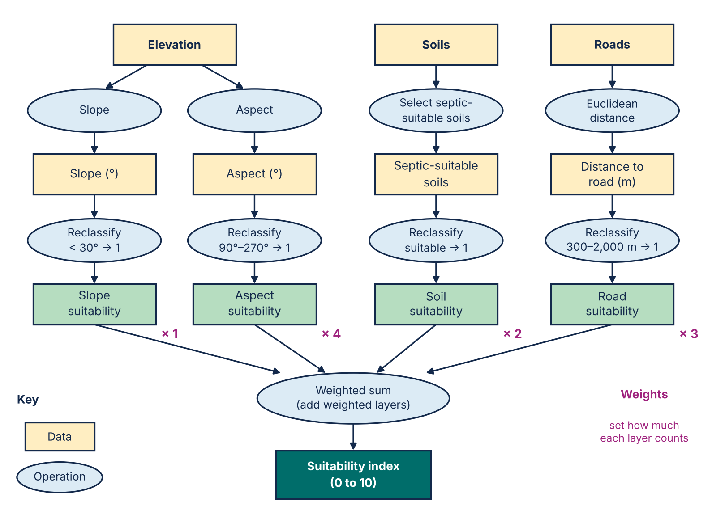
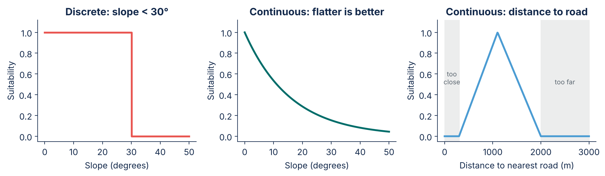
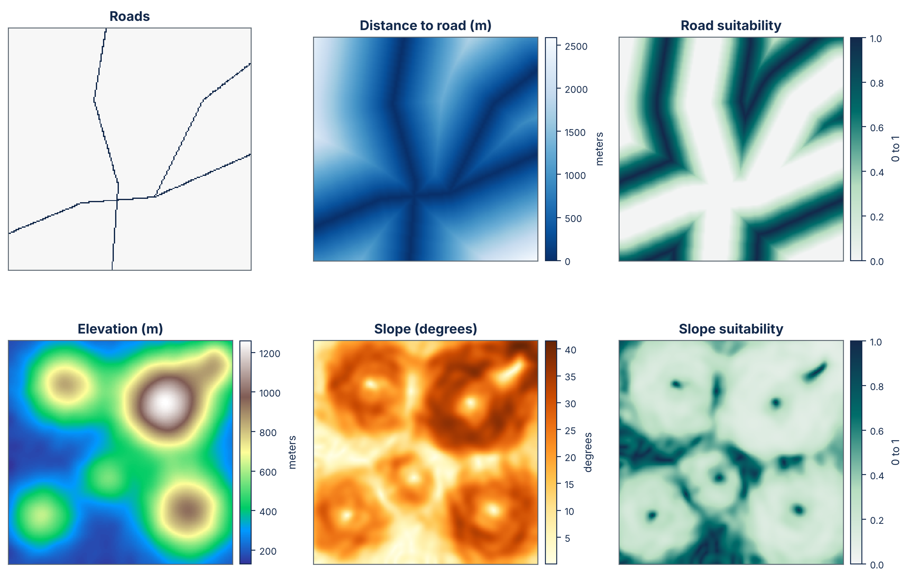
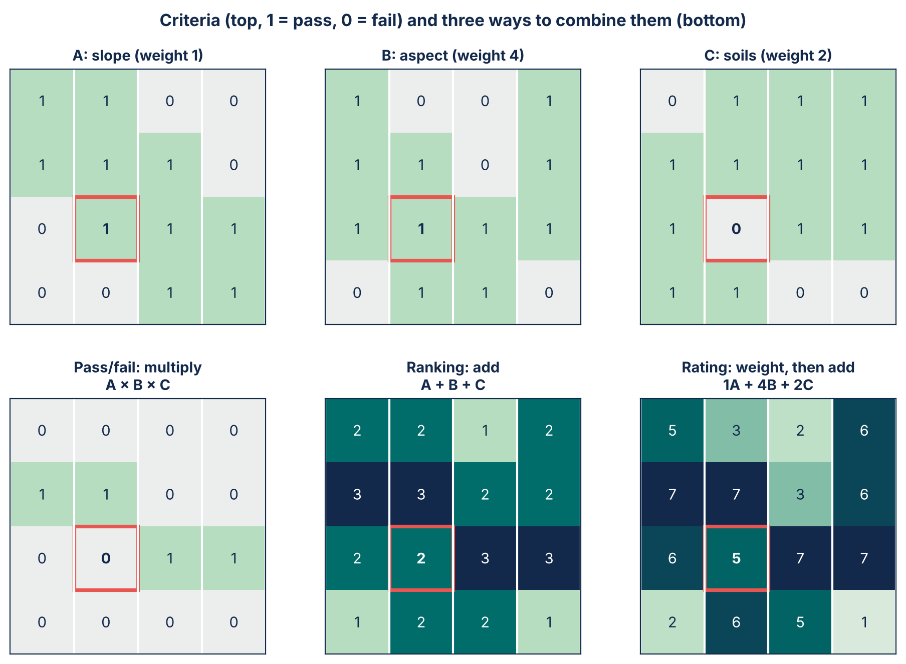
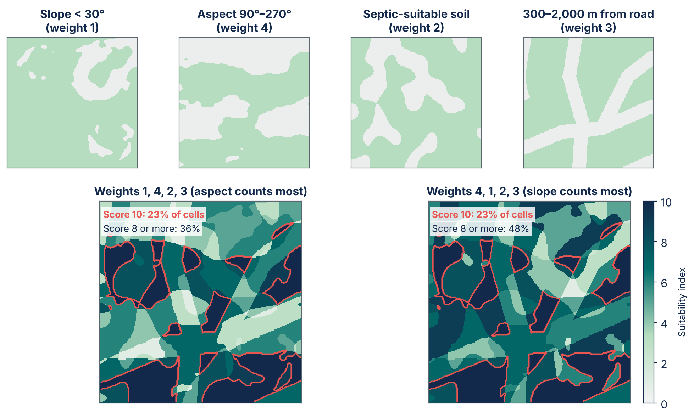

::: {.callout-note appearance="simple"}
## Learning objectives

By the end of this chapter you should be able to:

1.  Explain what a suitability model is, and describe it as a cartographic model and a flowchart.
2.  Turn plain-language criteria into measurable thresholds, and check that data exist for each one.
3.  Rank the values within a criterion from 0 to 1, with discrete and continuous rankings.
4.  Weight suitability layers, and calculate a suitability index.
5.  Tell the pass/fail, ranking, and rating (weighted linear combination) methods of combining layers apart, and choose between them.
6.  Justify weights, test a model's sensitivity, and name the tools for each step in ArcGIS Pro and QGIS.
:::

Where should the new school go? Which farms are best for a solar array? Where is the habitat for a rare salamander? Where should you build a house? Each of these questions asks GIS to look at *every* location in a study area, judge it against several criteria at once, and say which places are best. That is **suitability modeling**: ranking every location by how well it meets a set of criteria. It brings together almost everything in Unit 3, from reclassification and buffers (Chapter 14) to map algebra and distance on rasters (Chapter 15).

## Models and flowcharts {#sec-suitability-models}

### Cartographic models

Chapter 14 introduced the **cartographic model**: a chain of spatial operations, in which each output becomes the next input [@tomlin1990]. Every cartographic model has three parts:

- **Spatial data**: the input layers, such as elevation, soils, and roads.
- **Operations**: what is done to them, such as slope, buffer, reclassify, and overlay.
- **Output**: the result, such as a map that ranks every location.

A suitability model is a cartographic model whose output is a ranking of locations.

### Flowcharts

A **flowchart** is a diagram of a model's input data, its operations, and their order. In the usual convention, rectangles are data layers, ovals are operations, and arrows show the order of operations (@fig-home-flowchart). Sketch the flowchart *before* you open the software. Drawing it forces you to name every input and every step, and it documents the model so that someone else can check it and run it again.

{#fig-home-flowchart fig-alt="A flowchart. Elevation feeds two operations, Slope and Aspect, which produce slope and aspect layers. Soils feeds Select septic-suitable soils. Roads feeds Euclidean distance, which produces distance to road in meters. Each layer is then reclassified: slope under 30 degrees to 1, aspect 90 to 270 degrees to 1, suitable soils to 1, and 300 to 2,000 meters from a road to 1, producing four green suitability layers. They are multiplied by weights of 1, 4, 2, and 3 and go into a weighted sum, which produces a suitability index from 0 to 10."}

ArcGIS Pro's **ModelBuilder** and QGIS's **Model Designer** let you draw this flowchart on screen and run it. The diagram and the analysis are then the same thing, so the documentation can never fall out of date.

### A first example: siting a park

Here is a model with only two inputs. A city wants the best place for a new park. Parks should serve many people, so **population density** counts for 60% of the score. New parks should fill gaps, so **distance to existing parks** counts for 40%. Each input is converted to a common scale, multiplied by its percentage, and added, cell by cell. The cells with the highest totals are the best candidate sites. This is a *weighted overlay*, and the rest of this chapter takes it apart step by step.

::: {.callout-note .did-you-know appearance="simple" icon=false}
## Did you know..?

Suitability modeling is older than GIS. In *Design with Nature* [@mcharg1969], the landscape architect Ian McHarg mapped each factor, such as slope, soil drainage, historic value, and forest, on its own sheet of transparent film, shading the least suitable land darkest. Stacked on a light table, the overlays showed the lightest areas, where a highway, for example, would do the least harm. Planners had used hand-drawn overlays earlier in the 20th century, but McHarg's book made the method famous [@collins2001], and his light table became the GIS overlay.
:::

## The five steps {#sec-five-steps}

Every suitability model, whether for a house, a habitat, or a hospital, follows the same five steps:

1.  **Define criteria.**
2.  **Find data** to measure each criterion.
3.  **Rank each criterion**: create a suitability layer ranked from 0 to 1.
4.  **Weight each layer** by the importance of its criterion (1, 2, 3, 4, ...).
5.  **Combine the layers**, to find the locations with the highest (or lowest) suitability.

The rest of this chapter works through them with one running example: choosing a site for a house in the country.

## Steps 1 and 2: criteria and data {#sec-criteria}

### Criteria in plain language

**Criteria** are the conditions a site must meet. Start by writing them in plain language. For our house:

- **Slopes should not be steep.** Steep ground is harder and costlier to build on.
- **The land should face south.** In the Northern Hemisphere, south-facing slopes get more sun for light, heat, and solar panels.
- **Soils must suit a septic system**, because there is no sewer connection.
- **Far enough from a road for privacy, but not so far as to be isolated.**

### Before you build

Four questions come before any analysis:

- **Can I get the data?** Elevation, soils, and roads, at a usable resolution and date. In the United States, elevation comes from the USGS 3D Elevation Program, soils from the NRCS's SSURGO database, and roads from TIGER/Line files or a state's road layer.
- **What exactly does each criterion mean?** "Too steep" means nothing to software until it is a number of degrees.
- **How much does each criterion matter?** That will set the weights.
- **How accurate are the data?** Errors in any input carry straight through to the result (Chapter 21).

If a criterion can't be measured with the data you have, change it or drop it.

### Refining criteria into thresholds

Next, turn each criterion into a **threshold** the software can test (@tbl-refined-criteria).

| General criterion | Refined criterion |
|---|---|
| Slopes not too steep | Slope < 30° |
| Southern aspect preferred | 90° < aspect < 270° |
| Soils suitable for a septic system | Soil types on the septic-suitable list |
| Far enough from a road for privacy, but not isolated | 300 m < distance to road < 2,000 m |

: Refining the home-site criteria into thresholds. {#tbl-refined-criteria}

**Slope** is the steepness of the ground, and **aspect** is the compass direction a slope faces, measured in degrees clockwise from north. Both are calculated from an elevation raster. An aspect between 90° and 270° covers slopes facing east, south, and west, centered on south. A soil survey rates each soil type for septic systems, so the soils criterion becomes a list of acceptable types.

These numbers are *choices*. A builder might accept 35° slopes; a family who wants a garden might want under 10°. Change a threshold and the answer changes, so write down why you chose each one.

::: {.callout-tip appearance="simple"}
## Think about it

Write refined criteria for a new community garden on your campus or in your town. Which criteria need a distance? Which need a list of categories? Which do you have no data for?
:::

## Step 3: rank each criterion {#sec-ranking}

### Suitability layers

Slope is measured in degrees, distance in meters, and soils by name. To combine them, each must first be put on a common scale. A **suitability layer** scores every cell for one criterion, from 0 (completely unsuitable) to 1 (ideal). Because all suitability layers share the same scale, they can be added and compared.

The scores given to values within one criterion are **rankings**. There are two kinds (@fig-ranking-curves):

- A **discrete ranking** is a yes-or-no rule: each value passes (1) or fails (0). "Slope < 30°" is discrete: 29° scores 1, and 31° scores 0.
- A **continuous ranking** scales values smoothly from worst to best. Flat ground might score 1, 10° score 0.5, and 40° score close to 0. A continuous ranking keeps more information: a 31° slope is not as bad as a 60° one.

Some textbooks and tools rank on a scale of 0 to 10, or 1 to 9. Dividing by 10 gives the same idea on our 0 to 1 scale.

{#fig-ranking-curves fig-alt="Three line graphs of suitability from 0 to 1. Left: a red step, 1 for slopes from 0 to 30 degrees and 0 above 30. Middle: a green curve that starts at 1 for flat ground and falls steadily, to about 0.15 at 30 degrees and near 0 by 50 degrees. Right: a blue tent shape, 0 from 0 to 300 meters, rising to 1 at 1,100 meters, and falling to 0 at 2,000 meters and beyond; the zones below 300 and above 2,000 meters are shaded gray and labeled too close and too far."}

### Ranking examples: roads and slope

Some criteria can't be ranked directly from the input layer. A roads layer has lines, not distances. So we first **derive** a layer that measures the criterion, then rank it (@fig-derive-rank):

- **Roads.** Calculate the Euclidean distance from every cell to the nearest road (Chapter 15), then rank the distances with the tent-shaped function in @fig-ranking-curves. Too close is noisy, too far is isolated, so the score is 0 below 300 m and above 2,000 m, and highest near 1,100 m.
- **Slope.** Calculate slope from the elevation raster, then rank it with a curve that falls as slope rises: flat ground scores near 1, and steep ground near 0.

{#fig-derive-rank fig-alt="Six maps of the same square area. Top row: a few dark road lines crossing the area; a blue distance surface, darkest along the roads and palest, about 2,500 meters, in the far corners; and a road suitability map, palest on the roads and in the far corners, with dark green bands running parallel to each road about a kilometer away. Bottom row: an elevation map with several round hills up to about 1,250 meters; a slope map in orange, steepest in rings around each hill; and a slope suitability map, dark green on the flat lowlands between hills and on hilltops, and pale on the steep hillsides."}

### Reclassification

**Reclassification** (Chapter 15) is the workhorse of suitability modeling. It replaces each raw value with a score, using a rule or a lookup table. For our discrete criteria:

- Slope: under 30° → 1; otherwise → 0.
- Aspect: 90° to 270° → 1; otherwise → 0.
- Soils: types on the septic-suitable list → 1; all others → 0.
- Distance to road: 300 to 2,000 m → 1; otherwise → 0.

Record each rule in a table, or in the model itself, so the model can be rerun with new data or new thresholds. For continuous rankings, ArcGIS Pro's **Rescale by Function** tool applies a curve (linear, Gaussian, logistic, and others) instead of a table.

## Step 4: weight each layer {#sec-weighting}

Not every criterion matters equally. **Weightings** (or weights) are multipliers that set how much each criterion counts. Suppose the buyer cares most about a sunny, south-facing site, then about access, then about soils, and least about slope. We might weight aspect 4, roads 3, soils 2, and slope 1.

Each cell's **suitability index** is the sum of its weighted scores. With discrete (0 or 1) layers, a cell that passes a criterion earns that criterion's weight, and a cell that fails earns 0 (@tbl-suitability-index).

| Roads (weight 3) | Slope (weight 1) | Aspect (weight 4) | Soils (weight 2) | Suitability index |
|:---:|:---:|:---:|:---:|:---:|
| 0 | 0 | 0 | 0 | 0 |
| 0 | 0 | 0 | 2 | 2 |
| 0 | 0 | 4 | 2 | 6 |
| 0 | 1 | 4 | 2 | 7 |
| 3 | 1 | 4 | 2 | 10 |

: A suitability index for five example cells. Each entry is the cell's rank (0 or 1) times the criterion's weight. {#tbl-suitability-index}

The maximum is 3 + 1 + 4 + 2 = 10, for a cell that meets every criterion. Because aspect carries the most weight, a south-facing cell scores 6 even with no good road access, while a cell that meets every criterion *except* aspect can score no more than 6.

Weights are a judgment call. That doesn't make them arbitrary, but it does mean you must explain them (@sec-checking).

## Step 5: combine the layers {#sec-combining}

### Three ways to combine

Once every criterion is a ranked layer, there are three common ways to combine them (@tbl-combine-methods, @fig-combine).

| Method | How layers combine | What the output shows |
|---|---|---|
| **Pass/fail** (binary) | Multiply all the ranked, reclassified layers | 1 only where every criterion passes |
| **Ranking** (linear combination) | Add all the ranked, reclassified layers | How many criteria each cell meets |
| **Rating** (weighted linear combination) | Weight each layer, then add | A score that reflects each criterion's importance |

: Three ways to combine suitability layers. {#tbl-combine-methods}

{#fig-combine fig-alt="Top row: three 4 by 4 grids of 1s and 0s for A, slope, weight 1; B, aspect, weight 4; and C, soils, weight 2. One cell in the third row, second column, is outlined in red; it is 1 for slope, 1 for aspect, and 0 for soils. Bottom row: pass/fail, A times B times C, shows mostly 0s, with the outlined cell 0. Ranking, A plus B plus C, shows values from 1 to 3, with the outlined cell 2. Rating, 1A plus 4B plus 2C, shows values from 1 to 7, with the outlined cell 5."}

### Pass/fail

The **pass/fail** (binary) model reclassifies every criterion to 1 for good and 0 for bad, and multiplies the layers. Any 0 makes the product 0, so only cells that meet *every* criterion survive: 1 × 1 × 0 = 0. The outlined cell in @fig-combine passes slope and aspect, but fails soils, so it is ruled out.

Pass/fail is simple and strict. It matches criteria that are truly non-negotiable, such as "not in a floodway" or "not on protected land." But it can't tell a near miss from a terrible site, and with many criteria it often leaves nothing at all. It is the raster version of McHarg's overlays, and of the vector approach in Chapter 14: select, buffer, and intersect until only the qualifying areas are left.

### Ranking

The **ranking** model adds the same 0 and 1 layers instead of multiplying them. The result counts how many criteria each cell meets. The outlined cell now scores 1 + 1 + 0 = 2, "better" instead of ruled out, and the map separates the best, better, marginal, and bad cells. This is a **linear combination**. Its weakness is that every criterion counts equally.

### Rating: weighted linear combination

The **rating** model, or **weighted linear combination (WLC)**, multiplies each layer by its weight before adding:

$$
S = \sum_{i} w_i \, x_i
$$

where $x_i$ is a cell's score on criterion $i$, and $w_i$ is that criterion's weight [@eastman1995; @malczewski2004]. With weights 1, 4, and 2, the outlined cell scores 1(1) + 4(1) + 2(0) = 5 of a possible 7. WLC keeps the most information, and it is the method behind ArcGIS Pro's **Weighted Overlay** and **Weighted Sum** tools.

WLC works with continuous rankings too. If three criteria are rated on a scale of 1 (bad) to 9 (best), and a cell rates 9, 7, and 1 with equal weights, its rating is (9 + 7 + 1) ÷ 3 = 5.67, "OK to better." With equal weights, WLC is simply the average. Change the weights, and the same cell can rise or fall in the ranking.

Weights are often written as fractions that sum to 1, such as 0.4, 0.3, 0.2, and 0.1 instead of 4, 3, 2, and 1. Dividing every weight by their total does this without changing the ranking, and keeps the index on the same scale as the inputs.

## Choosing weights and checking results {#sec-checking}

A model's output looks precise, with a score for every cell. That can hide how many choices went into it. Before trusting a result:

- **Set weights openly.** Use expert judgment, input from the people affected (**stakeholders**), or a structured method of **pairwise comparison** such as the **Analytic Hierarchy Process (AHP)**, which asks which of two criteria matters more, and by how much [@saaty1980]. Chapter 20 works through AHP step by step.
- **Test sensitivity.** A **sensitivity analysis** changes one weight or threshold at a time, and watches whether the best sites move. If a small change moves them, the answer is fragile.
- **Check against reality.** Compare the results with sites you already know are good or bad.
- **Respect the data's limits.** Cell size, data age, and errors set how precise the answer can be. A 30 m cell can't answer a question about one house's footprint.

@fig-home-result runs the whole home-site model on our made-up landscape, then swaps the weights of aspect and slope. Cells that meet all four criteria score 10 either way. But the cells that score 8 or more grow from 36% of the area to 48% when slope counts most, and the second-best sites move. Which answer is "right" depends on what the buyer values, which is exactly why the weights must be written down.

{#fig-home-result fig-alt="Top row: four small maps in pale green and gray. Slope under 30 degrees passes almost everywhere except rings around two hills. Aspect 90 to 270 degrees passes in irregular bands. Septic-suitable soil passes in large blobs. 300 to 2,000 meters from a road fails along the roads and passes in between. Bottom row: two larger maps of the suitability index from 0, pale, to 10, dark navy. Both have the same red-outlined patches that score 10, covering 23 percent of cells. With weights 1, 4, 2, 3, 36 percent of cells score 8 or more. With weights 4, 1, 2, 3, 48 percent score 8 or more, and several mid-scoring patches turn darker."}

::: {.callout-tip appearance="simple"}
## Think about it

A county uses a WLC model to site a new landfill, and the top-ranked site is next to a low-income neighborhood. Which parts of the model would you question first: the criteria, the data, the rankings, or the weights? Who should have had a say in the weights?
:::

## The complete model {#sec-complete-model}

@fig-home-flowchart is the whole home-site model in one picture. Read each column from top to bottom: elevation gives slope and aspect, soils are selected for septic suitability, and roads become distance bands. Each branch ends in a suitability layer, and the weighted sum at the bottom combines them into one index. Every step in this chapter appears somewhere on the chart.

The same five steps, with different criteria and data, site wind farms, schools, retail stores, conservation reserves, and wildlife corridors. More advanced **multi-criteria decision analysis (MCDA)** methods add fuzzy (gradual) memberships, trade-offs between criteria, and ways to measure the uncertainty of the result [@malczewski2006], but they all start here.

## Suitability modeling in ArcGIS Pro and QGIS {#sec-suitability-software}

| Step | ArcGIS Pro | QGIS |
|---|---|---|
| Derive input layers | Slope, Aspect, Euclidean Distance (Distance Accumulation) | Slope, Aspect, Proximity (raster distance) |
| Rank each criterion | Reclassify, Rescale by Function | Reclassify by table, Raster Calculator |
| Weight and combine | Weighted Overlay, Weighted Sum, Raster Calculator | Raster Calculator |
| Document the model | ModelBuilder, Suitability Modeler | Model Designer |

: Tools for each step of a suitability model. {#tbl-suitability-tools}

In ArcGIS Pro these are Spatial Analyst tools. The **Suitability Modeler** walks you through the steps in one pane: add criteria, transform them to a common scale, weight them, and see the suitability map update as you go. In QGIS most of the tools are in the Processing Toolbox; build the whole chain in the **Model Designer** so the flowchart and the analysis are the same thing.

## Check your understanding

::: {.content-visible when-format="html"}

1.  Ranking every location by how well it meets a set of criteria is: <select class='webex-select'><option value='blank'></option><option value=''>Geocoding</option><option value='answer'>Suitability modeling</option><option value=''>Interpolation</option><option value=''>Georeferencing</option></select>

2.  In a flowchart, operations such as buffer and reclassify are usually drawn as: <select class='webex-select'><option value='blank'></option><option value=''>Rectangles</option><option value='answer'>Ovals</option><option value=''>Arrows</option><option value=''>Triangles</option></select>

3.  On a 0 to 1 suitability layer, a cell that is completely unsuitable scores: <input class='webex-solveme nospaces' size='3' data-answer='["0"]'/>

4.  Aspect between 90° and 270° describes slopes that face, broadly: <select class='webex-select'><option value='blank'></option><option value=''>North</option><option value='answer'>South</option><option value=''>Only east</option><option value=''>Only west</option></select>

5.  A ranking that scores each value 1 (pass) or 0 (fail) is: <select class='webex-select'><option value='blank'></option><option value='answer'>Discrete</option><option value=''>Continuous</option><option value=''>Weighted</option><option value=''>Global</option></select>

6.  With weights roads 3, slope 1, aspect 4, and soils 2, a cell that passes slope, aspect, and soils but fails roads has a suitability index of: <input class='webex-solveme nospaces' size='3' data-answer='["7"]'/>

7.  Multiplying 0/1 suitability layers gives: <select class='webex-select'><option value='blank'></option><option value='answer'>A pass/fail map</option><option value=''>A count of criteria met</option><option value=''>A weighted rating</option><option value=''>A distance surface</option></select>

8.  Changing one weight at a time to see whether the best sites move is a sensitivity analysis. <select class='webex-select'><option value='blank'></option><option value='answer'>TRUE</option><option value=''>FALSE</option></select>

:::

::: {.content-visible unless-format="html"}
The interactive self-check questions for this chapter are in the online version of the book.
:::

## Summary

- **Suitability modeling** ranks every location by how well it meets a set of **criteria**. It is a cartographic model, best planned and documented as a **flowchart** of data (rectangles), operations (ovals), and their order (arrows).
- The five steps are: define criteria, find data, rank each criterion from 0 to 1, weight the layers, and combine them.
- Plain-language criteria must become measurable **thresholds**, such as slope < 30°. Thresholds are choices, and should be recorded.
- **Rankings** turn the values within one criterion into scores on a common scale, either **discretely** (pass or fail) or **continuously**. Derived layers, such as slope, aspect, and distance, often come first, and **reclassification** does the ranking.
- **Weightings** set how much each criterion counts. The **suitability index** is the sum of the weighted scores.
- Layers can be combined by **multiplying** (pass/fail), **adding** (ranking), or **weighting and adding** (rating, or **weighted linear combination**).
- Set weights openly (expert judgment, stakeholders, or **AHP**), run a **sensitivity analysis**, check results against known sites, and respect the data's limits.

## Exercises

1.  **Refine the criteria.** Write refined criteria, with thresholds, for siting a new elementary school in Orange County, North Carolina. For each one, name a data source.
2.  **Suitability index by hand.** With weights roads 3, slope 1, aspect 4, and soils 2, compute the suitability index for a cell that passes roads and soils only, and for one that passes slope and aspect only. Which is the better site, and why?
3.  **Pass/fail vs. rating.** For the 16 cells in @fig-combine, how many pass under the pass/fail model? How many score 5 or more under the rating model? Which would you show a client, and why?
4.  **Build it.** Download a 1/3 arc-second (about 10 m) DEM from the USGS National Map and soils from the Web Soil Survey for a rural area of North Carolina. Build the home-site model in ArcGIS Pro's ModelBuilder or the QGIS Model Designer, and map the suitability index.
5.  **Sensitivity.** In your model from Exercise 4, swap the weights of aspect and slope. What fraction of the area scores 8 or more before and after? Did the best sites move?
6.  **Plan your own.** Working with a partner, pick a real siting problem: a wind farm, a community garden, a dog park, or habitat for a species you care about. Draw its flowchart, list the data for each criterion, say how you would rank and weight them, and name what could go wrong.

## Further reading and online resources

### Books and papers

- *GIS Fundamentals*, by Paul Bolstad [@bolstad2022]. The chapter on spatial analysis covers cartographic models and suitability analysis, including the home-site example.
- *Geographic Information Systems and Cartographic Modeling*, by C. Dana Tomlin [@tomlin1990], which introduced map algebra and the cartographic model.
- *Design with Nature*, by Ian McHarg [@mcharg1969], the classic of overlay-based planning.
- Jacek Malczewski, "GIS-based land-use suitability analysis: A critical overview" [@malczewski2004], and "GIS-based multicriteria decision analysis: A survey of the literature" [@malczewski2006].
- Collins, Steiner, and Rushman, "Land-use suitability analysis in the United States" [@collins2001], a short history of the method.
- Eastman and colleagues, "Raster procedures for multi-criteria/multi-objective decisions" [@eastman1995], the paper behind the decision-support tools in IDRISI (now TerrSet).
- *Intro to GIS and Spatial Analysis*, by Manuel Gimond, free online: <https://mgimond.github.io/Spatial/>.

### ArcGIS Pro

- Esri, "Introduction to the Suitability Modeler": <https://doc.esri.com/en/arcgis-pro/latest/help/analysis/spatial-analyst/suitability-modeler/what-is-the-suitability-modeler.html>.
- Esri, "Implement the suitability modeling workflow": <https://pro.arcgis.com/en/pro-app/3.3/help/analysis/spatial-analyst/suitability-modeler/implement-the-suitability-modeling-workflow-using-the-suitability-modeler.htm>.
- Esri, "How Weighted Overlay works": <https://pro.arcgis.com/en/pro-app/latest/tool-reference/spatial-analyst/how-weighted-overlay-works.htm>.
- Esri, "Weighted Sum": <https://pro.arcgis.com/en/pro-app/latest/tool-reference/spatial-analyst/weighted-sum.htm>.
- Esri, "How Rescale by Function works": <https://pro.arcgis.com/en/pro-app/latest/tool-reference/spatial-analyst/how-rescale-by-function-works.htm>.
- Esri, "Reclassify": <https://pro.arcgis.com/en/pro-app/latest/tool-reference/spatial-analyst/reclassify.htm>.
- Esri, "Slope": <https://pro.arcgis.com/en/pro-app/latest/tool-reference/spatial-analyst/slope.htm>, and "Aspect": <https://pro.arcgis.com/en/pro-app/latest/tool-reference/spatial-analyst/aspect.htm>.
- Esri, "What is ModelBuilder?": <https://pro.arcgis.com/en/pro-app/latest/help/analysis/geoprocessing/modelbuilder/what-is-modelbuilder-.htm>.
- Esri, "Suitability modeling workflow using ArcGIS Pro", a three-lesson case study: <https://desktop.arcgis.com/en/analytics/case-studies/suit-lesson1-pro-exploring-and-deriving-data.htm>.
- Esri, "Site suitability analysis" (imagery workflows): <https://doc.arcgis.com/en/imagery/workflows/resources/site-suitability-analysis.htm>.
- *ArcUser*, "Modeling Suitability": <https://www.esri.com/about/newsroom/arcuser/modeling-suitability>.
- Learn ArcGIS, "Site a sustainable shrimp farm": <https://learn.arcgis.com/en/projects/site-a-sustainable-shrimp-farm/>.
- Learn ArcGIS, "Identify groundwater vulnerable areas": <https://learn.arcgis.com/en/projects/identify-groundwater-vulnerable-areas/>.
- Utah State University, "Suitability Modeler in ArcGIS Pro" tutorial: <https://www.usu.edu/geospatial/tutorials/advanced/suitability-modeler>.

### QGIS

- QGIS Tutorials and Tips, "Multi Criteria Overlay Analysis (QGIS3)": <https://www.qgistutorials.com/en/docs/3/multi_criteria_overlay.html>.
- Spatial Thoughts, "Weighted Multi-Criteria Overlay Analysis using GDAL Tools": <https://spatialthoughts.com/2022/01/31/multi-criteria-overlay-gdal/>.
- QGIS User Guide, "Raster Analysis" (Raster Calculator): <https://docs.qgis.org/latest/en/docs/user_manual/working_with_raster/raster_analysis.html>.
- QGIS User Guide, Processing algorithms for raster analysis: <https://docs.qgis.org/latest/en/docs/user_manual/processing_algs/qgis/rasteranalysis.html>, raster terrain analysis: <https://docs.qgis.org/latest/en/docs/user_manual/processing_algs/qgis/rasterterrainanalysis.html>, and GDAL raster analysis (Proximity): <https://docs.qgis.org/latest/en/docs/user_manual/processing_algs/gdal/rasteranalysis.html>.
- QGIS User Guide, "The model designer": <https://docs.qgis.org/latest/en/docs/user_manual/processing/modeler.html>.
- QGIS Training Manual, "Lesson: Terrain Analysis": <https://docs.qgis.org/latest/en/docs/training_manual/rasters/terrain_analysis.html>, and "Module: Completing the Analysis", a full site-selection problem: <https://docs.qgis.org/latest/en/docs/training_manual/complete_analysis/index.html>.

### Data

- USGS 3D Elevation Program (3DEP): <https://www.usgs.gov/3d-elevation-program>.
- NRCS Web Soil Survey: <https://websoilsurvey.nrcs.usda.gov/>, and the SSURGO database: <https://www.nrcs.usda.gov/resources/data-and-reports/soil-survey-geographic-database-ssurgo>.
- U.S. Census Bureau TIGER/Line Shapefiles (roads): <https://www.census.gov/geographies/mapping-files/time-series/geo/tiger-line-file.html>.
- Multi-Resolution Land Characteristics Consortium (National Land Cover Database): <https://www.mrlc.gov/>.
- NC OneMap, North Carolina's statewide GIS data: <https://www.nconemap.gov/>.

### Other tools and courses

- TerrSet (formerly IDRISI), Clark University, with multi-criteria evaluation tools: <https://www.clarku.edu/geospatial-analytics/terrset/>.
- AHP Online System (AHP-OS), a free pairwise comparison calculator: <https://bpmsg.com/ahp/>.
- Penn State, GEOG 586: Geographic Information Analysis: <https://courses.ems.psu.edu/geog586/node/699>.
- The GIS&T Body of Knowledge: <https://www.ucgis.org/site/gis-t-body-of-knowledge>.
