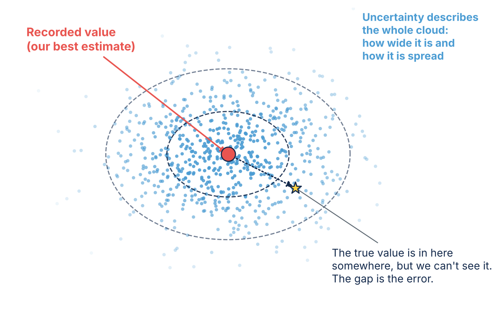
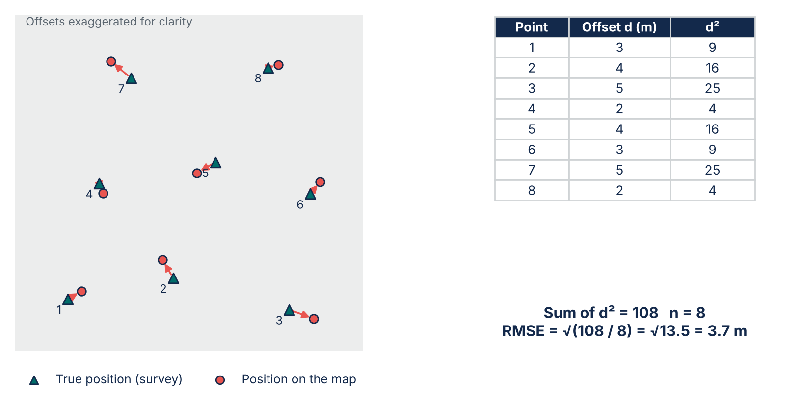
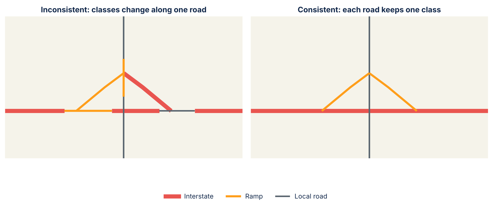
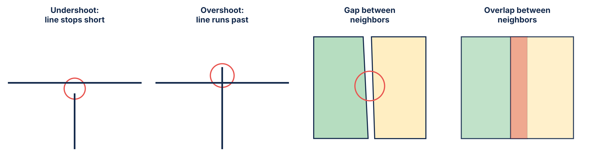
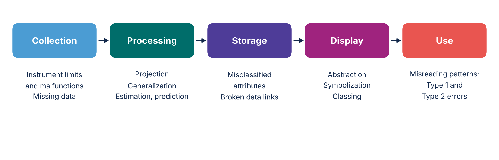
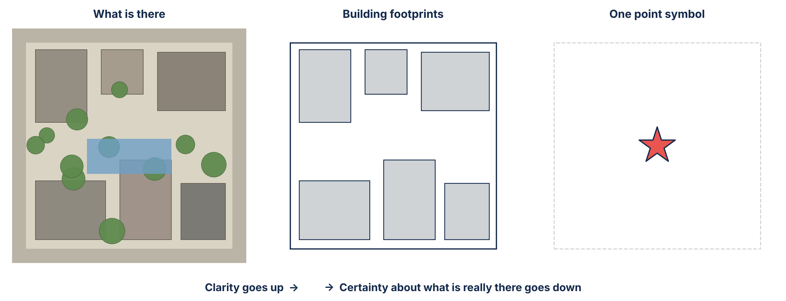
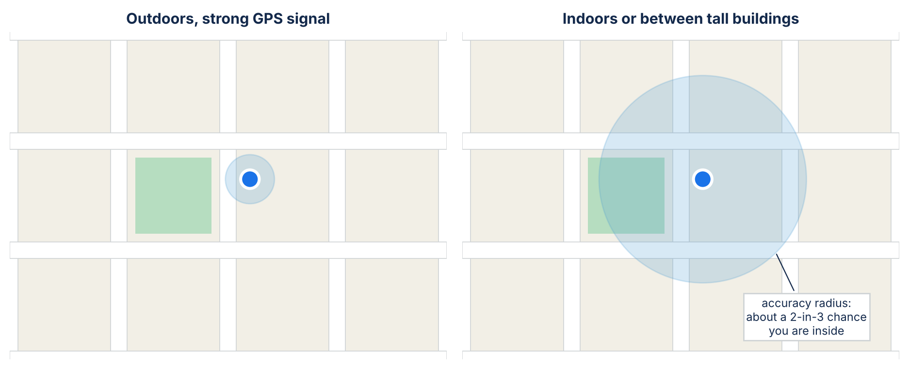
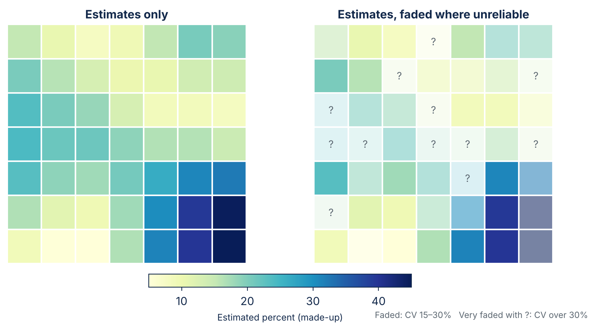
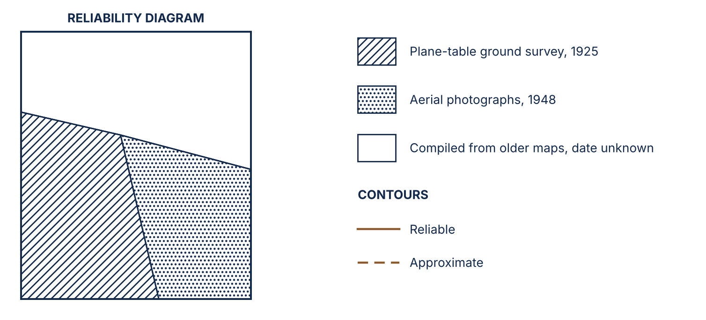

::: {.callout-note appearance="simple"}
## Learning objectives

By the end of this chapter you should be able to:

1.  Define uncertainty, and tell it apart from error.
2.  Name the elements of geospatial data quality, and give an example of a problem with each.
3.  Calculate positional accuracy as a root mean square error, and explain a map accuracy standard.
4.  Trace how uncertainty enters at each stage of the data lifecycle, from collection to use.
5.  Choose visual variables to show uncertainty on a map.
6.  Explain Type 1 and Type 2 errors in map reading, and why uncertainty matters to the people who use maps.
:::

Every chapter in this book has produced numbers that look exact: a coordinate to six decimal places, a population density for every county, a suitability score for every cell, a flood risk class for every community. None of them is exact. Coordinates come from instruments with limits. Census figures are estimates with margins of error (Chapter 8). Interpolated surfaces are predictions (Chapters 16 and 17). Suitability and risk scores rest on thresholds and weights that someone chose (Chapters 18 and 19). This chapter is about the gap between what a map shows and what is true, and about how to be honest about it.

## What is uncertainty? {#sec-what-is-uncertainty}

**Uncertainty** is the degree to which we aren't sure of something. Picture it as a cloud of all the values a measurement could plausibly take (@fig-cloud). The value we record is our best estimate, near the middle of the cloud. The true value is in there somewhere, but we can't see it.

{#fig-cloud fig-alt="A cloud of blue dots, densest in the center and fading outward, with two dashed ellipses around the middle. A red dot at the center is labeled recorded value, our best estimate. A small yellow star, off-center, is labeled the true value is in here somewhere, but we can't see it; the gap is the error. A dotted arrow runs from the red dot to the star. Blue text reads uncertainty describes the whole cloud: how wide it is and how it is spread."}

Two words are easy to confuse:

- **Error** is the difference between a recorded value and the true value. A well that the map puts 12 m north of where it really is has a positional error of 12 m.
- **Uncertainty** is how much we *don't know* about that error. Usually we can't know the error at any particular well, because if we knew the true location, we'd have mapped it there. We can only describe how large errors tend to be.

Every map is a model of the world, so every map carries some uncertainty [@zhang2002]. The question is not whether a map is uncertain, but how uncertain it is, whether that matters for the job at hand, and whether the map says so.

## Geospatial data quality {#sec-data-quality-elements}

Data quality and uncertainty are two sides of the same coin. Chapter 10 introduced the seven elements of spatial data quality, which van Oort [-@vanoort2006] found shared by mapping standards around the world, and which are now written into ISO 19157 (@tbl-quality-elements). Each element names a place where uncertainty can enter the data.

| Element | What it describes |
|---|---|
| Lineage | Sources, methods, and processing history |
| Positional accuracy | How close coordinates are to true positions |
| Attribute accuracy | How correct the non-spatial, non-temporal values are |
| Logical consistency | Whether the relationships within the data agree with each other |
| Completeness | Missing data and excess data |
| Usage, purpose, and constraints | What the data were made for, and their limits |
| Temporal quality | How valid and accurate the time measurements are |

: The seven elements of geospatial data quality. Source: van Oort [-@vanoort2006]. {#tbl-quality-elements}

The rest of this section looks at several of them more closely.

### Positional accuracy

**Positional accuracy** is how close a position on the map is to its true position on the ground. A famous joke makes the point: the New York-New York Hotel in Las Vegas has a skyline and a Statue of Liberty that are correct as *features*, but they are about 2,200 miles from where they belong. Every feature can be right in kind and still wrong in position.

Positional accuracy is tested by comparing the map with a more accurate reference, such as a GPS survey, at a set of **test points** (or check points, as in georeferencing in Chapter 9). For each test point $i$, measure the distance $d_i$ between its mapped position and its true position. The usual summary is the **root mean square error (RMSE)**:

$$
\text{RMSE} = \sqrt{\frac{\sum d_i^2}{n}}
$$

where $n$ is the number of test points. Square each offset, average the squares, then take the square root of the whole average (@fig-rmse).

{#fig-rmse fig-alt="Left: a gray map with eight numbered pairs of symbols, a green triangle for the true position and a red dot for the position on the map, joined by a short red arrow in a different direction for each pair. Right: a table of offsets for points 1 to 8: 3, 4, 5, 2, 4, 3, 5, and 2 meters, with squares 9, 16, 25, 4, 16, 9, 25, and 4. Below: sum of d squared equals 108, n equals 8; RMSE equals the square root of 108 over 8, which is the square root of 13.5, or 3.7 meters."}

Squaring makes large offsets count more than small ones, so a few badly placed points raise the RMSE sharply. RMSE is the same statistic you met for georeferencing (Chapter 9) and for cross validation in interpolation (Chapter 16).

**Accuracy standards** turn RMSE into a pass or fail. The **U.S. National Map Accuracy Standards** of 1947 [@usbb1947] said that for maps at a scale of 1:20,000 or smaller, no more than 10% of tested points may be off by more than 1/50 inch *on the map*. At 1:24,000, the scale of USGS topographic quadrangles, 1/50 inch is 40 feet on the ground. So 90% of tested points must fall within 40 feet of their true positions. Today the **National Standard for Spatial Data Accuracy** [@fgdc1998] reports accuracy in ground units at 95% confidence (about 1.73 times the RMSE for horizontal positions), whatever the map scale.

### Attribute accuracy

**Attribute accuracy** is how faithfully names, classes, and values describe each feature. A feature can be in the right place with the wrong label. A 1920 road guide, the *Automobile Blue Book*, labeled the campus in Boulder "Colorado State University." It is the University of Colorado. The geometry was fine; the attribute was wrong. In the same way, a land-cover map could put a desert pixel in exactly the right place, and still call it forest.

Attribute errors can be **categorical** (a wrong name or class, such as a misclassified land-cover pixel) or **numeric** (a wrong value, such as a wrong elevation or population count). For categorical data, accuracy is often summarized with a **confusion matrix** (or error matrix), which cross-tabulates the classes on the map against the true classes at a sample of test sites. The diagonal holds the sites classed correctly; the cells off the diagonal show which classes are confused with which.

::: {.callout-note .did-you-know appearance="simple" icon=false}
## Did you know..?

Some map errors are on purpose. Around 1930, two mapmakers at the General Drafting Company, Otto G. Lindberg and Ernest Alpers, invented a town called Agloe (an anagram of their initials) and put it on their map of New York State. If Agloe showed up on someone else's map, they would know their work had been copied. Agloe later did appear on a Rand McNally map, but by then a lodge and, by some accounts, a general store near the spot had taken the name, so the made-up town had arguably become real. Such **copyright traps**, also called paper towns or trap streets, are deliberate attribute errors.
:::

### Logical consistency

**Logical consistency** is the internal consistency of the data: whether the same thing is always recorded the same way, features have the right geometry type, and relationships are valid. @tbl-starbucks shows one coffee chain, nine records, and seven different problems.

| Name | Address | Type | Problem |
|---|---|---|---|
| Starbucks | 100 Main St. | Point | None |
| Starbucks | 110 Main St. | Point | None |
| \$tarbuck\$ | 111 Main St. | Point | Symbols in name |
| STARBUCKS | 112 Main St. | Point | Inconsistent case |
| Café Starbucks | 200 Main St. | Point | Name variant |
| Starbuck | 201 Main St. | Line | Wrong geometry type |
| Starbucks | 201b Main St. | Point | Address format |
| star bucks | 400 Main St. | Point | Spelling and case |
| Starbux | 1 Mainz St. | Polygon | Name, street, and geometry |

: Logical consistency problems in a made-up table of coffee shops. {#tbl-starbucks}

None of these records is wrong about location by itself. Together, they break counts, joins, and geocoding. A query for `Name = 'Starbucks'` (Chapter 5) finds only three stores, and an address-matching tool (Chapter 9) may fail on "201b" and "Mainz St." Data cleaning, and validation rules such as a list of allowed names, catch these.

Consistency rules apply to geometry and **topology** too (@fig-road-consistency, @fig-topology-errors). A road should keep one class from end to end, or a reader sees an interstate turn into a ramp and back again. Lines that should meet must actually connect, with no **undershoots** or **overshoots**; polygons must close; and neighboring polygons must not overlap or leave gaps. GIS software can test these rules automatically: ArcGIS Pro with geodatabase topology, and QGIS with the Topology Checker and Geometry Checker plugins.

{#fig-road-consistency fig-alt="Two maps of the same interchange: a horizontal road, a vertical road crossing it, and a ramp arching over the crossing. Left, inconsistent: the horizontal road switches from thick red interstate to orange ramp to red interstate to thin gray local road and back to interstate; the vertical road switches from local road to ramp to local road; one half of the arch is a ramp and the other half interstate. Right, consistent: the horizontal road is interstate throughout, the vertical road is a local road throughout, and the whole arch is a ramp."}

{#fig-topology-errors fig-alt="Four small diagrams. Undershoot: a vertical line stops just short of a horizontal line, circled in red. Overshoot: a vertical line crosses a horizontal line and runs a little past it, circled. Gap: two neighboring polygons with a thin empty wedge between them, circled. Overlap: two neighboring polygons whose edges overlap in a red strip."}

### Completeness

**Completeness** is "a measure of the absence of data and the presence of excess data" [@vanoort2006, 23]. A building layer may miss new houses (errors of omission) and still include ones that were torn down (errors of commission). Chapter 10 showed how completeness varies across OpenStreetMap, from place to place and from feature type to feature type.

### Temporal quality

**Temporal quality** (or temporal accuracy) asks whether the data are correct for the time the map represents. Every dataset has a date stamp, even if no one wrote it down, so ask when the data were *collected*, not just when the map was published. Are roads up to date? Some maps show planned roads that were never built. Have demolished buildings been removed?

**Temporal stability** is how long a feature stays the same. A mountain range changes over millions of years, a shoreline over decades, and a storefront over months. Less stable features need more frequent updates. A five-year-old elevation model is probably fine; a five-year-old layer of restaurants is not.

::: {.callout-tip appearance="simple"}
## Think about it

Open a map app and look at your street or campus. Find one example of a problem with positional accuracy, attribute accuracy, completeness, or temporal quality. Which element was it, and how would you report it?
:::

## Sources of uncertainty {#sec-sources}

### The data lifecycle

Uncertainty is not one problem at one step. It can enter at every stage of the life of a dataset (@fig-lifecycle):

- **Collection.** Instruments have limits, and can malfunction, which is a big issue in remote sensing. GPS positions drift. Surveys have non-response, so social data have gaps.
- **Processing.** Almost every computation adds uncertainty. Projection distorts (Chapter 4), generalization simplifies, and estimation and prediction fill in values that were never measured (Chapters 16 and 17).
- **Storage.** Attributes get misclassified, fields get truncated, and links between tables break (Chapter 6).
- **Display.** Abstraction and symbolization trade detail for clarity, and classing (Chapter 11) can create or hide patterns.
- **Use.** Readers misread maps: they see patterns that aren't there, or miss ones that are (@sec-type-errors).

{#fig-lifecycle fig-alt="Five colored boxes in a row joined by arrows: Collection (instrument limits and malfunctions, missing data), Processing (projection, generalization, estimation, prediction), Storage (misclassified attributes, broken data links), Display (abstraction, symbolization, classing), and Use (misreading patterns: Type 1 and Type 2 errors)."}

### From errors to uncertainty

Each source of error nudges the recorded value away from the truth by an unknown amount. Since we can't know the exact error, we have to accept that a range of true values is possible. Uncertainty is our description of that range: how wide the cloud in @fig-cloud is, and how the possibilities are spread out. A census margin of error (Chapter 8), a kriging prediction standard error (Chapter 17), and an RMSE are all descriptions of the cloud.

Uncertainty also **propagates**. When layers are combined in a suitability or risk model (Chapters 18 and 19), the errors in each input carry into the output, and can compound. A slope layer computed from an elevation model inherits the elevation model's errors, and so does every suitability score built on that slope.

### Uncertainty in abstraction

Abstraction makes geographic information readable and usable. The price is uncertainty: every simplification hides some detail (@fig-abstraction). A city block with buildings, trees, and a pond can be drawn as building footprints, or as a single point symbol. The symbol is much easier to read and compare across a whole map, but the reader can no longer see what is actually there. Map design is a deliberate compromise between clarity and certainty. Good cartographers make that trade on purpose, and tell the reader when it matters.

{#fig-abstraction fig-alt="Three panels of the same square city block. Left, what is there: gray rooftops of six buildings, green trees, and a blue pond on tan ground. Middle, building footprints: six plain gray rectangles in an outlined block. Right, one point symbol: a single red star in an empty dashed square. Below: clarity goes up, certainty about what is really there goes down."}

### Uncertainty in use: Type 1 and Type 2 errors {#sec-type-errors}

The last stage is the reader. Even perfect data can be misread, in two ways that parallel errors in statistics (@tbl-type-errors).

| Error | Map reading | In statistics |
|---|---|---|
| **Type 1**: "seeing wrong" | Concluding that a pattern exists where none exists, such as a cluster that is only an artifact of how classes were drawn | A false positive |
| **Type 2**: "not seeing" | Missing a pattern that does exist, perhaps because the symbolization hid it | A false negative |

: Type 1 and Type 2 errors in reading maps. {#tbl-type-errors}

Type 2 errors are the more problematic. A pattern someone claims to see can be checked and challenged. A pattern that nobody notices is never investigated at all.

## Visualizing uncertainty {#sec-visualizing-uncertainty}

### Why show it?

In science, a number without an error estimate is incomplete, and scientific datasets are not considered complete without measures of error, accuracy, completeness, or confidence. The same standard now applies to maps. If uncertainty is part of the data, hiding it misrepresents the data, and putting it in a footnote or a metadata file means most readers never see it. MacEachren and colleagues [-@maceachren2005] argue that uncertainty belongs in the main display, and that doing this well takes people who understand both geographic data and how readers perceive graphics, which is what cartographers are trained to do.

### An everyday example

Most people read an uncertainty display every day without thinking about it: the shaded circle around the blue dot on a phone's map (@fig-location-circle). The dot is the phone's best estimate of your position, and the circle is where you probably are. On Android, the accuracy radius is a 68% confidence circle: there is about a two-in-three chance you are inside it. When the GPS signal is weak, indoors or between tall buildings, the circle grows. Transparency lets it show uncertainty without hiding the map underneath. If the app showed only the dot, people would trust it more than they should.

{#fig-location-circle fig-alt="Two stylized street maps with a blue dot at the same place. Left, outdoors, strong GPS signal: a small pale blue circle around the dot, barely bigger than a building. Right, indoors or between tall buildings: a large pale blue circle covering several blocks, labeled accuracy radius: about a 2-in-3 chance you are inside."}

### Visual variables for uncertainty

Cartographers describe symbols with **visual variables**: size, shape, color hue, color value, and so on. MacEachren [-@maceachren1992] suggested adding variables that read naturally as "less certain" (@fig-visual-variables):

- **Crispness**: sharp edges where boundaries are known, and blurred edges where they are not. This suits fuzzy boundaries such as soil types or the edge of a wildfire.
- **Transparency**: a faded symbol tells readers to trust it less, as in the phone's location circle.
- **Saturation**: rich color for reliable values, washed-out color for doubtful ones. Keep the hue the same, so that the data category doesn't seem to change.
- **Added symbols**: glyphs, error bars, question marks, or labels placed on top of the data.

The first three are **intrinsic**: they change the symbol itself. Added symbols are **extrinsic**: they add a new symbol. Extrinsic symbols are explicit, but they add clutter.

![Four visual variables for showing uncertainty, after MacEachren [-@maceachren1992].](../images/uncertainty/visual-variables.png){#fig-visual-variables fig-alt="Four pairs of dark green circles, each labeled certain on the left and uncertain on the right. Crispness: a sharp-edged circle and a blurred one. Transparency: a solid circle and a pale, faded one. Saturation: a rich green circle and a grayish, washed-out green one. Added symbols: a plain circle and one with a white question mark and a horizontal error bar across it."}

@fig-estimate-map applies transparency and added symbols to a map of estimates, such as the percent of people in poverty from the ACS. Tracts with large margins of error (Chapter 8) are faded, so readers' eyes go first to the values they can trust.

{#fig-estimate-map fig-alt="Two 7 by 7 grids of squares colored from pale yellow to dark blue, with a color bar for estimated percent from 5 to 45. The left grid shows every square at full color. The right grid shows the same colors, but about half the squares are faded toward white, and the palest ones have a gray question mark; a dark blue cluster in the lower right stays mostly solid."}

Two more tips. Never rely on color alone: pair these effects with a legend that explains them in words. And test the design. A review of user studies found that people can use uncertainty displays well, but that which design works best depends on the task [@kinkeldey2014].

::: {.callout-tip appearance="simple"}
## Think about it

The National Hurricane Center's "cone of uncertainty" shows where the *center* of a storm will probably go, not how big the storm is. Many people read it as the area that will be hit. Is that a Type 1 or a Type 2 error? How would you redesign the map?
:::

### Historical displays of uncertainty

Showing uncertainty is not new. Printed topographic maps often carried a small **reliability diagram** in the margin, dividing the sheet into zones by survey method and date, such as a 1925 ground survey and 1948 aerial photographs (@fig-reliability). Contour legends split lines into reliable and approximate.

{#fig-reliability fig-alt="Left: a rectangle labeled reliability diagram, divided into three zones: diagonal hatching in the lower left, dots in the lower right, and plain white across the top. Right: a legend. Diagonal hatching, plane-table ground survey, 1925. Dots, aerial photographs, 1948. Plain, compiled from older maps, date unknown. Below, contours: a solid brown line, reliable, and a dashed brown line, approximate."}

These displays are a good start, but minimalist. They describe how the map was *compiled*. They don't say whether the map is good enough for *your* purpose, such as siting a well or planning a hike. That gap between compilation information and **fitness for use** is still a challenge today.

## Why do we care? {#sec-why-care}

### Whose fault?

Uncertainty has real consequences. In April 2008, a charter bus carrying a Seattle high school softball team hit the Arboretum Sewer Trestle, a low bridge in the Washington Park Arboretum, shearing off the bus's roof and injuring several students. According to news reports, the bus company said the driver had been following a GPS unit set up for cars.

Who was at fault? The bus company chose the device. The driver passed the clearance signs. The navigation map did not record height limits for vehicles. The data provider may never have collected them. When map data are incomplete or uncertain, and nobody communicates that, responsibility gets spread thin. Some communities now post road signs warning drivers not to trust their sat nav.

### Living with uncertainty

The Buddhist teacher Pema Chödrön writes that "uncertainty is all we truly have," and that much suffering comes from resisting that fact [@chodron2002]. Her point applies to maps too. Pretending data are certain feels safer, but it sets readers up to be misled. Accepting and showing uncertainty is more honest and, in the end, more useful. What would have changed if the bus's navigation map had said "height limits unknown on this route"?

Our job as GIS analysts and cartographers is not to eliminate uncertainty, which is impossible, but to measure it, document it in metadata, and show it, so that readers can decide whether a map is fit for their purpose.

## Uncertainty in ArcGIS Pro and QGIS {#sec-uncertainty-software}

- **Positional accuracy.** Compute RMSE from test points in a table with the Field Calculator, or use the residuals reported by the georeferencing tools (Chapter 9).
- **Logical consistency.** ArcGIS Pro: geodatabase topology rules and the Validate Topology tool, and attribute rules. QGIS: the Topology Checker and Geometry Checker plugins, and the Check Validity and Fix Geometries tools.
- **Metadata.** ArcGIS Pro and QGIS both have metadata editors, under a layer's Properties, for recording lineage, accuracy, and constraints.
- **Showing uncertainty.** Use transparency or saturation driven by a field (in ArcGIS Pro, "Vary symbology by attribute"; in QGIS, data-defined overrides), or a bivariate color scheme of estimate and margin of error. Map kriging's prediction standard error beside the prediction (Chapter 17).

## Check your understanding

::: {.content-visible when-format="html"}

1.  The difference between a recorded value and the true value is: <select class='webex-select'><option value='blank'></option><option value='answer'>Error</option><option value=''>Uncertainty</option><option value=''>Lineage</option><option value=''>Precision</option></select>

2.  The sources, methods, and processing history of a dataset are its: <select class='webex-select'><option value='blank'></option><option value=''>Completeness</option><option value='answer'>Lineage</option><option value=''>Temporal quality</option><option value=''>Logical consistency</option></select>

3.  Four test points are off by 3, 4, 0, and 0 m. What is the RMSE, in meters? <input class='webex-solveme nospaces' size='4' data-answer='["2.5"]'/>

4.  A coffee shop stored as a polygon in a layer of points is a problem of: <select class='webex-select'><option value='blank'></option><option value=''>Positional accuracy</option><option value='answer'>Logical consistency</option><option value=''>Temporal quality</option><option value=''>Lineage</option></select>

5.  A map still shows a building that was torn down five years ago. Which elements of quality does this affect? <select class='webex-select'><option value='blank'></option><option value='answer'>Completeness and temporal quality</option><option value=''>Positional accuracy only</option><option value=''>Lineage only</option><option value=''>None</option></select>

6.  Blurring the edges of a symbol to show uncertainty uses the visual variable of: <select class='webex-select'><option value='blank'></option><option value=''>Saturation</option><option value='answer'>Crispness</option><option value=''>Size</option><option value=''>Shape</option></select>

7.  Missing a pattern that really exists on a map is a: <select class='webex-select'><option value='blank'></option><option value=''>Type 1 error</option><option value='answer'>Type 2 error</option><option value=''>Positional error</option><option value=''>Topology error</option></select>

8.  Under the 1947 National Map Accuracy Standards, at 1:24,000, 90% of tested points must fall within 40 feet of their true positions. <select class='webex-select'><option value='blank'></option><option value='answer'>TRUE</option><option value=''>FALSE</option></select>

:::

::: {.content-visible unless-format="html"}
The interactive self-check questions for this chapter are in the online version of the book.
:::

## Summary

- **Uncertainty** is the degree to which we aren't sure of something: the cloud of possible values around what we record. **Error** is the gap between a recorded value and the truth, which we usually can't know. Every map carries uncertainty.
- Seven elements of data quality describe where it comes from: **lineage**, **positional accuracy**, **attribute accuracy**, **logical consistency**, **completeness**, **usage, purpose, and constraints**, and **temporal quality**.
- **Positional accuracy** is summarized by the **RMSE** of test points, and judged against standards such as the **National Map Accuracy Standards** (at 1:24,000, 90% of points within 40 feet).
- Uncertainty can enter at every stage of the **data lifecycle**: collection, processing, storage, display, and use. It propagates when layers are combined, and **abstraction** trades certainty for clarity.
- Readers make **Type 1** ("seeing wrong") and **Type 2** ("not seeing") errors. Type 2 errors are the more problematic, because nobody investigates a pattern they never noticed.
- Uncertainty belongs on the map, not in a footnote. **Crispness**, **transparency**, and **saturation** (intrinsic) and **added symbols** (extrinsic) show it, with a legend that explains them in words.
- The goal is not to eliminate uncertainty but to communicate it, so readers can judge **fitness for use**.

## Exercises

1.  **RMSE.** Six test points on a parcel map are off by 1.2, 0.8, 2.5, 1.0, 0.6, and 3.1 m. Compute the RMSE. Which point contributes most, and why does squaring make it count so much?
2.  **Accuracy standard.** Under the 1947 National Map Accuracy Standards, what is the allowable error on the ground for a map at 1:100,000? (Hint: 1/50 inch on the map.)
3.  **Logical consistency.** Download the points of interest for Chapel Hill from OpenStreetMap (Chapter 10), and find every record for one chain store or restaurant. How many ways is its name written? What would a query for the exact name miss?
4.  **Metadata.** Find a layer on NC OneMap, and read its metadata. Which of the seven quality elements does it report? Which are missing?
5.  **Map the margin of error.** Map an ACS estimate, such as median household income, for North Carolina census tracts (Chapter 8). Make a second map that fades tracts whose coefficient of variation is over 30%. Which tracts' values should a reader trust least?
6.  **Uncertainty in your project.** For a suitability or risk model you have built (Chapters 18 and 19), list one source of uncertainty at each stage of the lifecycle. Which one do you think affects the result most?

## Further reading and online resources

### Books and papers

- *Uncertainty in Geographical Information*, by Jingxiong Zhang and Michael Goodchild [@zhang2002].
- P. A. J. van Oort, *Spatial Data Quality: From Description to Application* [@vanoort2006], the source of the seven elements of quality.
- Alan MacEachren, "Visualizing uncertain information" [@maceachren1992], which proposed the visual variables for uncertainty.
- Alan MacEachren and colleagues, "Visualizing geospatial information uncertainty: What we know and what we need to know" [@maceachren2005].
- Christoph Kinkeldey, Alan MacEachren, and Jochen Schiewe, "How to assess visual communication of uncertainty?" [@kinkeldey2014]: <https://repos.hcu-hamburg.de/handle/hcu/758>.
- *How to Lie with Maps*, by Mark Monmonier [@monmonier2018].
- Claus Wilke, *Fundamentals of Data Visualization*, chapter 16, "Visualizing uncertainty" [@wilke2019], free online: <https://clauswilke.com/dataviz/visualizing-uncertainty.html>.
- *GIS Fundamentals*, by Paul Bolstad [@bolstad2022]. The chapter on data standards and data quality covers accuracy testing and standards.
- *Comfortable with Uncertainty*, by Pema Chödrön [@chodron2002].

### Accuracy standards

- U.S. Geological Survey, "Map Accuracy Standards" (Fact Sheet 171-99), describing the 1947 National Map Accuracy Standards: <https://pubs.usgs.gov/fs/1999/0171/report.pdf>.
- Federal Geographic Data Committee, National Standard for Spatial Data Accuracy [@fgdc1998]: <https://fgdc.gov/standards/projects/accuracy/part3>.
- ASPRS Positional Accuracy Standards for Digital Geospatial Data: <https://www.asprs.org/news-resources/asprs-positional-accuracy-standards-for-digital-geospatial-data>.
- ISO 19157-1:2023, *Geographic information: Data quality*: <https://www.iso.org/standard/78900.html>.
- GPS.gov, "GPS Accuracy": <https://www.gps.gov/systems/gps/performance/accuracy/>.

### Checking data in ArcGIS Pro and QGIS

- Esri, "Topology in ArcGIS": <https://pro.arcgis.com/en/pro-app/latest/help/data/topologies/topology-in-arcgis.htm>.
- QGIS User Guide, "Topology Checker Plugin": <https://docs.qgis.org/latest/en/docs/user_manual/plugins/core_plugins/plugins_topology_checker.html>.
- QGIS User Guide, "Geometry Checker Plugin": <https://docs.qgis.org/latest/en/docs/user_manual/plugins/core_plugins/plugins_geometry_checker.html>.

### Uncertainty on maps

- National Hurricane Center, "Definition of the NHC Track Forecast Cone": <https://www.nhc.noaa.gov/aboutcone.shtml>.
- Android Developers, `Location.getAccuracy()`, which defines the accuracy radius: <https://developer.android.com/reference/android/location/Location#getAccuracy()>.
- Penn State, GEOG 486: Cartography and Visualization: <https://www.e-education.psu.edu/geog486/>.
- The GIS&T Body of Knowledge: <https://www.ucgis.org/site/gis-t-body-of-knowledge>.

### Map errors and traps

- NPR, "An Imaginary Town Becomes Real, Then Not. True Story" (Agloe, New York): <https://www.npr.org/blogs/krulwich/2014/03/18/290236647/an-imaginary-town-becomes-real-then-not-true-story>.
- UC Berkeley Library, "Map Traps": <https://guides.lib.berkeley.edu/mapsandmore/maptraps>.
- Cascade PBS, "Attack of the giant 'Sewer Trestle'" (the 2008 bus crash): <https://www.cascadepbs.org/2008/04/attack-giant-sewer-trestle>.
