::: {.callout-note appearance="simple"}
## Learning objectives

By the end of this chapter you should be able to:

1.  Explain how a map abstracts the real world, turning entities into features.
2.  Describe the steps of data abstraction, from the real world to a data model, a data structure, and machine code.
3.  Tell discrete objects from continuous data, and spatial data from attribute data.
4.  Name the four main geographic data models, and describe the vector and raster models and their terms.
5.  Work out a raster cell's coordinates from its row, column, and cell size, and explain how cell size sets resolution.
6.  Explain how a shapefile stores a vector layer, and what metadata records.
7.  Weigh the advantages and disadvantages of the vector and raster models, and choose one for a task.
:::

Start with a scenario. Your new GIS consulting firm has been hired to make a map of campus for new students. *What data would you collect? How would you collect it?* (And what would you name your firm?) Take two minutes and make a list. You might write down buildings, sidewalks, parking lots, bus stops, and the dining halls. Keep your list: we will come back to it several times in this chapter.

Whatever is on your list, you made choices. You didn't list every tree, every bench, or every crack in the sidewalk, and you didn't say *how* a building should be drawn. This chapter is about those choices: how we turn the messy, continuous real world into data a computer can store and analyze. It answers five questions. How does a map represent the world? What types of data do we use? How do data models describe geography? How is geographic data stored? And what are the advantages and disadvantages of each type?

## How a map represents the world {#sec-represent}

### Entities and features

Start with the real world. An **entity** is a real-world object: a tree, a building, a light post, a sidewalk, a lawn. A **feature** is how a map represents an entity, usually as a point, a line, or a polygon (@fig-entities-features).

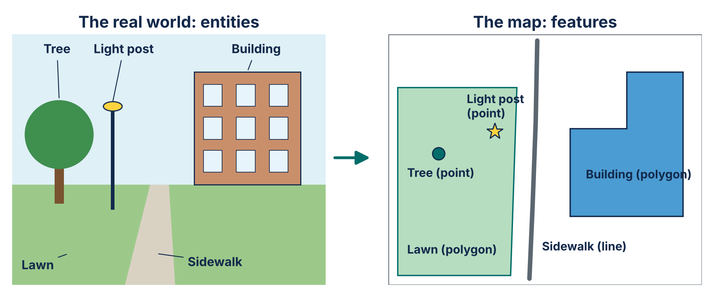{#fig-entities-features fig-alt="Two panels joined by an arrow. On the left, a simple drawing of a campus scene: a round green tree, a black light post with a yellow lamp, a brick building with nine windows, a tan sidewalk running across a green lawn, each labeled. On the right, the same scene as a map: a teal dot labeled Tree (point), a yellow star labeled Light post (point), a gray line labeled Sidewalk (line), a blue L-shaped polygon labeled Building (polygon), and a light green polygon labeled Lawn (polygon)."}

Notice what the map leaves out. The building's windows, the color of its bricks, the shape of the tree's crown, and the people walking by are all gone. Every map is a set of choices about what to keep, what to leave out, and how to draw what is kept. Look back at your campus list: which entities made it onto your map, and which did you leave off without even thinking about it?

### Data abstraction

A computer can't store a tree. It can only store numbers, and in the end, only ones and zeros. **Data abstraction** is the chain of steps that turns the real world into something a computer can store (@fig-abstraction):

1.  **The real world**: the wetland, with its water, plants, and soggy edges.
2.  **A data model**: the way *people* think about it in a GIS, such as polygons for each wetland and a table that gives each one an ID, an area, and a type.
3.  **A data structure**: the way the model is laid out in a computer, such as a list of the *x, y* coordinate pairs around each polygon's edge.
4.  **Machine code**: the ones and zeros the computer actually stores.

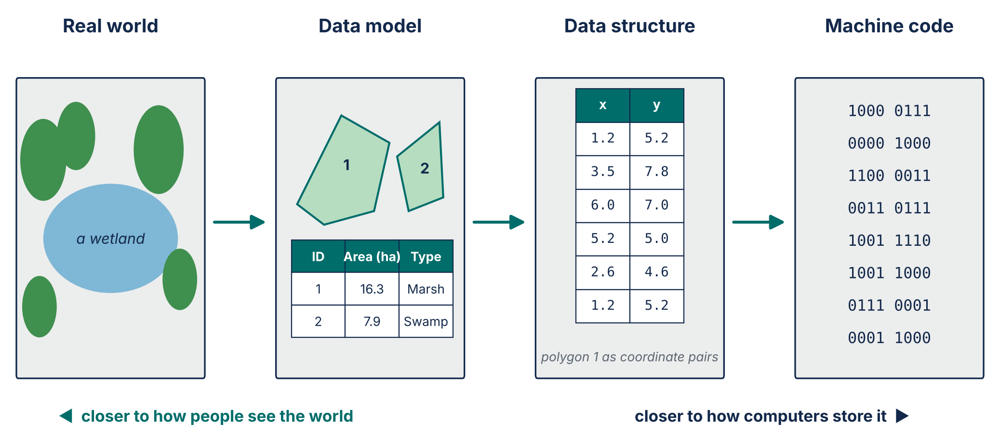{#fig-abstraction fig-alt="Four boxes in a row, joined by arrows. Real world: a blue pond labeled a wetland, surrounded by green trees. Data model: two green polygons numbered 1 and 2 above a table with columns ID, Area (ha), and Type, with rows 1, 16.3, Marsh and 2, 7.9, Swamp. Data structure: a table of x and y coordinate pairs for polygon 1, starting and ending at 1.2, 5.2. Machine code: eight rows of binary digits. Below, the left side is labeled closer to how people see the world, and the right side closer to how computers store it."}

Humans work with data models; computers store data structures and binary code. The good news is that GIS software hides the right-hand steps. When you open a layer in QGIS or ArcGIS Pro, you see polygons and tables, not lists of coordinates, and certainly not ones and zeros. But knowing the steps are there helps you understand why files are organized the way they are, why some operations are slow, and why the same data can be stored in more than one way.

### Geographic data models

A **data model** sits where human understanding and computer understanding overlap. People think about roads, rivers, and parcels; computers handle numbers and coordinates. The data model is the meeting point. Paul Bolstad, in *GIS Fundamentals*, describes a data model as the objects in a spatial database plus the relationships among them, and says its purpose is "to provide a formal means of representing and manipulating spatially-referenced information" [@bolstad2022]. *Formal* here means mathematical: a data model has exact rules, so a computer can follow them without guessing.

GIS uses four main data models (@fig-four-models):

- **Vector**: points, lines, and polygons, each stored as coordinates.
- **Raster**: a grid of cells, each holding a value.
- **TIN** (triangulated irregular network): triangles that connect sampled elevation points into a surface.
- **Tabular**: tables of attributes, linked to features.

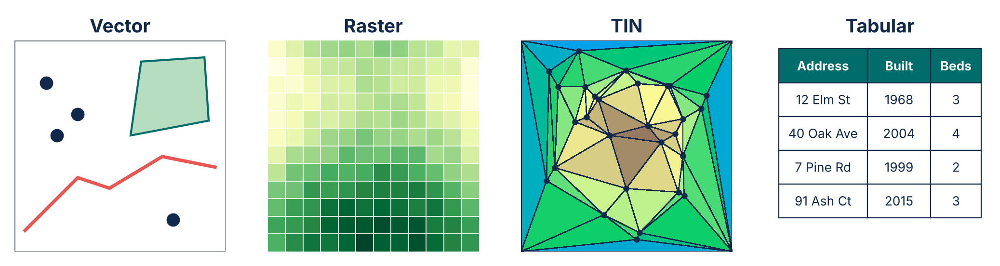{#fig-four-models fig-alt="Four panels. Vector: four navy dots, a red zigzag line, and a green four-sided polygon on a white background. Raster: a square grid of green cells shading from pale yellow-green at the top to dark green at the bottom. TIN: a square filled with irregular triangles whose corners are navy dots, colored from blue at the edges through green and yellow to brown at a peak in the middle. Tabular: a table with columns Address, Built, and Beds, and four rows of houses such as 12 Elm St, 1968, 3."}

Most of this chapter is about vector and raster, the two models you will use most. A TIN is a special model for surfaces such as terrain: it puts more triangles where the ground is rough and fewer where it is flat, so it can be more efficient than a grid. Tables aren't a picture of the world on their own, but they hold the attributes that make vector and raster data useful.

## What types of data do we use? {#sec-types}

### Discrete objects and continuous data

There are two ways of thinking about what is on a map (@fig-discrete-continuous).

**Discrete objects** exist in one place and not in another. They have clear boundaries, and at any location they are either present or absent: a road is either here or it isn't. Roads, houses, lakes, and state boundaries are discrete objects.

**Continuous data** describe a quantity that exists across the whole map. It is always present, and its value changes from place to place. Every point on Earth has an elevation, a temperature, and an amount of rainfall, even if the value is zero. You can't point to where elevation "ends."

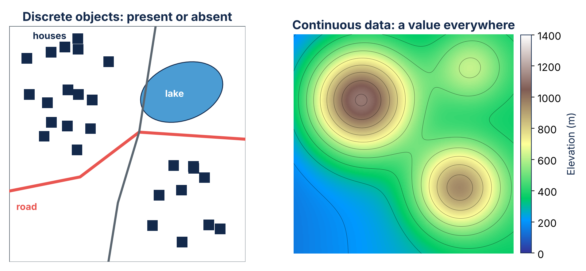{#fig-discrete-continuous fig-alt="Two panels. Left, titled Discrete objects: present or absent: a white map with small navy squares for houses in two clusters, a red road, a gray road, and a blue oval lake, each labeled. Right, titled Continuous data: a value everywhere: a shaded surface colored from blue in the lowlands through green and yellow to brown on two hilltops, with thin contour lines circling the hills and a color bar for elevation from 0 to 1,400 meters."}

Some things can be thought of either way, and the choice depends on your question. Is a forest discrete or continuous? A forest boundary drawn as a polygon is discrete: you are either inside the forest or not. But the percent of tree canopy over each patch of ground is continuous, and it shades gradually from dense forest to open field. As you will see, this choice largely decides whether you use the vector or the raster model.

::: {.callout-tip appearance="simple"}
## Think about it

Sort these into discrete objects and continuous data: fire hydrants, air pollution, county boundaries, snow depth, rivers, soil moisture, noise from an airport. Which ones could be either, depending on the question?
:::

### Points, lines, polygons, and annotation

Maps portray the world with four kinds of features (@fig-feature-types):

- A **point** is a location with no area, such as a school or a well.
- A **line** has length but no area, such as a road or a stream.
- A **polygon** encloses an area, such as a lake or a park.
- **Annotation** is the text placed on a map, such as place names and street names.

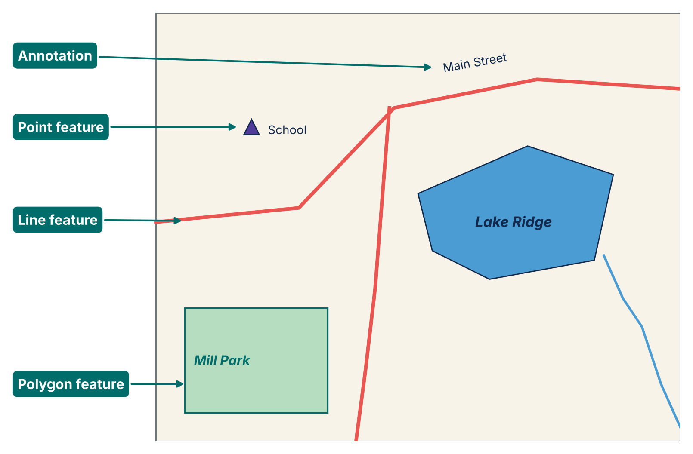{#fig-feature-types fig-alt="A simple map of a small area with labeled boxes pointing to examples. Point feature points to a purple triangle labeled School. Line feature points to a red road. Polygon feature points to a light green rectangle, Mill Park. Annotation points to the text Main Street. The map also has a blue lake labeled Lake Ridge and a blue stream."}

The same entity can be any of these, depending on **scale**. A city is a point on a map of the United States, and a polygon on a map of its county. A river is a line on a state map, and a polygon on a detailed map of its banks. You will see this idea again in the vector model, below.

### What is an entity?

Every entity carries five kinds of information. Take a lake as an example:

- **A spatial location**: where it is, as an address or coordinates. The lake's center is at a particular latitude and longitude.
- **An extent**: how big it is, its size, boundary, and dimensions. The lake covers 40 hectares.
- **Non-spatial attributes**: facts that describe it without saying where it is, such as a name, a number, a quality, or a color. The lake is called Lake Ridge, and it is 12 meters deep.
- **Time**: when it existed, and when the data were collected. The shoreline was mapped from aerial photos taken in 2023, and a dry summer could move it.
- **A geometry**: its shape. The lake is stored as a polygon.

### Spatial and non-spatial data

**Spatial data** have a location that can be put on a map: the buildings on your campus, the rainfall measured across North Carolina, the U.S. highway network. **Non-spatial data** have no location of their own: the parts of a bicycle, a list of student ID numbers, your class grades.

When non-spatial information describes a spatial entity, we call it an **attribute**. A building's name and the year it was built are attributes of the building's polygon. Quick check: is a student's home address spatial or non-spatial? On its own it is just text, but once software matches it to a location on a map (a step called **geocoding**), it becomes spatial.

### Attribute data

**Attribute data** describe features. They have no location on their own; they borrow the location of the feature they are linked to. Attributes are usually stored in a table, with one row per feature and one column per attribute. Every feature in a layer has the same set of attributes, even if some values are blank.

Take a layer of fire hydrants (@fig-attributes). Each dot on the map is one hydrant, and each row of the table describes one of those dots: its ID, how many flanges it has (the outlets hoses connect to), its color, and its condition rating. Select hydrant 2 on the map, and its row lights up in the table; select the row, and the hydrant lights up on the map.

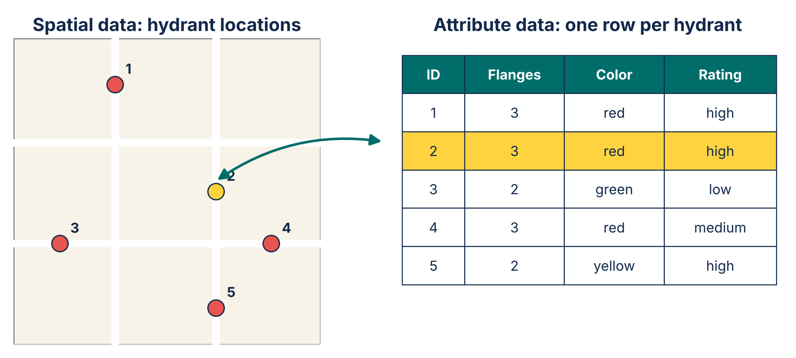{#fig-attributes fig-alt="Two panels joined by a curved two-headed arrow. Left, titled Spatial data: hydrant locations: a tan map of city blocks divided by white streets, with five red dots numbered 1 to 5 at street corners. Dot 2 is yellow. Right, titled Attribute data: one row per hydrant: a table with columns ID, Flanges, Color, and Rating, and five rows. Row 2, which reads 3, red, high, is highlighted in yellow."}

That consistency, the same columns for every feature, is what lets a GIS **query** a layer (find every hydrant rated low) and **symbolize** it (color each hydrant by its rating).

### Thematic layers

A **layer** groups similar features, such as all the roads, all the parcels, or all the hydrants. Stacking layers that cover the same area lets us compare themes and find where they meet (@fig-layers). This is the overlay idea from Chapter 1, put into practice.

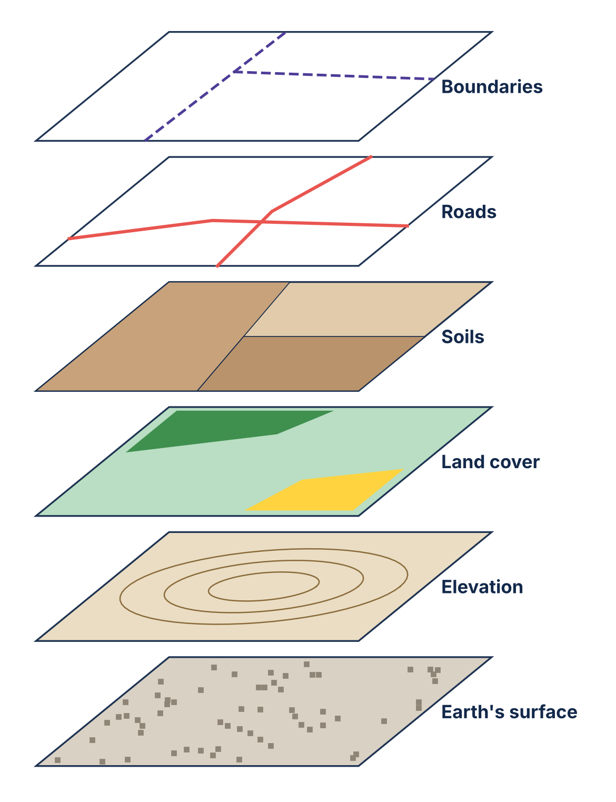{#fig-layers fig-alt="Six flat, tilted sheets stacked one above the other like transparent maps, each labeled on the right. From the bottom: Earth's surface, a gray-brown sheet with small specks; Elevation, with brown contour rings around a hill; Land cover, green with a dark green forest patch and a yellow field; Soils, divided into three brown soil areas; Roads, white with two red roads crossing; and Boundaries, white with dashed purple boundary lines."}

The two programs in this book organize layers slightly differently:

- **ArcGIS Pro**: the layers you display together make up a *map*. A project (an `.aprx` file) can hold several maps, along with layouts and other items. (Older ArcMap called a map a *data frame*, and saved its work as a *map document*, an `.mxd` file.)
- **QGIS**: layers belong to a *project* (a `.qgz` file), and are drawn in the *map canvas*. The Layers panel lists them, top to bottom, in the order they are drawn.

In both programs, a layer *points to* data stored somewhere else, in a file or a database. It does not hold the data itself. Deleting a layer from your map does not delete the data, and moving the data can break the layer. Keep that in mind when you move a project to another computer.

::: {.callout-tip appearance="simple"}
## Think about it

Go back to your campus map list. Name three layers you would need. For each one, would its features be points, lines, or polygons? What attributes would you give them?
:::

## How do data models describe geography? {#sec-models}

### Vector and raster

The two main data models represent the world in very different ways (@fig-vector-raster; @tbl-vector-raster).

The **vector** model stores geometry as coordinates. A point is a single *x, y* pair; a line is an ordered list of pairs; a polygon is a list that closes back on itself. Vector suits discrete objects, and each feature carries its own attributes.

The **raster** model divides space into a regular grid of **cells**, each holding one value. Raster suits continuous data. How much detail it keeps depends on the size of the cells. (In an image, a cell is called a **pixel**, short for *picture element*.)

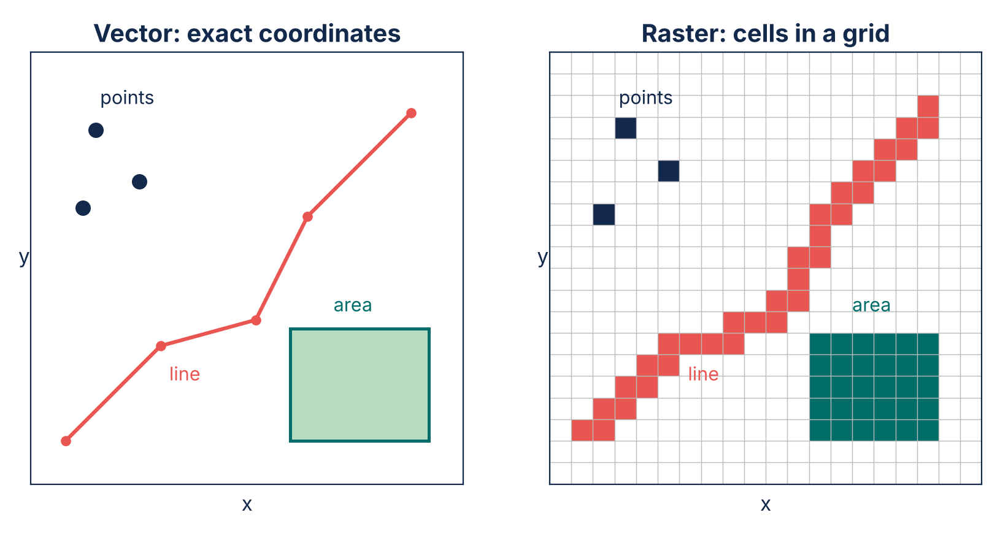{#fig-vector-raster fig-alt="Two panels with x and y axes. Left, Vector: exact coordinates: three navy dots labeled points, a red line made of straight segments through five points, and a green rectangle labeled area. Right, Raster: cells in a grid: the same features drawn by filling cells of a fine gray grid. The points are three single navy cells, the line is a staircase of red cells, and the area is a block of dark green cells."}

| | Vector | Raster |
|:--|:--------|:--------|
| Stores | Points, lines, and polygons | A regular grid of cells |
| Best for | Discrete objects | Continuous data |
| Location | *x, y* coordinates | The cell's row and column in the grid |
| Detail set by | The precision of the coordinates | The cell size |
| Attributes | Each feature has its own row of attributes | Each cell holds one value |
| Examples | Roads, parcels, wells, county boundaries | Elevation, satellite imagery, land cover, temperature |

: The vector and raster data models compared. {#tbl-vector-raster}

Before you read the examples in the table, try to think of your own: what would you store as vector, and what as raster?

### The vector model: one entity, several features

The vector model gives you choices. The buildings in a neighborhood can be stored as points, as outlines (lines), or as filled areas (polygons) (@fig-three-ways).

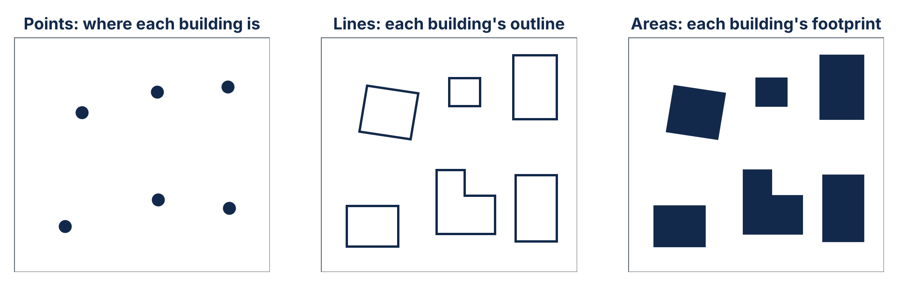{#fig-three-ways fig-alt="Three panels showing the same six buildings. Points: where each building is: six navy dots. Lines: each building's outline: six hollow outlines of rectangles and an L shape. Areas: each building's footprint: the same six shapes filled in solid navy."}

The right choice depends on scale and purpose. A citywide map of schools only needs points. A campus map for finding building entrances needs footprints. What is the difference between a line and an area? *Enclosure*: an area is a closed shape with an inside, so you can measure how big it is and ask whether something is in it. An outline drawn as a line has no inside, only a length.

### Vector terms

A few terms describe the parts of vector features (@fig-vector-terms):

- A **point** is a standalone location.
- A **node** is the start or end point of a line.
- A **vertex** (plural **vertices**) is an intermediate point where a line changes direction.
- A **line segment** is the straight piece between two vertices or nodes.
- A **polygon** is a closed line that encloses an area. Its corners are vertices.

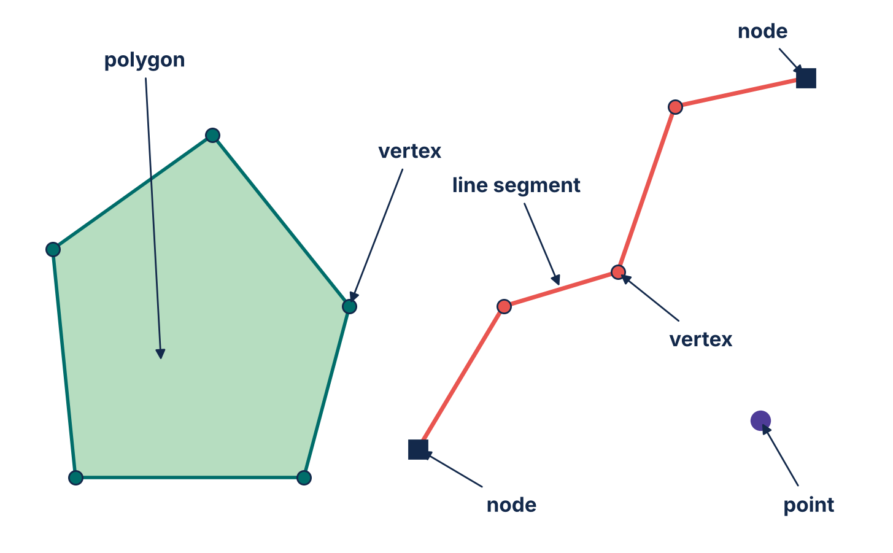{#fig-vector-terms fig-alt="A labeled line drawing. On the left, a green five-sided polygon with a dot at each corner; labels point to the polygon and to one corner, a vertex. In the middle, a red line that bends three times. Its two ends are navy squares labeled node, and the bends are red dots, one labeled vertex. A label points to one straight piece, a line segment. On the right, a single purple dot labeled point."}

Nodes matter for **networks**. Roads meet at nodes, so routing software, like the route optimization in Chapter 1, uses them to find paths from one road to the next.

When you edit vector data in QGIS or ArcGIS Pro, you will move, add, and delete vertices one at a time. The more vertices a line has, the more closely it can follow a curving river, and the larger its file.

### The raster model: a grid of cells

A **raster** is rows and columns of equal-sized cells, laid on an *x, y* coordinate system (@fig-raster-grid). Four things define it:

- **Each cell holds one value.** Most values are numbers, such as an elevation in meters. A value can also stand for a category, such as a land cover class (1 = water, 2 = forest, 3 = farmland), usually stored as a numeric code with a table that says what each code means. The cell marked N in the figure is a reminder that a value need not be a measurement.
- **The cell size** is the real-world length of one side of a cell, such as 30 meters. It sets the raster's **resolution**.
- **The coordinates of the lower-left cell** anchor the grid to a place on Earth.
- **The number of rows and columns** sets how far the grid extends.

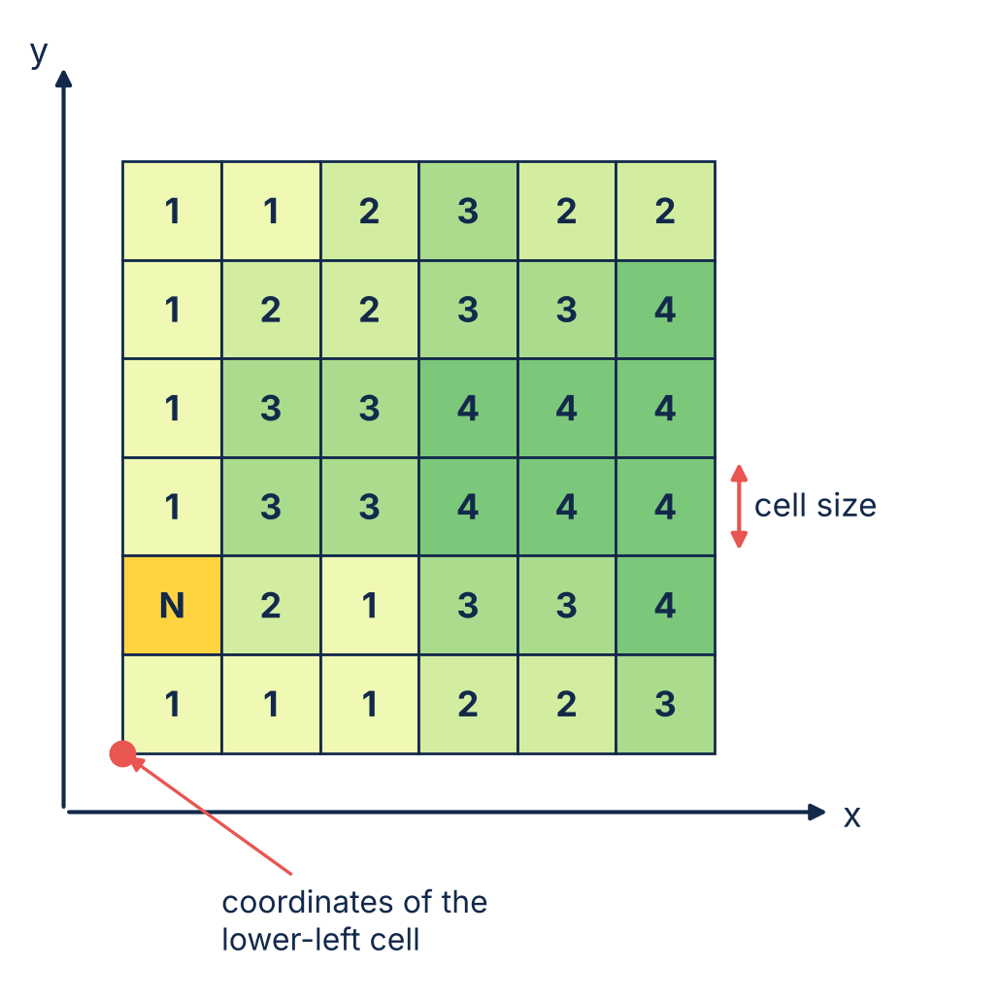{#fig-raster-grid fig-alt="A six by six grid of square cells on x and y axes. Most cells hold a number from 1 to 4, shaded from pale yellow-green for 1 to medium green for 4. One cell, second from the bottom in the left column, is yellow and holds the letter N. A red arrow beside one cell marks its height as the cell size. A red dot at the grid's lower-left corner is labeled coordinates of the lower-left cell."}

Because every cell is the same size, you don't need to store the coordinates of each cell. You only need the coordinates of one corner and the cell size, and you can work out where every other cell is. That is a big part of why rasters are simple and fast to process.

### Cell size and cell coordinates

**Cell size** is the ground distance covered by one side of a cell. Smaller cells mean more cells over the same area, which means finer resolution and larger files. @fig-cell-size shows the same 200-meter square at three cell sizes. Halving the cell size multiplies the number of cells by four: 4, then 16, then 64.

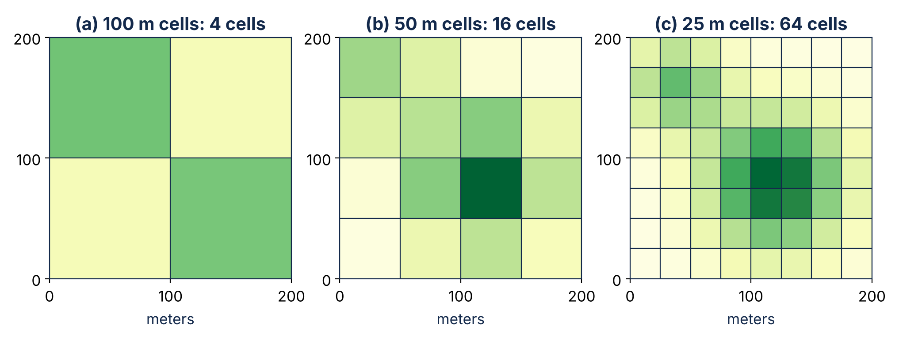{#fig-cell-size fig-alt="Three square grids side by side, each 200 meters on a side and shaded green where values are high. Grid a has 100 meter cells, so only 4 cells, two pale and two green. Grid b has 50 meter cells, 16 cells, with one dark green cell in the lower middle. Grid c has 25 meter cells, 64 cells, which show a smooth green peak in the lower middle and a smaller one at the upper left."}

To find where a cell is, start from the lower-left cell and count. Number rows and columns from 0, starting at the lower-left cell. Then:

$$N_{cell} = N_{lower\text{-}left} + (\text{row} \times \text{cell size})$$

$$E_{cell} = E_{lower\text{-}left} + (\text{column} \times \text{cell size})$$

Here *N* is the **northing**, a distance north (the *y* coordinate), and *E* is the **easting**, a distance east (the *x* coordinate). You will meet eastings and northings again when we study coordinate systems.

For example, suppose the lower-left cell of a raster is at E 500,000 m, N 4,400,000 m, and the cells are 25 meters on a side. The cell in row 2, column 3 is at:

- N = 4,400,000 + (2 × 25) = **4,400,050 m**
- E = 500,000 + (3 × 25) = **500,075 m**

::: {.callout-tip appearance="simple"}
## Trivia time: which cell size gives the best resolution?

Look at @fig-cell-size again. If you were buying a new TV, which of these would give you the best picture: (a) 100 m cells, (b) 50 m cells, or (c) 25 m cells?

Show the answer

(c), the 25-meter cells. Smaller cells mean more cells over the same area, so finer detail. A TV works the same way: more, smaller pixels on the same size screen give a sharper picture. The cost? Grid (c) has sixteen times as many cells as grid (a), so its file is larger and slower to process.

:::

::: {.callout-note .did-you-know appearance="simple" icon=false}
## Did you know..?

Each cell in an image from the Landsat satellites, which have photographed Earth continuously since 1972, is 30 meters on a side. That is about the size of a baseball infield, whose bases are 90 feet (27.4 meters) apart. A single cell can't show you a house, but a grid of them covering every place on Earth, every 16 days for over 50 years, can show you forests being cut, cities growing, and lakes drying up.
:::

## How is geographic data stored? {#sec-stored}

### Data structures

The data model is the concept; the **data structure** is how a computer actually stores it. @fig-arcs shows one way a vector polygon can be stored. The polygon is built from three **arcs** (A1, A2, and A3), each a short line. Each arc is stored as an ordered list of coordinate pairs at particular addresses in the computer's memory, and a **pointer** tells the computer which arc comes next.

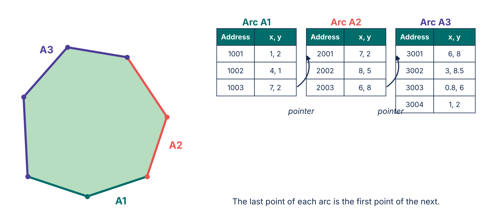{#fig-arcs fig-alt="On the left, a light green seven-sided polygon whose edge is drawn in three colors: the bottom edge, A1, in teal; the right side, A2, in red; and the top and left sides, A3, in purple. On the right, three tables, Arc A1, Arc A2, and Arc A3, list memory addresses and coordinate pairs. Arc A1 runs from 1, 2 to 7, 2; Arc A2 from 7, 2 to 6, 8; Arc A3 from 6, 8 back to 1, 2. Curved arrows labeled pointer run from the last row of each table to the first row of the next. A note reads: The last point of each arc is the first point of the next."}

Notice that the last coordinate of each arc is the same as the first coordinate of the next. That shared point is what joins the arcs into a closed polygon. Storing shared edges once, and recording how they connect, is called **topology**. It saves space, and it guarantees that two neighboring polygons, like two counties, share exactly the same border, with no gaps or overlaps between them. You will meet topology again when you edit data.

You rarely need to think about data structures. But they explain things you will notice: why some file formats are larger than others, why a file can be corrupted if one part is missing, and why some tools need data in a particular format.

### The Esri shapefile

The data structure you will use most often this semester is the **shapefile**, a vector format that Esri created in the early 1990s and published as an open specification in 1998 [@esri1998]. Despite its name, a shapefile is not one file. It is a group of files that share a name and together store one vector layer (@tbl-shapefile).

| File | What it holds | Required? |
|:--|:--------|:--|
| `roads.shp` | The feature geometry: the coordinates of each point, line, or polygon | Yes |
| `roads.shx` | A positional index that links each shape to its record | Yes |
| `roads.dbf` | The attribute table, in dBASE format | Yes |
| `roads.prj` | The coordinate system and projection | No, but you almost always need it |
| `roads.sbn`, `roads.sbx` | A spatial index for faster searches | No |
| `roads.cpg` | The character set used for text in the `.dbf` | No |
| `roads.shp.xml` | Metadata for the layer | No |

: The files that make up a shapefile named roads. {#tbl-shapefile}

Three files are required: `.shp`, `.shx`, and `.dbf`. Without the `.prj` file, software can't tell where on Earth the coordinates are, so the layer may show up in the wrong place, or not at all.

The most common student mistake is to email, upload, or move only the `.shp` file. The other files are left behind, and the shapefile won't open. **Always copy, move, and rename all of a shapefile's files together**, or zip the folder that holds them. Better yet, use the tools in QGIS (the Browser panel) or ArcGIS Pro (the Catalog pane), which treat the group of files as one layer.

::: {.callout-note .did-you-know appearance="simple" icon=false}
## Did you know..?

The shapefile is over thirty years old, and it shows its age. Its attribute table is a `.dbf` file from dBASE, a database program from the early 1980s, so field names can be no more than **10 characters** long (`POPULATION_2020` becomes `POPULATION`), a table can have at most 255 fields, and the `.shp` and `.dbf` files can each be no larger than **2 GB**. Each shapefile can also hold only one kind of geometry. Some GIS users run a website, *Switch from Shapefile*, that lists these limits and urges everyone to move to newer formats. The most popular replacement is the **GeoPackage** (`.gpkg`), an open standard from the Open Geospatial Consortium that stores many layers, rasters as well as vectors, in a single file. It has been QGIS's default format since 2018. Yet the shapefile is still everywhere, because nearly every GIS program ever written can read it.
:::

### Metadata

Before you trust a dataset, read its **metadata**: data about the data. Good metadata answers questions like these:

- **Who** created the data?
- **When** were they created, and for what time period?
- **How** were they created, and how accurate are they?
- **What** coordinate system do they use?
- **Where** can the data be found, and **can I use them**? Are there limits on how they may be shared or used?

Metadata is how you judge whether a dataset fits your purpose. A road layer made from 1990s paper maps may be fine for a state overview and useless for routing an ambulance. A land cover raster made with 30-meter cells can't tell you how many trees are in your yard.

In the United States, many public datasets follow the metadata standard of the Federal Geographic Data Committee (FGDC); internationally, the ISO 19115 standard is common. In QGIS you can read a layer's metadata in its **Layer Properties**, and in ArcGIS Pro in the **Metadata** tab of the Catalog pane or a layer's properties.

::: {.callout-tip appearance="simple"}
## Think about it

Your consulting firm has finished its campus map. What metadata would you write, so that a student three years from now could decide whether to reuse your data?
:::

## Vector or raster? {#sec-advantages}

Neither model is better in general. Each has strengths and weaknesses (@tbl-pros-cons), and you choose the one that fits the data and the question.

| Model | Advantages | Disadvantages |
|:--|:--------|:--------|
| **Vector** | Precise locations and boundaries | A more complex data structure |
| | Compact storage for discrete features | Slower for overlay and surface analysis |
| | Each feature carries its own attributes | A poor fit for continuous data |
| | Looks good at any zoom level | |
| **Raster** | A simple grid structure | Precision limited by cell size |
| | Fast overlay and **map algebra** (math on grids, cell by cell) | Large files at fine resolution |
| | A natural fit for continuous data and imagery | Lines and edges look blocky |
| | Satellite and drone imagery is already raster | Each cell holds only one value |

: Advantages and disadvantages of the vector and raster models. {#tbl-pros-cons}

A memory aid that generations of GIS students have used for exams:

> **Vector is corrector, but raster is faster.**

Vector keeps exact coordinates, so shapes and boundaries are more correct. Raster's simple grid makes overlay and analysis faster. Here are a few choices to try:

- **Property parcel boundaries**: vector. A parcel's boundary is a legal line, and it needs to be exact.
- **A snow-depth map**: raster. Snow depth is continuous; there is a value everywhere.
- **A city's bus routes and stops**: vector. Lines and points, with schedules and route numbers as attributes.
- **A satellite image of a wildfire**: raster. Imagery is collected as a grid of pixels.
- **Land cover for a whole state**: usually raster, because it covers everything, with no gaps.

Software can convert between the two. Turning vector data into a raster is called **rasterizing**, and turning a raster into vector features is called **vectorizing**. Each conversion loses some information: rasterizing loses precision, and vectorizing produces blocky, staircase-shaped lines that follow the cell edges.

::: {.callout-note .did-you-know appearance="simple" icon=false}
## Did you know..?

The word *raster* comes, through German, from the Latin *rastrum*, a rake. Early television and computer screens drew their pictures as a set of parallel lines swept across the screen, like the lines a rake leaves in soil, and that pattern became known as a raster scan. *Vector* comes from the Latin *vehere*, to carry: in mathematics, a vector carries a point from one place to another, which is just what the line segments of a vector feature do.
:::

## Check your understanding

::: {.content-visible when-format="html"}

1.  A tree on campus is an entity. The dot that represents it on a map is a: <select class='webex-select'><option value='blank'></option><option value=''>Pixel</option><option value='answer'>Feature</option><option value=''>Pointer</option><option value=''>Attribute</option></select>

2.  Which step of data abstraction is a list of *x, y* coordinate pairs? <select class='webex-select'><option value='blank'></option><option value=''>Real world</option><option value=''>Data model</option><option value='answer'>Data structure</option><option value=''>Machine code</option></select>

3.  Precipitation is an example of discrete data. <select class='webex-select'><option value='blank'></option><option value=''>TRUE</option><option value='answer'>FALSE</option></select>

4.  The start or end point of a line is called a: <select class='webex-select'><option value='blank'></option><option value=''>Vertex</option><option value='answer'>Node</option><option value=''>Cell</option><option value=''>Segment</option></select>

5.  A raster's cells are 50 m on a side. If you change to 25 m cells over the same area, how many times as many cells will it have? <input class='webex-solveme nospaces' size='3' data-answer='["4","four"]'/>

6.  The lower-left cell of a raster is at N 4,400,000, and the cells are 25 m. Counting from row 0, what is the northing of row 2? <input class='webex-solveme nospaces' size='10' data-answer='["4400050","4,400,050"]'/>

7.  Which shapefile file holds the attribute table? <select class='webex-select'><option value='blank'></option><option value=''>.shp</option><option value=''>.shx</option><option value='answer'>.dbf</option><option value=''>.prj</option></select>

8.  "Vector is corrector, but raster is ___." <input class='webex-solveme nospaces ignorecase' size='6' data-answer='["faster"]'/>

<button>Show hint for question 6</button>

Start from the lower-left northing and add the row number times the cell size: 4,400,000 + (2 × 25).

:::

::: {.content-visible unless-format="html"}
The interactive self-check questions for this chapter are in the online version of the book.
:::

## Summary

- A map abstracts the world. Real-world **entities** become **features**: points, lines, polygons, and annotation. Every map is a set of choices about what to keep.
- **Data abstraction** runs from the real world to a **data model** (how people think about the data), a **data structure** (how a computer lays it out), and machine code.
- **Discrete objects** are present or absent, with clear boundaries; **continuous data** have a value everywhere.
- Every entity has a location, an extent, attributes, a time, and a geometry. **Attributes** are non-spatial facts that describe a spatial feature, stored in a table with one row per feature.
- **Layers** group similar features, and stacked layers make a map.
- The four main data models are **vector**, **raster**, **TIN**, and **tabular**. Vector stores points, lines, and polygons as coordinates, built from **nodes**, **vertices**, and **line segments**. Raster stores a grid of **cells**; the **cell size** sets its resolution, and every cell's location can be worked out from the lower-left cell.
- **Shapefiles** store a vector layer in several files (`.shp`, `.shx`, `.dbf`, and usually `.prj`) that must stay together. **Metadata** describes who made the data, when, how, and how accurate it is.
- *Vector is corrector, but raster is faster.* Choose the model that fits the data and the question.

Now return to your campus map list from the start of the chapter. Which entities would you store as vector features, and which as rasters? What attributes and metadata would you record?

## Exercises

1.  **Your campus map.** For each item on the list you made at the start of the chapter, say whether you would store it as a point, a line, a polygon, or a raster, and why. List two attributes for each.
2.  **Five kinds of information.** Pick an entity near you, such as your dorm, a bus stop, or a creek. Describe its location, extent, attributes, time, and geometry.
3.  **Discrete or continuous?** Give three examples of discrete objects and three of continuous data from your own major or interests. Then find one thing that could be either, and explain when you would treat it each way.
4.  **Scale changes everything.** Describe how a river, an airport, and a university could each be represented as a point, a line, or a polygon, depending on the scale of the map.
5.  **Cell arithmetic.** A raster's lower-left cell is at E 650,000 m, N 3,950,000 m, and its cells are 30 m. Find the easting and northing of the cell in row 4, column 7. How many cells would it take to cover a 3 km by 3 km square? How many with 10 m cells?
6.  **Read the metadata.** Download a layer from NC OneMap (<https://www.nconemap.gov>) and open its metadata. Who made it, when, and how? What coordinate system does it use? Would you trust it for an ambulance routing system? For a state overview map?
7.  **Shapefile detective.** Download a shapefile from the U.S. Census Bureau's TIGER/Line page, unzip it, and list every file in the folder. What does each one hold? Then open the layer in QGIS or ArcGIS Pro and look at its attribute table. Which field names look cut short to 10 characters?
8.  **Vector or raster?** For each of these, choose vector or raster and explain why: hiking trails, wildfire burn severity, voting precincts, nighttime lights seen from space, the locations of cell towers, and annual rainfall.

## Further reading and online resources

### Books and open textbooks

- *GIS Fundamentals: A First Text on Geographic Information Systems*, by Paul Bolstad [@bolstad2022]. Chapter 2, "Data Models," covers the vector, raster, and TIN models, topology, and data structures in depth.
- *Understanding GIS through Sustainable Development Goals*, by Paul Holloway [@holloway2023]. Its chapters on spatial data introduce vector and raster data with worked examples.
- *Essentials of Geographic Information Systems*, by Jonathan Campbell and Michael Shin. Chapter 4, "Data Models for GIS," and Chapter 5, "Geospatial Data Management," are free online: <https://open.umn.edu/opentextbooks/textbooks/67>, also on LibreTexts at <https://geo.libretexts.org/Bookshelves/Geography_(Physical)/Essentials_of_Geographic_Information_Systems_(Campbell_and_Shin)>.
- *Intro to GIS and Spatial Analysis*, by Manuel Gimond. See the chapters "Feature Representation" and "GIS Data Formats": <https://mgimond.github.io/Spatial/>.
- *The Nature of Geographic Information*, by David DiBiase and colleagues at Penn State. Chapter 1, "Data and Information," and its sections on vector and raster representations: <https://www.e-education.psu.edu/natureofgeoinfo/>.
- *GIS Commons: An Introductory Textbook on Geographic Information Systems*, by Michael Schmandt. A free online text with a chapter on data models: <https://giscommons.org>.
- *Geographic Information Systems and Science*, by Paul Longley, Michael Goodchild, David Maguire, and David Rhind. The chapters on representing geography and on data models are classics of the field.

### Data models: vector, raster, and TIN

- The GIS&T Body of Knowledge, from UCGIS, has short articles on this chapter's ideas. Search it for "Vector Data Models," "Raster Data Models," "The Triangulated Irregular Network (TIN)," "Conceptual Models of Space," and "Topology": <https://www.ucgis.org/site/gis-t-body-of-knowledge>.
- QGIS, *A Gentle Introduction to GIS*, the chapters "Vector Data," "Vector Attribute Data," and "Raster Data": <https://docs.qgis.org/latest/en/docs/gentle_gis_introduction/>.
- Esri, "Introduction to image and raster data," in the ArcGIS Pro help: <https://pro.arcgis.com/en/pro-app/latest/help/data/imagery/introduction-to-raster-data.htm>.
- Esri, "TIN in ArcGIS Pro": <https://pro.arcgis.com/en/pro-app/latest/help/data/tin/tin-in-arcgis-pro.htm>.
- National Geographic Education, "Vector and raster data" and related resources on GIS: <https://education.nationalgeographic.org/resource/geographic-information-system-gis/>.
- GIS Geography, "Vector vs Raster in GIS: What's the Difference?": <https://gisgeography.com/spatial-data-types-vector-raster/>.
- Earth Lab, University of Colorado Boulder, "Introduction to spatial data: vector and raster" lessons: <https://www.earthdatascience.org>.
- Data Carpentry, "Introduction to Geospatial Concepts," a short lesson on vector and raster data, metadata, and file formats (no longer updated, but still useful): <https://datacarpentry.github.io/organization-geospatial/>.

### File formats

- Esri, *ESRI Shapefile Technical Description* [@esri1998], the original specification: <https://www.esri.com/content/dam/esrisites/sitecore-archive/Files/Pdfs/library/whitepapers/pdfs/shapefile.pdf>.
- Esri, "Shapefiles" in the ArcGIS Pro help, including which files make up a shapefile: <https://pro.arcgis.com/en/pro-app/latest/help/data/shapefiles/working-with-shapefiles-in-arcgis-pro.htm>, and "Geoprocessing considerations for shapefile output," on its limits: <https://pro.arcgis.com/en/pro-app/latest/tool-reference/appendices/geoprocessing-considerations-for-shapefile-output.htm>.
- Switch from Shapefile, a community site that lists the shapefile's limits and the alternatives: <http://switchfromshapefile.org>.
- GeoPackage, the open standard from the Open Geospatial Consortium (OGC): <https://www.geopackage.org>.
- GDAL, the open-source library behind most GIS software's ability to read and write data, with a list of every vector and raster format it supports: <https://gdal.org/en/stable/drivers/vector/index.html> and <https://gdal.org/en/stable/drivers/raster/index.html>.
- GeoJSON, a simple text format for vector data on the web: <https://geojson.org>. Try drawing features and watching the coordinates appear at <https://geojson.io>.
- Cloud Optimized GeoTIFF, a raster format built for the cloud: <https://cogeo.org>.

### Metadata

- Federal Geographic Data Committee (FGDC), geospatial metadata standards: <https://www.fgdc.gov/metadata>.
- U.S. Geological Survey, "Metadata creation" and data management guidance: <https://www.usgs.gov/data-management/metadata-creation>.
- QGIS User Guide, "Metadata Properties" for a layer: <https://docs.qgis.org/latest/en/docs/user_manual/working_with_vector/vector_properties.html#metadata-properties>.
- ArcGIS Pro, "View metadata": <https://pro.arcgis.com/en/pro-app/latest/help/metadata/view-and-edit-metadata.htm>.
- Data.gov, the U.S. government's open data catalog, where every dataset has metadata you can read: <https://data.gov>.

### Raster data and resolution

- USGS, "Landsat Satellite Missions," the history of every Landsat satellite and its sensors: <https://www.usgs.gov/landsat-missions/landsat-satellite-missions>.
- NASA Earth Observatory, "How to Interpret a Satellite Image: Five Tips and Strategies": <https://science.nasa.gov/earth/earth-observatory/how-to-interpret-a-satellite-image/>.
- USGS 3D Elevation Program (3DEP), elevation rasters for the whole country at several resolutions: <https://www.usgs.gov/3d-elevation-program>.
- Multi-Resolution Land Characteristics Consortium, the National Land Cover Database (NLCD), a 30-meter land cover raster of the United States: <https://www.mrlc.gov>.

### Software and tutorials

- QGIS Training Manual, "Create a Basic Map" and "Vector Data" modules: <https://docs.qgis.org/latest/en/docs/training_manual/>.
- QGIS User Guide, "Working with Vector Data" and "Working with Raster Data": <https://docs.qgis.org/latest/en/docs/user_manual/>.
- ArcGIS Pro, "Get started with ArcGIS Pro": <https://pro.arcgis.com/en/pro-app/latest/get-started/get-started.htm>, and free lessons at Learn ArcGIS: <https://learn.arcgis.com>.

### Where to find geographic data

- NC OneMap, North Carolina's geospatial data portal: <https://www.nconemap.gov>.
- U.S. Census Bureau, TIGER/Line shapefiles: <https://www.census.gov/geographies/mapping-files/time-series/geo/tiger-line-file.html>.
- USGS EarthExplorer, for Landsat imagery and elevation rasters: <https://earthexplorer.usgs.gov>.
- USGS National Map Downloader, for elevation, hydrography, and other national layers: <https://apps.nationalmap.gov/downloader/>.
- Natural Earth, free vector and raster world data: <https://www.naturalearthdata.com>.
- OpenStreetMap, the free, editable vector map of the world: <https://www.openstreetmap.org>.
