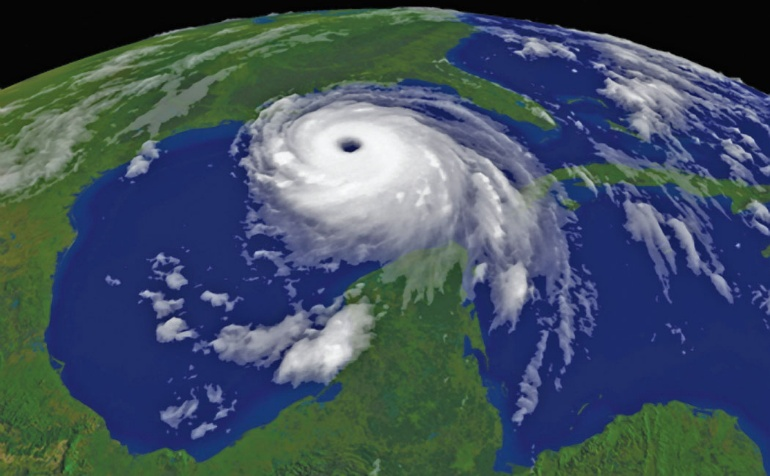
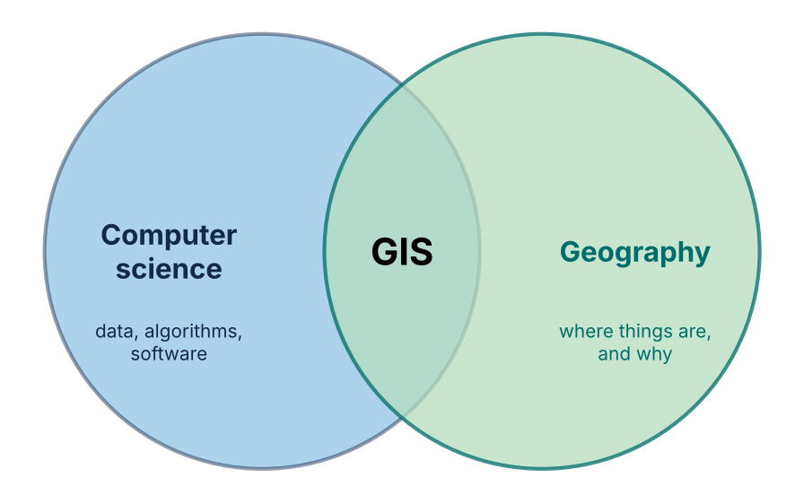
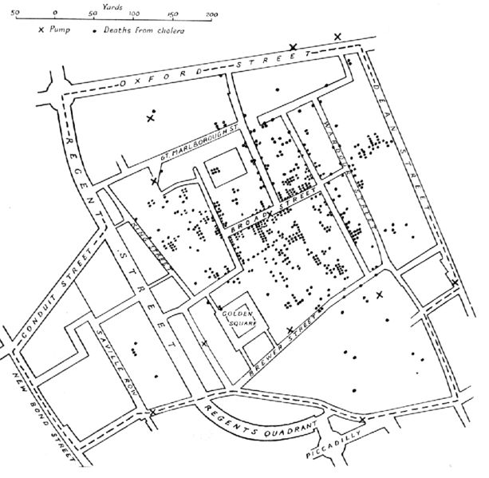
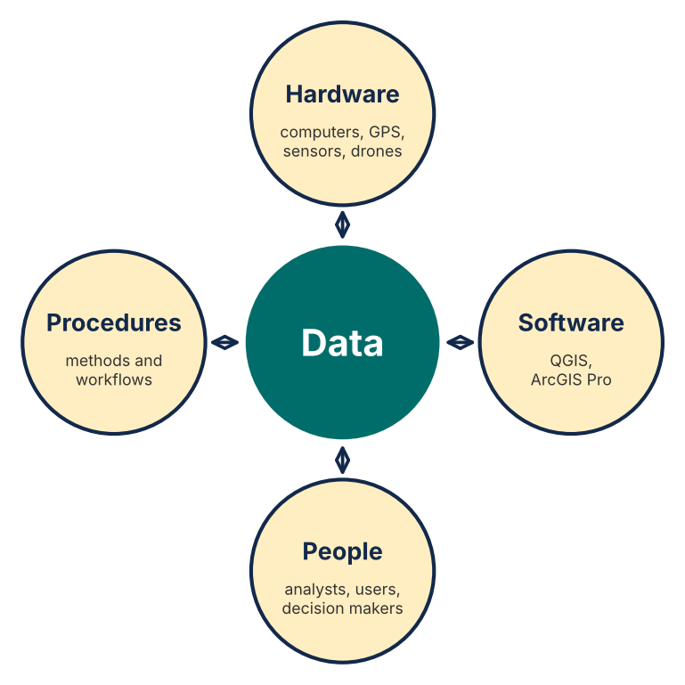

::: {.callout-note appearance="simple"}
## Learning objectives

By the end of this chapter you should be able to:

1.  Explain how maps and spatial data are used in real events, such as wildfires, earthquakes, and hurricanes.
2.  Describe a geographic problem by its scale, time, space, and purpose.
3.  Name the kinds of questions a GIS can answer, and recognize a GIS question when you see one.
4.  Define a geographic information system, and name its five components.
5.  Explain the difference between GISystems and GIScience, and why we say *geographic* rather than *spatial*.
6.  Outline the history of GIS, who uses it today, and the ethical questions it raises.
:::

Before you read on, take a moment to answer a question: *what do you think a GIS is?* Write your answer down. You may think of an app on your phone, a map on the news, or software you have heard of at work. All of those are part of the answer, but none of them is the whole answer. We will come back to your answer at the end of the chapter.

This first chapter looks at the big picture. It starts with recent events where maps and spatial data mattered, then defines what a geographic information system is, the science behind it, and the people who use it. It ends with the tools you will use in this book, and the kinds of questions you will be able to answer by the end of it.

## GIS in recent events {#sec-events}

The easiest way to see what GIS does is to watch it at work. In each of the events below, people had to make fast decisions about *where*: where the danger is, where people are, and where to send help.

### Wildfires in Los Angeles, January 2025

On January 7, 2025, two wildfires broke out in Los Angeles County and spread quickly in strong Santa Ana winds. The Palisades Fire burned through Pacific Palisades on the west side of the city, and the Eaton Fire burned through Altadena and the hills above Pasadena. Together they destroyed more than 16,000 homes and other buildings (@fig-palisades), among the most destructive fires in California's history.

.jpg), [CC BY 4.0](https://creativecommons.org/licenses/by/4.0/), cropped.](../images/what-is-gis/palisades-fire.jpg){#fig-palisades fig-alt="A street lined with tall palm trees and a streetlight with a 45 mile per hour speed limit sign. Behind them, a brush-covered hillside is on fire, with a tall orange flame in the middle and thick gray and pink smoke filling the sky." width="80%"}

Think about how maps and spatial data would be used during an event like this:

- **Fire perimeters and spread forecasts.** Firefighters map the edge of the fire several times a day, from aircraft and satellites, and models forecast where wind will push it next.
- **Evacuation zones and routes.** Emergency managers divide the area into zones and tell each one when to leave, and which roads to take.
- **Shelters and resources.** Maps show where shelters, water, fuel, and fire engines are, and how to get them where they are needed.
- **Damage assessment.** After the fire passes, satellite and aerial imagery show which buildings were damaged or destroyed.

Damage assessment is a good example of GIS at work. Smoke and cloud block ordinary cameras, but **radar** satellites send out their own microwave signal, which passes through smoke. Researchers compared images from the European Space Agency's Copernicus Sentinel-1 radar satellite taken before and after the Eaton Fire, and mapped which buildings in Altadena had changed. Each damaged building became a shape on a map, published within days by *The New York Times* and by NASA's Disasters program. Insurers, the Federal Emergency Management Agency (FEMA), utilities, residents, and rebuilding offices could all use maps like these to plan aid and recovery before crews could safely reach every street.

### An earthquake in Tibet, January 2025

On the same day, January 7, 2025, a magnitude 7.1 earthquake struck Dingri County in Shigatse, Tibet, close to the Nepal border. The shaking was felt in Nepal, Bhutan, and India, and the earthquake killed more than 120 people. In the first hours after an earthquake, rescue teams have one urgent question: *where should we search first?*

The region has been hit before. On April 25, 2015, the magnitude 7.8 Gorkha earthquake struck central Nepal, killing nearly 9,000 people and destroying or damaging hundreds of thousands of homes, temples, and historic buildings in and around Kathmandu (@fig-nepal-2015).

, Creative Commons license.](../images/what-is-gis/nepal-earthquake-2015.jpg){#fig-nepal-2015 fig-alt="Stone temple shrines under large trees. The shrine on the left still stands, with a carved stone roof. The roof of the shrine on the right has collapsed into a pile of orange bricks and gray stone slabs that spills down the steps in front of it." width="80%"}

No single map answers that. You need to combine several layers of information: where the epicenter was and how strongly the ground shook in each place, where the buildings are and how they were built, how many people live in each village, and which roads through the mountains are still open. Putting layers like these together, to find the places that meet several conditions at once, is one of the oldest and most important things a GIS does. The U.S. Geological Survey publishes a ShakeMap and an estimate of likely losses (PAGER) for large earthquakes worldwide within an hour or so, for exactly this purpose.

### Spacing pilgrims in Mecca, 2021

Not every geographic problem is a disaster. During the COVID-19 pandemic, Saudi Arabia limited the Hajj pilgrimage in 2021 to about 60,000 vaccinated residents, compared with more than two million pilgrims in a typical year. Pilgrims at the Grand Mosque in Mecca walked around the Kaaba on marked paths, spaced apart (@fig-mecca).

, Creative Commons license.](../images/what-is-gis/mecca-2021.jpg){#fig-mecca fig-alt="The open courtyard of the Grand Mosque in Mecca, paved in white marble, with the black, cube-shaped Kaaba in the middle. A few dozen pilgrims in white and black walk across the courtyard, well apart from each other, inside a ring of low white barriers. Arched colonnades surround the courtyard, and tall hotels and two minarets under construction with cranes rise behind it." width="80%"}

Planning that spacing is a spatial problem. How many people fit safely in a space? Where should the markers and paths go? How do crowds move through the entrances and exits? The same questions come up when planning a football game, a graduation, or a concert on your own campus.

### Hurricane Katrina, 2005: a problem in space and time

Hurricane Katrina made landfall on the Gulf Coast on August 29, 2005 (@fig-katrina). Its storm surge, ocean water pushed ashore by the storm, flooded the Mississippi coast and much of New Orleans, and the storm killed well over a thousand people. A satellite view of the storm in the Gulf shows *before*; a map of the flooded coast shows *after*. The same place looks completely different from one week to the next.

{#fig-katrina fig-alt="A satellite view of the Gulf of Mexico with the green land of the southern United States, Florida, and Mexico around it. A large white spiral of cloud with a clear eye in the middle fills much of the Gulf."}

The storm, the surge, and the recovery all happened in specific places at specific times. That is what makes Katrina a *geographic* problem: it has a **where** and a **when**.

## Defining a geographic problem {#sec-geographic-problem}

Four questions help describe any geographic problem. @tbl-four-questions applies them to Katrina.

| Question | What it asks | Katrina |
|:--|:--------|:--------|
| **Scale** | Does the problem look different at different levels of geographic detail? | One flooded home, one county, the whole Gulf Coast |
| **Time** | Are the consequences short-term or long-term? | Hours of storm surge; years of rebuilding |
| **Space** | Does the problem affect a small area or a large one? | Damage stretched across several states |
| **Purpose** | Are we advancing scientific knowledge, or solving a practical problem? | Better storm surge models, or faster evacuations |

: Four questions that define a geographic problem, applied to Hurricane Katrina. {#tbl-four-questions}

Scale matters because a decision made for a whole region may be wrong for a single neighborhood, and the data you need change with it: a county-level flood map can't tell a family whether their street will flood. Time matters because some problems last hours and others decades, and because the data you have describe one moment. Space matters because large problems need data from many sources that must fit together. Purpose matters because research and practice ask for different kinds of answers: a scientist wants to know *why* the surge reached so far inland, and an emergency manager wants to know *who must leave now*.

::: {.callout-tip appearance="simple"}
## Think about it

Apply the four questions to the Los Angeles fires or the Tibet earthquake. At what scales does the problem matter? How long will its consequences last? How large an area does it cover? Who would use a map of it, and for what purpose?
:::

## What questions can GIS answer? {#sec-questions}

GIS helps answer a few broad kinds of questions. One way to remember them is: *where things are, how much is there, how things change, and how to get there.*

### Where things are: the Deepwater Horizon oil spill, 2010

On April 20, 2010, the Deepwater Horizon drilling rig exploded in the Gulf of Mexico, killing 11 workers. Oil flowed from the well for 87 days, until it was capped in July, making it the largest marine oil spill in U.S. history. At its largest, oil on the surface covered tens of thousands of square miles of the Gulf.

The simplest GIS question is *where is it?* Agencies mapped the oil every day, from satellites, aircraft, and ships, and used those maps to close fishing areas in its path (at the peak, more than a third of the federal waters in the Gulf), to protect beaches and marshes, and to send cleanup crews where they were needed. Knowing where the oil was, and where currents would carry it next, drove almost every decision.

### How much: where Americans live

GIS can also show *how much* of something is in each place. A map of U.S. population density, the number of people per square mile, shows at a glance that most Americans live in a few metropolitan areas: along the East Coast from Boston to Washington, around the Great Lakes, in Florida, Texas, and California. Large parts of the interior West are nearly empty (@fig-pop-density). Maps like this are made from U.S. Census data, which you will map yourself in Unit 2.

, Creative Commons license.](../images/what-is-gis/us-county-population-density.jpg){#fig-pop-density fig-alt="A map of the United States, including Alaska and Hawaii, divided into counties and colored from white through yellow and green to dark blue. Dark blue counties, the most crowded, cluster along the East Coast from Boston to Washington, around the Great Lakes, in Florida, in Texas around Houston and Dallas, and along the California coast. Much of the interior West, the Great Plains, and Alaska is white or pale yellow, with fewer than 2 people per square kilometer."}

### How things have changed: the 2004 Indian Ocean tsunami

On December 26, 2004, a magnitude 9.1 earthquake off the coast of Sumatra, Indonesia, set off a tsunami that crossed the Indian Ocean and killed about 230,000 people in more than a dozen countries. Satellite images of the same coastline before and after the tsunami show where beaches, buildings, roads, and trees were swept away.

Comparing images or maps of one place at two times is called **change detection**. It measures what was lost, and it guides rebuilding and planning for the next disaster. The same method tracks slower changes too: forests cut or regrown, cities spreading into farmland, glaciers retreating, and coastlines eroding.

### How to get there: route optimization

Beyond mapping, GIS solves problems. **Route optimization** is one you probably use every day. When you ask your phone for the fastest route to Miami, the software treats roads as a **network** of lines and intersections, each road segment with a length and a travel time, and searches for the path with the lowest total cost. (Most routing software uses descendants of an algorithm that the computer scientist Edsger Dijkstra published in 1959.)

What did your phone need to know to answer? The road network, which roads connect where, speed limits, turn restrictions, live traffic, and your own location from GPS. The same **network analysis** plans delivery routes that visit many stops, measures how long an ambulance or fire engine takes to reach each neighborhood, and helps choose where to put a new store, clinic, or fire station, a task called **site selection**.

### Five kinds of GIS questions

A widely used list from the early GIS literature sorts the questions a GIS can answer into five kinds (@tbl-gis-questions).

| Kind | The question | Example |
|:--|:----|:--------|
| Location | *What is at* this place? | Who owns the parcel at 123 Main Street? |
| Condition | *Where is* the place that meets these conditions? | Where is there flat, forested land within 1 km of a road and not in a floodplain? |
| Trends | *What has changed* here since then? | How much forest was lost in the Blue Ridge after Hurricane Helene? |
| Patterns | *What spatial patterns* exist? | Do cancer cases cluster near a particular factory? |
| Modeling | *What if...?* | What happens to traffic if this bridge closes? Where will the fire spread? |

: Five kinds of questions a GIS can answer. {#tbl-gis-questions}

## What is GIS? {#sec-what-is-gis}

### Where geography meets computer science

So what is GIS? It sits where two fields overlap (@fig-venn). **Geography** asks where things are, and why they are there. **Computer science** gives us the data structures, algorithms, and software to store and analyze large amounts of data. GIS is the overlap: using computers to capture, store, analyze, and display geographic data.

{#fig-venn fig-alt="A Venn diagram of two overlapping circles. The left circle, in blue, is labeled Computer science: data, algorithms, software. The right circle, in green, is labeled Geography: where things are, and why. The overlap in the middle is labeled GIS." width="75%"}

### Does GIS mean...?

Ask a room of people what GIS stands for, and you'll get more than one answer:

- **Geographic Information Systems**: the tools. The software, hardware, and data for working with maps and spatial data. This is what most people mean.
- **Geographic Information Science**: the theory and methods behind the tools.
- **Guaranteed Income Source**: a joke, but with some truth in it. GIS skills are in demand in government, business, the environment, health, and planning (see @sec-who-uses).

This book covers the first two.

### What is a GISystem?

There are many definitions of a geographic information system. One of the clearest comes from Paul Bolstad's textbook, *GIS Fundamentals* [@bolstad2022]:

> "A GIS is a computer-based system to aid in the collection, maintenance, storage, analysis, output, and distribution of spatial data and information."

Two parts of the definition are worth slowing down for. First, **spatial data**: data tied to a location on Earth, such as the address of a house, the outline of a county, or the elevation at a point. Second, the six verbs, *collect, maintain, store, analyze, output,* and *distribute*. They describe the whole life of spatial data, from the moment it is measured to the moment someone uses a map of it to make a decision. You will practice each of them in this book.

Other definitions stress different things. Esri, the company that makes ArcGIS, calls GIS a system that creates, manages, analyzes, and maps all types of data, connecting data to a map. Others stress that a GIS is a way of *thinking* about problems, not just software. All of them agree on the core: data with a location, and a computer to work with it.

### Is a map a GIS? John Snow and cholera, 1854

In late August and September 1854, cholera killed more than 500 people within a few blocks of Broad Street, in the Soho district of London. Most doctors at the time believed that cholera spread through bad air, a "miasma". The physician John Snow suspected contaminated water instead.

Snow marked each death at its home address on a street map, along with the locations of the public water pumps where people got their drinking water (@fig-snow). The deaths clustered around the pump on Broad Street. Snow persuaded local officials to remove the pump's handle on September 8, and the outbreak, already waning, ended. His map, published in 1855 [@snow1855], became a classic example of spatial analysis, and Snow is remembered as one of the founders of **epidemiology**, the study of how diseases spread through populations.

{#fig-snow fig-alt="A black and white street map of a few blocks of central London, with street names such as Oxford Street, Regent Street, and Broad Street. Small black dots, each a death from cholera, are drawn in stacks along the streets, densest around the middle of Broad Street. Crosses mark the water pumps. A scale bar in yards is at the top." width="80%"}

So, is Snow's map a GIS? It has spatial data (deaths and pumps, each at a location), it has analysis (comparing the pattern of deaths with the pumps), and it led to a decision (remove the handle). But it has no computer. By Bolstad's definition, which says *computer-based*, it is not. By the spirit of the definition, it does everything a GIS does. Decide for yourself, and notice that the *thinking* behind Snow's map, combining layers of information to find a pattern, is the same thinking you will use in GIS software.

### The five components of a GIS

A geographic information system is more than software. It has five components, arranged around data (@fig-components).

{#fig-components fig-alt="A diagram with a large green circle labeled Data in the center. Four smaller tan circles surround it, each connected to it by a two-headed arrow: Hardware at the top (computers, GPS, sensors, drones), Software on the right (QGIS, ArcGIS Pro), People at the bottom (analysts, users, decision makers), and Procedures on the left (methods and workflows)." width="60%"}

- **Data** are the center of every GIS. Without good data, nothing else matters. Data include the spatial features themselves and their **attributes**, the facts we know about each one, and **metadata**, the record of who made the data, when, and how.
- **Hardware** can be as simple as pen and paper, or as complex as GPS units, drones, satellites, sensors, laptops, and servers in the cloud.
- **Software** includes programs such as QGIS and ArcGIS Pro, but also the methods and analysis the programs carry out.
- **People** are often the most important part, and the most overlooked: the analysts who build the data and maps, the users who read them, and the decision makers who act on them.
- **Procedures** are the agreed methods and workflows that make results reliable and repeatable, so that two analysts given the same data and the same question get the same answer.

### Geographic Information Science (GIScience)

**Geographic information science**, or **GIScience**, is the theory of GIS: the research behind the tools. The geographer Michael Goodchild coined the term in 1992, arguing that the hard problems of GIS were scientific questions in their own right, not just questions of software [@goodchild1992]. GIScience covers:

- **Analysis techniques**: how to measure distance, find clusters, model surfaces, and predict change.
- **Data management, storage, and entry**: how to represent the real world in a computer, and how to keep data accurate.
- **Visualization and cartography**: how maps and graphics communicate, and how they can mislead.
- **GIS and society**: ethics, privacy, equity, and who is and isn't represented in the data.

GIScience asks how we can improve GISystems, so the tools of tomorrow come from the science of today.

### GIScience or GISystems?

What is the difference, and what kinds of problems does each solve?

| | GISystems | GIScience |
|:--|:--------|:--------|
| What it is | The tools that store, analyze, and display spatial data | The questions and methods behind the tools |
| Kind of problem | Practical tasks | Research questions |
| Wildfire example | Mapping today's fire perimeter | Building a better model of where fires will spread |
| Hurricane example | Mapping evacuation routes | Improving storm surge forecasts |

: GISystems and GIScience compared. {#tbl-systems-science}

The two depend on each other. Every tool in a GISystem started as a research question in GIScience, and the practical problems people bring to GISystems raise new questions for GIScience.

### Why "geographic"?

Why do we say *geographic* information, rather than just *spatial* information?

- **Spatial** can mean any space. Computer-aided design (**CAD**) software is spatial: it measures shapes and distances in a drawing of a building or an engine part. But those drawings aren't tied to places on Earth.
- **Geographic** means locations on or near Earth's surface. Geographic data come with coordinates, which place them on a round Earth, and **map projections**, which flatten it onto a screen or a page. Handling those is a big part of what makes GIS different from other graphics software, and it is the subject of later chapters.
- **Geospatial** is often used to mean the same thing as geographic, especially in industry, the military, and government. The U.S. National Geospatial-Intelligence Agency (NGA) is one example.

## A brief history of GIS {#sec-history}

People have made maps for thousands of years, and overlaying maps to find patterns is much older than computers. But GIS as we know it began in the 1960s, when computers first became powerful enough to store maps (@tbl-history).

| When | What happened |
|:--|:--------|
| 1854 | John Snow maps cholera deaths and water pumps in London. |
| 1960s | Roger Tomlinson leads the **Canada Geographic Information System** (CGIS), built to inventory land across Canada. Tomlinson coins the term *geographic information system* and is often called the father of GIS. |
| 1965 | Howard Fisher founds the Harvard Laboratory for Computer Graphics and Spatial Analysis, whose software and graduates shape the field for decades. |
| 1969 | Jack and Laura Dangermond found Esri in Redlands, California. Landscape architect Ian McHarg's book *Design with Nature* [@mcharg1969] popularizes **overlay analysis**: stacking transparent maps of soils, slope, water, and land use to find the best places to build. |
| 1972 | The first Landsat satellite launches, beginning the longest continuous record of Earth from space. |
| 1980s | Desktop and workstation GIS software spreads, including Esri's ARC/INFO (1982) and the open-source GRASS GIS, first developed by the U.S. Army Corps of Engineers. |
| 1990 | The U.S. Census Bureau's TIGER files put every street in the country into digital form for the 1990 census. |
| 1992 | Michael Goodchild names the field of geographic information science. |
| 1995–2000 | The **Global Positioning System** (GPS) becomes fully operational, and in 2000 the U.S. turns off the deliberate error that had limited civilian accuracy. |
| 2002 | Gary Sherman begins writing Quantum GIS, now QGIS. |
| 2004–2005 | OpenStreetMap is founded, and Google launches Google Maps and Google Earth, putting interactive maps in front of hundreds of millions of people. |
| 2007 onward | Smartphones with GPS make nearly everyone a producer of location data. |
| 2015 | Esri releases ArcGIS Pro. |
| 2020s | Cloud platforms, drones, and artificial intelligence (**GeoAI**) process satellite imagery and map features at a scale no team of people could. |

: Some milestones in the history of GIS. {#tbl-history}

Two threads run through this history. One is the move from expensive mainframes run by specialists to software on every laptop and maps on every phone. The other is the explosion of data: from a few hand-digitized maps to daily satellite images of the whole planet, and billions of location records from phones and cars.

## The GIS process {#sec-process}

Using a GIS to solve a problem is a cycle that connects people, data, and the real world (@fig-gis-process).

```{mermaid}
%%| label: fig-gis-process
%%| fig-cap: "The GIS process as a cycle. Data come in from the physical world, and decisions go back out to it. Those two links are where GIS meets the real world."
flowchart LR
  W(["The physical world"]) ==> P["Define protocols"]
  P --> C["Collect and edit<br/>spatial data"]
  C --> A["Analyze"]
  A --> R["Report results"]
  R --> D["Decide and act"]
  D ==> W
```

1.  **Define protocols.** Decide what to measure, how, where, and to what accuracy. Good procedures here save trouble later.
2.  **Collect and edit spatial data.** Gather data from the field, from GPS, from imagery, or from existing sources, and clean it.
3.  **Analyze.** Use the GIS to answer the question: overlay layers, measure distances, find clusters, or model change.
4.  **Report results.** Make maps, tables, and reports that communicate what you found.
5.  **Decide and act.** People use the results to make decisions, which change the physical world, and the cycle starts again.

The two links to the physical world (the thick arrows) are where GIS connects to reality: data come *in* from the world, and decisions go back *out* to it. Everything in between is an interaction between computers, people, and data.

## Who uses GIS? {#sec-who-uses}

GIS is used in almost every sector of the economy (@tbl-sectors).

| Sector | Examples |
|:----|:------------|
| Business | Banking, insurance, logistics, media, marketing, real estate, retail, economics |
| Government and safety | Politics, government, homeland security, military, emergency management, law enforcement |
| Health, education, and culture | Health care, public health, education, research, libraries, museums, archaeology |
| Environment and resources | Agriculture, forestry, conservation, restoration, biology, mining, energy exploration |
| Infrastructure and utilities | Transportation, engineering, electricity, gas, water, wastewater, telecommunications, surveying |

: Some of the sectors that use GIS. {#tbl-sectors}

A few examples of what that work looks like: a county planner checks a proposed subdivision against floodplain maps; a public health analyst maps which neighborhoods are more than 30 minutes by bus from a clinic; an insurer prices policies by wildfire risk; a retailer chooses where to open its next store; a utility tracks every pipe and valve in its water system; a conservation group maps habitat corridors for black bears; a newsroom maps where public money was spent.

Some people work as GIS analysts, technicians, or developers, but many more use GIS as one skill among others in a job with a different title: planner, epidemiologist, ecologist, engineer, or market analyst. The U.S. Department of Labor's Geospatial Technology Competency Model describes the skills employers look for, and the GIS Certification Institute offers a professional certification, the **GISP**, for experienced practitioners.

::: {.callout-tip appearance="simple"}
## Think about it

Find your own major, or the career you hope to have, in @tbl-sectors. If it isn't there, how might location still matter in that field?
:::

## GIS and society {#sec-society}

Maps are powerful, and they can do harm as well as good. GIScience takes this seriously, and so should anyone who makes maps.

- **Privacy.** Your phone records where you go, and that data is bought and sold. A few location points are often enough to identify a person, find where they live and work, and reveal visits to a clinic, a place of worship, or a protest. Mapping individuals' data, even with names removed, can expose them.
- **Equity and representation.** Data describe some places and people better than others. Rural areas, poorer neighborhoods, and countries with fewer resources are often mapped in less detail, so they are easier to overlook in decisions. Volunteer projects such as the Humanitarian OpenStreetMap Team map buildings and roads in places that commercial maps miss.
- **Maps can be used to discriminate.** In the 1930s, the federal Home Owners' Loan Corporation drew maps grading city neighborhoods for lending risk, outlining many Black and immigrant neighborhoods in red. This practice, now called **redlining**, shaped where banks lent money for decades, and its effects can still be seen in home values, health, and tree cover in the same neighborhoods today.
- **Maps can mislead.** Choices about color, classes, scale, and what to leave out can make the same data tell very different stories. A good analyst makes those choices honestly and explains them.

Professional organizations such as the GIS Certification Institute and URISA publish codes of ethics for GIS professionals. A simple test to start with: who could be helped by this map, who could be harmed by it, and who was left off it?

## Our toolbox {#sec-toolbox}

This book uses two desktop GIS programs (@tbl-toolbox).

| | QGIS | ArcGIS Pro |
|:--|:--------|:--------|
| Made by | A volunteer community (the QGIS project, part of OSGeo) | Esri |
| Cost | Free and **open source** | Commercial; universities often provide student licenses |
| Runs on | Windows, Mac, and Linux | Windows only |
| Where you'll see it | Governments, nonprofits, universities, and anyone on a budget | Most U.S. government agencies and many companies |

: The two desktop GIS programs used in this book. {#tbl-toolbox}

Many employers use ArcGIS Pro, so it is worth knowing both. The good news is that the skills transfer: **layers**, attribute tables, coordinate systems, and geoprocessing tools work the same way in both programs, and once you know one, you can learn the other quickly. When a chapter gives step-by-step instructions, it gives them for both.

GIS doesn't stop at desktop software. You will also meet web maps (ArcGIS Online, Google Maps, OpenStreetMap), cloud platforms for satellite imagery (Google Earth Engine), and programming languages with GIS libraries (Python and R). The concepts in this book apply to all of them.

## What this book will teach you {#sec-book-objectives}

By the end of the book, you will be able to:

1.  **Use GIS software** to design, develop, and carry out a GIS for a scientific spatial research project.
2.  **Understand the concepts behind GIS**, including data models, map projections, coordinate systems, measurement, and data types.
3.  **Think critically about spatial data**: how it is collected and used, who it affects, and the ethics of working with it.

The book follows the course's three units, each ending with a project (@tbl-roadmap).

| Unit | Modules | Project |
|:----|:--------|:--------|
| 1. Data Models and Projections | Getting started with GIS; working with geographic information | Editing and querying spatial data |
| 2. Spatial Data Quality | Census data; georeferencing | Mapping Census data |
| 3. Spatial Analysis | Density analysis; measurements; weather data | Your own GIS project |

: The three units of the course. {#tbl-roadmap}

Unit 1 builds the foundation: how a GIS stores the world as data, and how coordinate systems and **data models** put that data in the right place. Unit 2 is about data quality: where data come from, how to judge whether they are good enough, and how to bring old maps and new data into a GIS. Unit 3 puts it all to work with spatial analysis, and ends with a project of your own.

## What are GIS questions? {#sec-gis-questions}

A GIS question is one where the answer depends on location. Here are five from North Carolina. The key word in each names the kind of question.

| Question | Key word | Kind of analysis |
|:--------------|:--|:--------|
| **Where** are there higher clusters of theft and burglary in Chapel Hill? | Where | Mapping and finding clusters |
| Are incomes **different** between Durham and Raleigh? | Difference | Comparing places |
| What location **factors** contribute to housing prices in Charlotte? | Factors | Explaining a pattern |
| How has forest cover **changed** in the Blue Ridge Mountains after Hurricane Helene? | Change | Comparing data over time |
| Which neighborhoods have less **accessibility** to hospitals? | Accessibility | Distance and travel time |

: Examples of GIS questions. {#tbl-nc-questions}

Good GIS questions have a few things in common. They are specific about *what* is being measured and *where*. They can be answered with data that exist, or that you can collect. And the answer would be useful to someone: a planner, a business, a public health department, or the people who live there.

::: {.callout-tip appearance="simple"}
## Thought experiment: a GIScience project in your field

What is a geographic information science project related to your own area of study or interest? GIS is used in business, computer science, environmental science, geography, law, geology, real estate, public health, the social sciences, urban planning, communications and journalism, government, transportation, and much more.

Take two minutes and write down one idea. Then answer three questions about it: What is the location question? What data would you need? Who would use the answer? Ideas like this can grow into your final project in Unit 3.

If you're stuck, here are three to start from. Public health: which neighborhoods can't reach a clinic by bus in 30 minutes? Real estate: what explains differences in housing prices between neighborhoods? Journalism: where in the state was disaster relief money spent?
:::

## Check your understanding

::: {.content-visible when-format="html"}

1.  Which question about a geographic problem asks whether it affects a small or a large area? <select class='webex-select'><option value='blank'></option><option value=''>Scale</option><option value=''>Time</option><option value='answer'>Space</option><option value=''>Purpose</option></select>

2.  Comparing satellite images of the same coast before and after a tsunami is an example of: <select class='webex-select'><option value='blank'></option><option value=''>Route optimization</option><option value='answer'>Change detection</option><option value=''>Site selection</option><option value=''>Computer-aided design</option></select>

3.  Which is **not** one of the five components of a GIS? <select class='webex-select'><option value='blank'></option><option value=''>People</option><option value=''>Procedures</option><option value=''>Hardware</option><option value='answer'>Projections</option></select>

4.  Mapping today's fire perimeter is an example of GIScience rather than a GISystem. <select class='webex-select'><option value='blank'></option><option value=''>TRUE</option><option value='answer'>FALSE</option></select>

5.  John Snow's 1854 map showed cholera deaths clustered around a public water ___ on Broad Street. <input class='webex-solveme nospaces ignorecase' size='6' data-answer='["pump"]'/>

6.  Software that measures shapes in a drawing of an engine part, but doesn't tie them to places on Earth, is called: <select class='webex-select'><option value='blank'></option><option value=''>GIS</option><option value='answer'>CAD</option><option value=''>GPS</option><option value=''>GeoAI</option></select>

7.  "Which neighborhoods have less access to hospitals?" is which kind of GIS question? <select class='webex-select'><option value='blank'></option><option value=''>Change</option><option value=''>Difference</option><option value='answer'>Accessibility</option><option value=''>Factors</option></select>

8.  QGIS runs on Windows, Mac, and Linux. <select class='webex-select'><option value='blank'></option><option value='answer'>TRUE</option><option value=''>FALSE</option></select>

<div class='webex-solution'><button>Show hint for question 4</button>

GISystems are the tools used for practical tasks, like mapping where a fire is today. GIScience is the research behind the tools, like building a better model of where the fire will spread.

</div>

:::

::: {.content-visible unless-format="html"}
The interactive self-check questions for this chapter are in the online version of the book.
:::

## Summary

- Maps and spatial data guide decisions in real events, such as wildfires, earthquakes, hurricanes, and crowd planning: where the danger is, where people are, and where to send help.
- A **geographic problem** can be described by its **scale**, **time**, **space**, and **purpose**.
- GIS answers questions about **where things are**, **how much** is in each place, **how things change**, and **how to get there**, and more generally about location, condition, trends, patterns, and "what if" models.
- A **geographic information system** is "a computer-based system to aid in the collection, maintenance, storage, analysis, output, and distribution of spatial data and information." It has five components: **data**, **hardware**, **software**, **people**, and **procedures**.
- **GIScience** is the theory and methods behind the tools. GISystems solve practical problems; GIScience asks research questions and improves the tools.
- *Geographic* means tied to places on or near Earth's surface, unlike other *spatial* data such as CAD drawings. *Geospatial* is a common synonym.
- GIS grew from the Canada Geographic Information System and university labs in the 1960s to free software, GPS, and maps on every phone today.
- GIS is used in almost every sector, and maps can harm as well as help: think about privacy, equity, and honesty whenever you make one.
- This book uses **QGIS** and **ArcGIS Pro**. Their concepts and skills transfer to each other and to other GIS tools.

Now look back at the answer you wrote down at the start of the chapter: *what do you think a GIS is?* Has your answer changed?

## Exercises

1.  **GIS in the news.** Find a news story from the past year in which a map or spatial data played a role. What was the geographic question? Describe the problem using the four questions in @tbl-four-questions.
2.  **Layers for a decision.** An earthquake strikes a mountain region. List five layers of data you would want in order to decide where rescuers should search first, and say where you might find each one.
3.  **Is it a GIS?** Is a paper road atlas a GIS? A weather app on your phone? A spreadsheet of customer addresses? Use Bolstad's definition and the five components to argue each case.
4.  **The five kinds of questions.** Write one question of each kind in @tbl-gis-questions (location, condition, trends, patterns, modeling) about your hometown or campus.
5.  **Systems or science?** For a topic you care about, give one example of a GISystem task and one example of a GIScience research question.
6.  **Ethics.** Your phone's location history for the past month is put on a map. What could someone learn about you from it? Who should be allowed to see it?
7.  **Your project.** Write your idea from the thought experiment as one clear GIS question. Underline its key word (where, different, factors, change, accessibility, or another), list the data you would need, and say who would use the answer.

## Further reading and online resources

### Books and open textbooks

- *GIS Fundamentals: A First Text on Geographic Information Systems*, by Paul Bolstad [@bolstad2022]. A thorough introduction to the whole field, and the source of this chapter's definition of a GIS.
- *Understanding GIS through Sustainable Development Goals*, by Paul Holloway [@holloway2023]. Chapter 1, "Introduction and Context," introduces GIS through the United Nations' Sustainable Development Goals.
- *Essentials of Geographic Information Systems*, by Jonathan Campbell and Michael Shin. A free, open textbook: <https://open.umn.edu/opentextbooks/textbooks/67>, also on LibreTexts at <https://geo.libretexts.org/Bookshelves/Geography_(Physical)/Essentials_of_Geographic_Information_Systems_(Campbell_and_Shin)>.
- *Intro to GIS and Spatial Analysis*, by Manuel Gimond. Free online notes that explain GIS concepts clearly: <https://mgimond.github.io/Spatial/>.
- *The Nature of Geographic Information*, by David DiBiase and colleagues at Penn State. A free online text on how geographic data are made and used: <https://www.e-education.psu.edu/natureofgeoinfo/>.
- *Learning to Think Spatially*, by the National Research Council [@nrc2006]. Why spatial thinking matters, and how GIS supports it. Free to read at <https://nap.nationalacademies.org/catalog/11019>.
- *Design with Nature*, by Ian McHarg [@mcharg1969]. The classic book on overlay analysis for planning.
- *The Ghost Map*, by Steven Johnson (2006). A readable history of John Snow and the 1854 Broad Street cholera outbreak.

### What is GIS? Introductions and overviews

- Esri, "What is GIS?": <https://www.esri.com/en-us/what-is-gis/overview>, and "The history of GIS": <https://www.esri.com/en-us/what-is-gis/history-of-gis>.
- National Geographic Education, "GIS (Geographic Information System)": <https://education.nationalgeographic.org/resource/geographic-information-system-gis/>.
- U.S. Geological Survey, "What is a geographic information system (GIS)?": <https://www.usgs.gov/faqs/what-geographic-information-system-gis>.
- QGIS, *A Gentle Introduction to GIS*: <https://docs.qgis.org/latest/en/docs/gentle_gis_introduction/>.
- The **GIS&T Body of Knowledge**, from the University Consortium for Geographic Information Science (UCGIS): short, peer-reviewed articles on hundreds of GIS topics, written for students. <https://gistbok.ucgis.org>.
- Michael Goodchild's paper that named the field, "Geographical information science" [@goodchild1992].

### Videos

- *Geospatial Revolution*, a video series from Penn State Public Media (WPSU) on how digital mapping changes the way we live, including the episode *Mapping the Pandemic*: <https://www.geospatialrevolution.psu.edu/> and <https://wpsu.psu.edu/digital/geospatial-revolution>.

### Software and tutorials

- QGIS, free and open source: <https://qgis.org>. Install the Long Term Release. The *QGIS Training Manual* is at <https://docs.qgis.org/latest/en/docs/training_manual/>.
- ArcGIS Pro: get started at <https://pro.arcgis.com/en/pro-app/latest/get-started/get-started.htm>. Free, guided lessons are at Learn ArcGIS, <https://learn.arcgis.com>.
- OSGeo, the Open Source Geospatial Foundation, home of QGIS, GRASS GIS, and other open-source GIS projects: <https://www.osgeo.org>.
- Google Earth Engine, for analyzing satellite imagery in the cloud: <https://earthengine.google.com>.
- geojson.io, a simple website for drawing features on a map and seeing the data behind them: <https://geojson.io>.

### The events in this chapter

- NASA Disasters program, maps and data for the January 2025 Southern California wildfires, including Sentinel-1 damage maps: <https://disasters.nasa.gov/what-we-do/disasters/disasters-activations/southern-california-wildfires-jan-2025>.
- U.S. Geological Survey Earthquake Hazards Program, with ShakeMaps and PAGER loss estimates for earthquakes worldwide: <https://earthquake.usgs.gov>.
- Copernicus Emergency Management Service, rapid maps of disasters around the world: <https://emergency.copernicus.eu>.
- NOAA Office of Response and Restoration, on the Deepwater Horizon oil spill: <https://response.restoration.noaa.gov>.
- National Hurricane Center, tropical cyclone reports, including Hurricane Katrina: <https://www.nhc.noaa.gov>.
- UCLA Department of Epidemiology, "John Snow": a large collection of material on Snow and his maps, <https://www.ph.ucla.edu/epi/snow.html>.

### Where to find geographic data

- NC OneMap, North Carolina's geospatial data portal: <https://www.nconemap.gov>.
- U.S. Census Bureau, TIGER/Line shapefiles and other mapping files: <https://www.census.gov/geographies/mapping-files.html>.
- USGS EarthExplorer, for Landsat and other satellite imagery: <https://earthexplorer.usgs.gov>.
- NASA Earthdata: <https://www.earthdata.nasa.gov>.
- FEMA Flood Map Service Center: <https://msc.fema.gov>.
- Natural Earth, free world map data at small scales: <https://www.naturalearthdata.com>.
- OpenStreetMap, the free, editable map of the world: <https://www.openstreetmap.org>.

### GIS and society

- *Mapping Inequality: Redlining in New Deal America*, from the University of Richmond's Digital Scholarship Lab: <https://dsl.richmond.edu/panorama/redlining/>.
- Humanitarian OpenStreetMap Team, which maps places in need for disaster response and development: <https://www.hotosm.org>. Anyone can volunteer to map.
- GIS Certification Institute, Code of Ethics: <https://www.gisci.org/Portals/0/Ethics/CodeOfEthics_PR.pdf>.

### Careers and professional organizations

- U.S. Bureau of Labor Statistics, *Occupational Outlook Handbook*, "Cartographers and Photogrammetrists": <https://www.bls.gov/ooh/architecture-and-engineering/cartographers-and-photogrammetrists.htm>.
- GIS Certification Institute, which awards the GISP: <https://www.gisci.org>.
- URISA, a professional association for GIS in government and planning: <https://www.urisa.org>.
- American Association of Geographers: <https://www.aag.org>.
- University Consortium for Geographic Information Science (UCGIS): <https://www.ucgis.org>.
- GIS Day, held every November, with events on campuses around the world: <https://www.gisday.com>.
