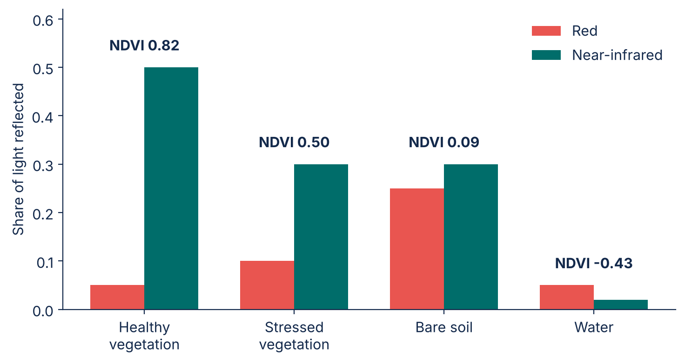
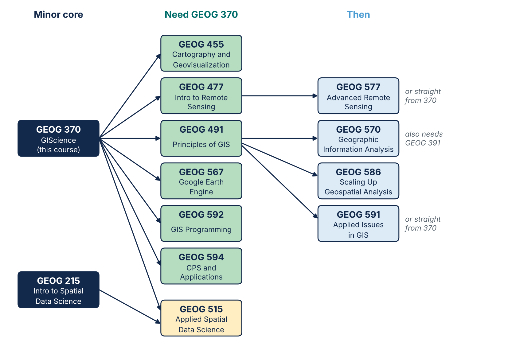

::: {.callout-note appearance="simple"}
## Learning objectives

By the end of this chapter you should be able to:

1.  Name applications of GIS in public health, the environment, local government, and humanitarian work, and the methods from this book that each one uses.
2.  Describe advanced GIS topics: remote sensing, spatial statistics, big data and the cloud, GeoAI, web and 3D GIS, programming, and critical GIS.
3.  Find and read GIS research, and name ways to get involved in research at UNC.
4.  Plan your next GIS courses at UNC, and the GIS minor or the Geospatial Data Science major.
5.  Name UNC clubs, events, and campus resources for GIS, North Carolina GIS conferences such as the NC GIS Conference and NCAUG, and ways to start building a portfolio.
:::

This chapter looks forward instead of teaching a new method. Look at what you can already do:

- **Model the world as data:** vector and raster models, coordinate systems, datums, and map projections (Chapters 1–4).
- **Query and combine it:** attribute queries, table joins, and spatial joins (Chapters 5–7).
- **Judge its quality:** census data and its margins of error, federal data sets, geocoding and georeferencing, and volunteered data from OpenStreetMap (Chapters 8–11).
- **Analyze and map it:** data classing, density, buffers and overlay, map algebra, terrain analysis with elevation models, interpolation, and kriging (Chapters 12–18).
- **Answer real questions with it, honestly:** suitability modeling, risk analysis, and uncertainty (Chapters 19–21).
- **Do all of it in real software:** QGIS and ArcGIS Pro (Chapters 22 and 23).

That is the core of geographic information science. This chapter shows where it is used, previews advanced topics that build on it, points you to the research behind them, and maps out what to take and join next at UNC. As you read, notice which topic excites you most. That is a good clue to which course to take next.

## GIS in action {#sec-gis-in-action}

Almost any question that involves "where" is a GIS question. The questions change by field, but the methods are shared. For each example below, notice which methods from this book show up.

### Public health

**Spatial epidemiology** studies how health varies across places. Its origin story is John Snow's 1854 map of cholera deaths in London [@snow1855], which you met in Chapter 1. Today analysts geocode cases (Chapter 10), join them to census tracts (Chapters 7 and 8), and map rates with careful classing (Chapter 12) and density surfaces (Chapter 13). **Accessibility** studies buffer clinics and pharmacies, or measure travel time along road networks, to find who lives too far from care.

### Environment and hazards

GIS is central to every stage of a disaster: flood maps, evacuation routes, and shelter locations before a storm, and damage mapping from aerial and satellite imagery after it. When Hurricane Helene flooded western North Carolina in 2024, imagery and GIS were used to map flooding, landslides, and closed roads. The key question, *who is exposed?*, is an overlay of hazard zones with census data (Chapters 7, 8, and 14), and risk indices combine hazard with social vulnerability (Chapter 20). Elevation rasters and map algebra (Chapter 15) model where water flows, and interpolation and kriging (Chapters 17 and 18) turn rain gauges and air quality monitors into continuous surfaces.

### Local government {#sec-local-government}

Cities and counties are among the biggest users of GIS, and nearly every county in North Carolina has GIS staff. Local governments keep the authoritative data that the rest of us rely on, and use it every day to run services:

- **Land records and property tax.** The county GIS or land records office maintains the official parcel map. In Orange County, for example, every parcel has a Property Identification Number (PIN) that links it to its deed, survey plats, and tax record, and anyone can search parcels on the county's public web map. Tax assessors use those parcels, with attribute joins (Chapter 6), to value property.
- **Addressing and 911.** When someone calls 911, the call is routed and the caller located using address and street data kept in GIS. Orange County keeps a single GIS database of more than 85,000 addresses and 4,600 streets, coordinated with Chapel Hill, Carrboro, Hillsborough, Mebane, and Durham, and, where the county is the addressing authority, assigns a new address when a building permit is requested. These data are kept up to the standard for Next Generation 911 and shared with the state's AddressNC program and NC OneMap. This is the reference data behind the geocoding in Chapter 10.
- **Planning, zoning, and permits.** Planners map zoning districts, review development proposals against them, and track building permits by parcel. Choosing where to put a new school, park, or fire station is a classic **site selection** problem: reclassify and weight several layers, then overlay them to find the best places (Chapters 14 and 15).
- **Public works and utilities.** Water and sewer lines, stormwater pipes, streetlights, and signs are mapped as features with attributes such as size, material, and install date, so crews can find them, plan repairs, and track work orders.
- **Emergency management and public health.** Counties map shelters, evacuation zones, and flood risk. During Hurricane Helene, damaged 911 centers in western North Carolina had their calls rerouted to working centers elsewhere. Health departments map cases and services; Forsyth County, for example, has mapped overdoses to target its response.
- **Open data and public apps.** Many cities and counties publish their layers on open data portals and in web apps, such as maps of trash pickup days, polling places, road closures, and park amenities. Look up the GIS page of your home county or city to see what it shares.

Local government GIS work is a common first job for GIS graduates, and a good place for internships. Many local governments also celebrate GIS Day each November; the City of Raleigh, for example, holds a free GIS Day event to show residents how state and local governments use GIS.

### Humanitarian and social justice work

After the 2010 Haiti earthquake and the 2015 Nepal earthquake, volunteers around the world traced roads and buildings in OpenStreetMap from satellite imagery, and responders used those maps on the ground [@zook2010; @parr2015]. Chapter 11 showed how to judge the quality of those data.

Historians and social scientists also use GIS to study inequality. The Mapping Inequality project digitized the 1930s **redlining** maps of American cities, including Durham, Greensboro, and other North Carolina cities. Researchers georeference those maps (Chapter 10) and overlay them with today's data on health, heat, and wealth.

::: {.callout-tip appearance="simple"}
## Think about it

Pick the example in this section that interests you most. Which chapters of this book would you need for a first project on it? What data would you need, and who publishes them?
:::

## Advanced topics in GIS {#sec-advanced}

The rest of this section previews areas that build directly on this book. Each one is a full course or career on its own, so the goal is vocabulary and a sense of what is possible, not mastery.

### Remote sensing and Earth observation

**Remote sensing** collects information about Earth from a distance, and it produces most of the raster data in the world. Sensors come in two kinds:

- **Passive sensors** record reflected sunlight or emitted heat, like a camera.
- **Active sensors** send their own signal and measure what comes back. **Radar** sees through clouds and at night, and **lidar** times laser pulses to measure elevation and tree height, often to within centimeters.

Different surfaces reflect different wavelengths of light, so each has a **spectral signature**. Healthy plants absorb red light, because chlorophyll uses it, and strongly reflect near-infrared (NIR) light. The **normalized difference vegetation index** (**NDVI**) turns that contrast into one number for each cell:

$$
\text{NDVI} = \frac{\text{NIR} - \text{Red}}{\text{NIR} + \text{Red}}
$$

NDVI ranges from −1 to 1, and dense green vegetation is high (@fig-ndvi). It is map algebra, from Chapter 15, applied to two bands of an image.

{#fig-ndvi fig-alt="A bar chart with a red bar and a near-infrared bar for each of four surfaces. Healthy vegetation reflects 0.05 red and 0.50 near-infrared, giving NDVI 0.82. Stressed vegetation reflects 0.10 and 0.30, NDVI 0.50. Bare soil reflects 0.25 and 0.30, NDVI 0.09. Water reflects 0.05 and 0.02, NDVI -0.43."}

Classification then assigns each cell a land cover class, and **change detection** compares images of the same place from different dates. Hansen and colleagues used more than 650,000 Landsat scenes to map forest loss across the whole planet at 30-meter resolution [@hansen2013], work that ran on Google Earth Engine, a cloud platform for analyzing petabytes of imagery without downloading it [@gorelick2017].

::: {.callout-note .did-you-know appearance="simple" icon=false}
## Did you know..?

North Carolina was one of the first states to map its entire land area with lidar, after Hurricane Floyd's floods in 1999 showed how out of date its floodplain maps were. Statewide lidar now underlies the state's flood maps, and you can download it free from NC OneMap.
:::

### Spatial statistics beyond the basics

Chapters 13 and 18 introduced spatial autocorrelation and the semivariogram. Spatial statistics goes much further:

- **Geographically weighted regression** (**GWR**) fits a separate regression at each location, weighting nearby observations more, so you can map how a relationship changes across space [@brunsdon1996]. For example, the link between income and asthma might be strong in one county and weak in the next.
- **Hot spot analysis** (Getis-Ord Gi\*) and local Moran's I test whether a cluster of high or low values is bigger than chance would produce.
- **Space-time analysis** extends Tobler's first law to time: nearby moments are related, just as nearby places are. A **space-time cube** stacks a map for every time step, and methods such as emerging hot spot analysis find places where clusters are new, growing, or fading.

Advanced work also takes the choice of units seriously. Chapter 12 showed how the class breaks you choose change a map; the zones you aggregate data into change the results of an analysis too. Mei-Po Kwan's **uncertain geographic context problem** goes further: the neighborhood that actually affects a person depends on where they spend their day, not only where they live, so a census tract may be the wrong unit [@kwan2012].

### Big data, the cloud, and CyberGIS

Datasets are growing faster than laptops. Planet-wide imagery, billions of phone locations, and streams of sensor readings don't fit on one computer, so analysis is moving to the cloud, where the data sit next to the computing. Miller and Goodchild call this shift **data-driven geography** [@miller2015]. Useful terms:

- **Cloud platforms:** Google Earth Engine, Microsoft Planetary Computer, and Amazon's open data registry.
- **Spatial databases:** PostGIS, from Chapter 6, adds spatial queries to SQL, so a spatial join can run on millions of rows on a server.
- **Cloud-ready formats:** Cloud Optimized GeoTIFF and GeoParquet let a program read only the piece of a file it needs.
- **CyberGIS:** GIS built on high-performance and cloud computing, so an analysis can be split across many processors [@wang2010].

### GeoAI

**GeoAI** is artificial intelligence applied to spatial data, and it is one of the fastest-growing parts of the field [@janowicz2020].

- **Deep learning reads imagery at scale.** Models trained to recognize objects have extracted building footprints for whole countries, and now map roads, solar panels, crops, and flood extent automatically. Microsoft's global building footprints were made this way, and OpenStreetMap mappers can add them with the Rapid editor.
- **Machine learning predicts.** Methods such as random forests estimate air quality, poverty, or crop yield in places with no measurements, a cousin of the interpolation in Chapter 17.
- **Foundation models** are large models pretrained on huge image archives that can be adapted to new tasks with little labeled data. NASA and IBM's open Prithvi model, trained on Landsat and Sentinel-2 imagery, is an example.

Spatial thinking keeps AI honest. Most machine learning assumes observations are independent, and spatial data are not. If you test a model on points chosen at random, its test points sit right next to its training points, and it looks far more accurate than it is. **Spatial cross-validation** holds out whole regions instead, like the cross-validation in Chapters 17 and 18 but with blocks of space. Ploton and colleagues found that large forest-mapping models that looked accurate under random testing had little predictive power when tested this way [@ploton2020].

### Web GIS, interactive maps, and 3D

More and more maps are made to be used, not just looked at. **Web GIS** puts maps, data, and analysis in a browser: ArcGIS Online dashboards and StoryMaps, QGIS Cloud, and open-source libraries such as Leaflet and MapLibre. Designing an interactive map well is its own research field [@roth2013], and GEOG 455 covers it.

GIS is also going 3D. Lidar point clouds, 3D building models, and scene layers in ArcGIS Pro let you measure building heights, shade, and views. A **digital twin** is a detailed, constantly updated 3D model of a city or facility, linked to live sensor data, so planners can test a change before they make it [@batty2018].

### GIS programming and automation

Every tool you ran by clicking in Chapters 22 and 23 can also be run from code. Automating a workflow makes it faster, repeatable, and shareable:

- **Python** is the main scripting language of desktop GIS: ArcPy in ArcGIS Pro, PyQGIS in QGIS, and the open-source GeoPandas, Rasterio, and Shapely libraries.
- **R**, with the sf and terra packages, is popular for spatial statistics and is taught in GEOG 215 and GEOG 515.
- **ModelBuilder** and the QGIS Model Designer chain tools into a diagram without writing code, a good first step toward automation.

Employers increasingly ask for GIS skills *and* some programming, so a course such as GEOG 592 GIS Programming pays off.

### Critical GIS and ethics

GIS is powerful, so it raises hard questions. In the 1990s, geographers debated whether GIS favored governments and corporations over communities, and who gets represented on a map at all. That debate grew into **critical GIS**, which studies the social effects of mapping technology and how to use it more fairly [@schuurman2000]. Some questions it asks:

- **Privacy.** A few location points can be enough to identify a person, which is why the Census Bureau uses differential privacy (Chapter 8) and why Chapter 10 warned against posting geocoded health records as points.
- **Representation.** Who maps OpenStreetMap, and which places are left blank (Chapter 11)?
- **Bias.** Training data for AI often come from wealthy, well-mapped places, so models do worst where better data are needed most.
- **Participation.** Participatory GIS puts mapping tools in the hands of communities, so they can map their own knowledge and concerns.

::: {.callout-tip appearance="simple"}
## Think about it

A model predicts poverty from satellite images of North Carolina's census tracts. It is trained on a random 80% of tracts and scores 95% accuracy on the other 20%. Why might it do much worse in South Carolina? How would you test it more honestly?
:::

## Reading and doing GIS research {#sec-research}

Every method in this book started as research, and GIScience is still an active research field. Michael Goodchild named it in 1992, arguing that GIS raises scientific questions of its own, about how to represent, analyze, and communicate geographic information [@goodchild1992].

### Where to find GIS research

Research papers can be hard reading at first, but the abstract, introduction, and figures usually tell you most of what you need. Good places to start:

- **Journals.** The *International Journal of Geographical Information Science*, *Transactions in GIS*, *Cartography and Geographic Information Science*, *Computers, Environment and Urban Systems*, *Annals of the American Association of Geographers*, and *Remote Sensing of Environment*. Every paper cited in this chapter came from journals like these.
- **The GIS&T Body of Knowledge**, from UCGIS, has short, peer-reviewed entries on hundreds of GIS topics, written for students.
- **Google Scholar and UNC Libraries.** Search Google Scholar, and use the UNC Libraries website or connect Google Scholar to UNC's subscriptions, so you can read paywalled papers for free as a UNC student.

When you find a useful paper, look at what it cites and who has cited it since. That trail leads to the rest of the research on a topic.

### Research at UNC

Undergraduates can do real research at UNC:

- **Work with faculty.** Many Geography and Environment faculty use GIS and remote sensing in their research. Read their profiles on the department website, and email one whose work interests you to ask about research opportunities.
- **The Office for Undergraduate Research** (OUR) funds Summer Undergraduate Research Fellowships (**SURF**) for students to do a summer research project with a faculty mentor.
- **The Celebration of Undergraduate Research**, run by OUR at the end of every spring semester, is a poster session where hundreds of undergraduates present their research. Geography students regularly present GIS projects there.
- **A senior honors thesis** in Geography (GEOG 691H and 692H) is a two-semester research project, and many use GIS.
- **Research centers.** The Carolina Population Center's Spatial Analysis Services supports research in spatial analysis, remote sensing, cartography, GPS data collection, and web mapping, and many UNC research projects on health and population use GIS.

## Keep learning at UNC {#sec-unc}

Course titles and requirements in this section come from the 2026–27 UNC catalog. Always check the catalog and ConnectCarolina for when each course is offered, and meet with a Geography advisor before you plan.

### A path through UNC GIS courses

GEOG 370, this course, is the gateway to most upper-level GIS courses at UNC (@fig-course-path). It is one of the two core courses of the GIS minor, with GEOG 215 Introduction to Spatial Data Science, which teaches spatial analysis in R. GEOG 515 Applied Spatial Data Science needs both.

{#fig-course-path fig-alt="A flow diagram. GEOG 370, this course, has arrows to GEOG 455 Cartography and Geovisualization, GEOG 477 Intro to Remote Sensing, GEOG 491 Principles of GIS, GEOG 567 Google Earth Engine, GEOG 592 GIS Programming, GEOG 594 GPS and Applications, and GEOG 515 Applied Spatial Data Science. GEOG 215 also has an arrow to GEOG 515. GEOG 477 leads to GEOG 577 Advanced Remote Sensing, which can also follow GEOG 370 directly. GEOG 491 leads to GEOG 570 Geographic Information Analysis, which also needs GEOG 391; GEOG 586 Scaling Up Geospatial Analysis; and GEOG 591 Applied Issues in GIS, which can also follow GEOG 370 directly."}

### Geography courses by interest

| If you liked… | Take |
|:--------------|:-----|
| Analysis in ArcGIS Pro and QGIS (Chapters 14–20) | GEOG 491 Principles of Geographic Information Systems; GEOG 591 Applied Issues in GIS |
| Map design and data classing (Chapter 12) | GEOG 455 Cartography and Geovisualization; GEOG 456 Geovisualizing Change; GEOG 555 Cartography of the Global South |
| Rasters and imagery (Chapters 2 and 15) | GEOG 477 Introduction to Remote Sensing of the Environment; GEOG 577 Advanced Remote Sensing; GEOG 567 Geospatial Data Analysis with Google Earth Engine |
| Interpolation, kriging, and statistics (Chapters 17–18) | GEOG 391 Quantitative Methods in Geography; GEOG 570 Geographic Information Analysis; GEOG 515 Applied Spatial Data Science |
| Coordinates and data collection (Chapters 3 and 10) | GEOG 594 Global Positioning Systems and Applications |
| Automating your work | GEOG 592 Geographic Information Science Programming; GEOG 586 Scaling Up Geospatial Analysis |
| Health and census data (Chapter 8) | GEOG 541 GIS in Public Health; GEOG 544 GIS for Impact Evaluation and Health Studies |

: Geography Department GIS courses by interest. {#tbl-geog-courses}

### GIS courses beyond Geography

GIS is taught across campus. Some of these count toward the GIS minor; check its list in the catalog.

- **Anthropology:** ANTH 419 Anthropological Application of GIS.
- **Environment, Ecology, and Energy:** ENEC 468 Temporal GIS and Space/Time Geostatistics for the Environment and Public Health; ENEC 479 Landscape Analysis.
- **Earth, Marine, and Environmental Sciences:** EMES 483 GIS and Remote Sensing for Earth and Ocean Sciences.
- **City and Regional Planning:** GEOG/PLAN 491 is cross-listed, and graduate planning courses use GIS heavily.

### Turn your interest into a credential

- **Geographic Information Sciences minor (15 credit hours).** The core is GEOG 215 and GEOG 370, plus three GIS electives such as GEOG 477, 491, 541, 577, 591, 592, or 594. It is open to all undergraduates and pairs well with any major. With GEOG 370 done, you are already partway there.
- **Geospatial Data Science B.S.** A full major. Its core includes GEOG 215, 370, 391, 392, 455, 477, 491, and 515, plus math and data science courses, applied GIS electives, and a capstone seminar or honors thesis.
- **Graduate Certificate in Geographic Information Science,** for graduate students.

## Get involved at UNC {#sec-get-involved}

Some of the best GIS learning happens outside class.

- **Carolina Geography and Environment Club.** The Department of Geography and Environment's student club, open to anyone interested in geography. Ask the department or your instructor how to find the next meeting.
- **UNC GIS Day.** GIS Day is celebrated around the world each November, and UNC's celebration, organized by the Department of Geography and Environment with UNC Libraries, has included a campus-wide **map competition** with prizes for students from any department, and humanitarian **mapathons**. Entering a map you made in this course is a great first portfolio piece.
- **Mapathons.** At a mapathon, volunteers trace buildings and roads in OpenStreetMap for a humanitarian project, using the editing skills from Chapters 11 and 22. You can also join a project on your own any time through the Humanitarian OpenStreetMap Team's Tasking Manager.
- **UNC Libraries.** The GIS librarian and Digital Research Services in Davis Library help with finding data, choosing software, and project questions, and you can book a consultation. UNC Libraries also offers free workshops, such as "Working with Spatial Data in R," and has course guides for GIS classes.
- **Odum Institute.** The Odum Institute for Research in Social Science offers short courses on research methods, including GIS workshops.
- **Office for Undergraduate Research.** See @sec-research for SURF and the Celebration of Undergraduate Research.

### GIS conferences in North Carolina

Conferences are where GIS professionals share their work, learn new tools, and hire. Students are welcome, and going to one is a great way to see what GIS jobs look like and to meet people who do them.

- **The North Carolina GIS Conference** has been held every two years since 1987, most recently in March 2025 in Winston-Salem, with about 600 attendees and more than 120 sessions. It calls itself the largest state GIS conference in the nation. It is organized by the NC Center for Geographic Information and Analysis with state and local government GIS professionals, and co-sponsored by Carolina URISA. Students can enter papers for the G. Herbert Stout student awards; local government GIS projects compete for the Stout awards too, and Chapel Hill was a 2025 winner. The next conference is in 2027.
- **NCAUG, the North Carolina ArcGIS Users Group,** is a statewide community of people who use Esri software, many of them in local government. It holds an annual conference each fall, with talks, hands-on pre-conference workshops (at reduced student rates), vendors, and networking; it has met in Wilmington, with Esri's founder, Jack Dangermond, as keynote speaker. Workshop proceeds support NCAUG's scholarship fund for GIS students.
- **Carolina URISA,** the regional chapter of the Urban and Regional Information Systems Association, focuses on GIS in government and holds meetings and workshops for GIS professionals in the Carolinas.
- **National conferences** include the Esri User Conference in San Diego each July, the American Association of Geographers annual meeting, and the NACIS conference for cartographers, which offers student travel grants. Most have reduced student rates.

::: {.callout-tip appearance="simple"}
## Think about it

Which of these could you do this semester? Choose one, find its next date, and put it on your calendar.
:::

## Careers and your portfolio {#sec-careers}

Spatial skills make you more employable in many fields. Job titles vary, so search broadly: **GIS analyst or technician** is the most common entry point, and others include remote sensing analyst, cartographer, geospatial developer, and geospatial data scientist. Many of you will use GIS as a core skill in another job: planner, epidemiologist, environmental consultant, or emergency manager.

In North Carolina, GIS professionals work for nearly every city and county, state agencies such as NCDOT and the NC Center for Geographic Information and Analysis (which runs NC OneMap), federal agencies such as the EPA in Research Triangle Park, research organizations, engineering and environmental consulting firms, and software companies.

### Skills employers look for

| Technical skills | Professional skills |
|:-----------------|:--------------------|
| ArcGIS Pro and QGIS | Clear maps and visual communication |
| Data quality and metadata | Writing for non-technical audiences |
| SQL and spatial databases | Asking good spatial questions |
| Python or R | Data ethics and privacy |
| Remote sensing and cloud tools | Teamwork and project management |

: Skills that GIS job postings commonly ask for. {#tbl-skills}

You already have the first two rows of the technical column from this course. Don't underestimate the second column: employers consistently say they need people who can make a clear map, explain it to a non-specialist, and think carefully about ethics.

### Start building your portfolio now

Two or three polished projects matter more than a list of courses.

- Put your best maps on a personal website or in an online portfolio, each with a short description of the question, data, and methods. Your course projects, cleaned up, are a strong start.
- Enter the UNC GIS Day map competition, and present at the Celebration of Undergraduate Research.
- Contribute to OpenStreetMap or a humanitarian mapping project.
- Look for internships with city, county, and state GIS offices, research centers, and consulting firms.
- Go to a conference, such as the NC GIS Conference or NCAUG's fall conference, and join a professional community, such as Carolina URISA, NACIS for cartographers, or the American Association of Geographers. Most have student rates, and many offer student awards, scholarships, or travel grants.
- Later in your career, consider the **GISP** certification and Esri's technical certifications.

## Check your understanding

::: {.content-visible when-format="html"}

1.  NDVI is high for healthy vegetation because plants: <select class='webex-select'><option value='blank'></option><option value=''>Reflect red light strongly and absorb near-infrared light</option><option value='answer'>Absorb red light and reflect near-infrared light strongly</option><option value=''>Absorb all visible light</option><option value=''>Emit their own infrared light</option></select>

2.  Which kind of sensor measures elevation and tree height with laser pulses? <select class='webex-select'><option value='blank'></option><option value=''>A multispectral camera</option><option value=''>A thermal sensor</option><option value='answer'>Lidar</option><option value=''>A GPS receiver</option></select>

3.  Geographically weighted regression lets the relationship between variables change from place to place. <select class='webex-select'><option value='blank'></option><option value='answer'>TRUE</option><option value=''>FALSE</option></select>

4.  Why does testing a machine learning model on randomly chosen spatial points usually overstate its accuracy? <select class='webex-select'><option value='blank'></option><option value=''>Random points are always in the wrong projection</option><option value='answer'>Test points sit next to similar training points, because of spatial autocorrelation</option><option value=''>Random samples are too small</option><option value=''>Machine learning cannot use coordinates</option></select>

5.  A detailed 3D model of a city, linked to live sensor data, is called a: <select class='webex-select'><option value='blank'></option><option value=''>Space-time cube</option><option value=''>Semivariogram</option><option value='answer'>Digital twin</option><option value=''>Story map</option></select>

6.  Which two courses make up the core of UNC's GIS minor? <select class='webex-select'><option value='blank'></option><option value=''>GEOG 370 and GEOG 491</option><option value='answer'>GEOG 215 and GEOG 370</option><option value=''>GEOG 455 and GEOG 477</option><option value=''>GEOG 370 and GEOG 515</option></select>

7.  In North Carolina, who usually maintains the official parcel map and the address points used for 911? <select class='webex-select'><option value='blank'></option><option value=''>The U.S. Census Bureau</option><option value='answer'>The county or city GIS office</option><option value=''>OpenStreetMap volunteers</option><option value=''>Esri</option></select>

8.  Which course needs both GEOG 215 and GEOG 370? <select class='webex-select'><option value='blank'></option><option value=''>GEOG 477 Introduction to Remote Sensing</option><option value=''>GEOG 455 Cartography and Geovisualization</option><option value='answer'>GEOG 515 Applied Spatial Data Science</option><option value=''>GEOG 594 GPS and Applications</option></select>

:::

::: {.content-visible unless-format="html"}
The interactive self-check questions for this chapter are in the online version of the book.
:::

## Summary

- GIS answers "where" questions in nearly every field: **spatial epidemiology** and **accessibility** in public health, hazards and the environment, humanitarian and social justice work, and local government, where cities and counties use GIS for parcels and property tax, addressing and 911, planning and **site selection**, utilities, and emergency management. The methods are the ones in this book.
- **Remote sensing** collects data from a distance with **passive** or **active** sensors such as **lidar**. **NDVI** uses the contrast between red and near-infrared light to measure vegetation, and **change detection** compares images over time.
- Advanced spatial statistics includes **geographically weighted regression**, hot spot analysis, and space-time analysis, and takes the **uncertain geographic context problem** seriously.
- Big data is moving GIS to the cloud and to **CyberGIS**. **GeoAI** reads imagery and makes predictions at scale, and honest testing needs **spatial cross-validation**.
- **Web GIS**, 3D GIS, and **digital twins** change how maps are used, and programming in Python or R automates GIS work. **Critical GIS** asks who benefits from maps and who is left out.
- Find GIS research in journals, the GIS&T Body of Knowledge, and Google Scholar through UNC Libraries. At UNC, try SURF, the Celebration of Undergraduate Research, or an honors thesis.
- GEOG 370 opens most upper-level GIS courses. Consider the GIS minor or the Geospatial Data Science B.S., join the Carolina Geography and Environment Club, enter the GIS Day map competition, go to the NC GIS Conference or NCAUG's fall conference, and start a portfolio now.

## Exercises

1.  **Spot the methods.** Choose one example from @sec-gis-in-action. List every method from this book it uses, with the chapter where you learned it.
2.  **Compute NDVI.** A cell reflects 0.08 of red light and 0.40 of near-infrared light. Compute its NDVI. Is it more likely forest, bare soil, or water? Then compute NDVI for a Landsat or Sentinel-2 image of Chapel Hill with the Raster Calculator in QGIS or ArcGIS Pro.
3.  **Read a paper.** Choose one paper cited in @sec-advanced. Read its abstract, introduction, and figures. In one paragraph, say what question it asked, what data and methods it used, and what it found.
4.  **Find a researcher.** On the UNC Department of Geography and Environment website, find a faculty member whose research uses GIS or remote sensing. Summarize one of their recent projects in three sentences.
5.  **Plan your path.** Using @fig-course-path and @tbl-geog-courses, write a four-semester plan of GIS courses that fits your interests, and check each course's prerequisites in the UNC catalog.
6.  **Your local government.** Find the GIS web map or open data portal of your home county or city. List five layers it publishes, and say which department probably maintains each one and what it uses it for.
7.  **Portfolio piece.** Choose your best map from this course. Write a one-paragraph description of it for a non-technical reader, as you would on a personal website or a GIS Day map competition entry.

## Further reading and online resources

### Papers and books

- Goodchild, "Geographical Information Science" [@goodchild1992], the paper that named the field.
- Janowicz and colleagues, "GeoAI" [@janowicz2020], a short introduction to AI that takes space seriously.
- Kwan, "The Uncertain Geographic Context Problem" [@kwan2012].
- Hansen and colleagues, "High-Resolution Global Maps of 21st-Century Forest Cover Change" [@hansen2013], and Gorelick and colleagues, "Google Earth Engine" [@gorelick2017].
- Ploton and colleagues, "Spatial Validation Reveals Poor Predictive Performance of Large-Scale Ecological Mapping Models" [@ploton2020].
- *Geographic Information Analysis*, by David O'Sullivan and David Unwin [@osullivan2010], the next step in spatial statistics.
- *Geocomputation with R*, by Robin Lovelace, Jakub Nowosad, and Jannes Muenchow, free online: <https://r.geocompx.org>.

### Online resources

- The GIS&T Body of Knowledge: <https://www.ucgis.org/site/gis-t-body-of-knowledge>.
- Mapping Inequality: Redlining in New Deal America: <https://dsl.richmond.edu/panorama/redlining>.
- Humanitarian OpenStreetMap Team Tasking Manager: <https://tasks.hotosm.org>.
- Google Earth Engine: <https://earthengine.google.com>.
- North Carolina GIS Conference: <https://it.nc.gov/about/boards-commissions/gicc/cgia/north-carolina-gis-conference>.
- NC OneMap, North Carolina's portal for state and local GIS data: <https://www.nconemap.gov>.
- Orange County GIS, Addressing, and Land Records: <https://orangecountync.gov/845/Land-Records-GIS>.

### At UNC

- GIS minor: <https://catalog.unc.edu/undergraduate/programs-study/gis-minor/>.
- Geospatial Data Science B.S.: <https://catalog.unc.edu/undergraduate/programs-study/geospatial-data-science-major-bs/>.
- Department of Geography and Environment, undergraduate program: <https://geography.unc.edu/undergraduates>.
- UNC Libraries course guide for GIS classes: <https://guides.lib.unc.edu/gis>.
- Office for Undergraduate Research, Celebration of Undergraduate Research: <https://our.unc.edu/share/celebration>.
- Carolina Population Center research services, including Spatial Analysis Services: <https://www.cpc.unc.edu/about/services-to-cpc/research-services/>.
