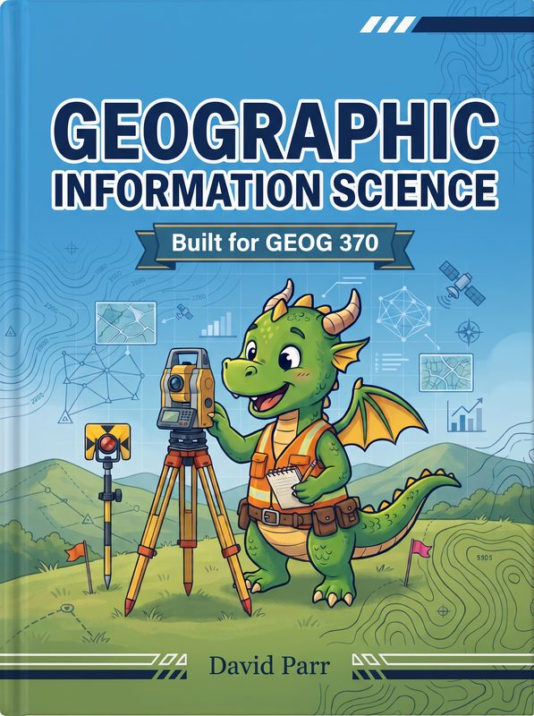

<!--
The PDF textbook (`--profile textbook`) has no Welcome page: it opens with
the Preface instead. (The daveparr.com Action copies preface.qmd over this
file before rendering, so the sidebar there says "Preface".)
-->
::: {.content-visible when-profile="textbook"}

:::

::: {.content-hidden when-profile="textbook"}
# Welcome {.unnumbered}

**GEOG 370: Geographic Information Science**\
University of North Carolina at Chapel Hill · Fall 2026 · Dr. David Parr

{.welcome-cover fig-alt="Cover of the textbook Geographic Information Science, built for GEOG 370, by David Parr. A dragon in a surveyor's outfit stands beside a tripod-mounted instrument above a map."}

Hello and welcome to **Geographic Information Science**! I'm thrilled to have you in this class. Whether you're new to GIS or already have some experience, this course is your gateway to understanding and working with **spatial data** and using GIS software including **QGIS** and **ArcGIS Pro**.

We'll go beyond traditional maps and dive into the nature of spatial data, including how it's constructed, managed, and the issues that working with spatial data can create. Throughout the semester, we'll build your skills from the ground up. We'll work with QGIS and ArcGIS Pro to manage data, answer questions, and create visualizations, and we'll have three projects to demonstrate your growing skill sets based on real-world data.

My goal is for you to leave this course with a robust understanding of both working with GIS software and spatial data. By the end of the semester, you'll be able to confidently create maps and spatial analysis for your own spatial research, and critically evaluate data.

I'm here to support you every step of the way. Please feel free to reach out with any questions about the class, or just to chat about the fascinating world of geographic information. My office hours are open, and I encourage every student to stop by at least once during the semester.

*Dr. Parr*

## On this site

| | |
|:--|:--|
| [**Syllabus**](syllabus.qmd) | How the course works: learning objectives, grading bundles, tokens, and course policies. |
| [**Textbook**](preface.qmd) | The course textbook, with self-check questions and a quiz for each chapter. Students sign in with the email on the class list. Also available as a [PDF](Geographic-Information-Science.pdf). |
| [**Course resources**](materials.qmd) | Course staff and office hours, units and modules, the class schedule, and assignment deadlines. Students sign in with the email on the class list. |
| [**About**](about.qmd) | About the instructor and author. |

<!-- Home-screen app instructions: geog370.org only (assets/pwa-head.html). -->
::: {.content-visible when-profile="geog370"}
## Put this site on your phone

You can add this site to your phone's home screen. It then opens full screen with its own GEOG 370 icon, like an app, and pages you've already read work without internet.

- **iPhone or iPad (Safari):** tap **Share**, then **Add to Home Screen**.
- **Android (Chrome):** tap the **⋮** menu, then **Add to Home screen** or **Install app**.

Sign in inside the app by typing the 6-digit code from the sign-in email (the link in the email opens your web browser instead). Quizzes, polls, and questions still need an internet connection.
:::

## Course at a glance

- **Meets:** Mondays, Wednesdays, and Fridays, 2:30–3:20 pm, Carolina Hall 220 (Section 006)
- **Recitations:** Carolina Hall 322. Section 601, Tuesdays 2–2:50 pm; Section 602, Thursdays 12:30–1:20 pm
- **Credit hours:** 3. No prerequisites.
- **Gen Ed:** IDEAs in Action FC-QUANT or FC-NATSCI
- **Software:** QGIS and ArcGIS Pro (installed on the recitation lab computers)
- **Assignments and grades:** on Canvas. Announcements and discussion are on Microsoft Teams.
- **Final exam:** Friday, December 4, 8–11 am, in our classroom

:::
